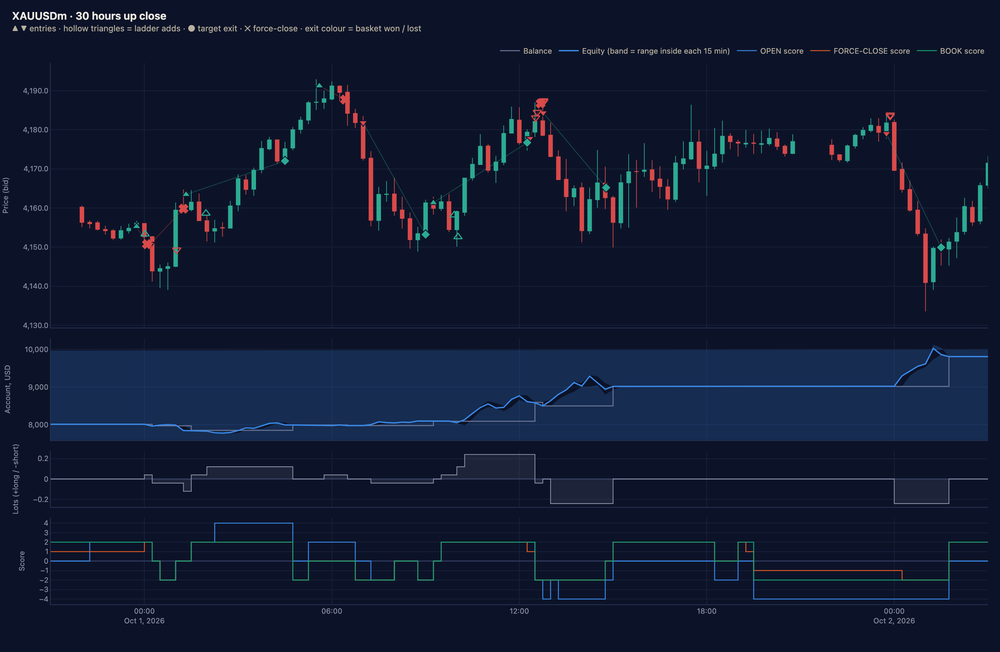
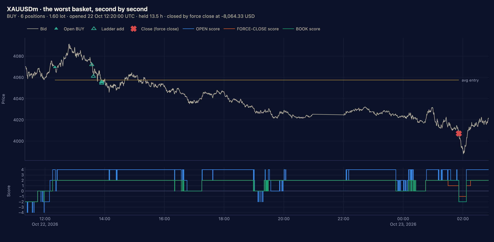
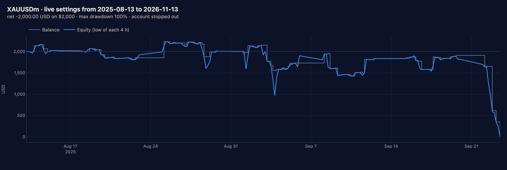
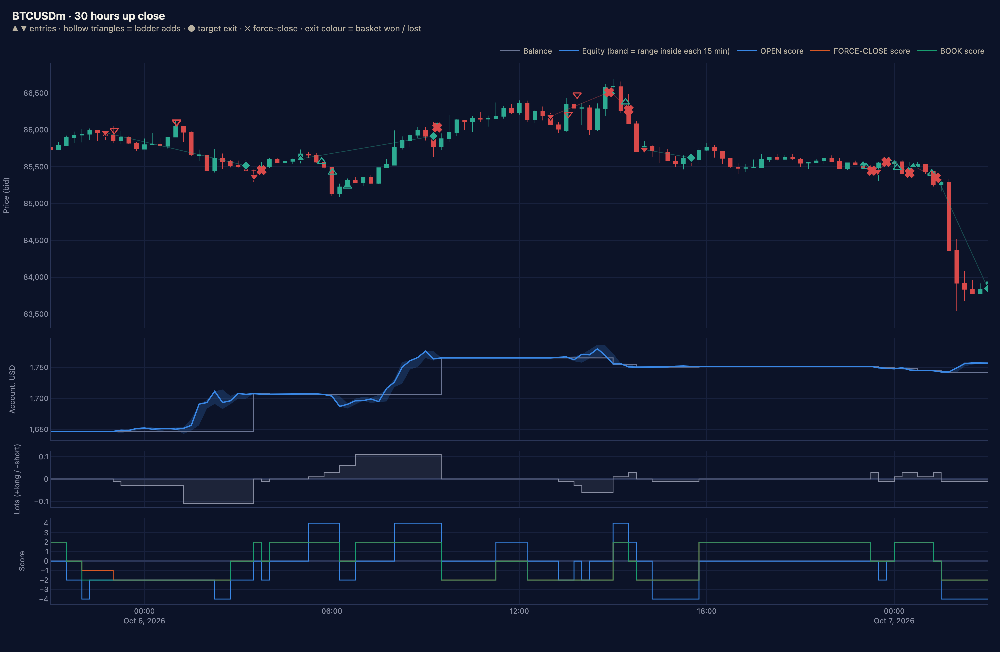
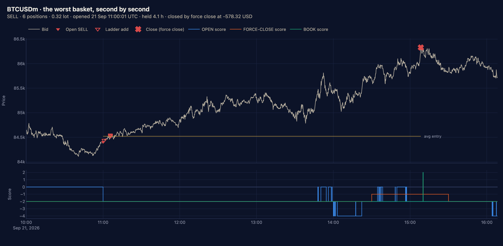
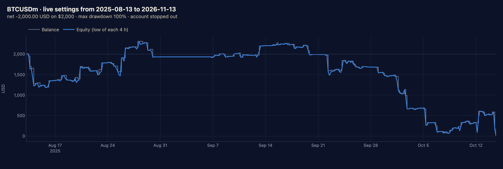
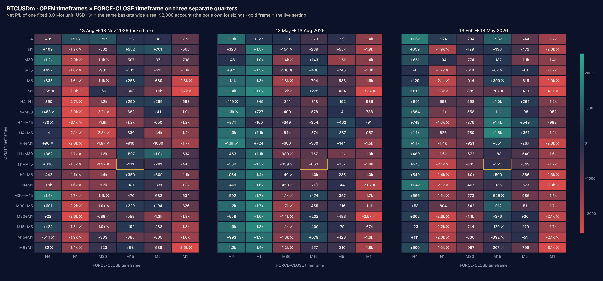

# Backtest of the netting strategy on real Exness ticks

This branch adds a tick-level backtester for the live bot and the results of running it. Nothing in the live files was changed. The strategy tested is exactly what `strategy.py` / `constants.py` on this branch do: open on the H1x1 + M15x1 slope score with full M15 agreement, an RSI ladder of Fibonacci-sized adds, a force-close on an M15 slope reversal, and as profit exit a slope "book" (close when in profit by more than $1 × unit and the M15 score reverses).

- **Results page:** [`backtest_results/index.html`](backtest_results/index.html) (open in a browser; every chart is interactive)
- **Per-run reports:** linked in the table below — candles with every fill, equity, attribution, second-by-second close-ups
- **Replay studio:** `python -m backtesting studio` — watch the bot trade the history tick by tick
- **How it works, how to run it:** [`backtesting/README.md`](backtesting/README.md)

## Results with the live settings

$2,000 start, 1:2000 account leverage (BTC margined at 1:400), unit auto-stepped from the balance exactly as the bot does it (`floor(balance / 2500) + 1`), real bid/ask quotes. The three-month runs replay every tick at the live loop's cadence (one pass a second, 0.1 s more after an order, 1 s more after a ladder add); the fifteen-month runs use the per-second series (one pass on every whole second).

| Run | Net P/L | Return | Max drawdown | Baskets | Win rate | Needed to break even | Avg win / avg loss | Worst basket | Stopped out | Same run, fixed 0.01-lot unit |
|---|---:|---:|---:|---:|---:|---:|---:|---:|---:|---:|
| [XAUUSDm · 3 months: 13 Aug → 13 Nov 2026](backtest_results/baseline/XAUUSDm/report.html) | −$2,000 | -100.0% | $14,127 (100%) | 393 | 38.4% | 39.5% | +$281 / −$184 | −$8,064 | **yes, on 2026-11-12** (day 92 of 92) | +$1,743 |
| [BTCUSDm · 3 months: 13 Aug → 13 Nov 2026](backtest_results/baseline/BTCUSDm/report.html) | −$86.13 | -4.3% | $1,204 (54%) | 628 | 35.4% | 35.7% | +$26.51 / −$14.71 | −$578 | no | −$39.71 |
| [XAUUSDm · 15 months: 13 Aug 2025 → 13 Nov 2026](backtest_results/long/XAUUSDm/report.html) | −$2,000 | -100.0% | $2,353 (100%) | 176 | 37.5% | 51.3% | +$40.38 / −$42.49 | −$1,031 | **yes, on 2025-09-23** (day 41 of 457) | −$2,000 |
| [BTCUSDm · 15 months: 13 Aug 2025 → 13 Nov 2026](backtest_results/long/BTCUSDm/report.html) | −$2,000 | -100.0% | $2,451 (100%) | 346 | 38.4% | 48.1% | +$31.15 / −$28.86 | −$424 | **yes, on 2025-10-14** (day 63 of 457) | −$2,000 |

A run that is stopped out ends there: its basket count, win rate and averages describe the days up to the stop-out, not the whole period.

A *basket* is one fresh entry plus its ladder adds, closed together. "Fixed 0.01-lot unit" is the same run with the balance auto-step switched off.

### Quarter by quarter, and how much is timing luck

One run is one path. Whether the bot happens to be inside a basket when a sharp move starts depends on which tick its once-a-second poll lands on, and a few large baskets decide a quarter. The live loop does not poll on a fixed grid either: it sleeps a second and then spends a varying time talking to the terminal. So each of the five quarters was run eight times on raw ticks, on a fresh $2,000, with every pass of the loop taking between 0 and 0.2 s longer, drawn at random (eight different random sequences). All eight are equally plausible for the live bot; the run in the table above is a ninth path, on the fixed one-second grid.

**XAUUSDm**

| Quarter | Median net P/L | Worst timing | Best timing | Runs that lost money | Runs stopped out | Median max drawdown | Worst basket | Baskets (median) |
|---|---:|---:|---:|---:|---:|---:|---:|---:|
| Aug–Nov 2025 (hold-out) | −$2,000 | −$2,000 | −$2,000 | 8 of 8 | 8 of 8 | 100% | −$1,031 | 177 |
| Nov 2025–Feb 2026 (hold-out) | −$2,000 | −$2,000 | −$2,000 | 8 of 8 | 8 of 8 | 100% | −$2,210 | 126 |
| Feb–May 2026 | −$2,000 | −$2,000 | −$2,000 | 8 of 8 | 8 of 8 | 100% | −$2,761 | 61 |
| May–Aug 2026 | −$2,000 | −$2,000 | −$2,000 | 8 of 8 | 8 of 8 | 101% | −$1,384 | 19 |
| Aug–Nov 2026 | −$2,000 | −$2,000 | −$2,000 | 8 of 8 | 8 of 8 | 100% | −$8,088 | 393 |

40 of 40 quarter-runs lost money; 40 ended with the account stopped out.

**BTCUSDm**

| Quarter | Median net P/L | Worst timing | Best timing | Runs that lost money | Runs stopped out | Median max drawdown | Worst basket | Baskets (median) |
|---|---:|---:|---:|---:|---:|---:|---:|---:|
| Aug–Nov 2025 (hold-out) | −$2,000 | −$2,000 | −$2,000 | 8 of 8 | 8 of 8 | 100% | −$425 | 304 |
| Nov 2025–Feb 2026 (hold-out) | −$2,000 | −$2,000 | −$2,000 | 8 of 8 | 8 of 8 | 100% | −$1,414 | 515 |
| Feb–May 2026 | −$112 | −$209 | +$92.43 | 5 of 8 | 0 of 8 | 73% | −$586 | 572 |
| May–Aug 2026 | −$2,000 | −$2,000 | −$800 | 8 of 8 | 6 of 8 | 100% | −$486 | 172 |
| Aug–Nov 2026 | −$47.47 | −$107 | −$24.84 | 8 of 8 | 0 of 8 | 53% | −$587 | 627 |

37 of 40 quarter-runs lost money; 22 ended with the account stopped out.

## What the backtest says about the strategy

**1. Over the fifteen months tested the live settings lose on both symbols**  
Each quarter was run eight times on raw ticks on a fresh $2,000 with the live unit auto-step, with only the loop's timing drawn at random. Median result per quarter, gold: Aug–Nov 2025 −$2,000; Nov 2025–Feb 2026 −$2,000; Feb–May 2026 −$2,000; May–Aug 2026 −$2,000; Aug–Nov 2026 −$2,000; 40 of 40 quarter-runs lost money and 40 ended with the account stopped out. BTC: Aug–Nov 2025 −$2,000; Nov 2025–Feb 2026 −$2,000; Feb–May 2026 −$112; May–Aug 2026 −$2,000; Aug–Nov 2026 −$47; 37 of 40 lost money and 22 were stopped out. Run as one continuous account from 13 Aug 2025, gold was stopped out on 23 Sep 2025, day 41 and BTC was stopped out on 14 Oct 2025, day 63. On gold every one of the 40 quarter-runs ended with the account stopped out; on BTC the three months you asked for were the least bad of the five.

**2. It loses more baskets than it wins, and a few large ladder baskets decide the result**  
Gold, 13 Aug–13 Nov 2026: 38.4% of 393 baskets won, and it needs 39.5% to break even, because the average win is +$281.14 and the average loss −$183.69 (the average win is larger than the average loss). The worst basket lost $8,064, as much as 29 average wins; the ten worst gave back 54% of everything the winners made. The quarter ended −$2,000. BTC, 13 Aug–13 Nov 2026: 35.4% of 628 baskets won, and it needs 35.7% to break even, because the average win is +$26.51 and the average loss −$14.71 (the average win is larger than the average loss). The worst basket lost $578, as much as 22 average wins; the ten worst gave back 36% of everything the winners made. The quarter ended −$86. What matters is the gap between the win rate and the break-even rate: about one point below it on gold and a fraction of a point on BTC, decided by a handful of large baskets.

**3. One run is one path: the same quarter ends up or down depending on which ticks the loop happens to poll**  
Gold, 13 Aug–13 Nov 2026, same settings, same ticks: all eight random loop timings ended with the account stopped out, and so did the run with no random delay. BTC: from −$107 to −$25 (median −$47); no random delay −$86. The reason is the pay-off above: whether the bot is inside a basket when a sharp move starts depends on the second it entered, and one such basket outweighs a month of wins. Even at one fixed 0.01-lot unit the result of a gold quarter moved by $939 at the median, and by up to $2,267, with nothing changed but the loop timing. So no single backtest figure, and no single live month, tells you whether a setting is good; only the spread over many runs and many quarters does.

**4. The ladder is not a ladder: the last three adds usually go in about two seconds apart, at one price**  
Each add is released when the RSI of its timeframe is beyond 35 / 65, which is a level, not a new event. When the M15, H1 and H4 RSI are already there, the third, fourth and fifth add fire on consecutive passes of the loop. On gold 64–92% of those adds came within ten seconds of the previous one (median 2 s), $0.30–0.54 away from it; the median spread at its entries is $0.26. So 26 of the 32 units of a full ladder are one clip at one price, not an average-down. Gold baskets that never added made +$1,256 in the quarter; baskets that added lost $3,257; the 26 that reached all six positions account for −$6,160, with an average loss of $1,114 when they lost. BTC shows the same timing (63–93% within ten seconds): +$175 without adds, −$261 with.

**5. The only loss exit watches momentum pivots, not price or money, and nothing stands behind it**  
A losing basket is closed when the M15 RSI / MACD pivot score turns against it (the profit "book" uses the same M15 condition, so it adds nothing: see below). In a steady adverse move that score stays neutral or supportive. The worst gold basket of the quarter was a BUY of 1.60 lots opened on 22 Oct 2026 at 4,069.57: it was held 13.5 hours while price moved $50.40 against its average entry and was closed at −$8,064. 74% of gold's losing baskets were closed within 10% of the worst point they ever showed, 78% had been in profit before, and one basket that ended as a winner had been $2,576 under water on the way. There is no price stop, no time stop and no equity stop, and the stop sent to the broker is not a stop (see the live-code findings).

**6. The entry signal says nothing about where price goes next**  
An entry needs the M15 RSI vote and the M15 MACD vote to agree. Both are measured from the last pivot of their indicator, so both are votes to fade the last extreme: over the fifteen months the MACD vote pointed against its own signal-line trend on 80% of gold's M15 bars (79% for BTC), and 88% of RSI up-votes came after an oversold low. Tested on every closed M15 bar with the live indicator code: after both votes pointed up, gold was higher four bars later 50.8% of the time, against 50.8% for any bar; after both pointed down it was lower 49.9% of the time, against 49.2%. BTC: 51.5% against 50.0%, and 50.8% against 50.0%. That is a coin flip. The wins come from the target being close and the stop being absent, not from the signal knowing direction, which is why the timeframes the signal is read on cannot fix the result.

**7. The spread takes a large share of what the winners make**  
Gold paid $1,701 of spread in the quarter, 4% of the winners' gross profit, on 4 baskets a day; before spread the closed baskets net −$300, after it −$2,001. BTC paid $313 (5% of the winners' gross). The spread was not the same in every quarter (see the hold-out section), and the strategy's result moves with it.

**8. The unit auto-step raises the stake after a good run and the next loss is taken at the larger size**  
The unit is floor(balance / 2,500) + 1, re-derived whenever the account is flat. In the gold quarter: unit 1: 58 baskets, +$1,000 (worst −$1,197); unit 2: 148 baskets, +$1,058 (worst −$1,733); unit 3: 42 baskets, +$2,281 (worst −$2,841); unit 4: 79 baskets, +$6,432 (worst −$2,913); unit 5: 66 baskets, −$12,773 (worst −$8,064). The account stepped up to five units on the way up and gave everything back at unit 5 (−$12,773 in 66 baskets, worst −$8,064). Because the target also scales with the unit while the worst case of a basket has no limit, stepping up multiplies the tail, not the edge.

**9. No choice of timeframes makes it pay: settings that look good on one period do not hold on another**  
432 combinations of OPEN and FORCE-CLOSE timeframes were run on five quarters (one fixed 0.01-lot unit; "wiped" replays the baskets on a real $2,000 account with the bot's lot sizing). Gold: no setting was profitable in all three analysed quarters without wiping the account. BTC: 31 of 432 settings were profitable in all three analysed quarters without wiping a $2,000 account. On the two hold-out quarters 3% of those were profitable in both and 81% wiped the account in one (mean −$763 a quarter), against 3% and 87% (mean −$1,546) for all settings; rank correlation between the two periods +0.35. No gold setting was profitable in all five quarters without wiping the account. No BTC setting was profitable in all five quarters without wiping the account. Averaged over all five quarters every gold timeframe loses; on BTC only a FORCE-CLOSE on H4 breaks even. Mean net per quarter, gold: FORCE-CLOSE on H4 −$2,823, H1 −$3,676, M30 −$4,021, M15 −$2,177, M5 −$3,404, M1 −$3,899; OPEN containing H4 −$1,331, M5 −$3,382, M30 −$3,472, M15 −$3,596, H1 −$3,805, M1 −$4,257. BTC: FORCE-CLOSE on H4 +$0, H1 −$1,909, M30 −$184, M15 −$404, M5 −$1,242, M1 −$1,605; OPEN containing H4 −$603, H1 −$739, M30 −$751, M15 −$825, M5 −$1,105, M1 −$1,219. The live setting (OPEN H1+M15, FORCE-CLOSE M15) on gold: Aug–Nov 2025 +$765, Nov 2025–Feb 2026 −$12,273, Feb–May 2026 −$3,168, May–Aug 2026 −$9,880, Aug–Nov 2026 +$1,939. Keep in mind that each cell is a single path whose result moves by about $900 a quarter on gold (up to $2,300) and a few hundred dollars on BTC with the loop timing alone.

**10. Removing the ladder cuts the worst loss many times over; nothing tested makes the live timeframes reliably profitable**  
Each what-if changes one rule, or one small package of rules, and leaves the rest live (one fixed unit, three 2026 quarters, single paths). Gold: live settings: −$11,109 over three quarters, worst basket −$5,968, account wiped; no ladder: −$886 over three quarters, worst basket −$212; ladder: adds >= $3 apart: −$16,596 over three quarters, worst basket −$5,403, account wiped; stop: $20 per unit: −$5,620 over three quarters, worst basket −$236, account wiped; no ladder + stop $10: −$603 over three quarters, worst basket −$44; cooldown 30 min: −$7,723 over three quarters, worst basket −$5,543, account wiped; signals on closed bars: −$10,233 over three quarters, worst basket −$2,681, account wiped. BTC: live settings: −$1,149 over three quarters, worst basket −$583; no ladder: −$62 over three quarters, worst basket −$21; ladder: adds >= $300 apart: +$284 over three quarters, worst basket −$271; stop: $20 per unit: −$3,450 over three quarters, worst basket −$123, account wiped; no ladder + stop $10: −$76 over three quarters, worst basket −$11; cooldown 30 min: −$1,765 over three quarters, worst basket −$584; signals on closed bars: −$2,574 over three quarters, worst basket −$523, account wiped. A stop alone turns a rare large loss into frequent medium ones; the ladder is what makes the large loss large. These are directions to test on a demo account, not settings to deploy. Spacing the ladder $3 apart cut gold's worst basket only by about a tenth and BTC's by about half.

**11. What does hold up on data it was never fitted to: a with-trend design with a real stop and no ladder (gold)**  
The improvement search was run on the hedging branch. The two live variants differ only in their profit exit (the $1 target there, the slope book here), and the design that held up closes baskets only at its own stop and target, so with the book switched off it is exactly the same design on this branch. V3-lite: entries only with the H1 trend (H1 MACD signal line), H1 votes with M15 agreement, stop and target 8 H1-volatility units on the whole basket, no ladder, a 12 h pause after a losing basket, book and force-close off. Chosen on Jan 2024 – Jun 2025 and 13 Aug 2025 – 13 Nov 2026, frozen, then run once on Feb – Dec 2023 (three quarters and one two-month block) (every tick, eight loop timings per quarter, a real $2,000 account): gold +$106 per block with no losing run of 32, and +$152 a quarter in 2024 – mid 2025. On BTC no design made money reliably (V3-lite +$7 a quarter in 2023). About 1,200 designs were tried, so the 2023 figure is the honest one. Details: IMPROVEMENT.md on the backtest_hedging branch.

**12. Support and resistance, and the other ways to recover a losing position, do not add an edge**  
Two independent studies of H1, H4 and D1 levels (swing highs and lows, the previous day's and week's high and low, round numbers): price turned at the levels no more often than at placebo prices, and no bounce rule made money after the spread in either period. A few gold breakout and retest rules with the trend were slightly positive in both, but they were found after the fact and did no better than placebo levels in 2025-26. Forty-two position-management mechanisms on the same 32,553 entries (averaging down with a budget, averaging up, break-even and trailing stops, scale-out, hedge lock, zone recovery, stop-and-reverse, martingale): none raised the expectancy. A ladder with equal lots, at most two adds and a hard $60 budget, flat over every market closure, never lost more than $60 (held over closures, up to −$222 on gold), and earned no more than not adding. A hedge lock unlocked on the next signal pays exactly what closing and re-entering pays; a lock that is simply closed later costs one spread more than a stop. Reports: backtest_results/improve/ on the backtest_hedging branch.

## XAUUSDm: the three months in pictures

Measured on the baseline run (numbers in [`diagnostics.json`](backtest_results/baseline/XAUUSDm/diagnostics.json)):

- **Pay-off.** 38.4% of 393 baskets won; break-even needs 39.5%. Average win +$281, average loss −$184 (one loss = 1 wins). The worst basket (−$8,064) cancelled 29 average wins; the ten worst gave back 54% of everything the winners made.
- **Ladder.** 532 adds in 226 baskets. Share of each tier's adds that came within 10 s of the previous fill: M1 1% (median 2141 s, $4.60 away); M5 22% (median 1042 s, $3.86 away); M15 64% (median 2 s, $0.54 away); H1 87% (median 2 s, $0.36 away); H4 92% (median 2 s, $0.30 away). Baskets with no add: +$1,256; baskets with at least one add: −$3,257.
- **Full ladders.** 26 baskets reached all 6 positions: 35% won +$1,420 on average, the rest lost −$1,114 on average (worst −$8,064); net −$6,160.
- **Exits.** 74% of losing baskets were closed within 10% of the largest loss they ever showed. Losers were held a median 33 min, the longest 62.6 h. Winners were at worst −$2,576 under water before recovering.
- **Spread.** $1,701 paid, 4% of the winners' gross profit. Before spread the run nets −$300; after it −$2,001.


*Three months at a glance: price with every exit, account, exposure, scores.*



*Thirty hours up close: every entry, ladder add and exit at its fill price.*


*Where the money came from and where it went.*



*The worst basket, second by second.*



*The same settings over the whole history.*

## BTCUSDm: the three months in pictures

Measured on the baseline run (numbers in [`diagnostics.json`](backtest_results/baseline/BTCUSDm/diagnostics.json)):

- **Pay-off.** 35.4% of 628 baskets won; break-even needs 35.7%. Average win +$26.51, average loss −$14.71 (one loss = 1 wins). The worst basket (−$578) cancelled 22 average wins; the ten worst gave back 36% of everything the winners made.
- **Ladder.** 775 adds in 349 baskets. Share of each tier's adds that came within 10 s of the previous fill: M1 1% (median 2290 s, $1.00 away); M5 20% (median 1054 s, $0.93 away); M15 63% (median 2 s, $0.13 away); H1 84% (median 2 s, $0.09 away); H4 93% (median 2 s, $0.09 away). Baskets with no add: +$175; baskets with at least one add: −$261.
- **Full ladders.** 44 baskets reached all 6 positions: 30% won +$250 on average, the rest lost −$103 on average (worst −$578); net +$66.59.
- **Exits.** 70% of losing baskets were closed within 10% of the largest loss they ever showed. Losers were held a median 32 min, the longest 8.9 h. Winners were at worst −$636 under water before recovering.
- **Spread.** $313 paid, 5% of the winners' gross profit. Before spread the run nets +$227; after it −$85.86.


*Three months at a glance: price with every exit, account, exposure, scores.*



*Thirty hours up close: every entry, ladder add and exit at its fill price.*


*Where the money came from and where it went.*



*The worst basket, second by second.*



*The same settings over the whole history.*

## What the entry signal is made of

An entry needs the M15 RSI vote and the M15 MACD vote to point the same way. Measured with the live `indicator.py` functions on every closed M15 bar (no spread, no ladder, no exits — this describes the signal, not the trading). The MACD vote compares the histogram with its last pivot on the side the signal line selects, so in an up-trend it reads "down" unless momentum makes a new high; the RSI vote is measured from the last pivot beyond 60 / 40. Both are therefore votes to fade the last extreme. The bold columns are the test of whether that predicts anything: after both votes agreed, how often was price further that way four bars later, against how often that happens on any bar. Neighbouring bars overlap (each looks four bars ahead), so a difference of a point or two between a bold figure and its neighbour is within noise. A bar that closed unchanged counts as neither higher nor lower in the bold columns; in the (any bar) lower column it counts as lower.

### XAUUSDm

| Period | M15 bars | MACD vote against its own trend | RSI up-votes that follow an oversold low | Both votes up (share of bars) | … price higher 4 bars later | (any bar) | Both votes down (share of bars) | … price lower 4 bars later | (any bar)  |
|---|---:|---:|---:|---:|---:|---:|---:|---:|---:|
| Aug–Nov 2025 | 6,057 | 80% | 83% | 30% | **52.8%** | 54.1% | 43% | **44.8%** | 45.9% |
| Nov 2025–Feb 2026 | 5,838 | 79% | 84% | 33% | **53.1%** | 54.2% | 39% | **45.6%** | 45.8% |
| Feb–May 2026 | 5,697 | 80% | 91% | 37% | **52.0%** | 50.0% | 35% | **52.4%** | 50.0% |
| May–Aug 2026 | 6,030 | 80% | 91% | 38% | **48.2%** | 47.9% | 34% | **53.8%** | 52.1% |
| Aug–Nov 2026 | 6,058 | 79% | 92% | 38% | **48.8%** | 48.0% | 33% | **54.9%** | 52.0% |
| All fifteen months | 29,680 | 80% | 88% | 35% | **50.8%** | 50.8% | 37% | **49.9%** | 49.2% |

### BTCUSDm

| Period | M15 bars | MACD vote against its own trend | RSI up-votes that follow an oversold low | Both votes up (share of bars) | … price higher 4 bars later | (any bar) | Both votes down (share of bars) | … price lower 4 bars later | (any bar)  |
|---|---:|---:|---:|---:|---:|---:|---:|---:|---:|
| Aug–Nov 2025 | 8,736 | 79% | 90% | 36% | **53.2%** | 50.2% | 35% | **50.7%** | 49.8% |
| Nov 2025–Feb 2026 | 8,807 | 79% | 92% | 36% | **52.5%** | 50.1% | 34% | **51.0%** | 49.9% |
| Feb–May 2026 | 8,352 | 78% | 89% | 36% | **50.7%** | 50.3% | 36% | **50.1%** | 49.7% |
| May–Aug 2026 | 8,832 | 79% | 92% | 35% | **50.3%** | 49.2% | 36% | **51.3%** | 50.8% |
| Aug–Nov 2026 | 8,832 | 79% | 90% | 35% | **50.7%** | 50.3% | 36% | **51.0%** | 49.7% |
| All fifteen months | 43,559 | 79% | 91% | 36% | **51.5%** | 50.0% | 36% | **50.8%** | 50.0% |

## Which timeframes for OPEN, FORCE-CLOSE, BOOK — RSI and MACD

Each setting was run on three separate three-month windows: the one asked for (13 Aug → 13 Nov) and the two before it. To compare settings fairly they all trade a fixed 0.01-lot unit on a balance that cannot be stopped out; the column "wiped $2,000" then says whether the real account would have survived. A timeframe choice is only worth anything if it holds up on windows it was not picked on.

### XAUUSDm


| Window | Combinations profitable | Median net | Best | Worst | Would have wiped $2,000 |
|---|---:|---:|---:|---:|---:|
| Aug–Nov 2026 | 39% | −$899 | +$5,567 | −$8,949 | 88% |
| May–Aug 2026 | 17% | −$4,561 | +$5,866 | −$17,345 | 96% |
| Feb–May 2026 | 36% | −$2,154 | +$12,430 | −$20,397 | 97% |

432 combinations of OPEN timeframes × FORCE-CLOSE timeframe × threshold convention. **0** made money in all 3 quarters without wiping a real $2,000 account; 431 wipe it out in at least one quarter. ("Wiped" replays each setting's baskets on a $2,000 account with the bot's own lot sizing: the unit steps up above $2,500, so later losses are larger than at the fixed unit shown in the net columns.)

**How much of one cell is luck.** The live setting itself, at the same fixed 0.01-lot unit, run eight times per quarter on raw ticks with nothing changed but the loop timing: Aug–Nov 2025 −$1,435 to +$831; Nov 2025–Feb 2026 −$13,023 to −$12,084; Feb–May 2026 −$3,524 to −$3,065; May–Aug 2026 −$10,384 to −$8,607; Aug–Nov 2026 +$1,686 to +$1,902. The spread inside one quarter was $939 at the median and $2,267 at most. Differences of that size between two settings in the tables below are not evidence; only patterns that repeat across quarters are.

Does choosing on one window work on another?

| Chosen on → tested on | Rank correlation | Top 10% there | Same settings here | Best single setting there → here |
|---|---:|---:|---:|---:|
| Aug–Nov 2026 → May–Aug 2026 | +0.44 | +$3,294 | −$1,418 | +$5,567 → +$946 |
| Aug–Nov 2026 → Feb–May 2026 | -0.04 | +$3,294 | −$5,527 | +$5,567 → −$8,276 |
| May–Aug 2026 → Aug–Nov 2026 | +0.44 | +$3,533 | +$808 | +$5,866 → +$1,487 |
| May–Aug 2026 → Feb–May 2026 | -0.26 | +$3,533 | −$5,953 | +$5,866 → −$9,155 |
| Feb–May 2026 → Aug–Nov 2026 | -0.04 | +$7,598 | +$528 | +$12,430 → +$1,908 |
| Feb–May 2026 → May–Aug 2026 | -0.26 | +$7,598 | −$5,809 | +$12,430 → −$6,086 |

The live setting and the ten that held up best on these three quarters (sorted by quarters survived, quarters profitable, worst quarter). Net P/L of one fixed 0.01-lot unit; ✕ = the same baskets wipe a real $2,000 account in that quarter (the bot's own lot sizing applied). This ranking is hindsight; the hold-out section tests it.

|  | OPEN | FORCE-CLOSE | Entry needs | FC fires on | Aug–Nov 2026 | May–Aug 2026 | Feb–May 2026 | Deepest dip of the $2,000 account | Baskets / quarter |
|---|---:|---:|---:|---:|---:|---:|---:|---:|---:|
| **live** | H1+M15 | M15 | one TF fully aligned | one indicator reversing | +$1,939 ✕ | −$9,880 ✕ | −$3,168 ✕ | $2,000 | 388 |
|  | H4+M30 | M5 | every TF fully aligned | one indicator reversing | −$484 | −$112 | +$3,524 | $1,377 | 451 |
|  | H4+M5 | M15 | every TF fully aligned | both reversing | +$3,307 | +$5,167 | −$946 ✕ | $2,000 | 201 |
|  | H4+M1 | M5 | every TF fully aligned | one indicator reversing | +$6.39 | −$1,856 ✕ | +$2,072 | $2,000 | 1,278 |
|  | H4+M5 | M1 | every TF fully aligned | both reversing | −$2,794 ✕ | +$104 | +$1,711 | $2,000 | 1,859 |
|  | H4 | M5 | one TF fully aligned | one indicator reversing | +$592 | −$2,810 ✕ | +$1,087 | $2,000 | 1,659 |
|  | H4+M30 | M15 | every TF fully aligned | one indicator reversing | +$2,176 | +$5,058 | −$2,925 ✕ | $2,000 | 175 |
|  | H4+M30 | M15 | every TF fully aligned | both reversing | +$2,534 | +$5,365 | −$4,122 ✕ | $2,000 | 173 |
|  | H4+H1 | M5 | every TF fully aligned | one indicator reversing | −$150 | −$1,322 | +$1,793 ✕ | $2,000 | 674 |
|  | M30+M15 | M5 | every TF fully aligned | one indicator reversing | −$1,574 | −$2,189 ✕ | +$5,809 | $2,000 | 681 |
|  | H4+M15 | M1 | every TF fully aligned | both reversing | −$2,230 ✕ | −$985 | +$295 | $2,000 | 941 |

Averaged over every combination that contains the timeframe:

| Timeframe | in OPEN: mean net / window | in OPEN: wiped $2,000 | as FORCE-CLOSE: mean net / window | as FORCE-CLOSE: wiped $2,000 |
|---|---:|---:|---:|---:|
| H4 | −$1,246 | 85% | −$2,892 | 97% |
| H1 | −$3,008 | 93% | +$257 | 100% |
| M30 | −$3,039 | 94% | −$4,272 | 97% |
| M15 | −$2,516 | 95% | −$1,456 | 95% |
| M5 | −$2,271 | 94% | −$2,259 | 83% |
| M1 | −$3,419 | 99% | −$5,016 | 90% |

**OPEN: RSI slope on one timeframe, MACD slope on another.** Three quarters added up, one fixed 0.01-lot unit; in brackets the number of quarters that were profitable; ✕ = wipes a real $2,000 account in one of them. On the diagonal both indicators read the same timeframe. Every cell needs both votes to agree: grey-fill (a grey vote borrowing the other's sign) only exists when both sit on one timeframe, so it is off throughout this grid to keep the cells comparable.

| RSI ↓ / MACD → | H4 | H1 | M30 | M15 | M5 | M1 |
|---|---:|---:|---:|---:|---:|---:|
| **H4** | +$8,749 ✕ (3/3) | +$6,465 ✕ (2/3) | +$5,177 ✕ (3/3) | +$9,692 ✕ (3/3) | +$10,176 ✕ (3/3) | +$6,004 ✕ (3/3) |
| **H1** | −$31.43 ✕ (2/3) | −$2,900 ✕ (1/3) | −$6,966 ✕ (1/3) | −$7,251 ✕ (1/3) | −$4,813 ✕ (1/3) | −$8,960 ✕ (1/3) |
| **M30** | −$968 ✕ (1/3) | −$10,043 ✕ (0/3) | −$11,544 ✕ (0/3) | −$4,469 ✕ (2/3) | −$4,964 ✕ (1/3) | −$5,540 ✕ (1/3) |
| **M15** | +$1,539 ✕ (2/3) | −$9,466 ✕ (1/3) | −$14,391 ✕ (0/3) | −$1,879 ✕ (1/3) | −$4,731 ✕ (1/3) | −$2,609 ✕ (1/3) |
| **M5** | +$3,274 ✕ (2/3) | −$12,726 ✕ (1/3) | −$14,635 ✕ (0/3) | −$1,685 ✕ (1/3) | −$2,375 ✕ (1/3) | −$4,055 ✕ (1/3) |
| **M1** | +$3,142 ✕ (2/3) | −$10,612 ✕ (0/3) | −$12,004 ✕ (0/3) | −$2,625 ✕ (1/3) | −$3,937 ✕ (1/3) | −$3,804 ✕ (1/3) |

**FORCE-CLOSE: RSI slope on one timeframe, MACD slope on another.** Three quarters added up, one fixed 0.01-lot unit; in brackets the number of quarters that were profitable; ✕ = wipes a real $2,000 account in one of them. On the diagonal both indicators read the same timeframe. Every cell needs both votes to agree: grey-fill (a grey vote borrowing the other's sign) only exists when both sit on one timeframe, so it is off throughout this grid to keep the cells comparable.

| RSI ↓ / MACD → | H4 | H1 | M30 | M15 | M5 | M1 |
|---|---:|---:|---:|---:|---:|---:|
| **H4** | −$7,939 ✕ (2/3) | −$4,669 ✕ (0/3) | −$16,061 ✕ (1/3) | −$11,413 ✕ (0/3) | −$12,936 ✕ (1/3) | −$11,161 ✕ (0/3) |
| **H1** | −$10,164 ✕ (1/3) | −$2,531 ✕ (2/3) | −$15,798 ✕ (0/3) | −$13,253 ✕ (1/3) | −$4,042 ✕ (2/3) | −$7,008 ✕ (1/3) |
| **M30** | −$10,360 ✕ (0/3) | −$784 ✕ (2/3) | −$10,971 ✕ (1/3) | −$12,015 ✕ (1/3) | −$556 ✕ (1/3) | −$3,080 ✕ (1/3) |
| **M15** | −$7,712 ✕ (0/3) | −$3,495 ✕ (2/3) | −$14,452 ✕ (1/3) | −$11,109 ✕ (1/3) | −$2,944 ✕ (1/3) | −$5,169 ✕ (1/3) |
| **M5** | −$7,833 ✕ (0/3) | −$1,111 ✕ (2/3) | −$10,561 ✕ (0/3) | −$4,996 ✕ (1/3) | −$7,030 ✕ (1/3) | −$13,312 ✕ (0/3) |
| **M1** | −$5,018 ✕ (1/3) | −$2,763 ✕ (2/3) | −$14,858 ✕ (0/3) | −$5,118 ✕ (1/3) | −$9,981 ✕ (0/3) | −$14,994 ✕ (0/3) |

**BOOK: RSI slope on one timeframe, MACD slope on another.** Three quarters added up, one fixed 0.01-lot unit; in brackets the number of quarters that were profitable; ✕ = wipes a real $2,000 account in one of them. On the diagonal both indicators read the same timeframe. Every cell needs both votes to agree: grey-fill (a grey vote borrowing the other's sign) only exists when both sit on one timeframe, so it is off throughout this grid to keep the cells comparable.

| RSI ↓ / MACD → | H4 | H1 | M30 | M15 | M5 | M1 |
|---|---:|---:|---:|---:|---:|---:|
| **H4** | −$3,326 ✕ (1/3) | −$6,775 ✕ (2/3) | −$11,920 ✕ (0/3) | −$12,350 ✕ (1/3) | −$1,873 ✕ (1/3) | −$5,998 ✕ (1/3) |
| **H1** | −$2,233 ✕ (2/3) | −$2,079 ✕ (2/3) | −$11,463 ✕ (1/3) | −$11,045 ✕ (1/3) | +$279 ✕ (2/3) | −$7,403 ✕ (1/3) |
| **M30** | −$8,827 ✕ (1/3) | −$8,077 ✕ (1/3) | −$17,112 ✕ (0/3) | −$11,739 ✕ (1/3) | −$7,967 ✕ (2/3) | −$11,288 ✕ (1/3) |
| **M15** | −$13,927 ✕ (1/3) | −$13,829 ✕ (1/3) | −$14,356 ✕ (1/3) | −$11,109 ✕ (1/3) | −$17,210 ✕ (1/3) | −$18,969 ✕ (1/3) |
| **M5** | −$8,260 ✕ (1/3) | −$10,006 ✕ (2/3) | −$11,736 ✕ (1/3) | −$9,600 ✕ (1/3) | −$6,912 ✕ (1/3) | −$14,764 ✕ (0/3) |
| **M1** | −$8,178 ✕ (1/3) | −$1,248 ✕ (2/3) | −$16,039 ✕ (1/3) | −$12,538 ✕ (1/3) | −$9,177 ✕ (0/3) | −$11,301 ✕ (0/3) |

### BTCUSDm



| Window | Combinations profitable | Median net | Best | Worst | Would have wiped $2,000 |
|---|---:|---:|---:|---:|---:|
| Aug–Nov 2026 | 27% | −$726 | +$1,939 | −$4,466 | 38% |
| May–Aug 2026 | 50% | −$12.35 | +$2,296 | −$3,327 | 25% |
| Feb–May 2026 | 33% | −$392 | +$1,772 | −$4,123 | 23% |

432 combinations of OPEN timeframes × FORCE-CLOSE timeframe × threshold convention. **31** made money in all 3 quarters without wiping a real $2,000 account; 231 wipe it out in at least one quarter. ("Wiped" replays each setting's baskets on a $2,000 account with the bot's own lot sizing: the unit steps up above $2,500, so later losses are larger than at the fixed unit shown in the net columns.)

**How much of one cell is luck.** The live setting itself, at the same fixed 0.01-lot unit, run eight times per quarter on raw ticks with nothing changed but the loop timing: Aug–Nov 2025 −$2,152 to −$2,011; Nov 2025–Feb 2026 −$1,670 to −$1,216; Feb–May 2026 −$93.33 to +$92.43; May–Aug 2026 −$907 to −$738; Aug–Nov 2026 −$72.69 to +$122. The spread inside one quarter was $186 at the median and $454 at most. Differences of that size between two settings in the tables below are not evidence; only patterns that repeat across quarters are.

Does choosing on one window work on another?

| Chosen on → tested on | Rank correlation | Top 10% there | Same settings here | Best single setting there → here |
|---|---:|---:|---:|---:|
| Aug–Nov 2026 → May–Aug 2026 | +0.15 | +$912 | +$347 | +$1,939 → +$504 |
| Aug–Nov 2026 → Feb–May 2026 | +0.44 | +$912 | +$72.12 | +$1,939 → +$696 |
| May–Aug 2026 → Aug–Nov 2026 | +0.15 | +$1,593 | −$743 | +$2,296 → +$238 |
| May–Aug 2026 → Feb–May 2026 | +0.32 | +$1,593 | −$816 | +$2,296 → −$984 |
| Feb–May 2026 → Aug–Nov 2026 | +0.44 | +$956 | −$132 | +$1,772 → −$330 |
| Feb–May 2026 → May–Aug 2026 | +0.32 | +$956 | +$603 | +$1,772 → −$374 |

The live setting and the ten that held up best on these three quarters (sorted by quarters survived, quarters profitable, worst quarter). Net P/L of one fixed 0.01-lot unit; ✕ = the same baskets wipe a real $2,000 account in that quarter (the bot's own lot sizing applied). This ranking is hindsight; the hold-out section tests it.

|  | OPEN | FORCE-CLOSE | Entry needs | FC fires on | Aug–Nov 2026 | May–Aug 2026 | Feb–May 2026 | Deepest dip of the $2,000 account | Baskets / quarter |
|---|---:|---:|---:|---:|---:|---:|---:|---:|---:|
| **live** | H1+M15 | M15 | one TF fully aligned | one indicator reversing | −$131 | −$863 | −$155 | $1,995 | 602 |
|  | M30+M15 | H4 | one TF fully aligned | one indicator reversing | +$1,544 | +$592 | +$666 | $1,447 | 269 |
|  | M30+M15 | H4 | one TF fully aligned | both reversing | +$1,939 | +$504 | +$696 | $1,712 | 265 |
|  | H1+M30 | H4 | one TF fully aligned | both reversing | +$1,013 | +$839 | +$482 | $1,687 | 569 |
|  | H1+M30 | H4 | one TF fully aligned | one indicator reversing | +$862 | +$453 | +$489 | $1,687 | 572 |
|  | H4+M5 | H4 | one TF fully aligned | both reversing | +$406 | +$1,122 | +$1,232 | $1,843 | 917 |
|  | M30+M5 | H4 | every TF fully aligned | both reversing | +$871 | +$1,092 | +$348 | $1,769 | 269 |
|  | H4 | M30 | one TF fully aligned | both reversing | +$612 | +$752 | +$348 | $1,262 | 526 |
|  | H1+M15 | H4 | one TF fully aligned | one indicator reversing | +$338 | +$509 | +$575 | $1,660 | 285 |
|  | H1+M15 | H4 | one TF fully aligned | both reversing | +$747 | +$288 | +$552 | $1,660 | 280 |
|  | H4 | M15 | one TF fully aligned | both reversing | +$283 | +$438 | +$254 | $1,656 | 402 |

Averaged over every combination that contains the timeframe:

| Timeframe | in OPEN: mean net / window | in OPEN: wiped $2,000 | as FORCE-CLOSE: mean net / window | as FORCE-CLOSE: wiped $2,000 |
|---|---:|---:|---:|---:|
| H4 | −$262 | 15% | +$525 | 23% |
| H1 | −$453 | 23% | −$897 | 53% |
| M30 | −$403 | 25% | −$538 | 42% |
| M15 | −$412 | 30% | +$44.15 | 15% |
| M5 | −$472 | 33% | −$435 | 15% |
| M1 | −$692 | 43% | −$1,422 | 24% |

**OPEN: RSI slope on one timeframe, MACD slope on another.** Three quarters added up, one fixed 0.01-lot unit; in brackets the number of quarters that were profitable; ✕ = wipes a real $2,000 account in one of them. On the diagonal both indicators read the same timeframe. Every cell needs both votes to agree: grey-fill (a grey vote borrowing the other's sign) only exists when both sit on one timeframe, so it is off throughout this grid to keep the cells comparable.

| RSI ↓ / MACD → | H4 | H1 | M30 | M15 | M5 | M1 |
|---|---:|---:|---:|---:|---:|---:|
| **H4** | +$469 (2/3) | +$258 (2/3) | +$61.05 (2/3) | −$266 (1/3) | +$289 (2/3) | −$926 (0/3) |
| **H1** | −$428 (1/3) | −$132 (2/3) | −$732 (1/3) | +$348 ✕ (2/3) | +$460 (2/3) | −$1,284 (1/3) |
| **M30** | +$65.02 (1/3) | −$670 (1/3) | −$283 (2/3) | +$534 ✕ (2/3) | +$647 ✕ (1/3) | +$286 (2/3) |
| **M15** | −$627 (1/3) | −$544 (1/3) | +$750 (2/3) | +$391 ✕ (2/3) | +$173 ✕ (1/3) | −$11.24 ✕ (2/3) |
| **M5** | +$164 (1/3) | −$753 (1/3) | +$453 (2/3) | +$464 ✕ (2/3) | +$762 (2/3) | −$540 ✕ (2/3) |
| **M1** | −$336 (1/3) | −$1,117 (1/3) | +$863 (2/3) | +$452 ✕ (2/3) | +$677 ✕ (3/3) | −$471 ✕ (1/3) |

**FORCE-CLOSE: RSI slope on one timeframe, MACD slope on another.** Three quarters added up, one fixed 0.01-lot unit; in brackets the number of quarters that were profitable; ✕ = wipes a real $2,000 account in one of them. On the diagonal both indicators read the same timeframe. Every cell needs both votes to agree: grey-fill (a grey vote borrowing the other's sign) only exists when both sit on one timeframe, so it is off throughout this grid to keep the cells comparable.

| RSI ↓ / MACD → | H4 | H1 | M30 | M15 | M5 | M1 |
|---|---:|---:|---:|---:|---:|---:|
| **H4** | +$1,422 (3/3) | −$5,276 ✕ (0/3) | −$2,140 ✕ (0/3) | −$1,911 ✕ (1/3) | −$4,052 ✕ (0/3) | −$2,486 (0/3) |
| **H1** | +$506 ✕ (2/3) | −$2,132 ✕ (1/3) | −$4,139 ✕ (0/3) | −$2,042 ✕ (0/3) | −$3,451 ✕ (0/3) | −$3,407 ✕ (0/3) |
| **M30** | +$56.66 (2/3) | −$1,282 ✕ (1/3) | −$3,030 ✕ (0/3) | −$2,338 ✕ (0/3) | −$3,144 ✕ (1/3) | −$3,927 ✕ (0/3) |
| **M15** | −$76.84 ✕ (2/3) | −$4,389 ✕ (1/3) | −$3,148 ✕ (0/3) | −$1,149 (0/3) | −$2,270 ✕ (0/3) | −$2,572 (0/3) |
| **M5** | +$647 ✕ (2/3) | −$4,051 ✕ (1/3) | −$3,602 ✕ (0/3) | −$56.49 (2/3) | −$1,187 (0/3) | −$2,553 (0/3) |
| **M1** | +$539 ✕ (2/3) | −$3,749 ✕ (1/3) | −$2,254 ✕ (0/3) | −$1,767 (0/3) | −$3,352 (0/3) | −$3,486 (0/3) |

**BOOK: RSI slope on one timeframe, MACD slope on another.** Three quarters added up, one fixed 0.01-lot unit; in brackets the number of quarters that were profitable; ✕ = wipes a real $2,000 account in one of them. On the diagonal both indicators read the same timeframe. Every cell needs both votes to agree: grey-fill (a grey vote borrowing the other's sign) only exists when both sit on one timeframe, so it is off throughout this grid to keep the cells comparable.

| RSI ↓ / MACD → | H4 | H1 | M30 | M15 | M5 | M1 |
|---|---:|---:|---:|---:|---:|---:|
| **H4** | −$1,462 (1/3) | −$283 (1/3) | −$1,922 (0/3) | −$1,130 (1/3) | −$643 (2/3) | −$1,187 (1/3) |
| **H1** | −$1,318 (1/3) | −$896 (0/3) | −$1,493 (1/3) | −$1,372 (0/3) | −$1,229 (0/3) | −$1,907 (0/3) |
| **M30** | −$1,849 (0/3) | −$586 (1/3) | −$1,685 (0/3) | −$1,888 (0/3) | −$1,149 (0/3) | −$2,323 (0/3) |
| **M15** | −$280 ✕ (2/3) | −$1,075 (0/3) | −$697 (1/3) | −$1,149 (0/3) | −$179 (2/3) | −$551 (1/3) |
| **M5** | −$2,580 ✕ (0/3) | −$1,674 (0/3) | −$750 (2/3) | −$1,244 (1/3) | −$1,501 (1/3) | −$2,224 (1/3) |
| **M1** | −$1,553 (1/3) | −$792 (1/3) | −$1,807 (0/3) | −$1,846 (0/3) | −$1,486 (1/3) | −$1,621 (0/3) |

## Does choosing timeframes on past data work? The hold-out test

Everything above was read off three quarters of 2026. A setting that looks good there was chosen with hindsight, so the same 432 settings were run on two earlier quarters (13 Aug 2025 → 13 Feb 2026) that were never used to choose anything. If picking by past performance worked, the settings that did best on the analysed quarters would do clearly better on the hold-out than the rest. The hold-out lies before the analysed quarters, so this tests whether a choice is stable across periods, not whether it forecasts; and one round trip did not cost the same in every quarter:

XAUUSDm: median spread Aug–Nov 2025 0.16 ($0.16 per 0.01 lot), Nov 2025–Feb 2026 0.16 ($0.16 per 0.01 lot), Feb–May 2026 0.28 ($0.28 per 0.01 lot), May–Aug 2026 0.26 ($0.26 per 0.01 lot), Aug–Nov 2026 0.24 ($0.24 per 0.01 lot).  
BTCUSDm: median spread Aug–Nov 2025 18.00 ($0.18 per 0.01 lot), Nov 2025–Feb 2026 18.00 ($0.18 per 0.01 lot), Feb–May 2026 14.00 ($0.14 per 0.01 lot), May–Aug 2026 10.00 ($0.10 per 0.01 lot), Aug–Nov 2026 10.00 ($0.10 per 0.01 lot).

### XAUUSDm


| On the three analysed quarters the setting was | Settings | Profitable in both hold-out quarters | In at least one | Wiped $2,000 in the hold-out | Mean hold-out net per quarter | Median |
|---|---:|---:|---:|---:|---:|---:|
| 3 of 3 profitable, but the account wiped in at least one | 7 | 29% | 86% | 100% | +$1,732 | +$2,112 |
| 2 of 3 profitable | 101 | 2% | 28% | 99% | −$6,556 | −$4,396 |
| 1 of 3 profitable | 177 | 5% | 47% | 99% | −$3,885 | −$4,158 |
| 0 of 3 profitable | 147 | 1% | 29% | 95% | −$3,902 | −$3,273 |

Across all 432 settings: 3% were profitable in both hold-out quarters, 97% would have wiped $2,000 in one of them, mean −$4,424 per quarter. Rank correlation between the three-quarter total and the hold-out total: -0.06.

The eight settings one would have picked from the analysed quarters (quarters survived, quarters profitable, worst quarter), and what they then did on the hold-out (one fixed 0.01-lot unit; ✕ = wipes a real $2,000 account in that quarter):

| OPEN | FORCE-CLOSE | Entry / FC | Aug–Nov 2026 | May–Aug 2026 | Feb–May 2026 | Nov 2025–Feb 2026 (hold-out) | Aug–Nov 2025 (hold-out) |
|---|---:|---:|---:|---:|---:|---:|---:|
| H4+M30 | M5 | strict / half | −$484 | −$112 | +$3,524 | +$1,059 | +$666 ✕ |
| H4+M5 | M15 | strict / full | +$3,307 | +$5,167 | −$946 ✕ | +$6,076 ✕ | −$1,471 ✕ |
| H4+M1 | M5 | strict / half | +$6.39 | −$1,856 ✕ | +$2,072 | −$1,238 ✕ | −$656 ✕ |
| H4+M5 | M1 | strict / full | −$2,794 ✕ | +$104 | +$1,711 | −$415 | −$811 |
| H4 | M5 | loose / half | +$592 | −$2,810 ✕ | +$1,087 | −$1,309 ✕ | −$1,452 ✕ |
| H4+M30 | M15 | strict / half | +$2,176 | +$5,058 | −$2,925 ✕ | +$2,620 ✕ | +$2,456 ✕ |
| H4+M30 | M15 | strict / full | +$2,534 | +$5,365 | −$4,122 ✕ | +$3,277 ✕ | +$2,425 ✕ |
| H4+H1 | M5 | strict / half | −$150 | −$1,322 | +$1,793 ✕ | +$225 | +$1,388 |

### BTCUSDm


| On the three analysed quarters the setting was | Settings | Profitable in both hold-out quarters | In at least one | Wiped $2,000 in the hold-out | Mean hold-out net per quarter | Median |
|---|---:|---:|---:|---:|---:|---:|
| 3 of 3 profitable, account never wiped | 31 | 3% | 52% | 81% | −$763 | −$579 |
| 3 of 3 profitable, but the account wiped in at least one | 18 | 0% | 67% | 100% | −$660 | −$505 |
| 2 of 3 profitable | 93 | 5% | 49% | 88% | −$1,086 | −$990 |
| 1 of 3 profitable | 142 | 4% | 43% | 89% | −$1,882 | −$1,679 |
| 0 of 3 profitable | 148 | 1% | 32% | 84% | −$1,785 | −$1,599 |

Across all 432 settings: 3% were profitable in both hold-out quarters, 87% would have wiped $2,000 in one of them, mean −$1,546 per quarter. Rank correlation between the three-quarter total and the hold-out total: +0.35.

The eight settings one would have picked from the analysed quarters (quarters survived, quarters profitable, worst quarter), and what they then did on the hold-out (one fixed 0.01-lot unit; ✕ = wipes a real $2,000 account in that quarter):

| OPEN | FORCE-CLOSE | Entry / FC | Aug–Nov 2026 | May–Aug 2026 | Feb–May 2026 | Nov 2025–Feb 2026 (hold-out) | Aug–Nov 2025 (hold-out) |
|---|---:|---:|---:|---:|---:|---:|---:|
| M30+M15 | H4 | loose / half | +$1,544 | +$592 | +$666 | −$2,094 ✕ | −$321 ✕ |
| M30+M15 | H4 | loose / full | +$1,939 | +$504 | +$696 | −$2,337 ✕ | +$2,318 ✕ |
| H1+M30 | H4 | loose / full | +$1,013 | +$839 | +$482 | +$1,096 | +$1,889 ✕ |
| H1+M30 | H4 | loose / half | +$862 | +$453 | +$489 | +$1,081 | −$880 ✕ |
| H4+M5 | H4 | loose / full | +$406 | +$1,122 | +$1,232 | −$1,620 ✕ | +$2,847 ✕ |
| M30+M5 | H4 | strict / full | +$871 | +$1,092 | +$348 | −$1,915 ✕ | −$1,457 ✕ |
| H4 | M30 | loose / full | +$612 | +$752 | +$348 | +$860 | −$1,083 ✕ |
| H1+M15 | H4 | loose / half | +$338 | +$509 | +$575 | −$1,894 ✕ | −$589 ✕ |

## Candidate settings

Five hand-picked timeframe families, the same for both symbols, each with the live ladder, without a ladder, and with a short spaced ladder. Four of them (A to D) put H4 into the decision in different ways; E keeps the live H1 + M15 timeframes and requires both to be fully aligned. A and C enter on the same rule (H4 and M15 both fully aligned) and differ only in when a ladder add is blocked, so their no-ladder rows are identical. They were chosen by eye from an earlier sweep of the three 2026 quarters: they are not the best of the sweep on either symbol, those quarters flatter them, and the two hold-out columns are the only independent evidence.

### XAUUSDm

Because one run is one path, every setting was run eight times per quarter on raw ticks (eight random loop timings, as above), each on a fresh $2,000 with the unit auto-step: 40 quarter-runs per setting. Cells show the median of the eight; ✕ = one or more of the eight ended in a stop-out.


| Setting | Aug–Nov 2025 (hold-out) | Nov 2025–Feb 2026 (hold-out) | Feb–May 2026 | May–Aug 2026 | Aug–Nov 2026 | Quarter-runs that lost | Stopped out | Median quarter-run | Mean | Worst quarter-run | Worst basket | Baskets / quarter | One run of all 15 months on $2,000 | That run stopped out |
|---|---:|---:|---:|---:|---:|---:|---:|---:|---:|---:|---:|---:|---:|---:|
| **live timeframes · live ladder** | −$2,000 ✕ | −$2,000 ✕ | −$2,000 ✕ | −$2,000 ✕ | −$2,000 ✕ | 40 of 40 | 40 of 40 | −$2,000 | −$2,000 | −$2,000 | −$8,088 | 155 | −$2,000 | **yes** |
| live timeframes · no ladder | −$224 | −$186 | −$12.86 | −$891 | +$16.36 | 32 of 40 | 0 of 40 | −$186 | −$260 | −$922 | −$212 | 393 | −$1,288 | no |
| live timeframes · 2 adds, >= $3 apart | −$306 | −$2,000 ✕ | −$769 | −$2,000 ✕ | −$8.81 | 38 of 40 | 16 of 40 | −$769 | −$1,032 | −$2,000 | −$2,209 | 325 | −$2,000 | **yes** |
| A: H4 must agree - open H4+M15 (both aligned), close on M15 · live ladder | −$2,000 ✕ | −$2,000 ✕ | −$2,000 ✕ | −$2,000 ✕ | −$2,000 ✕ | 40 of 40 | 40 of 40 | −$2,000 | −$2,000 | −$2,000 | −$6,452 | 97 | −$2,000 | **yes** |
| A: H4 must agree - open H4+M15 (both aligned), close on M15 · no ladder | −$320 | +$472 | +$222 | −$66.98 | +$104 | 16 of 40 | 0 of 40 | +$104 | +$83.74 | −$338 | −$135 | 270 | +$345 | no |
| A: H4 must agree - open H4+M15 (both aligned), close on M15 · 2 adds, >= $3 apart | −$482 | +$333 | +$264 | +$356 | +$433 | 9 of 40 | 0 of 40 | +$328 | +$171 | −$619 | −$1,255 | 270 | +$3,265 | no |
| B: H4 gate - open M5+M15, H4 must agree, close when H4 turns · live ladder | −$2,000 ✕ | −$2,000 ✕ | −$2,000 ✕ | −$2,000 ✕ | −$2,000 ✕ | 40 of 40 | 40 of 40 | −$2,000 | −$2,000 | −$2,000 | −$51,673 | 111 | −$2,000 | **yes** |
| B: H4 gate - open M5+M15, H4 must agree, close when H4 turns · no ladder | −$456 | +$808 | −$514 | +$90.44 | +$642 | 16 of 40 | 0 of 40 | +$90.44 | +$122 | −$519 | −$682 | 163 | +$558 | no |
| B: H4 gate - open M5+M15, H4 must agree, close when H4 turns · 2 adds, >= $3 apart | −$2,000 ✕ | −$2,000 ✕ | −$2,000 ✕ | −$879 | +$2,592 | 32 of 40 | 24 of 40 | −$2,000 | −$853 | −$2,000 | −$3,138 | 164 | −$2,000 | **yes** |
| C: open on H4 alone, close on M15 · live ladder | −$2,000 ✕ | +$9,734 | −$2,000 ✕ | −$2,000 ✕ | +$7,230 ✕ | 23 of 40 | 23 of 40 | −$2,000 | +$2,129 | −$2,000 | −$15,950 | 161 | −$2,000 | **yes** |
| C: open on H4 alone, close on M15 · no ladder | −$346 | +$514 | +$169 | +$65.10 | +$229 | 8 of 40 | 0 of 40 | +$169 | +$126 | −$356 | −$135 | 259 | +$620 | no |
| C: open on H4 alone, close on M15 · 2 adds, >= $3 apart | −$576 | +$3,213 | +$15.22 | +$231 | +$1,273 | 12 of 40 | 0 of 40 | +$231 | +$832 | −$780 | −$1,254 | 261 | +$9,504 | no |
| D: slow - open H1+H4 (both aligned), close on H1 · live ladder | −$2,000 ✕ | −$2,000 ✕ | −$2,000 ✕ | −$2,000 ✕ | −$2,000 ✕ | 40 of 40 | 40 of 40 | −$2,000 | −$2,000 | −$2,000 | −$8,397 | 505 | −$2,000 | **yes** |
| D: slow - open H1+H4 (both aligned), close on H1 · no ladder | −$301 | −$136 | +$196 | −$38.38 | +$298 | 23 of 40 | 0 of 40 | −$35.80 | +$2.76 | −$334 | −$231 | 556 | +$9.86 | no |
| D: slow - open H1+H4 (both aligned), close on H1 · 2 adds, >= $3 apart | −$2,000 ✕ | −$1,152 | +$803 | −$220 | −$370 | 32 of 40 | 8 of 40 | −$370 | −$582 | −$2,000 | −$1,781 | 951 | −$2,000 | **yes** |
| E: live timeframes, H1 must fully agree · live ladder | −$2,000 ✕ | −$2,000 ✕ | −$2,000 ✕ | −$2,000 ✕ | −$2,000 ✕ | 40 of 40 | 40 of 40 | −$2,000 | −$2,000 | −$2,000 | −$2,779 | 92 | −$2,000 | **yes** |
| E: live timeframes, H1 must fully agree · no ladder | −$38.45 | −$986 | +$159 | −$1,030 | +$5.26 | 25 of 40 | 0 of 40 | −$38.45 | −$380 | −$1,042 | −$216 | 320 | −$2,000 | **yes** |
| E: live timeframes, H1 must fully agree · 2 adds, >= $3 apart | −$89.56 | −$2,000 ✕ | +$79.70 | −$2,000 ✕ | −$347 | 35 of 40 | 16 of 40 | −$428 | −$886 | −$2,000 | −$2,216 | 262 | −$2,000 | **yes** |
| live timeframes · no ladder, 1 h cooldown | −$139 | −$311 | +$224 | −$608 | −$135 | 32 of 40 | 0 of 40 | −$145 | −$194 | −$622 | −$212 | 274 | −$938 | no |
| live timeframes · closed-bar signals, no ladder | −$265 | −$426 | +$357 | −$742 | +$135 | 24 of 40 | 0 of 40 | −$265 | −$188 | −$749 | −$217 | 241 | −$906 | no |

### BTCUSDm

Because one run is one path, every setting was run eight times per quarter on raw ticks (eight random loop timings, as above), each on a fresh $2,000 with the unit auto-step: 40 quarter-runs per setting. Cells show the median of the eight; ✕ = one or more of the eight ended in a stop-out.


| Setting | Aug–Nov 2025 (hold-out) | Nov 2025–Feb 2026 (hold-out) | Feb–May 2026 | May–Aug 2026 | Aug–Nov 2026 | Quarter-runs that lost | Stopped out | Median quarter-run | Mean | Worst quarter-run | Worst basket | Baskets / quarter | One run of all 15 months on $2,000 | That run stopped out |
|---|---:|---:|---:|---:|---:|---:|---:|---:|---:|---:|---:|---:|---:|---:|
| **live timeframes · live ladder** | −$2,000 ✕ | −$2,000 ✕ | −$112 | −$2,000 ✕ | −$47.47 | 37 of 40 | 22 of 40 | −$2,000 | −$1,168 | −$2,000 | −$1,414 | 462 | −$2,000 | **yes** |
| live timeframes · no ladder | −$108 | −$59.83 | −$99.31 | −$2.03 | +$47.38 | 30 of 40 | 0 of 40 | −$59.83 | −$44.58 | −$119 | −$44.12 | 578 | −$204 | no |
| live timeframes · 2 adds, >= $300 apart | −$159 | −$92.94 | +$65.59 | −$33.03 | +$191 | 24 of 40 | 0 of 40 | −$31.96 | −$8.82 | −$201 | −$284 | 578 | +$30.14 | no |
| A: H4 must agree - open H4+M15 (both aligned), close on M15 · live ladder | +$5.63 | −$361 | +$225 | −$949 | −$186 | 25 of 40 | 0 of 40 | −$149 | −$221 | −$1,047 | −$690 | 396 | −$1,089 | no |
| A: H4 must agree - open H4+M15 (both aligned), close on M15 · no ladder | −$123 | −$90.60 | −$27.84 | +$7.50 | +$4.94 | 25 of 40 | 0 of 40 | −$27.84 | −$46.10 | −$140 | −$27.78 | 397 | −$235 | no |
| A: H4 must agree - open H4+M15 (both aligned), close on M15 · 2 adds, >= $300 apart | +$248 | −$159 | +$7.43 | −$102 | −$112 | 26 of 40 | 0 of 40 | −$101 | −$24.50 | −$167 | −$141 | 397 | −$159 | no |
| B: H4 gate - open M5+M15, H4 must agree, close when H4 turns · live ladder | −$2,000 ✕ | −$2,000 ✕ | −$331 | +$3,194 | −$2,000 ✕ | 31 of 40 | 23 of 40 | −$2,000 | −$535 | −$2,000 | −$2,565 | 219 | −$2,000 | **yes** |
| B: H4 gate - open M5+M15, H4 must agree, close when H4 turns · no ladder | −$260 | −$65.95 | +$37.63 | −$134 | +$18.85 | 24 of 40 | 0 of 40 | −$65.95 | −$81.35 | −$279 | −$117 | 182 | −$385 | no |
| B: H4 gate - open M5+M15, H4 must agree, close when H4 turns · 2 adds, >= $300 apart | −$560 | −$145 | +$368 | +$210 | −$102 | 24 of 40 | 0 of 40 | −$72.78 | −$37.24 | −$590 | −$619 | 245 | −$69.48 | no |
| C: open on H4 alone, close on M15 · live ladder | +$63.39 | −$2,000 ✕ | −$447 | −$280 | +$288 | 28 of 40 | 5 of 40 | −$280 | −$417 | −$2,000 | −$1,424 | 358 | −$61.81 | no |
| C: open on H4 alone, close on M15 · no ladder | −$110 | −$43.78 | −$16.29 | +$20.14 | −$17.05 | 32 of 40 | 0 of 40 | −$19.09 | −$33.47 | −$115 | −$36.58 | 377 | −$170 | no |
| C: open on H4 alone, close on M15 · 2 adds, >= $300 apart | +$248 | −$10.10 | +$120 | +$156 | −$45.44 | 15 of 40 | 0 of 40 | +$120 | +$86.67 | −$80.95 | −$146 | 381 | +$280 | no |
| D: slow - open H1+H4 (both aligned), close on H1 · live ladder | −$1,253 ✕ | −$2,000 ✕ | +$307 | +$109 | +$626 | 16 of 40 | 9 of 40 | +$109 | −$391 | −$2,000 | −$1,254 | 698 | −$2,000 | **yes** |
| D: slow - open H1+H4 (both aligned), close on H1 · no ladder | −$229 | −$161 | +$61.50 | −$15.06 | +$15.77 | 24 of 40 | 0 of 40 | −$15.06 | −$66.89 | −$281 | −$62.03 | 397 | −$312 | no |
| D: slow - open H1+H4 (both aligned), close on H1 · 2 adds, >= $300 apart | −$317 | −$528 | +$154 | +$185 | +$291 | 16 of 40 | 0 of 40 | +$142 | −$45.35 | −$586 | −$300 | 571 | −$198 | no |
| E: live timeframes, H1 must fully agree · live ladder | −$525 | −$2,000 ✕ | −$404 | −$465 | +$301 | 32 of 40 | 6 of 40 | −$469 | −$630 | −$2,000 | −$1,419 | 476 | −$2,000 | **yes** |
| E: live timeframes, H1 must fully agree · no ladder | −$2.16 | −$62.04 | −$117 | +$25.10 | +$3.63 | 23 of 40 | 0 of 40 | −$2.50 | −$30.13 | −$130 | −$44.65 | 481 | −$153 | no |
| E: live timeframes, H1 must fully agree · 2 adds, >= $300 apart | −$75.36 | +$153 | −$119 | −$51.85 | +$183 | 24 of 40 | 0 of 40 | −$51.44 | +$14.33 | −$152 | −$278 | 481 | −$29.56 | no |
| live timeframes · no ladder, 1 h cooldown | −$89.23 | +$57.95 | −$130 | +$9.57 | +$58.16 | 17 of 40 | 0 of 40 | +$9.57 | −$17.38 | −$135 | −$43.43 | 405 | −$59.55 | no |
| live timeframes · closed-bar signals, no ladder | +$28.52 | +$97.41 | −$81.40 | +$52.33 | +$6.69 | 8 of 40 | 0 of 40 | +$28.52 | +$20.88 | −$82.93 | −$45.86 | 349 | +$101 | no |

## What-ifs aimed at the flaws

Each row changes the rules in one deliberate way that answers a weakness found above. None was tuned on the data. One fixed 0.01-lot unit per quarter. "Wiped $2,000 in" counts the quarters in which the same baskets wipe a real $2,000 account (the bot's own lot sizing applied); sorted by that count, then by the three-quarter total.

### XAUUSDm


| What-if | Aug–Nov 2026 | May–Aug 2026 | Feb–May 2026 | Three quarters | Profitable quarters | Deepest dip of the $2,000 account | Wiped $2,000 in | Worst basket |
|---|---:|---:|---:|---:|---:|---:|---:|---:|
| **live settings** | +$1,939 | −$9,880 | −$3,168 | −$11,109 | 1/3 | $2,000 | 3/3 | −$5,968 |
| closed bars + no ladder + stop $10 | +$95.56 | −$580 | +$464 | −$19.85 | 2/3 | $619 | 0/3 | −$39.54 |
| closed bars + no ladder | +$126 | −$743 | +$405 | −$212 | 2/3 | $801 | 0/3 | −$121 |
| no ladder + stop $10 | −$71.96 | −$943 | +$412 | −$603 | 1/3 | $981 | 0/3 | −$43.98 |
| no ladder + stop $10 + protect $3 | −$71.96 | −$943 | +$412 | −$603 | 1/3 | $981 | 0/3 | −$43.98 |
| no ladder + stop $5 | −$93.77 | −$946 | +$265 | −$775 | 1/3 | $986 | 0/3 | −$43.09 |
| no ladder + stop $20 | −$27.69 | −$883 | +$126 | −$784 | 1/3 | $926 | 0/3 | −$52.91 |
| no ladder | +$29.03 | −$888 | −$26.87 | −$886 | 1/3 | $931 | 0/3 | −$212 |
| no ladder + protect $3 | +$29.03 | −$888 | −$26.87 | −$886 | 1/3 | $931 | 0/3 | −$212 |
| ladder: 1 add only | −$142 | −$1,431 | +$618 | −$955 | 1/3 | $1,627 | 0/3 | −$580 |
| flat lots, >= $3 apart + stop $20 | −$174 | −$1,022 | −$168 | −$1,364 | 0/3 | $1,108 | 0/3 | −$56.51 |
| no ladder + $3 target on top of the book | −$210 | −$1,061 | −$243 | −$1,515 | 0/3 | $1,132 | 0/3 | −$217 |
| 2 adds >= $3 apart + stop $20 | −$882 | −$1,047 | +$363 | −$1,565 | 1/3 | $1,514 | 0/3 | −$68.00 |
| adds >= $3 apart + stop $40 | −$65.58 | −$1,588 | −$210 | −$1,863 | 0/3 | $1,846 | 0/3 | −$113 |
| no ladder, $1 target instead of the book | −$364 | −$1,152 | −$805 | −$2,321 | 0/3 | $1,199 | 0/3 | −$217 |
| stop: $80 per unit | +$3,574 | −$6,592 | +$6,382 | +$3,363 | 2/3 | $2,000 | 1/3 | −$269 |
| adds >= $5 apart + stop $80 | +$1,123 | −$2,175 | +$696 | −$356 | 2/3 | $2,000 | 1/3 | −$269 |
| stop: $40 per unit | +$231 | −$3,215 | +$2,536 | −$447 | 2/3 | $2,000 | 1/3 | −$175 |
| ladder: 2 adds only | +$308 | −$2,783 | +$558 | −$1,918 | 2/3 | $2,000 | 1/3 | −$1,137 |
| ladder: flat lots 1,1,1,1,1,1 | +$355 | −$2,493 | −$43.36 | −$2,182 | 1/3 | $2,000 | 1/3 | −$1,139 |
| stop: $10 per unit | −$403 | −$2,788 | −$512 | −$3,703 | 0/3 | $2,000 | 1/3 | −$157 |
| stop: $20 per unit | −$988 | −$4,661 | +$29.27 | −$5,620 | 1/3 | $2,000 | 1/3 | −$236 |
| time stop: 1 h | −$1,957 | −$3,945 | +$2,913 | −$2,989 | 1/3 | $2,000 | 2/3 | −$1,643 |
| ladder: flat lots, adds >= $3 apart | +$252 | −$2,647 | −$838 | −$3,233 | 1/3 | $2,000 | 2/3 | −$1,070 |
| time stop: 4 h | +$2,109 | −$7,319 | −$4,161 | −$9,370 | 1/3 | $2,000 | 2/3 | −$4,791 |
| ladder: adds >= $5 apart | +$2,017 | −$9,427 | −$8,273 | −$15,684 | 1/3 | $2,000 | 2/3 | −$4,135 |
| ladder: adds >= 15 min apart | +$1,393 | −$11,173 | −$6,705 | −$16,485 | 1/3 | $2,000 | 2/3 | −$5,789 |
| ladder: adds >= $3 apart | +$1,217 | −$10,031 | −$7,782 | −$16,596 | 1/3 | $2,000 | 2/3 | −$5,403 |
| ladder: adds >= $3 apart and >= 5 min apart | +$1,860 | −$9,730 | −$9,177 | −$17,047 | 1/3 | $2,000 | 2/3 | −$5,457 |
| force-close needs 60 s confirmation | +$4,755 | −$9,509 | +$1,243 | −$3,510 | 2/3 | $2,000 | 3/3 | −$2,670 |
| cooldown 30 min | +$1,535 | −$6,518 | −$2,740 | −$7,723 | 1/3 | $2,000 | 3/3 | −$5,543 |
| signals on closed bars | −$201 | −$9,780 | −$251 | −$10,233 | 0/3 | $2,000 | 3/3 | −$2,681 |

### BTCUSDm


| What-if | Aug–Nov 2026 | May–Aug 2026 | Feb–May 2026 | Three quarters | Profitable quarters | Deepest dip of the $2,000 account | Wiped $2,000 in | Worst basket |
|---|---:|---:|---:|---:|---:|---:|---:|---:|
| **live settings** | −$131 | −$863 | −$155 | −$1,149 | 0/3 | $1,995 | 0/3 | −$583 |
| ladder: adds >= $300 apart | +$407 | −$79.23 | −$43.84 | +$284 | 1/3 | $521 | 0/3 | −$271 |
| ladder: adds >= $500 apart | +$236 | −$75.63 | −$7.57 | +$153 | 1/3 | $240 | 0/3 | −$117 |
| adds >= $300 apart + stop $40 | +$81.99 | +$28.87 | −$20.45 | +$90.41 | 2/3 | $324 | 0/3 | −$49.05 |
| ladder: flat lots, adds >= $300 apart | +$105 | −$14.77 | −$34.38 | +$55.49 | 1/3 | $222 | 0/3 | −$75.66 |
| flat lots, >= $300 apart + stop $20 | +$80.97 | −$4.83 | −$34.70 | +$41.44 | 1/3 | $180 | 0/3 | −$21.90 |
| ladder: adds >= $300 apart and >= 5 min apart | +$251 | −$152 | −$73.69 | +$24.79 | 1/3 | $517 | 0/3 | −$271 |
| no ladder + $3 target on top of the book | +$97.52 | +$27.76 | −$124 | +$1.49 | 2/3 | $126 | 0/3 | −$26.19 |
| closed bars + no ladder | +$6.12 | +$51.42 | −$83.61 | −$26.07 | 2/3 | $98.90 | 0/3 | −$27.58 |
| adds >= $500 apart + stop $80 | +$17.14 | −$75.63 | +$26.47 | −$32.02 | 2/3 | $240 | 0/3 | −$82.79 |
| closed bars + no ladder + stop $10 | −$2.09 | +$47.87 | −$85.99 | −$40.21 | 1/3 | $101 | 0/3 | −$11.64 |
| no ladder + stop $20 | +$46.16 | −$1.25 | −$103 | −$58.53 | 1/3 | $110 | 0/3 | −$20.04 |
| no ladder | +$43.87 | −$1.25 | −$104 | −$61.85 | 1/3 | $111 | 0/3 | −$21.07 |
| no ladder + protect $3 | +$43.87 | −$1.25 | −$104 | −$61.85 | 1/3 | $111 | 0/3 | −$21.07 |
| no ladder + stop $10 | +$55.28 | −$18.02 | −$113 | −$76.16 | 1/3 | $120 | 0/3 | −$11.42 |
| no ladder + stop $10 + protect $3 | +$55.28 | −$18.02 | −$113 | −$76.16 | 1/3 | $120 | 0/3 | −$11.42 |
| 2 adds >= $300 apart + stop $20 | +$76.37 | −$71.29 | −$123 | −$118 | 1/3 | $301 | 0/3 | −$26.38 |
| no ladder + stop $5 | +$35.77 | −$11.20 | −$188 | −$164 | 1/3 | $193 | 0/3 | −$7.02 |
| ladder: 1 add only | +$44.49 | −$133 | −$99.93 | −$189 | 1/3 | $270 | 0/3 | −$69.23 |
| no ladder, $1 target instead of the book | −$51.44 | −$6.27 | −$191 | −$248 | 0/3 | $193 | 0/3 | −$26.10 |
| ladder: flat lots 1,1,1,1,1,1 | −$33.42 | −$183 | −$132 | −$349 | 0/3 | $421 | 0/3 | −$119 |
| ladder: 2 adds only | −$129 | −$293 | −$165 | −$587 | 0/3 | $489 | 0/3 | −$131 |
| ladder: adds >= 15 min apart | −$440 | −$969 | +$21.30 | −$1,388 | 1/3 | $1,459 | 0/3 | −$503 |
| time stop: 4 h | +$280 | −$1,002 | −$875 | −$1,598 | 1/3 | $1,748 | 0/3 | −$431 |
| cooldown 30 min | −$406 | −$801 | −$558 | −$1,765 | 0/3 | $1,871 | 0/3 | −$584 |
| time stop: 1 h | −$798 | −$548 | −$548 | −$1,894 | 0/3 | $1,317 | 0/3 | −$306 |
| stop: $40 per unit | −$1,306 | −$726 | −$637 | −$2,670 | 0/3 | $1,507 | 0/3 | −$123 |
| stop: $10 per unit | −$1,141 | −$976 | −$823 | −$2,940 | 0/3 | $1,141 | 0/3 | −$123 |
| stop: $80 per unit | −$1,674 | −$1,066 | −$1,468 | −$4,208 | 0/3 | $1,875 | 0/3 | −$123 |
| force-close needs 60 s confirmation | +$534 | −$847 | −$404 | −$717 | 1/3 | $2,000 | 1/3 | −$614 |
| stop: $20 per unit | −$627 | −$929 | −$1,894 | −$3,450 | 0/3 | $2,000 | 1/3 | −$123 |
| signals on closed bars | −$191 | −$529 | −$1,854 | −$2,574 | 0/3 | $2,000 | 2/3 | −$523 |

## Every other parameter, one at a time

One parameter changed, everything else at the live value. Net P/L of one fixed 0.01-lot unit per quarter; ✕ = the same baskets wipe a real $2,000 account in that quarter (the bot's own lot sizing applied). Charts of the same numbers are on the results page.

<details><summary><b>XAUUSDm</b> — all parameter tables</summary>

| entry s | Aug–Nov 2026 | May–Aug 2026 | Feb–May 2026 | Three quarters |
|---|---:|---:|---:|---:|
| 2 | +$1,939 ✕ | −$9,880 ✕ | −$3,168 ✕ | −$11,109 |
| 4 | +$572 ✕ | −$10,731 ✕ | −$2,004 ✕ | −$12,163 |

| entry agree s | Aug–Nov 2026 | May–Aug 2026 | Feb–May 2026 | Three quarters |
|---|---:|---:|---:|---:|
| 0 | +$2,214 ✕ | −$10,898 ✕ | −$4,889 ✕ | −$13,573 |
| 1 | +$2,992 | −$10,441 ✕ | −$4,032 ✕ | −$11,481 |
| 2 | +$1,939 ✕ | −$9,880 ✕ | −$3,168 ✕ | −$11,109 |

| force close s | Aug–Nov 2026 | May–Aug 2026 | Feb–May 2026 | Three quarters |
|---|---:|---:|---:|---:|
| 1 | +$1,939 ✕ | −$9,880 ✕ | −$3,168 ✕ | −$11,109 |
| 2 | +$4,042 ✕ | −$8,865 ✕ | −$6,180 ✕ | −$11,003 |

| ladder s | Aug–Nov 2026 | May–Aug 2026 | Feb–May 2026 | Three quarters |
|---|---:|---:|---:|---:|
| 2 | +$1,939 ✕ | −$9,880 ✕ | −$3,168 ✕ | −$11,109 |
| 4 | +$1,221 ✕ | −$9,721 ✕ | −$3,840 ✕ | −$12,340 |

| rsi oversold | Aug–Nov 2026 | May–Aug 2026 | Feb–May 2026 | Three quarters |
|---|---:|---:|---:|---:|
| 20 | +$5,245 | −$2,235 ✕ | +$2,574 ✕ | +$5,584 |
| 25 | +$5,111 | −$3,692 ✕ | +$2,859 ✕ | +$4,279 |
| 30 | +$3,160 | −$7,077 ✕ | −$2,314 ✕ | −$6,231 |
| 35 | +$1,939 ✕ | −$9,880 ✕ | −$3,168 ✕ | −$11,109 |
| 40 | −$1,081 ✕ | −$14,240 ✕ | −$1,364 ✕ | −$16,686 |

| rsi overbought | Aug–Nov 2026 | May–Aug 2026 | Feb–May 2026 | Three quarters |
|---|---:|---:|---:|---:|
| 60 | +$2,387 ✕ | −$9,734 ✕ | −$3,819 ✕ | −$11,166 |
| 65 | +$1,939 ✕ | −$9,880 ✕ | −$3,168 ✕ | −$11,109 |
| 70 | −$15.85 ✕ | −$12,857 ✕ | −$6,258 ✕ | −$19,132 |
| 75 | −$2,035 ✕ | −$11,237 ✕ | −$5,900 ✕ | −$19,172 |
| 80 | −$2,882 ✕ | −$9,169 ✕ | −$5,067 ✕ | −$17,118 |

| rsi length | Aug–Nov 2026 | May–Aug 2026 | Feb–May 2026 | Three quarters |
|---|---:|---:|---:|---:|
| 7 | +$7,731 ✕ | −$8,605 ✕ | −$1,715 ✕ | −$2,588 |
| 9 | +$1,719 ✕ | −$5,830 ✕ | +$4,264 ✕ | +$153 |
| 14 | +$1,939 ✕ | −$9,880 ✕ | −$3,168 ✕ | −$11,109 |
| 21 | −$1,149 ✕ | −$8,267 ✕ | −$9,348 ✕ | −$18,764 |
| 28 | −$342 | −$8,524 ✕ | −$5,180 ✕ | −$14,046 |

| peak lookback | Aug–Nov 2026 | May–Aug 2026 | Feb–May 2026 | Three quarters |
|---|---:|---:|---:|---:|
| 8 | −$1,928 ✕ | −$9,253 ✕ | +$6,459 ✕ | −$4,721 |
| 12 | +$2,051 ✕ | −$6,372 ✕ | +$6,884 ✕ | +$2,563 |
| 20 | +$1,939 ✕ | −$9,880 ✕ | −$3,168 ✕ | −$11,109 |
| 30 | +$75.65 ✕ | −$6,863 ✕ | −$5,444 ✕ | −$12,231 |
| 50 | +$3,832 ✕ | −$8,764 ✕ | −$1,064 ✕ | −$5,996 |

| pivot width | Aug–Nov 2026 | May–Aug 2026 | Feb–May 2026 | Three quarters |
|---|---:|---:|---:|---:|
| 1 | −$2,434 ✕ | −$3,654 ✕ | −$3,030 ✕ | −$9,118 |
| 2 | +$1,939 ✕ | −$9,880 ✕ | −$3,168 ✕ | −$11,109 |
| 3 | +$910 ✕ | −$9,808 ✕ | −$3,549 ✕ | −$12,447 |
| 4 | −$2,238 ✕ | −$9,324 ✕ | −$5,612 ✕ | −$17,174 |

| rsi peak ob | Aug–Nov 2026 | May–Aug 2026 | Feb–May 2026 | Three quarters |
|---|---:|---:|---:|---:|
| 55 | +$1,242 ✕ | −$7,755 ✕ | −$3,525 ✕ | −$10,037 |
| 60 | +$1,939 ✕ | −$9,880 ✕ | −$3,168 ✕ | −$11,109 |
| 65 | +$1,573 ✕ | −$9,098 ✕ | −$5,365 ✕ | −$12,890 |
| 70 | +$862 ✕ | −$8,972 ✕ | −$4,074 ✕ | −$12,184 |

| rsi peak os | Aug–Nov 2026 | May–Aug 2026 | Feb–May 2026 | Three quarters |
|---|---:|---:|---:|---:|
| 30 | +$4,177 | −$10,560 ✕ | −$10,495 ✕ | −$16,878 |
| 35 | +$3,308 | −$12,206 ✕ | −$8,541 ✕ | −$17,439 |
| 40 | +$1,939 ✕ | −$9,880 ✕ | −$3,168 ✕ | −$11,109 |
| 45 | +$1,212 ✕ | −$11,664 ✕ | −$6,702 ✕ | −$17,154 |

| reentry cooldown s | Aug–Nov 2026 | May–Aug 2026 | Feb–May 2026 | Three quarters |
|---|---:|---:|---:|---:|
| 0 | +$1,486 ✕ | −$7,520 ✕ | −$3,163 ✕ | −$9,197 |
| 60 | +$1,658 ✕ | −$7,438 ✕ | −$3,788 ✕ | −$9,568 |
| 300 | +$1,939 ✕ | −$9,880 ✕ | −$3,168 ✕ | −$11,109 |
| 900 | +$1,798 ✕ | −$7,963 ✕ | −$2,311 ✕ | −$8,477 |
| 1800 | +$1,535 ✕ | −$6,518 ✕ | −$2,740 ✕ | −$7,723 |
| 3600 | +$710 ✕ | −$7,296 ✕ | −$3,161 ✕ | −$9,746 |

| max adds | Aug–Nov 2026 | May–Aug 2026 | Feb–May 2026 | Three quarters |
|---|---:|---:|---:|---:|
| 0 | +$29.03 | −$888 | −$26.87 | −$886 |
| 1 | −$142 | −$1,431 | +$618 | −$955 |
| 2 | +$308 | −$2,783 ✕ | +$558 | −$1,918 |
| 3 | +$1,190 | −$4,751 ✕ | +$505 ✕ | −$3,056 |
| 4 | +$1,843 | −$6,710 ✕ | −$39.02 ✕ | −$4,906 |
| 5 | +$1,939 ✕ | −$9,880 ✕ | −$3,168 ✕ | −$11,109 |

| macd | Aug–Nov 2026 | May–Aug 2026 | Feb–May 2026 | Three quarters |
|---|---:|---:|---:|---:|
| 5,13,4 | −$2,440 ✕ | −$6,592 ✕ | −$638 ✕ | −$9,670 |
| 8,17,9 | +$797 ✕ | −$11,061 ✕ | −$4,032 ✕ | −$14,296 |
| 12,26,9 | +$1,939 ✕ | −$9,880 ✕ | −$3,168 ✕ | −$11,109 |
| 19,39,9 | −$1,217 ✕ | −$5,721 ✕ | −$2,204 ✕ | −$9,142 |
| 24,52,18 | −$2,636 ✕ | −$4,656 ✕ | −$4,520 ✕ | −$11,812 |

| rsi bands | Aug–Nov 2026 | May–Aug 2026 | Feb–May 2026 | Three quarters |
|---|---:|---:|---:|---:|
| 20/80 | +$425 | −$1,524 | +$674 | −$425 |
| 25/75 | +$1,137 | −$5,049 ✕ | +$128 | −$3,784 |
| 30/70 | +$1,205 | −$10,055 ✕ | −$5,404 ✕ | −$14,254 |
| 35/65 | +$1,939 ✕ | −$9,880 ✕ | −$3,168 ✕ | −$11,109 |
| 40/60 | −$633 ✕ | −$14,094 ✕ | −$2,015 ✕ | −$16,742 |

| ladder shape | Aug–Nov 2026 | May–Aug 2026 | Feb–May 2026 | Three quarters |
|---|---:|---:|---:|---:|
| fibonacci 1,2,3,5,8,13 (live) | +$1,939 ✕ | −$9,880 ✕ | −$3,168 ✕ | −$11,109 |
| flat 1,1,1,1,1,1 | +$355 | −$2,493 ✕ | −$43.36 | −$2,182 |
| linear 1,2,3,4,5,6 | +$1,460 | −$7,044 ✕ | −$1,268 ✕ | −$6,852 |
| double 1,2,4,8,16,32 | +$3,423 ✕ | −$18,103 ✕ | −$8,338 ✕ | −$23,019 |

| ladder timeframes | Aug–Nov 2026 | May–Aug 2026 | Feb–May 2026 | Three quarters |
|---|---:|---:|---:|---:|
| M1,M5,M15,H1,H4 (live) | +$1,939 ✕ | −$9,880 ✕ | −$3,168 ✕ | −$11,109 |
| M5,M15,H1,H4,H4 | −$125 ✕ | −$11,480 ✕ | −$4,882 ✕ | −$16,487 |
| M15,H1,H4,H4,H4 | −$1,631 ✕ | −$6,552 ✕ | −$6,191 ✕ | −$14,374 |
| H4,H1,M15,M5,M1 | −$2,083 ✕ | −$7,484 ✕ | −$6,544 ✕ | −$16,111 |
| all five on M1 | −$3,486 ✕ | −$10,758 ✕ | +$7,974 ✕ | −$6,270 |
| all five on M5 | +$1,763 ✕ | −$15,502 ✕ | +$1,731 ✕ | −$12,009 |
| all five on M15 | +$3,460 ✕ | −$9,198 ✕ | +$4,124 ✕ | −$1,614 |
| all five on H1 | −$10,802 ✕ | −$5,845 ✕ | +$1,032 ✕ | −$15,614 |

| ladder min gap | Aug–Nov 2026 | May–Aug 2026 | Feb–May 2026 | Three quarters |
|---|---:|---:|---:|---:|
| $0 in price | +$1,939 ✕ | −$9,880 ✕ | −$3,168 ✕ | −$11,109 |
| $1 in price | +$2,307 | −$9,310 ✕ | −$5,120 ✕ | −$12,122 |
| $2 in price | +$1,353 | −$10,717 ✕ | −$7,545 ✕ | −$16,909 |
| $3 in price | +$1,217 | −$10,031 ✕ | −$7,782 ✕ | −$16,596 |
| $5 in price | +$2,017 | −$9,427 ✕ | −$8,273 ✕ | −$15,684 |
| $8 in price | +$1,143 | −$7,489 ✕ | −$7,385 ✕ | −$13,731 |

| signals on | Aug–Nov 2026 | May–Aug 2026 | Feb–May 2026 | Three quarters |
|---|---:|---:|---:|---:|
| forming bar (live) | +$1,939 ✕ | −$9,880 ✕ | −$3,168 ✕ | −$11,109 |
| closed bars: slopes | −$2,091 ✕ | −$10,831 ✕ | +$6,359 ✕ | −$6,563 |
| closed bars: slopes + ladder RSI | −$201 ✕ | −$9,780 ✕ | −$251 ✕ | −$10,233 |

| ladder min interval | Aug–Nov 2026 | May–Aug 2026 | Feb–May 2026 | Three quarters |
|---|---:|---:|---:|---:|
| 0 min | +$1,939 ✕ | −$9,880 ✕ | −$3,168 ✕ | −$11,109 |
| 1 min | +$1,461 ✕ | −$8,147 ✕ | −$7,229 ✕ | −$13,915 |
| 5 min | +$1,778 ✕ | −$10,778 ✕ | −$7,417 ✕ | −$16,418 |
| 15 min | +$1,393 | −$11,173 ✕ | −$6,705 ✕ | −$16,485 |
| 30 min | +$511 | −$8,216 ✕ | −$5,152 ✕ | −$12,857 |
| 60 min | −$105 | −$6,757 ✕ | −$3,064 ✕ | −$9,926 |

| max hold | Aug–Nov 2026 | May–Aug 2026 | Feb–May 2026 | Three quarters |
|---|---:|---:|---:|---:|
| none (live) | +$1,939 ✕ | −$9,880 ✕ | −$3,168 ✕ | −$11,109 |
| 0.25 h | −$2,122 ✕ | −$4,064 ✕ | −$541 | −$6,728 |
| 0.5 h | +$371 | −$4,173 ✕ | −$768 ✕ | −$4,571 |
| 1 h | −$1,957 ✕ | −$3,945 ✕ | +$2,913 | −$2,989 |
| 2 h | −$1,091 ✕ | −$5,965 ✕ | +$3,137 ✕ | −$3,919 |
| 4 h | +$2,109 | −$7,319 ✕ | −$4,161 ✕ | −$9,370 |
| 8 h | +$1,056 ✕ | −$9,576 ✕ | −$3,973 ✕ | −$12,493 |

| fc confirm s | Aug–Nov 2026 | May–Aug 2026 | Feb–May 2026 | Three quarters |
|---|---:|---:|---:|---:|
| 0 | +$1,939 ✕ | −$9,880 ✕ | −$3,168 ✕ | −$11,109 |
| 10 | +$3,299 ✕ | −$11,205 ✕ | −$3,679 ✕ | −$11,586 |
| 30 | +$3,514 ✕ | −$11,345 ✕ | +$2,028 ✕ | −$5,804 |
| 60 | +$4,755 ✕ | −$9,509 ✕ | +$1,243 ✕ | −$3,510 |
| 120 | +$4,434 | −$10,241 ✕ | −$1,056 ✕ | −$6,863 |
| 300 | +$3,410 ✕ | −$7,215 ✕ | −$2,435 ✕ | −$6,240 |

| entry confirm s | Aug–Nov 2026 | May–Aug 2026 | Feb–May 2026 | Three quarters |
|---|---:|---:|---:|---:|
| 0 | +$1,939 ✕ | −$9,880 ✕ | −$3,168 ✕ | −$11,109 |
| 10 | +$1,992 ✕ | −$9,902 ✕ | −$3,104 ✕ | −$11,014 |
| 30 | +$1,972 ✕ | −$9,904 ✕ | −$3,904 ✕ | −$11,837 |
| 60 | +$1,920 ✕ | −$9,886 ✕ | −$3,427 ✕ | −$11,392 |
| 120 | +$1,982 ✕ | −$8,632 ✕ | −$3,420 ✕ | −$10,070 |
| 300 | +$1,690 ✕ | −$8,814 ✕ | +$3,083 ✕ | −$4,042 |

| min hold s | Aug–Nov 2026 | May–Aug 2026 | Feb–May 2026 | Three quarters |
|---|---:|---:|---:|---:|
| 0 | +$1,939 ✕ | −$9,880 ✕ | −$3,168 ✕ | −$11,109 |
| 30 | +$1,962 ✕ | −$9,893 ✕ | −$3,163 ✕ | −$11,093 |
| 60 | +$1,959 ✕ | −$9,882 ✕ | −$3,176 ✕ | −$11,099 |
| 300 | +$1,738 ✕ | −$9,943 ✕ | −$3,104 ✕ | −$11,309 |
| 900 | +$2,005 ✕ | −$10,571 ✕ | −$4,040 ✕ | −$12,606 |

| stop loss | Aug–Nov 2026 | May–Aug 2026 | Feb–May 2026 | Three quarters |
|---|---:|---:|---:|---:|
| none (live) | +$1,939 ✕ | −$9,880 ✕ | −$3,168 ✕ | −$11,109 |
| $3 per unit | −$1,246 | −$1,540 | −$886 | −$3,672 |
| $5 per unit | −$826 | −$2,259 ✕ | −$374 | −$3,458 |
| $10 per unit | −$403 | −$2,788 ✕ | −$512 | −$3,703 |
| $20 per unit | −$988 | −$4,661 ✕ | +$29.27 | −$5,620 |
| $40 per unit | +$231 | −$3,215 ✕ | +$2,536 | −$447 |
| $80 per unit | +$3,574 | −$6,592 ✕ | +$6,382 | +$3,363 |

| side | Aug–Nov 2026 | May–Aug 2026 | Feb–May 2026 | Three quarters |
|---|---:|---:|---:|---:|
| both (live) | +$1,939 ✕ | −$9,880 ✕ | −$3,168 ✕ | −$11,109 |
| long only | −$3,360 ✕ | −$7,830 ✕ | −$5,654 ✕ | −$16,845 |
| short only | +$5,246 | +$296 ✕ | +$1,934 ✕ | +$7,476 |

| exit mix | Aug–Nov 2026 | May–Aug 2026 | Feb–May 2026 | Three quarters |
|---|---:|---:|---:|---:|
| force-close off | +$7,876 ✕ | −$7,285 ✕ | +$11,802 ✕ | +$12,393 |
| book + $3 target | +$20.26 | −$3,388 ✕ | −$1,867 ✕ | −$5,235 |
| book + $10 target | +$1,324 | −$2,802 ✕ | −$2,313 ✕ | −$3,791 |
| target $1 only (hedging exit) | +$296 | −$2,356 ✕ | −$2,299 ✕ | −$4,359 |

| profit protect usd per unit | Aug–Nov 2026 | May–Aug 2026 | Feb–May 2026 | Three quarters |
|---|---:|---:|---:|---:|
| 0.0 | +$1,939 ✕ | −$9,880 ✕ | −$3,168 ✕ | −$11,109 |
| 1.0 | +$1,939 ✕ | −$9,880 ✕ | −$3,168 ✕ | −$11,109 |
| 3.0 | +$1,939 ✕ | −$9,880 ✕ | −$3,168 ✕ | −$11,109 |
| 10.0 | +$1,939 ✕ | −$9,880 ✕ | −$3,168 ✕ | −$11,109 |

</details>

<details><summary><b>BTCUSDm</b> — all parameter tables</summary>

| entry s | Aug–Nov 2026 | May–Aug 2026 | Feb–May 2026 | Three quarters |
|---|---:|---:|---:|---:|
| 2 | −$131 | −$863 | −$155 | −$1,149 |
| 4 | +$384 | −$481 | −$394 | −$492 |

| entry agree s | Aug–Nov 2026 | May–Aug 2026 | Feb–May 2026 | Three quarters |
|---|---:|---:|---:|---:|
| 0 | −$259 | −$1,178 ✕ | −$563 | −$2,000 |
| 1 | −$121 | −$1,037 ✕ | −$443 | −$1,601 |
| 2 | −$131 | −$863 | −$155 | −$1,149 |

| force close s | Aug–Nov 2026 | May–Aug 2026 | Feb–May 2026 | Three quarters |
|---|---:|---:|---:|---:|
| 1 | −$131 | −$863 | −$155 | −$1,149 |
| 2 | −$29.76 | +$395 ✕ | −$1,311 ✕ | −$946 |

| ladder s | Aug–Nov 2026 | May–Aug 2026 | Feb–May 2026 | Three quarters |
|---|---:|---:|---:|---:|
| 2 | −$131 | −$863 | −$155 | −$1,149 |
| 4 | +$433 | −$784 | +$671 | +$320 |

| rsi oversold | Aug–Nov 2026 | May–Aug 2026 | Feb–May 2026 | Three quarters |
|---|---:|---:|---:|---:|
| 20 | −$701 | +$278 | −$68.84 | −$492 |
| 25 | −$664 | +$206 | −$87.86 | −$546 |
| 30 | +$163 | −$9.80 | +$206 | +$359 |
| 35 | −$131 | −$863 | −$155 | −$1,149 |
| 40 | +$152 | −$157 ✕ | +$1,350 | +$1,344 |

| rsi overbought | Aug–Nov 2026 | May–Aug 2026 | Feb–May 2026 | Three quarters |
|---|---:|---:|---:|---:|
| 60 | +$534 | −$647 | −$1,230 | −$1,344 |
| 65 | −$131 | −$863 | −$155 | −$1,149 |
| 70 | +$261 | −$1,037 ✕ | +$235 | −$540 |
| 75 | +$279 | −$1,090 ✕ | −$262 | −$1,073 |
| 80 | +$602 | −$1,222 ✕ | −$136 | −$756 |

| rsi length | Aug–Nov 2026 | May–Aug 2026 | Feb–May 2026 | Three quarters |
|---|---:|---:|---:|---:|
| 7 | +$891 | +$418 | −$1,012 ✕ | +$297 |
| 9 | +$998 | +$899 | +$1,460 | +$3,357 |
| 14 | −$131 | −$863 | −$155 | −$1,149 |
| 21 | +$698 | −$633 | +$764 | +$829 |
| 28 | −$224 | −$3.14 | +$466 | +$239 |

| peak lookback | Aug–Nov 2026 | May–Aug 2026 | Feb–May 2026 | Three quarters |
|---|---:|---:|---:|---:|
| 8 | −$493 | +$1,558 | +$905 | +$1,970 |
| 12 | +$1,046 | +$1,170 | +$359 | +$2,576 |
| 20 | −$131 | −$863 | −$155 | −$1,149 |
| 30 | −$605 | −$278 ✕ | −$519 | −$1,403 |
| 50 | −$966 | −$647 ✕ | −$381 | −$1,994 |

| pivot width | Aug–Nov 2026 | May–Aug 2026 | Feb–May 2026 | Three quarters |
|---|---:|---:|---:|---:|
| 1 | +$338 | −$121 | +$92.40 | +$310 |
| 2 | −$131 | −$863 | −$155 | −$1,149 |
| 3 | −$738 | −$879 ✕ | −$16.29 | −$1,633 |
| 4 | −$878 | −$731 ✕ | +$327 | −$1,282 |

| rsi peak ob | Aug–Nov 2026 | May–Aug 2026 | Feb–May 2026 | Three quarters |
|---|---:|---:|---:|---:|
| 55 | +$241 | −$361 | −$458 | −$577 |
| 60 | −$131 | −$863 | −$155 | −$1,149 |
| 65 | +$45.24 | −$428 | +$410 | +$26.90 |
| 70 | +$213 | −$763 ✕ | +$185 | −$364 |

| rsi peak os | Aug–Nov 2026 | May–Aug 2026 | Feb–May 2026 | Three quarters |
|---|---:|---:|---:|---:|
| 30 | +$758 | −$835 ✕ | +$877 | +$801 |
| 35 | +$200 | −$1,126 ✕ | −$97.04 | −$1,023 |
| 40 | −$131 | −$863 | −$155 | −$1,149 |
| 45 | −$562 | −$1,022 | −$284 | −$1,869 |

| reentry cooldown s | Aug–Nov 2026 | May–Aug 2026 | Feb–May 2026 | Three quarters |
|---|---:|---:|---:|---:|
| 0 | −$145 | −$974 ✕ | −$145 | −$1,264 |
| 60 | −$304 | −$975 ✕ | −$218 | −$1,497 |
| 300 | −$131 | −$863 | −$155 | −$1,149 |
| 900 | +$90.60 | −$944 | −$133 | −$986 |
| 1800 | −$406 | −$801 | −$558 | −$1,765 |
| 3600 | +$509 | −$770 | −$171 | −$433 |

| max adds | Aug–Nov 2026 | May–Aug 2026 | Feb–May 2026 | Three quarters |
|---|---:|---:|---:|---:|
| 0 | +$43.87 | −$1.25 | −$104 | −$61.85 |
| 1 | +$44.49 | −$133 | −$99.93 | −$189 |
| 2 | −$129 | −$293 | −$165 | −$587 |
| 3 | −$227 | −$432 | −$203 | −$861 |
| 4 | −$363 | −$451 | −$258 | −$1,073 |
| 5 | −$131 | −$863 | −$155 | −$1,149 |

| macd | Aug–Nov 2026 | May–Aug 2026 | Feb–May 2026 | Three quarters |
|---|---:|---:|---:|---:|
| 5,13,4 | −$246 | +$1,619 | −$473 | +$899 |
| 8,17,9 | +$197 | +$377 | −$772 | −$198 |
| 12,26,9 | −$131 | −$863 | −$155 | −$1,149 |
| 19,39,9 | −$2,069 ✕ | −$1,457 ✕ | +$8.85 | −$3,517 |
| 24,52,18 | −$1,402 ✕ | −$1,856 ✕ | −$938 | −$4,195 |

| rsi bands | Aug–Nov 2026 | May–Aug 2026 | Feb–May 2026 | Three quarters |
|---|---:|---:|---:|---:|
| 20/80 | +$31.55 | −$80.55 | −$50.23 | −$99.23 |
| 25/75 | −$255 | −$20.84 | −$195 | −$471 |
| 30/70 | +$555 | −$183 | +$596 | +$967 |
| 35/65 | −$131 | −$863 | −$155 | −$1,149 |
| 40/60 | +$816 | +$58.51 ✕ | +$274 | +$1,148 |

| ladder shape | Aug–Nov 2026 | May–Aug 2026 | Feb–May 2026 | Three quarters |
|---|---:|---:|---:|---:|
| fibonacci 1,2,3,5,8,13 (live) | −$131 | −$863 | −$155 | −$1,149 |
| flat 1,1,1,1,1,1 | −$33.42 | −$183 | −$132 | −$349 |
| linear 1,2,3,4,5,6 | −$185 | −$607 | −$182 | −$974 |
| double 1,2,4,8,16,32 | −$43.75 ✕ | −$1,621 ✕ | −$101 ✕ | −$1,765 |

| ladder timeframes | Aug–Nov 2026 | May–Aug 2026 | Feb–May 2026 | Three quarters |
|---|---:|---:|---:|---:|
| M1,M5,M15,H1,H4 (live) | −$131 | −$863 | −$155 | −$1,149 |
| M5,M15,H1,H4,H4 | +$936 | −$418 | +$349 | +$867 |
| M15,H1,H4,H4,H4 | +$916 | +$13.43 ✕ | −$274 | +$655 |
| H4,H1,M15,M5,M1 | +$884 | −$524 | +$539 | +$899 |
| all five on M1 | +$501 | −$1,973 ✕ | +$47.09 | −$1,425 |
| all five on M5 | −$490 | −$1,837 ✕ | −$287 ✕ | −$2,614 |
| all five on M15 | +$511 | +$520 ✕ | −$843 ✕ | +$188 |
| all five on H1 | +$165 | +$2,147 ✕ | −$418 ✕ | +$1,894 |

| ladder min gap | Aug–Nov 2026 | May–Aug 2026 | Feb–May 2026 | Three quarters |
|---|---:|---:|---:|---:|
| $0 in price | −$131 | −$863 | −$155 | −$1,149 |
| $100 in price | +$148 | −$717 | +$99.35 | −$469 |
| $200 in price | +$218 | −$414 | +$134 | −$60.87 |
| $300 in price | +$407 | −$79.23 | −$43.84 | +$284 |
| $500 in price | +$236 | −$75.63 | −$7.57 | +$153 |
| $800 in price | +$166 | −$3.98 | −$70.26 | +$91.99 |

| signals on | Aug–Nov 2026 | May–Aug 2026 | Feb–May 2026 | Three quarters |
|---|---:|---:|---:|---:|
| forming bar (live) | −$131 | −$863 | −$155 | −$1,149 |
| closed bars: slopes | −$807 | −$285 ✕ | −$1,422 ✕ | −$2,515 |
| closed bars: slopes + ladder RSI | −$191 | −$529 ✕ | −$1,854 ✕ | −$2,574 |

| ladder min interval | Aug–Nov 2026 | May–Aug 2026 | Feb–May 2026 | Three quarters |
|---|---:|---:|---:|---:|
| 0 min | −$131 | −$863 | −$155 | −$1,149 |
| 1 min | +$73.93 | −$653 | −$601 | −$1,180 |
| 5 min | −$378 | −$1,391 ✕ | −$325 | −$2,095 |
| 15 min | −$440 | −$969 | +$21.30 | −$1,388 |
| 30 min | −$451 | −$889 | −$73.38 | −$1,414 |
| 60 min | +$308 | −$762 | −$474 | −$929 |

| max hold | Aug–Nov 2026 | May–Aug 2026 | Feb–May 2026 | Three quarters |
|---|---:|---:|---:|---:|
| none (live) | −$131 | −$863 | −$155 | −$1,149 |
| 0.25 h | −$101 | −$955 | −$1,802 | −$2,857 |
| 0.5 h | −$200 | −$879 | −$750 | −$1,829 |
| 1 h | −$798 | −$548 | −$548 | −$1,894 |
| 2 h | +$366 | −$1,014 | −$886 | −$1,534 |
| 4 h | +$280 | −$1,002 | −$875 | −$1,598 |
| 8 h | −$106 | −$758 | −$330 | −$1,193 |

| fc confirm s | Aug–Nov 2026 | May–Aug 2026 | Feb–May 2026 | Three quarters |
|---|---:|---:|---:|---:|
| 0 | −$131 | −$863 | −$155 | −$1,149 |
| 10 | +$458 | −$1,113 ✕ | −$556 | −$1,211 |
| 30 | +$475 | −$1,274 ✕ | −$441 | −$1,240 |
| 60 | +$534 | −$847 ✕ | −$404 | −$717 |
| 120 | +$201 | −$777 ✕ | −$516 | −$1,092 |
| 300 | −$204 | −$422 ✕ | −$266 | −$892 |

| entry confirm s | Aug–Nov 2026 | May–Aug 2026 | Feb–May 2026 | Three quarters |
|---|---:|---:|---:|---:|
| 0 | −$131 | −$863 | −$155 | −$1,149 |
| 10 | −$131 | −$843 | −$162 | −$1,135 |
| 30 | −$91.79 | −$866 | −$140 | −$1,099 |
| 60 | −$37.96 | −$861 | −$217 | −$1,116 |
| 120 | +$31.08 | −$819 | −$211 | −$999 |
| 300 | +$309 | −$719 | −$200 | −$610 |

| min hold s | Aug–Nov 2026 | May–Aug 2026 | Feb–May 2026 | Three quarters |
|---|---:|---:|---:|---:|
| 0 | −$131 | −$863 | −$155 | −$1,149 |
| 30 | −$134 | −$883 ✕ | −$155 | −$1,173 |
| 60 | −$152 | −$883 ✕ | −$158 | −$1,192 |
| 300 | −$101 | −$737 | −$169 | −$1,008 |
| 900 | −$42.90 | −$989 ✕ | −$217 | −$1,249 |

| stop loss | Aug–Nov 2026 | May–Aug 2026 | Feb–May 2026 | Three quarters |
|---|---:|---:|---:|---:|
| none (live) | −$131 | −$863 | −$155 | −$1,149 |
| $3 per unit | −$429 | −$976 | −$762 | −$2,167 |
| $5 per unit | −$1,005 | −$1,263 | −$760 | −$3,028 |
| $10 per unit | −$1,141 | −$976 | −$823 | −$2,940 |
| $20 per unit | −$627 | −$929 | −$1,894 ✕ | −$3,450 |
| $40 per unit | −$1,306 | −$726 | −$637 | −$2,670 |
| $80 per unit | −$1,674 | −$1,066 | −$1,468 | −$4,208 |

| side | Aug–Nov 2026 | May–Aug 2026 | Feb–May 2026 | Three quarters |
|---|---:|---:|---:|---:|
| both (live) | −$131 | −$863 | −$155 | −$1,149 |
| long only | +$552 | −$1,287 ✕ | −$93.02 | −$828 |
| short only | −$739 | +$389 | −$83.42 | −$434 |

| exit mix | Aug–Nov 2026 | May–Aug 2026 | Feb–May 2026 | Three quarters |
|---|---:|---:|---:|---:|
| force-close off | −$2,384 ✕ | −$4,586 ✕ | −$601 ✕ | −$7,571 |
| book + $3 target | +$574 | −$141 | −$317 | +$116 |
| book + $10 target | +$539 | −$320 | −$78.57 | +$140 |
| target $1 only (hedging exit) | +$185 | −$159 | −$366 | −$340 |

| profit protect usd per unit | Aug–Nov 2026 | May–Aug 2026 | Feb–May 2026 | Three quarters |
|---|---:|---:|---:|---:|
| 0.0 | −$131 | −$863 | −$155 | −$1,149 |
| 1.0 | −$131 | −$863 | −$155 | −$1,149 |
| 3.0 | −$131 | −$863 | −$155 | −$1,149 |
| 10.0 | −$131 | −$863 | −$155 | −$1,149 |

</details>

## How fragile is the live result?

The live settings again, real $2,000 account and auto-step, varying only things the bot does not control.

### XAUUSDm

- **A slower loop** (median and range of 4 loop timings each): every 1 s: −$2,000 (−$2,000 … −$2,000); every 1.25 s: −$2,000 (−$2,000 … −$2,000); every 1.5 s: −$2,000 (−$2,000 … −$2,000); every 2 s: −$2,000 (−$2,000 … −$2,000).
- **Order latency**, the delay between the quote that triggered an order and the quote it fills at (median and range of 4 loop timings each): 0 ms: −$2,000 (−$2,000 … −$2,000); 150 ms: −$2,000 (−$2,000 … −$1,999); 300 ms: −$1,995 (−$2,000 … −$1,990); 600 ms: −$2,000 (−$2,000 … −$2,000); 1000 ms: −$1,983 (−$2,000 … −$1,066).
- **Spread scaled** (median and range of 4 loop timings each): ×1: −$2,000 (−$2,000 … −$2,000); ×1.25: −$2,000 (−$2,000 … −$2,000); ×1.5: −$2,000 (−$2,000 … −$2,000); ×2: −$2,000 (−$2,000 … −$2,000); ×3: −$2,000 (−$2,000 … −$2,000).
- **Adverse slippage on every fill**, in price units (median and range of 4 loop timings each): 0.02: −$2,000 (−$2,000 … −$2,000); 0.05: −$2,000 (−$2,000 … −$2,000); 0.1: −$2,000 (−$2,000 … −$2,000).
- **Start date** (same settings and end date, started up to 14 days later; 8 distinct runs, one path each): net P/L from −$2,000 to −$2,000; 0 of 8 positive; 8 stopped out.
- **Five consecutive quarters, a fresh $2,000 each**: 2025-08-13 → 2025-11-13 −$2,000 (stopped out); 2025-11-13 → 2026-02-13 −$2,000 (stopped out); 2026-02-13 → 2026-05-13 −$2,000 (stopped out); 2026-05-13 → 2026-08-13 −$2,000 (stopped out); 2026-08-13 → 2026-11-13 −$2,000 (stopped out).
- **Each calendar month on a fresh $2,000** (14 whole periods, per-second replay, one path each): 2 positive, 9 stopped out; best +$2,377, worst −$2,000, median −$2,000.
- **Each week of the three-month window on a fresh $2,000** (13 whole periods, per-second replay, one path each): 9 positive, 1 stopped out; best +$1,746, worst −$2,000, median +$284.
- **Which days happened to be in the quarter** (the baseline run's 393 baskets; whole days drawn with replacement 5,000 times, so some days count twice and others not at all; every basket re-sized by the bot's own unit rule; a path ends when the balance cannot cover a basket's worst floating loss): final balance 5th–95th percentile $0.00–$26,956, median $0.00; ended below the start in 78% of the draws, lost more than a quarter in 76%, wiped in 75%.

| Month (fresh $2,000 each) | Net P/L | Max drawdown | Baskets | Win rate | Worst basket | Stopped out |
|---|---:|---:|---:|---:|---:|---:|
| 2025-08-13 → 2025-09-01 (part) | +$8.71 | $733 | 88 | 31.8% | −$190 | no |
| 2025-09-01 → 2025-10-01 | −$2,000 | $2,328 | 88 | 43.2% | −$1,031 | **yes** |
| 2025-10-01 → 2025-11-01 | −$2,000 | $4,638 | 77 | 24.7% | −$1,502 | **yes** |
| 2025-11-01 → 2025-12-01 | +$874 | $3,184 | 105 | 41.0% | −$2,161 | no |
| 2025-12-01 → 2026-01-01 | −$2,000 | $3,217 | 94 | 42.5% | −$1,443 | **yes** |
| 2026-01-01 → 2026-02-01 | −$2,000 | $3,310 | 47 | 23.4% | −$2,273 | **yes** |
| 2026-02-01 → 2026-03-01 | −$2,000 | $2,125 | 1 | 0.0% | −$2,036 | **yes** |
| 2026-03-01 → 2026-04-01 | −$2,000 | $19,385 | 74 | 37.8% | −$8,209 | **yes** |
| 2026-04-01 → 2026-05-01 | −$423 | $4,040 | 144 | 32.6% | −$1,108 | no |
| 2026-05-01 → 2026-06-01 | −$2,000 | $3,094 | 37 | 29.7% | −$1,775 | **yes** |
| 2026-06-01 → 2026-07-01 | −$2,000 | $4,339 | 40 | 32.5% | −$3,001 | **yes** |
| 2026-07-01 → 2026-08-01 | −$512 | $2,405 | 134 | 34.3% | −$2,146 | no |
| 2026-08-01 → 2026-09-01 | −$2,000 | $2,419 | 20 | 35.0% | −$1,687 | **yes** |
| 2026-09-01 → 2026-10-01 | +$2,377 | $5,555 | 133 | 41.4% | −$2,197 | no |
| 2026-10-01 → 2026-11-01 | −$1,825 | $3,103 | 132 | 34.1% | −$1,594 | no |
| 2026-11-01 → 2026-11-13 (part) | −$2,000 | $3,831 | 46 | 45.6% | −$1,201 | **yes** |

### BTCUSDm

- **A slower loop** (median and range of 4 loop timings each): every 1 s: −$65.36 (−$107 … −$49.36); every 1.25 s: −$67.45 (−$86.47 … +$14.90); every 1.5 s: −$110 (−$139 … −$29.08); every 2 s: −$86.03 (−$94.60 … −$49.52).
- **Order latency**, the delay between the quote that triggered an order and the quote it fills at (median and range of 4 loop timings each): 0 ms: −$65.36 (−$107 … −$49.36); 150 ms: −$69.39 (−$89.50 … −$36.78); 300 ms: −$50.13 (−$61.78 … −$28.30); 600 ms: −$22.60 (−$35.71 … −$21.63); 1000 ms: −$26.20 (−$78.99 … −$0.29).
- **Spread scaled** (median and range of 4 loop timings each): ×1: −$65.36 (−$107 … −$49.36); ×1.25: −$137 (−$151 … −$68.06); ×1.5: −$215 (−$230 … −$144); ×2: −$372 (−$387 … −$193); ×3: −$685 (−$702 … −$509).
- **Adverse slippage on every fill**, in price units (median and range of 4 loop timings each): 1: −$132 (−$147 … −$72.26); 2.5: −$243 (−$259 … −$125); 5: −$428 (−$444 … −$249).
- **Start date** (same settings and end date, started up to 14 days later; 10 distinct runs, one path each): net P/L from −$125 to +$85.40; 2 of 10 positive; 0 stopped out.
- **Five consecutive quarters, a fresh $2,000 each**: 2025-08-13 → 2025-11-13 −$2,000 (stopped out); 2025-11-13 → 2026-02-13 −$2,000 (stopped out); 2026-02-13 → 2026-05-13 −$236; 2026-05-13 → 2026-08-13 −$863; 2026-08-13 → 2026-11-13 −$131.
- **Each calendar month on a fresh $2,000** (14 whole periods, per-second replay, one path each): 4 positive, 2 stopped out; best +$2,512, worst −$2,000, median −$378.
- **Each week of the three-month window on a fresh $2,000** (13 whole periods, per-second replay, one path each): 7 positive, 0 stopped out; best +$669, worst −$715, median +$22.15.
- **Which days happened to be in the quarter** (the baseline run's 628 baskets; whole days drawn with replacement 5,000 times, so some days count twice and others not at all; every basket re-sized by the bot's own unit rule; a path ends when the balance cannot cover a basket's worst floating loss): final balance 5th–95th percentile $0.00–$4,746, median $1,751; ended below the start in 60% of the draws, lost more than a quarter in 42%, wiped in 15%.

| Month (fresh $2,000 each) | Net P/L | Max drawdown | Baskets | Win rate | Worst basket | Stopped out |
|---|---:|---:|---:|---:|---:|---:|
| 2025-08-13 → 2025-09-01 (part) | −$66.32 | $924 | 86 | 38.4% | −$424 | no |
| 2025-09-01 → 2025-10-01 | −$446 | $927 | 166 | 39.2% | −$382 | no |
| 2025-10-01 → 2025-11-01 | −$1,964 | $2,233 | 206 | 37.4% | −$419 | no |
| 2025-11-01 → 2025-12-01 | +$337 | $2,283 | 196 | 38.3% | −$1,278 | no |
| 2025-12-01 → 2026-01-01 | +$2,512 | $369 | 163 | 40.5% | −$66.34 | no |
| 2026-01-01 → 2026-02-01 | −$1,348 | $1,923 | 199 | 33.7% | −$683 | no |
| 2026-02-01 → 2026-03-01 | −$2,000 | $2,582 | 33 | 30.3% | −$930 | **yes** |
| 2026-03-01 → 2026-04-01 | −$1,072 | $1,478 | 208 | 35.1% | −$263 | no |
| 2026-04-01 → 2026-05-01 | −$19.20 | $955 | 192 | 32.8% | −$583 | no |
| 2026-05-01 → 2026-06-01 | +$357 | $654 | 213 | 32.9% | −$152 | no |
| 2026-06-01 → 2026-07-01 | −$2,000 | $2,005 | 41 | 17.1% | −$484 | **yes** |
| 2026-07-01 → 2026-08-01 | −$397 | $527 | 201 | 34.8% | −$152 | no |
| 2026-08-01 → 2026-09-01 | −$360 | $1,080 | 190 | 41.6% | −$267 | no |
| 2026-09-01 → 2026-10-01 | −$195 | $1,370 | 196 | 36.7% | −$579 | no |
| 2026-10-01 → 2026-11-01 | +$366 | $1,403 | 218 | 33.5% | −$188 | no |
| 2026-11-01 → 2026-11-13 (part) | −$253 | $418 | 99 | 24.2% | −$165 | no |

## Recommendations

1. **Do not run the live settings on real money as they are.** In Aug 2025 – Nov 2026 every one of the 40 gold quarter-runs ended with the account stopped out, and 22 of 40 on BTC; the worst gold basket of the asked-for quarter lost $8,064.
2. **Put a hard stop behind every basket, at the broker.** The stop the bot sends today is not a stop (`RISK_REWARD_RATIO = [1, 1]` gives SL = 0.0 on a buy and SL = twice the price on a sell, see the live-code findings). Every design that held up has a stop on the whole basket.
3. **Trade with the higher-timeframe trend.** Entries only when the H1 MACD signal line agrees was the single largest improvement on gold; an H4 trend did not hold up outside 2025-26.
4. **Replace the Fibonacci ladder.** It is what empties the account: 26 of 32 units go in within seconds at one price, with no stop. If a ladder is kept, use equal lots, at most one or two adds, each at least one volatility unit away and released by an event (a MACD turn or an RSI cross-back, not an RSI level), all inside the basket stop. On gold one such add earned more than no add in every period tested; on BTC less in two of three.
5. **Candidate for a demo account: V3-lite on gold** (`IMPROVEMENT.md` on `backtest_hedging`; on this branch it also means switching the book off, which makes it the identical design): H1 trend filter, H1 votes with M15 agreement, stop and target 8 H1-volatility units, no ladder, 12 h pause after a loss. Expect about 25 baskets a quarter held about a day each, 60–64% won, and an edge of a few dollars a basket per 0.01 lot. Positions are held over weekends, so a Monday gap can pass the stop.
6. **BTC:** no tested design makes money reliably. Pause it, or run V3-lite only as a capital-preserving setup on demo.
7. **Keep the unit at 1 until a quarter of demo results exist.** The balance auto-step raises the stake after good runs and takes the next loss at the larger size.
8. **Fix the operational defects in the live code** listed under "Live-code findings": a failed position read is taken for "no positions", orders and closes are not checked or retried, a dead terminal connection is swallowed.
9. **Before any change goes live:** write it into `strategy.py` / `app.py` on a new branch, check with `python -m backtesting parity` that the backtester and the new live code make the same decisions, run it on a demo account, and compare the demo's deal history with the backtest of the same weeks.

## Why the simulation can be trusted — and where it cannot

**It makes the same decisions as the live code.** The reference engine runs this branch's own `app.py` loop, unmodified, against a simulated MT5 terminal fed with the same ticks. 337,762 polls of the real `app.py` loop across 7 windows, compared with the fast engine poll by poll:

| Window (UTC) | Settings | Live polls | Signal / score / fill mismatches | Fills | Orders the broker refused | Final balance live = fast | Result |
|---|---:|---:|---:|---:|---:|---:|---:|
| BTCUSDm 2026-09-22 00:00 → 2026-09-22 12:00 | open[H4x1 + M5x1] fc[D1x1 + H4x2 + H1x3 + M15x4] book[M5x1] + other overrides | 43,182 | 0 / 0 / 0 | 46 | none | 2,133.72 = 2,133.72 | identical |
| BTCUSDm 2026-10-20 00:00 → 2026-10-21 00:00 | open[H1x1 + M15x1] fc[M15x1] book[M15x1] | 86,381 | 0 / 0 / 0 | 48 | none | 2,066.09 = 2,066.09 | identical |
| XAUUSDm 2026-10-14 12:00 → 2026-10-15 00:00 | open[H1x1 + M15x1] fc[M15x1] book[M15x1] | 39,618 | 0 / 0 / 0 | 24 | none | 2,859.07 = 2,859.07 | identical |
| XAUUSDm 2026-02-02 00:50 → 2026-02-02 01:40 | open[H1x1 + M15x1] fc[M15x1] book[M15x1] + other overrides | 2,995 | 0 / 0 / 0 | 13 | none | 997,367.53 = 997,367.53 | identical |
| XAUUSDm 2026-10-21 00:00 → 2026-10-22 00:00 | open[H1x1 + M15x1] fc[M15x1] book[M15x1] | 82,824 | 0 / 0 / 0 | 14 | none | 1,959.63 = 1,959.63 | identical |
| XAUUSDm 2026-09-09 06:00 → 2026-09-09 18:00 | open[H1x1 + M15x1] fc[M15x1] book[M15x1] + other overrides | 43,196 | 0 / 0 / 0 | 7 | none | 2,595.93 = 2,595.93 | identical |
| XAUUSDm 2026-09-18 16:00 → 2026-09-21 04:00 | open[H1x1 + M15x1] fc[M15x1] book[M15x1] | 39,566 | 0 / 0 / 0 | 4 | none | 2,051.78 = 2,051.78 | identical |

The simulated terminal applies the same broker-side rules as the fast engine (an order sent after a session's last quote is refused, new orders are refused for 90 s after a session break and 3.5 min after the weekly open, and an order the free margin cannot carry is refused), so the windows in which the broker refused orders also check what the live loop does next. Not covered by this comparison: the stop-out (the simulated terminal has none; unit tests only), the handling of holes in the BTC history (the live code never meets one), and the 90 s / 3.5 min durations themselves, which are read off Exness's published behaviour, not measured.

**The data is the broker's own.** Exness's published tick history for `XAUUSDm` and `BTCUSDm`:

| Symbol | Span | Ticks | Dropped / out-of-order rows | Spread median / p99 / max | Silences > 3 min | Days without ticks |
|---|---:|---:|---:|---:|---:|---:|
| XAUUSDm | 2025-08-13 → 2026-11-12 | 121,848,115 | 0 / 0 | 0.24 / 0.36 / 4.00 | 335 (250 daily break, 64 weekend, 10 short pause, 7 early close before the daily break (holiday), 3 holiday / long close, 1 other) | 2025-11-30, 2026-04-03 |
| BTCUSDm | 2025-08-13 → 2026-11-12 | 70,060,891 | 0 / 0 | 14.00 / 21.60 / 413.89 | 72 (69 short pause (maintenance), 3 hole in the archive) | 2025-08-30, 2026-03-30, 2026-03-31 |

XAUUSDm: days without ticks other than Saturdays: 2025-11-30 (Sunday), 2026-04-03 (Friday). A Sunday without ticks is a late weekly open; a weekday is a market holiday (it shows up as a long close in the list of silences). 1 silence fits no session pattern (`data_quality/XAUUSDm.json` lists them).  
**BTCUSDm has 3 holes in the archive** — the market traded, the history is missing: 2025-08-29 23:59 → 2025-08-31 00:00 UTC (24.0 h, price +0.4% across it); 2025-11-30 18:29 → 2025-12-01 00:00 UTC (5.5 h, price -1.1% across it); 2026-03-29 23:59 → 2026-04-01 00:00 UTC (48.0 h, price +3.4% across it). The backtest does not pretend to know what happened inside them: a basket open at the last quote before a hole is closed there, and no basket is opened for 6.3 days after the history resumes, whatever the settings (38 H4 bars: the time the slowest indicator needs to leave the hole behind; see `data_hole_s` in the README).

**What it cannot know.** Real order latency and slippage, requotes, terminal or VPS outages, bot restarts, how long each pass of the live loop really takes, and whether the live MT5 server's ticks match the archive tick for tick. The timing and cost tests above show how sensitive the result is to order latency, slippage and the duration of a pass; they do not bound them. Leverage is taken as 1:2000 on gold and 1:400 on BTC and swaps as zero (Exness accounts are swap-free by default); neither was read from a real account. A backtest is a description of the past, not a forecast.

## Live-code findings (outside the strategy rules)

Found while reading the live code for the backtester; each was checked by a second reviewer against the code. Nothing here was changed on this branch.

- **No stop exists at the broker: every loss exit lives in the Python loop** (mt5_helper.py:471-481, constants.py:125) — With RISK_REWARD_RATIO = [1, 1] every BUY is sent with SL = price − price×1 = 0.0 (which MT5 reads as "no stop") and TP = 2× price; every SELL with SL = 2× price and TP = 0.0. The only thing that ever closes a losing basket is the M15 force-close, and it only runs while the Python process is alive, connected and sees the market as live. The CHANGELOG records this as a deliberate choice; it is listed first because every other item below is made worse by it. At unit 1 a full 0.32-lot basket loses the whole $2,000 on a $62.50 move in gold or a $6,250 move in BTC.
- **A dead MT5 connection is swallowed silently** (app.py:238, 479-844) — The bot connects once at start-up. If the terminal or its IPC link dies while Python keeps running, every helper call returns "no data": positions read as flat, the market reads as closed, no signal is computed and no close can be sent. The loop prints one console line per pass, keeps writing a fresh dashboard file showing 0 positions, and never reconnects, exits or raises an alert.
- **A failed position read is treated as "no positions"** (mt5_helper.py:52-53, 101-102; app.py:503-511) — get_buy_positions / get_sell_positions return None both when there are no positions and when the read failed, and the loop maps None to a count of 0. One failed read while a basket is open makes the bot believe it is flat: it re-derives the unit and, if the entry conditions hold, opens a second basket on top of the first. Demonstrated on this branch's real app.py by tests/test_live_fault_injection.py::test_failed_position_read_is_treated_as_flat.
- **Open and add orders are never checked** (mt5_helper.py:508-511, 526-529; app.py:729-750, 769-790) — buy() / sell() return the order result unread and the bot logs BUY_EXECUTED / SELL_EXECUTED unconditionally. A rejected order (market closed, no money, requote) leaves the signal true, so it is re-sent every loop with no back-off and no alert, and each attempt is logged as executed. Demonstrated by test_rejected_open_is_logged_as_executed_and_resent_every_loop: twelve seconds of refusals produce an "executed" line on every pass and no position.
- **A basket close is several independent orders, never retried** (mt5_helper.py:531-621; app.py:752-762, 792-802) — close_by_type sends one market order per leg in the order MT5 lists them. A leg that fails or fills partially is counted and left; the caller ignores the failure count, starts the re-entry cooldown and logs the close as done. The leftover leg stays open until a close condition happens to fire again.
- **Ladder tier comes from the ticket count, lot size from the summed volume** (strategy.py:39-65; strategy.py:291-300, 312-321; app.py:739, 779) — The two stay in step only while the open positions are exactly the bot's own ladder. After a partial close, a manual trade or a second process on the same symbol, the next add continues up the Fibonacci series from whatever volume is left: a lone 0.13 leg is followed by 0.13, 0.21, 0.34, 0.55 and 0.89 lots. There is no maximum-lot cap.
- **No magic number and no instance lock** (mt5_helper.py:483-493, 591-601; strategy.py:274 / 281 / 302) — Orders carry no magic number or comment, so every position on the symbol counts as the bot's: a manual trade or a second copy of the bot is added into the basket profit, used to size the next add, and closed by the bot. If positions exist on both sides at once the strategy has no branch for it and does nothing at all, with no log line, until someone intervenes.
- **A restart forgets the unit and the cooldown** (app.py:468, 477, 505-511) — The unit and the time of the last close exist only in process memory. After a restart with a basket open the unit is 1 until the symbol is flat: on an account above $2,500 the remaining adds are mis-sized (0.44× to 1.27× of the intended ladder). The 300 s re-entry cooldown is also forgotten: test_restart_forgets_the_reentry_cooldown shows an immediate re-entry where the running process would still be waiting. Changing any constant requires exactly such a restart.
- **Brake and trading window only block the first order of a basket** (app.py:516-517, 726, 766) — Ladder adds are sent under the manual brake, outside the trading window and at the weekend reopen, and nothing flattens a basket before the weekend. The backtest reproduces this as written; the worst gold baskets in the results were carried across a session break.
- **The liveness gate compares the VPS clock with broker time, and the bars that drive decisions are not checked at all** (mt5_helper.py:420-431; app.py:558, 580-584) — All actions, exits included, run only when the newest tick is less than three minutes old measured against the VPS wall clock. A VPS clock running more than three minutes fast, or a server whose time is not UTC, makes the bot treat an open market as closed and stop evaluating exits. Separately, the RSI / MACD inputs come from a single unverified copy_rates_from_pos call with no bar-age check, so stale bars would hold the force-close silent while ticks keep the gate open.
- **Decisions are taken on the still-forming bar, about once a second** (indicator.py:188-198; app.py:580-611, 834; strategy.py:291-300, 312-321) — The current value, the newest pivot's right-hand neighbour and the MACD side selector all include the forming bar, so a pivot can appear and vanish inside one bar and a close or entry fires on the first poll that sees it. This is how the live bot works and the backtest replays it poll by poll; it is listed because any closed-bar backtest (TradingView, MT5 strategy tester on bar closes) will not reproduce the live trades.
- **If any account is in MT5 netting mode, the ladder would run away** (strategy.py:291-300, 312-321; mt5_helper.py:50-71) — The ladder tier is the number of position tickets. On an MT5 netting-mode account there is always exactly one ticket, so tier 1 (M1 RSI ≤ 35 / ≥ 65) would re-fire about every two seconds with growing Fibonacci lots: 2.31 lots after nine adds. Nothing in the repo says any account is in that mode ("netting" here names the strategy variant, and the code documents six separate positions), but the code never checks account_info().margin_mode. Worth confirming for all forty accounts.

## Reproduce

```bash
pip install -r requirements-backtest.txt
python -m backtesting data --from 2025-07 --to 2026-11   # ~2 GB download
python -m backtesting reproduce                         # every table except the round-2 research (findings on the
                                                        # 2023 test, recommendations: IMPROVEMENT.md, backtest_results/improve/)
python -m backtesting docs                              # this file
python -m pytest tests -q                               # test-suite
```
