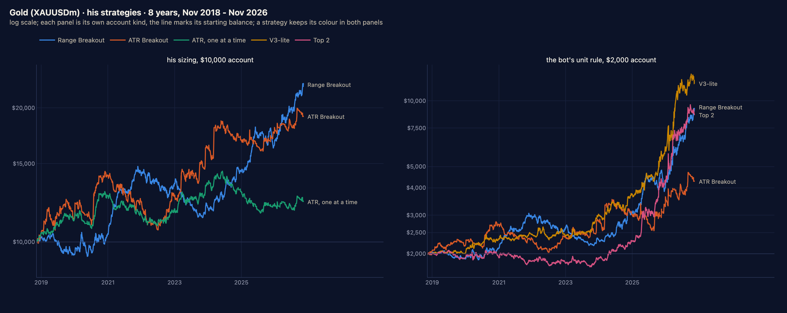
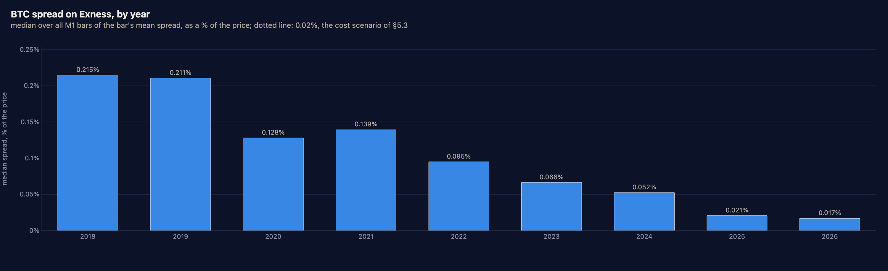
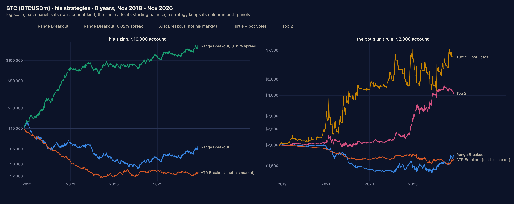
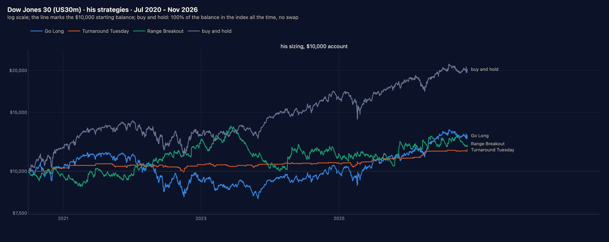
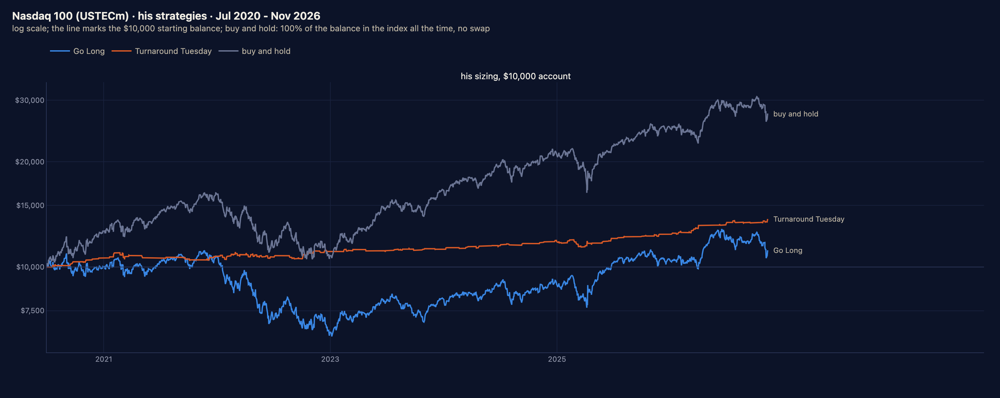
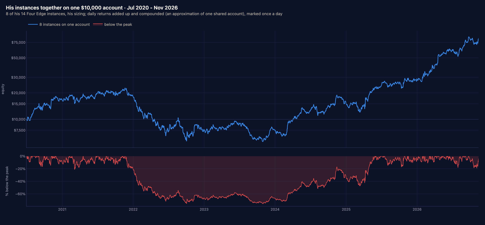
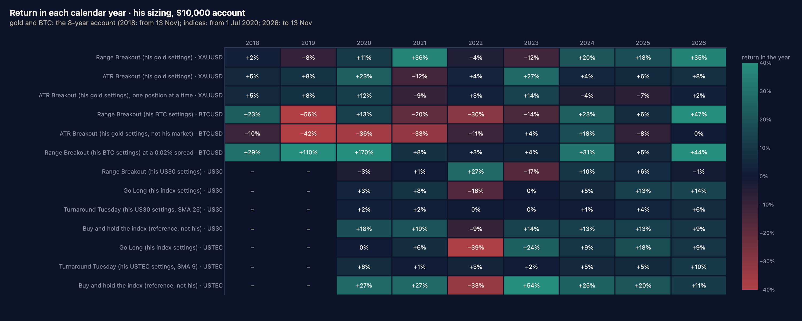

<!-- Generated: BALKE.md is built from BALKE.template.md by `python -m backtesting.research.balke report`, which fills every table and most figures from the result files. Edit the template, not BALKE.md. -->
# René Balke's strategies (BM Trading GmbH), rebuilt and backtested on our data

René Balke is a German algo-trading developer. He runs BM Trading GmbH, sells Expert Advisors on MQL5 (user `bmtrading`) and posts most weeks on YouTube. His newest product is the **Four Edge EA**. It was published on 31 Oct 2026 and is now at version 3.29 (13 Nov 2026). It bundles the four strategies he trades live:
- **Go Long**: buy an index every day, sell the same afternoon.
- **Turnaround Tuesday**: buy an index on Monday when it is below its moving average, sell on Tuesday.
- **Range Breakout**: trade the break of a morning price range.
- **ATR Breakout**: trade in the direction of an unusually large H1 candle.

He runs 14 instances of these on his live accounts, with settings files he publishes. This study rebuilt the four strategies from those files, his user guide and his videos. It then ran them on our Exness data for gold, BTC, the Dow (US30) and the Nasdaq 100 (USTEC). That covers 8 of his 14 instances. They were compared with the final ten's leaders and with his own published figures.

**Read this first: four things limit what these figures prove.**
1. **These are rebuilds, not his code.** Every rule and default is from his public settings files and guide. Where something is not public, the choice made here is stated (§2). His EA may differ in details.
2. **Our costs are not his.** We use Exness Standard spreads with no commission and no swap. He trades at IC Trading (raw spread plus commission) and backtests on Dukascopy data. For BTC this difference decides the result (§5).
3. **Stop entries fill at their level here.** The simulator uses 1-minute bars, so a breakout order fills exactly at the range edge. An independent real-tick test of his standalone Range Breakout EA found that 84% of gold stop entries filled worse, none better. The test was published by the seller of a competing EA. In that test the 1-minute model overstated profit by 6.6% on gold and 16% on USDJPY. Our Range Breakout figures are therefore on the kind side.
4. **Earlier studies read all of 2018 – 2026.** We tuned nothing here: every setting is his. But he chose his settings with backtests that include these years, so this is not an out-of-sample test of his choices.

### The answer

Growth per year is compound; DD is the deepest fall from an equity peak. "His sizing" is his own settings on a $10,000 account. The bot's unit rule is on $2,000, as in every earlier study.

| | Gold (XAUUSDm) | BTC (BTCUSDm) | US30 and USTEC |
|---|---|---|---|
| **His strategies here** | Range Breakout; ATR Breakout | Range Breakout | Go Long and Turnaround Tuesday on both; Range Breakout on US30 |
| **His sizing, longest window** (gold, BTC: 8 years; indices: Jul 2020 – Nov 2026) | Range Breakout {{v:XAUUSDm|Range Breakout (his gold settings)|his sizing, $10,000|8y|final_equity}} ({{v:XAUUSDm|Range Breakout (his gold settings)|his sizing, $10,000|8y|cagr_pct}} a year), DD {{v:XAUUSDm|Range Breakout (his gold settings)|his sizing, $10,000|8y|max_dd_pct}}. ATR Breakout {{v:XAUUSDm|ATR Breakout (his gold settings)|his sizing, $10,000|8y|final_equity}} ({{v:XAUUSDm|ATR Breakout (his gold settings)|his sizing, $10,000|8y|cagr_pct}} a year), DD {{v:XAUUSDm|ATR Breakout (his gold settings)|his sizing, $10,000|8y|max_dd_pct}} | At Exness's spreads: {{v:BTCUSDm|Range Breakout (his BTC settings)|his sizing, $10,000|8y|final_equity}} ({{v:BTCUSDm|Range Breakout (his BTC settings)|his sizing, $10,000|8y|cagr_pct}} a year), DD {{v:BTCUSDm|Range Breakout (his BTC settings)|his sizing, $10,000|8y|max_dd_pct}}. At today's 0.02% spread throughout: {{v:BTCUSDm|Range Breakout (his BTC settings) at a 0.02% spread|his sizing, $10,000|8y|final_equity|spread}}, DD {{v:BTCUSDm|Range Breakout (his BTC settings) at a 0.02% spread|his sizing, $10,000|8y|max_dd_pct|spread}} | Go Long: US30 {{v:US30m|Go Long (his index settings)|his sizing, $10,000|since 2020|cagr_pct}} a year (DD {{v:US30m|Go Long (his index settings)|his sizing, $10,000|since 2020|max_dd_pct}}), USTEC {{v:USTECm|Go Long (his index settings)|his sizing, $10,000|since 2020|cagr_pct}} (DD {{v:USTECm|Go Long (his index settings)|his sizing, $10,000|since 2020|max_dd_pct}}). Turnaround Tuesday: US30 {{v:US30m|Turnaround Tuesday (his US30 settings, SMA 25)|his sizing, $10,000|since 2020|cagr_pct}} (DD {{v:US30m|Turnaround Tuesday (his US30 settings, SMA 25)|his sizing, $10,000|since 2020|max_dd_pct}}), USTEC {{v:USTECm|Turnaround Tuesday (his USTEC settings, SMA 9)|his sizing, $10,000|since 2020|cagr_pct}} (DD {{v:USTECm|Turnaround Tuesday (his USTEC settings, SMA 9)|his sizing, $10,000|since 2020|max_dd_pct}}). Range Breakout US30 {{v:US30m|Range Breakout (his US30 settings)|his sizing, $10,000|since 2020|cagr_pct}} (DD {{v:US30m|Range Breakout (his US30 settings)|his sizing, $10,000|since 2020|max_dd_pct}}) |
| **His sizing, the last year** | Range Breakout {{v:XAUUSDm|Range Breakout (his gold settings)|his sizing, $10,000|1y|return_pct}} (DD {{v:XAUUSDm|Range Breakout (his gold settings)|his sizing, $10,000|1y|max_dd_pct}}); ATR Breakout {{v:XAUUSDm|ATR Breakout (his gold settings)|his sizing, $10,000|1y|return_pct}} (DD {{v:XAUUSDm|ATR Breakout (his gold settings)|his sizing, $10,000|1y|max_dd_pct}}) | {{v:BTCUSDm|Range Breakout (his BTC settings)|his sizing, $10,000|1y|return_pct}} (DD {{v:BTCUSDm|Range Breakout (his BTC settings)|his sizing, $10,000|1y|max_dd_pct}}): the spread is now near 0.02% | Go Long US30 {{v:US30m|Go Long (his index settings)|his sizing, $10,000|1y|return_pct}}, USTEC {{v:USTECm|Go Long (his index settings)|his sizing, $10,000|1y|return_pct}}; Turnaround Tuesday US30 {{v:US30m|Turnaround Tuesday (his US30 settings, SMA 25)|his sizing, $10,000|1y|return_pct}}, USTEC {{v:USTECm|Turnaround Tuesday (his USTEC settings, SMA 9)|his sizing, $10,000|1y|return_pct}} |
| **The bot's unit rule, 8 years**, next to the final ten | Range Breakout {{v:XAUUSDm|Range Breakout (his gold settings)|bot unit rule|8y|final_equity}}, DD {{v:XAUUSDm|Range Breakout (his gold settings)|bot unit rule|8y|max_dd_pct}}; V3-lite {{b:XAUUSDm|V3-lite|8y|final_equity}}, DD {{b:XAUUSDm|V3-lite|8y|max_dd_pct}} | Range Breakout {{v:BTCUSDm|Range Breakout (his BTC settings)|bot unit rule|8y|final_equity}}, DD {{v:BTCUSDm|Range Breakout (his BTC settings)|bot unit rule|8y|max_dd_pct}}; Turtle + bot votes {{b:BTCUSDm|Turtle + bot votes|8y|final_equity}}, DD {{b:BTCUSDm|Turtle + bot votes|8y|max_dd_pct}} | not the bot's markets |
| **Against his own figures** | ATR Breakout matches his test's trade count, win rate and profit factor, and his live months (§9) | his BTC test reportedly used a spread of 0.01% of the price, far below Exness's before 2025 | Turnaround Tuesday matches or beats the third-party test of his averages: profit factor {{v:US30m|Turnaround Tuesday (his US30 settings, SMA 25)|his sizing, $10,000|since 2020|profit_factor}} on US30 and {{v:USTECm|Turnaround Tuesday (his USTEC settings, SMA 9)|his sizing, $10,000|since 2020|profit_factor}} on USTEC, against 1.50 and 1.42. Go Long's old USTEC screenshot (profit factor 1.14) is not reproduced on Exness's costs ({{v:USTECm|Go Long (his index settings)|his sizing, $10,000|since 2020|profit_factor}}) |
| **For the bot** | Range Breakout is the one candidate. It hardly moves with V3-lite (daily correlation {{c:8y:V3-lite:corr_d}}). Shared half and half with V3-lite on one account, it ended above V3-lite alone in every window ({{c:8y:V3-lite:half.final}} against {{c:8y:V3-lite:ours.final}} over 8 years). The drawdown fell over 8 years and in the last year, and rose a little in the two older windows (§4.3) | a forward-test candidate only while spreads stay this low; the Turtle stays the BTC choice | Outside the bot's markets. Turnaround Tuesday is the steadiest idea in the study, but small |

**His 8 instances together** on one $10,000 account with his sizing: {{p:since 2020:cagr_pct}} a year from Jul 2020, max DD {{p:since 2020:max_dd_pct}} on daily marks; the last year {{p:1y:return_pct}} (§7).

## 1. Who he is and what he trades now

- **Company and channels.** BM Trading GmbH, Germany. MQL5 seller `bmtrading` (Range Breakout EA since Oct 2022, Go Long EA since Jul 2024, Turnaround Tuesday EA since Feb 2025, Four Edge since Oct 2026). YouTube channels in English and German, a blog at bmtrading.de.
- **Four Edge EA** (MQL5 product 205284). Four strategy modules in one EA. Each instance has its own symbol, magic number and `Key=Value` settings file. Instances on the same symbol coexist, so it needs a hedging account. His 14 live instances, all on IC Trading server time:
  - Go Long on US30, USTEC and DE40;
  - Turnaround Tuesday on US30, USTEC and DE40;
  - Range Breakout on USDJPY, GBPUSD, EURJPY, DE40, US30, XAUUSD and BTCUSD (BTC added Sep 2026);
  - ATR Breakout on XAUUSD (built with Claude AI in Feb – Mar 2026, live since Mar 2026, a Four Edge module since Oct 2026).
- **Run here:** the three gold and BTC instances; Go Long and Turnaround Tuesday on US30 and USTEC; Range Breakout on US30.
- **Not run:**
  - the three DE40 instances and the three currency-pair Range Breakouts. They are outside the bot's markets, and each needs six more years of tick downloads;
  - his older EAs (Ninja Turtle Scalper, Trend Tracer, martingale course projects). They are not part of what he trades now.
- **His live record (MQL5 signals, read 15 Nov 2026).**
  - *IC Trading 5K Live* runs Four Edge alone, "exactly as it is sold": about 20 weeks, +7.73%, profit factor 1.03, max balance drawdown 19.9%.
  - *IC Trading 50K Live*, his main account since Mar 2024: €109,305 profit, profit factor 1.15. Its growth and drawdown figures are distorted by €40k of deposits and €125k of withdrawals.
  - *BlackBull 2K Live* trades only gold, BTC and three currency pairs, probably the Range Breakout set: 25 weeks, +107%, profit factor 1.14, max balance drawdown 22.8%.

## 2. The four strategies, as rebuilt

Server time is IC Trading's: GMT+2 in winter and GMT+3 in summer, switching on the US dates. That is New York time + 7 hours all year, so his clock times are converted through New York time. "Risk x%" is his Percent mode: the loss at the stop is x% of the balance. With no stop, the whole price counts as the stop distance, so x% becomes the position's value as a share of the balance. A trade below 0.01 lot is skipped, as his EA does.

| Strategy | His settings file | Rules as rebuilt | Sizing |
|---|---|---|---|
| **Range Breakout, gold** | `RangeBreakout_XAUUSD_200005` | Range = highest and lowest price 03:05 – 06:05 server time. Then a buy stop at the range high and a sell stop at the range low, no buffer. The first fill cancels the other. A side whose level the price has already passed is skipped. Stop 1% of the entry price, no target. Orders deleted and the position closed at 18:55. Weekdays. | risk 1% |
| **Range Breakout, BTC** | `RangeBreakout_BTCUSD_200007` | Range 05:00 – 09:00, close 20:00. Stop at the other side of the range (factor 1.0). Every day, weekends too. | risk 1% |
| **Range Breakout, US30** | `RangeBreakout_US30_200004` | Range 11:00 – 13:00, close 18:00, stop at the other side of the range. Weekdays. | risk 0.5% |
| **ATR Breakout, gold** | `ATRBreakout_XAUUSD_400001` | At each new H1 candle, look at the last closed one. If its range is more than 2.5 × ATR(200) and it closed within 25% of its range from its high (bullish) or low (bearish), buy or sell at the next candle's open. Stop 0.5%, target 2% of the entry price, no time exit. **Every signal is traded, also while earlier trades are open** (see below). | risk 0.5% |
| **Go Long** | `GoLong_US30_100001`, `GoLong_USTEC_100002` | Buy at 01:05 server time (18:05 New York, just after the daily reopen), close at 22:55 the same day (15:55 New York). No stop, no target. Weekdays. The position never crosses the 17:00 New York rollover, so it pays no swap. | 100% of the balance in index value |
| **Turnaround Tuesday** | `TurnaroundTuesday_US30_300001` (SMA 25), `TurnaroundTuesday_USTEC_300002` (SMA 9) | On Monday at 01:05 server time, buy if the price is below the simple moving average of daily closes. Close on Tuesday at 22:55. No stop, no target. | 50% of the balance |

What his files leave open, and the choice made here (`ASSUMED` in [balke.py](../../backtesting/research/balke.py)):
- **The range** uses the 1-minute bars that open inside the window; the bar opening at the end time is not included. Its high and low are bid prices. A buy stop triggers on the ask, as in MT5.
- **ATR** is MetaTrader's simple average of the true range, and it includes the signal candle.
- **Overlapping ATR trades.** His guide does not say whether a new signal may open while an earlier ATR trade is still open. Here every signal opens its own trade. The data supports this: the signals come to 140 a year on gold, and his own 2015 – 2026 test made 1,552 trades in about eleven years, 141 a year. Holding one position at a time gives 86 trades a year. That variant is shown as well.
- **Turnaround Tuesday's average** is MetaTrader's at shift 0: the last 24 (or 8) closed server days plus the current price. Daily bars are server days.
- **Index contracts.** For US30m and USTECm, 0.01 lot is taken as 0.01 × the index in USD. Exness does not publish this in a readable form. His index strategies size by value, so the contract only changes the lot rounding.

## 3. How they were run

- **Data.** Exness tick history, built into 1-minute bid bars with each minute's mean spread: gold from 2017, BTC from 2018, US30m and USTECm from Jun 2020 (the archive starts there). The ask is the bid plus the bar's spread.
- **Simulator.** The M1-bar simulator of the earlier research (`external.py`), unchanged except for the multi-position account added for the ATR rows. Signals are read on closed bars and filled at the next 1-minute open. Within a bar the adverse price comes first, so a bar that reaches both stop and target counts as a stop. No swap, no commission.
- **Several positions at once.** A new account kernel ([balke.py](../../backtesting/research/balke.py), `multi_account`) holds overlapping trades and sizes each from the balance when it opens. It marks the equity on every bar as the single-position kernel does. On trades that never overlap it reproduces the single-position kernel to the cent (final equity, drawdown and every daily mark), checked on gold Go Long and on the non-overlapping ATR trades with both sizings.
- **Accounts.** Fresh accounts per window: $2,000 as in every earlier study, and $10,000 for his sizing. At today's gold price, 1% of $2,000 cannot buy the 0.01-lot minimum at a 1% stop, so on $2,000 his gold rules skip most trades (in the last year, all of them). His live accounts hold €5,000 and about €30,000. The **bot's unit rule** (0.01 lot, plus 0.01 lot for every $2,500 of balance, at most 0.10 lot) is also run on gold and BTC, so his entries and exits can be compared with our designs on equal sizing.
- **Windows** (UTC, start included, end excluded):
  - gold and BTC: the final ten's windows (8 years from 13 Nov 2018, 5 years, Nov 2018 – Dec 2020, the last year from 13 Nov 2025), plus Jul 2020 – Nov 2026 for the portfolio;
  - indices: Jul 2020 – Nov 2026, 5 years and the last year.
- **Drawdown** is measured from the running peak of the equity, with troughs at the worst price inside each 1-minute bar. The portfolio is marked once a day and the combinations in §4.3 on closed trades, so their drawdowns are lower bounds.

## 4. Gold (XAUUSDm)

### 4.1 Eight years, Nov 2018 – Nov 2026

{{main:XAUUSDm:8y:his sizing, $10,000+bot unit rule}}

Notes:
- **Range Breakout** made {{v:XAUUSDm|Range Breakout (his gold settings)|his sizing, $10,000|8y|cagr_pct}} a year on his sizing, with a max drawdown of {{v:XAUUSDm|Range Breakout (his gold settings)|his sizing, $10,000|8y|max_dd_pct}}. On the bot's unit rule, its $2,000 account grew to {{v:XAUUSDm|Range Breakout (his gold settings)|bot unit rule|8y|final_equity}}. V3-lite reached {{b:XAUUSDm|V3-lite|8y|final_equity}} with a deeper drawdown ({{b:XAUUSDm|V3-lite|8y|max_dd_pct}} against {{v:XAUUSDm|Range Breakout (his gold settings)|bot unit rule|8y|max_dd_pct}}).
- **ATR Breakout**, every signal traded: {{v:XAUUSDm|ATR Breakout (his gold settings)|his sizing, $10,000|8y|cagr_pct}} a year, max drawdown {{v:XAUUSDm|ATR Breakout (his gold settings)|his sizing, $10,000|8y|max_dd_pct}}, profit factor {{v:XAUUSDm|ATR Breakout (his gold settings)|his sizing, $10,000|8y|profit_factor}}, {{v:XAUUSDm|ATR Breakout (his gold settings)|his sizing, $10,000|8y|win_rate_pct}} of trades won. That is the shape of his own test (profit factor 1.15, about 23% won). One position at a time, the same signals make only {{v:XAUUSDm|ATR Breakout (his gold settings), one position at a time|his sizing, $10,000|8y|cagr_pct}} a year. The signals it cannot take, which come while a trade is already open, did better: {{atroverlap}}.
- **His sizing on $2,000** (in the window table): gold Range Breakout skipped {{v:XAUUSDm|Range Breakout (his gold settings)|his sizing, $2,000|8y|skipped_trades}} of its trades over eight years and every trade in the last year. ATR Breakout skipped every trade in the last year. A small account cannot run his gold settings at today's prices.



### 4.2 Every window

Growth a year (the last year: return over the year) and max drawdown. ⚠ marks an account that skipped more trades than it took.

{{windows:XAUUSDm}}

### 4.3 Next to V3-lite

His gold Range Breakout and our V3-lite hardly move together: the correlation of their daily returns is {{c:8y:V3-lite:corr_d}} over eight years.

The table puts the two on one account with the bot's unit rule ($2,000), replayed trade by trade from their closed trades:
- **Half the account each:** each trade's units come from half the balance.
- **Both at full size:** each trade's units come from the whole balance.
- **Each alone** is replayed the same way, so all four columns are measured alike. The drawdown here is that of the closed balance, which is shallower than the intraday figures in the tables above.

{{combo:V3-lite}}

- **Half each beat V3-lite alone on final equity in every window:** {{c:8y:V3-lite:half.final}} against {{c:8y:V3-lite:ours.final}} over eight years.
  - Its drawdown was lower over eight years ({{c:8y:V3-lite:half.dd}} against {{c:8y:V3-lite:ours.dd}}) and in the last year ({{c:1y:V3-lite:half.dd}} against {{c:1y:V3-lite:ours.dd}}).
  - It was higher over five years ({{c:5y:V3-lite:half.dd}} against {{c:5y:V3-lite:ours.dd}}) and in 2018 – 2020 ({{c:new:V3-lite:half.dd}} against {{c:new:V3-lite:ours.dd}}).
  - Below $5,000 the 0.01-lot minimum keeps both strategies at full size, so "half" only halves once the account has grown.
- **Both at full size** ended at {{c:8y:V3-lite:both.final}} over eight years, with a {{c:8y:V3-lite:both.dd}} drawdown of the closed balance. That drawdown is about V3-lite's own, on about four times its profit, because their losing stretches seldom overlap. Both units are capped at 10, as the bot caps them.
- **The replays reproduce each account's own final equity**, except V3-lite in 2018 – 2020, where they are $14 apart. With intraday marks all four drawdowns would be deeper. The real test would run both in the tick engine as the bot would (§10).

## 5. BTC (BTCUSDm)

### 5.1 Eight years, Nov 2018 – Nov 2026

{{main:BTCUSDm:8y:his sizing, $10,000+bot unit rule}}

### 5.2 Every window

{{windows:BTCUSDm}}

### 5.3 The spread decides it

Exness's BTC spread has fallen by a factor of about twelve since 2018:

{{spread}}



- **His BTC Range Breakout** risks 1% at a stop on the other side of a 4-hour range, and it trades every day. Each trade pays the spread once, as a share of that stop. At the spreads of 2018 – 2023 that cost exceeded the strategy's edge in most years (§8).
- **At Exness's real spreads** the $10,000 account fell to {{v:BTCUSDm|Range Breakout (his BTC settings)|his sizing, $10,000|8y|final_equity}} over eight years, with an {{v:BTCUSDm|Range Breakout (his BTC settings)|his sizing, $10,000|8y|max_dd_pct}} drawdown.
- **With every bar's spread set to 0.02% of the price**, the 2025 – 2026 level, the same rules grew it to {{v:BTCUSDm|Range Breakout (his BTC settings) at a 0.02% spread|his sizing, $10,000|8y|final_equity|spread}} ({{v:BTCUSDm|Range Breakout (his BTC settings) at a 0.02% spread|his sizing, $10,000|8y|max_dd_pct|spread}} drawdown). Viewers report that his own BTC backtest used a spread of 0.01% of the price.
- **Most of that gain is from 2019 – 2020**, when the real spread was six to ten times higher. Over the last five years the 0.02% scenario made {{v:BTCUSDm|Range Breakout (his BTC settings) at a 0.02% spread|his sizing, $10,000|5y|cagr_pct|spread}} a year (max drawdown {{v:BTCUSDm|Range Breakout (his BTC settings) at a 0.02% spread|his sizing, $10,000|5y|max_dd_pct|spread}}).
- **In the last year** the real spread was already near 0.02%. The real-spread account made {{v:BTCUSDm|Range Breakout (his BTC settings)|his sizing, $10,000|1y|return_pct}} (max drawdown {{v:BTCUSDm|Range Breakout (his BTC settings)|his sizing, $10,000|1y|max_dd_pct}}). On the bot's unit rule it made {{v:BTCUSDm|Range Breakout (his BTC settings)|bot unit rule|1y|return_pct}}.
- **ATR Breakout is not his BTC strategy.** It lost on BTC in most windows.



## 6. The Dow (US30m) and the Nasdaq 100 (USTECm)

His index instances here: Go Long and Turnaround Tuesday on both indices, and Range Breakout on US30. The Exness index archive starts in June 2020, so these run from July 2020 (6.4 years), plus the last five years and the last year.

**Buy and hold** is shown as a yardstick: 100% of the balance in the index for the whole window, no swap. Go Long holds the index on weekdays from the evening reopen to 15:55 New York, so holding it all the time is its natural comparison.

Two Exness details matter here:
- **Session hours.** His broker reopens the US index CFDs at 18:00 New York all year. Exness reopens them at 18:00 in winter but at 18:30 in US summer time. His 01:05 entries (18:05 New York) are therefore taken at the first quote at or after that time, within 90 minutes. In summer that is 18:30.
- **Spreads.** As with BTC, they fell sharply in 2025:

{{spread:US30m,USTECm}}

Go Long trades about 250 times a year with a position worth the whole balance. Each trade pays the spread once, so a spread of 0.02% of the price costs about 5% of the balance a year.

### 6.1 Jul 2020 – Nov 2026

#### US30m

{{main:US30m:since 2020}}

#### USTECm

{{main:USTECm:since 2020}}

### 6.2 Every window

#### US30m

{{windows:US30m}}

#### USTECm

{{windows:USTECm}}





## 7. His instances together on one account

Four Edge is sold as a portfolio, and his claims are about the portfolio. Here the 8 instances that could be run share one $10,000 account with his sizing:
- gold Range Breakout and ATR Breakout;
- BTC Range Breakout;
- US30 Range Breakout;
- Go Long on US30 and USTEC;
- Turnaround Tuesday on US30 and USTEC.

Each instance sizes its trades on the balance, so on one account its daily return is close to what it makes on its own account. The portfolio adds up the instances' daily returns and compounds them. This is an approximation, marked once a day, so its drawdown is a lower bound.

{{portfolio}}

- **High return, high risk.** At his sizing the 8 instances compounded $10,000 to {{p:since 2020:final}} from July 2020. On the way the account fell {{p:since 2020:max_dd_pct}} from a peak, on daily marks. His own main account's MQL5 record shows a similar depth: 50.9% maximal, and 77.8% relative, which withdrawals distort.
- **The calendar years show where.** 2022 lost more than half the account; Go Long on both indices and the BTC Range Breakout lost the most that year. 2024 – 2026 made most of the gain.
- **Gold carries it.** Gold Range Breakout made the most on its own (see the table). The index and BTC instances added little on Exness's costs.
- **What moves together.** The gold and BTC instances, and the US30 Range Breakout, hardly move with the others. Go Long and Turnaround Tuesday on the two indices move together (correlations of 0.3 – 0.7). On Mondays and Tuesdays his sizing holds up to three times the balance in index value.



## 8. Year by year

Return in each calendar year, his sizing on $10,000. Gold and BTC: the eight-year account. Indices: from 1 Jul 2020.

{{years:XAUUSDm,BTCUSDm,US30m,USTECm:his sizing, $10,000}}



## 9. His published numbers next to ours

His own figures are self-reported unless marked as an MQL5 signal, which is broker-verified. Ours come from the tables above.

| What he published (source) | Our rebuild, closest test | Reading |
|---|---|---|
| **ATR Breakout, gold, backtest.** 2015 – 2026 on Dukascopy ticks, €50k start: +€19,527, profit factor 1.15, max DD about 9.6%, 1,552 trades, about 23% won (his blog, 9 Jun 2026) | Every signal traded, 8 years: profit factor {{v:XAUUSDm|ATR Breakout (his gold settings)|his sizing, $10,000|8y|profit_factor}}, {{v:XAUUSDm|ATR Breakout (his gold settings)|his sizing, $10,000|8y|win_rate_pct}} won, {{v:XAUUSDm|ATR Breakout (his gold settings)|his sizing, $10,000|8y|trades_per_year}} trades a year (his: 141). At 0.5% of a compounding balance: {{v:XAUUSDm|ATR Breakout (his gold settings)|his sizing, $10,000|8y|cagr_pct}} a year, max DD {{v:XAUUSDm|ATR Breakout (his gold settings)|his sizing, $10,000|8y|max_dd_pct}} | The trade count, win rate and profit factor match. His money figures fit a fixed risk of about €100 a trade (0.2% of €50k), not his file's 0.5% of a growing balance. His 9.6% drawdown is therefore on a smaller stake than his settings use. |
| **ATR Breakout, live** since Mar 2026: 24 trades, 25% won, profit factor 1.30, against 23 trades, 26.1% won, 1.40 in his backtest of the same weeks (blog, Jun 2026). By month (blog): Jun +€539, Jul −€298, Aug +€1,122 with 8 trades, 4 won | About the same weeks (8 Mar – 9 Jun 2026): {{t:XAUUSDm|ATR Breakout (his gold settings)|his sizing, $10,000|1y|2026-03-08|2026-06-09}}. Trades closed in Aug 2026: {{t:XAUUSDm|ATR Breakout (his gold settings)|his sizing, $10,000|1y|2026-08-01|2026-09-01|close}}; Jun {{t:XAUUSDm|ATR Breakout (his gold settings)|his sizing, $10,000|1y|2026-06-01|2026-07-01|close}}; Jul {{t:XAUUSDm|ATR Breakout (his gold settings)|his sizing, $10,000|1y|2026-07-01|2026-08-01|close}} | Close in trade count, win rate and profit factor, and the same direction in each month he reported; in August, 8 trades and 4 winners in both. That supports the rebuild, including the choice to take every signal. |
| **Range Breakout, gold, backtest.** 2003 – 2026 on Dukascopy, €500 fixed risk on €100k: profit factor 1.05, about €46,290, 5,871 trades (a third-party summary of his Feb 2026 video; not verified) | 8 years: profit factor {{v:XAUUSDm|Range Breakout (his gold settings)|his sizing, $10,000|8y|profit_factor}} on his sizing ({{v:XAUUSDm|Range Breakout (his gold settings)|bot unit rule|8y|profit_factor}} on the bot's unit rule), {{v:XAUUSDm|Range Breakout (his gold settings)|his sizing, $10,000|8y|trades_per_year}} trades a year (his: 255) | Same frequency. The profit factor is better in 2018 – 2026 than his 23-year average, which he says was weak in 2003 – 2007. Our fills are kinder than real ones. |
| **Range Breakout, BTC, backtest** from 2018 on a custom symbol with the spread at 0.01% of the price (viewers' comments under his videos; not verified) | At Exness's real spreads: {{v:BTCUSDm|Range Breakout (his BTC settings)|his sizing, $10,000|8y|cagr_pct}} a year, max DD {{v:BTCUSDm|Range Breakout (his BTC settings)|his sizing, $10,000|8y|max_dd_pct}}. At 0.02% throughout: $10,000 → {{v:BTCUSDm|Range Breakout (his BTC settings) at a 0.02% spread|his sizing, $10,000|8y|final_equity|spread}} | Exness charged 10 – 20 times that spread before 2022. A test at 0.01% shows what the rules do at today's costs, not what they did then. |
| **Go Long, USTEC, backtest** 2013 – 2024, $100k: +$155,648, profit factor 1.14, 2,929 trades, 53.9% won, max balance DD 15.7% (old product screenshot; not verified) | USTEC, Jul 2020 – Nov 2026: {{v:USTECm|Go Long (his index settings)|his sizing, $10,000|since 2020|cagr_pct}} a year, max DD {{v:USTECm|Go Long (his index settings)|his sizing, $10,000|since 2020|max_dd_pct}}, profit factor {{v:USTECm|Go Long (his index settings)|his sizing, $10,000|since 2020|profit_factor}}, {{v:USTECm|Go Long (his index settings)|his sizing, $10,000|since 2020|win_rate_pct}} won | The same share of winners, but a much lower profit factor and a deeper drawdown on Exness's costs. Before 2025 the USTEC spread was 0.03 – 0.04% of the price, about 7 – 10% of the balance a year at Go Long's size. Holding the index made {{v:USTECm|Buy and hold the index (reference, not his)|his sizing, $10,000|since 2020|cagr_pct}} a year over the same window. |
| **Turnaround Tuesday with his averages**, 2005 – 2026 on daily data at 50% of the balance (Second Wind EA guide, a third party): US30 profit factor 1.50, about 2.7% a year, max DD 9.6%; USTEC 1.42, about 3.2% a year, 13.2% | Jul 2020 – Nov 2026: US30 {{v:US30m|Turnaround Tuesday (his US30 settings, SMA 25)|his sizing, $10,000|since 2020|cagr_pct}} a year, max DD {{v:US30m|Turnaround Tuesday (his US30 settings, SMA 25)|his sizing, $10,000|since 2020|max_dd_pct}}, profit factor {{v:US30m|Turnaround Tuesday (his US30 settings, SMA 25)|his sizing, $10,000|since 2020|profit_factor}}; USTEC {{v:USTECm|Turnaround Tuesday (his USTEC settings, SMA 9)|his sizing, $10,000|since 2020|cagr_pct}} a year, max DD {{v:USTECm|Turnaround Tuesday (his USTEC settings, SMA 9)|his sizing, $10,000|since 2020|max_dd_pct}}, profit factor {{v:USTECm|Turnaround Tuesday (his USTEC settings, SMA 9)|his sizing, $10,000|since 2020|profit_factor}} | Close to the third party on US30 and better on USTEC, with smaller drawdowns. It made money in every calendar year since mid-2020 on both indices (§8). It earns little: 2 – 5% a year at 50% of the balance. |
| **Portfolio, backtest.** 2015 – 2026, all his strategies, about €500 fixed risk a trade: +€735,025, every calendar year profitable, max DD about €45k (his blog) | 8 of his 14 instances on one account since Jul 2020: {{p:since 2020:cagr_pct}} a year, max DD {{p:since 2020:max_dd_pct}} (daily marks); calendar years in §7 | Not every year was profitable: 2022 lost more than half the account, and 2023 another 2% (§7). His sizing puts each instance on the whole balance, so the portfolio swings far more than any single instance. His €735k was made at a fixed €500 risk per trade, which does not compound, so its drawdown in euros is not comparable. |
| **Four Edge alone, live** (MQL5 signal 2392411, about 20 weeks to Nov 2026): +7.73%, profit factor 1.03, max balance DD 19.9%. By symbol: XAUUSD +$946, BTCUSD +$338, US30 −$780, USTEC −$512 | The same weeks (30 Jun – 13 Nov 2026), each instance on its own account: {{liveweeks}} | The same direction as his on every symbol he reports. Ours is larger. His account also runs the six instances not tested here (three currency pairs and three on DE40), and it added BTC only in September. |
| **Main account, live** (MQL5 signal 2223417, since Mar 2024): €109,305 profit, profit factor 1.15. By strategy to Jun 2026 (his blog): Go Long +€56,820, Range Breakout +€21,389, Turnaround Tuesday +€17,417, ATR Breakout +€389 | – | Go Long is his largest earner live. On his sizing it is also the riskiest instance: 100% of the balance in an index, with no stop. |

## 10. What this means for the bot

1. **Gold Range Breakout is the one worth a closer look.**
   - On the bot's unit rule it made {{v:XAUUSDm|Range Breakout (his gold settings)|bot unit rule|8y|final_equity}} over eight years against V3-lite's {{b:XAUUSDm|V3-lite|8y|final_equity}}, with a shallower drawdown ({{v:XAUUSDm|Range Breakout (his gold settings)|bot unit rule|8y|max_dd_pct}} against {{b:XAUUSDm|V3-lite|8y|max_dd_pct}}).
   - Its daily returns barely move with V3-lite's (correlation {{c:8y:V3-lite:corr_d}}). Shared half and half on one account with the unit rule, the pair ended above V3-lite alone in every window. The drawdown fell over eight years and in the last year, and rose a little over five years and in 2018 – 2020 (§4.3).
   - It is a second, independent source of trades on the bot's own symbol, with rules fixed by someone else, so not fitted to our data by us.
   - Before it goes near the live bot, three things are needed:
     - a tick-level test: the bot's tick engine runs our designs, not stop-order breakouts, so this needs new engine work, and real fills on breakouts are worse (see the top of this report);
     - a demo-account forward test next to V3-lite;
     - a way to hold it next to the basket. On the hedging account that means its own magic number; on netting the two would have to share one position.
2. **ATR Breakout has a small edge and needs several positions at once.** Every signal taken, it made {{v:XAUUSDm|ATR Breakout (his gold settings)|his sizing, $10,000|8y|cagr_pct}} a year at 0.5% risk, with long flat stretches. One position at a time, it made {{v:XAUUSDm|ATR Breakout (his gold settings), one position at a time|his sizing, $10,000|8y|cagr_pct}}. It is not a candidate.
3. **BTC Range Breakout depends on today's spreads.**
   - At Exness's spreads before 2025 it lost money. In the last year, with the spread near 0.02%, it made {{v:BTCUSDm|Range Breakout (his BTC settings)|his sizing, $10,000|1y|return_pct}} on his sizing.
   - Even at 0.02% throughout, 2021 – 2023 were flat ({{v:BTCUSDm|Range Breakout (his BTC settings) at a 0.02% spread|his sizing, $10,000|5y|cagr_pct|spread}} a year over five years).
   - The Turtle is still the BTC choice. If anything, the BTC Range Breakout is a candidate for a small forward test while spreads stay this low.
4. **The index strategies are outside the bot's markets.** **Turnaround Tuesday** is the steadiest idea in this study. It made a profit in every calendar year on both indices, with drawdowns near 6%. But it earns only 2 – 5% a year at his size, from about 20 trades a year per index. **Go Long** needs low costs: on Exness before 2025 it lagged holding the index by a wide margin. Either would be a separate small program, not a change to the bot.
5. **His gold sizing needs a bigger account.** At a 1% stop and 1% risk, the smallest trade (0.01 lot = 1 oz) needs a balance at least equal to the gold price, about $3,900 today. On $2,000 his gold rules placed no trade in the last year. On the bot's unit rule the same entries and exits trade normally.
6. **No new hold-out data was used**, and none is left: every year since 2018 has been read before. His rules were not tuned by us, which helps, but the next honest test of anything here is a demo-account forward run.

## 11. Limits of this test

- **Rebuilds.** His EA's code is not public. Where his files are silent, the choices are listed in §2. Different choices (the range's last bar, the ATR bar, overlapping trades) change the numbers. Overlapping trades changed ATR Breakout's eight-year growth from 2.6% to 8.4% a year.
- **Fills.** Stop entries fill at their level on 1-minute bars. Real fills on fast breakouts are worse (see the top of this report). Market entries fill at the next 1-minute open with that bar's mean spread; a spread widening inside the minute is not seen.
- **Costs.**
  - No commission. Exness Standard has none; his IC Trading account pays raw spread plus commission.
  - No swap. Go Long never holds over the rollover, but Turnaround Tuesday holds one night a week and ATR Breakout often several.
  - The index data's spreads are Exness's. On his broker they are lower.
- **History.**
  - The indices start in mid-2020. That window has no 2018 – 2019 and only one bear year for stocks (2022).
  - The BTC store starts in 2018, gold's in 2017. His tests reach back to 2003 – 2015.
- **Portfolio and combinations.** The portfolio adds daily returns of separate accounts; the V3-lite combinations replay closed trades, without intraday marks. A shared account would size every trade on the shared balance, and its margin would be shared too. On days when Go Long, Turnaround Tuesday and the breakouts are all open, his sizing holds up to about three times the balance in index value, which a 1:500 account allows.
- **Server time.** His times assume IC Trading's clock. On Exness (UTC), his 01:05 is 22:05 UTC in summer and 23:05 UTC in winter; the conversion here follows New York time, as his broker's clock does.

## 12. Files and how to reproduce

```bash
python -m backtesting data --symbols US30m USTECm --from 2020-06 --to 2026-11   # the index ticks (gold and BTC are in the store)
python -m backtesting.research.balke run       # every account (backtest_results/balke/runs_*.csv, years_*, equity_*, trades_*)
python -m backtesting.research.balke report    # this report, results.csv and the charts
pytest tests/test_balke.py                     # the rebuilt rules and the multi-position account on hand-made bars
```

- `runs_<symbol>.csv`: one row per strategy, sizing, account and window, with every figure of the tables.
- `years_<symbol>.csv`: calendar years of the longest window.
- `equity_<symbol>.csv.gz`: daily equity of every account.
- `trades_<symbol>.csv.gz`: every trade, with its time, price, lots and exit reason.
- `results.csv`: all runs plus the final ten's rows used for comparison.
- `img/*.png` and `*.html`: the charts (the HTML versions are interactive).

## Sources

- His MQL5 profile and products: [mql5.com/en/users/bmtrading](https://www.mql5.com/en/users/bmtrading), [Four Edge EA](https://www.mql5.com/en/market/product/205284), [Range Breakout EA](https://www.mql5.com/en/market/product/87520), [Go Long EA](https://www.mql5.com/en/market/product/120773), [Turnaround Tuesday EA](https://www.mql5.com/en/market/product/132590).
- The Four Edge user guide with his 14 settings files: [mql5.com/en/blogs/post/778897](https://www.mql5.com/en/blogs/post/778897), [bmtrading.de/en/expert-advisors/four-edge/guide/](https://bmtrading.de/en/expert-advisors/four-edge/guide/). The same values are in his public [FourEdgeTester.zip](https://bmtrading.de/Downloads/FourEdgeTester.zip), which was read, not run.
- His blog posts with backtest and live figures: [ATR Candle Breakout](https://bmtrading.de/en/blog/atr-candle-breakout-ea/), [live portfolio and 10-year backtest](https://bmtrading.de/en/blog/live-portfolio-10-year-backtest/).
- His live signals: [IC Trading 5K Live (Four Edge only)](https://www.mql5.com/en/signals/2392411), [IC Trading 50K Live](https://www.mql5.com/en/signals/2223417), [BlackBull 2K Live](https://www.mql5.com/en/signals/2392412).
- Third-party rebuilds and tests: [Profectus.AI portfolio inspired by René Balke](https://docs.profectus.ai/en/articles/12453702-the-trading-portfolio-inspired-by-rene-balke), [Second Wind EA guide (Turnaround Tuesday with his moving averages)](https://www.mql5.com/en/blogs/post/778434).
- His videos (newest first): [all settings, 15 Nov 2026](https://www.youtube.com/watch?v=qS83h0eViOs), [Four Edge, 4 Nov 2026](https://www.youtube.com/watch?v=sA9k8V9FINE), [all strategies, 10 Sep 2026](https://www.youtube.com/watch?v=qgsi-u0kOVw), [BTC Range Breakout set-up, Sep 2026](https://www.youtube.com/watch?v=CxsBONtw7co).
