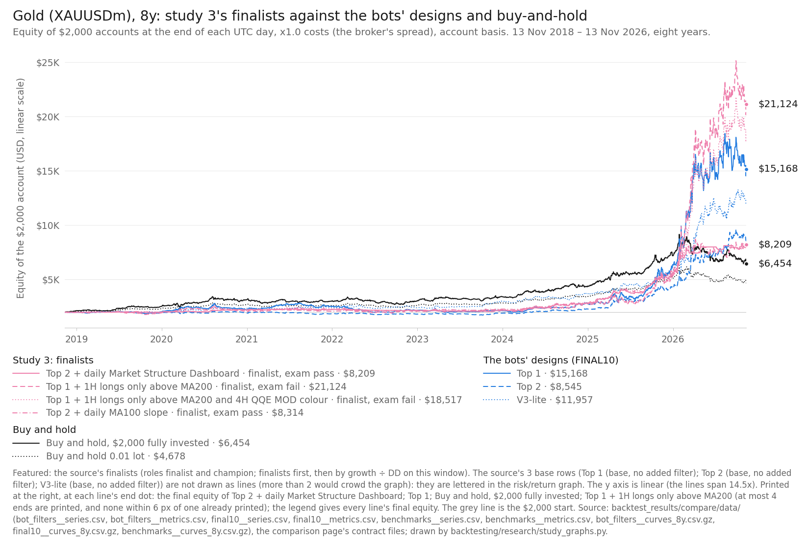
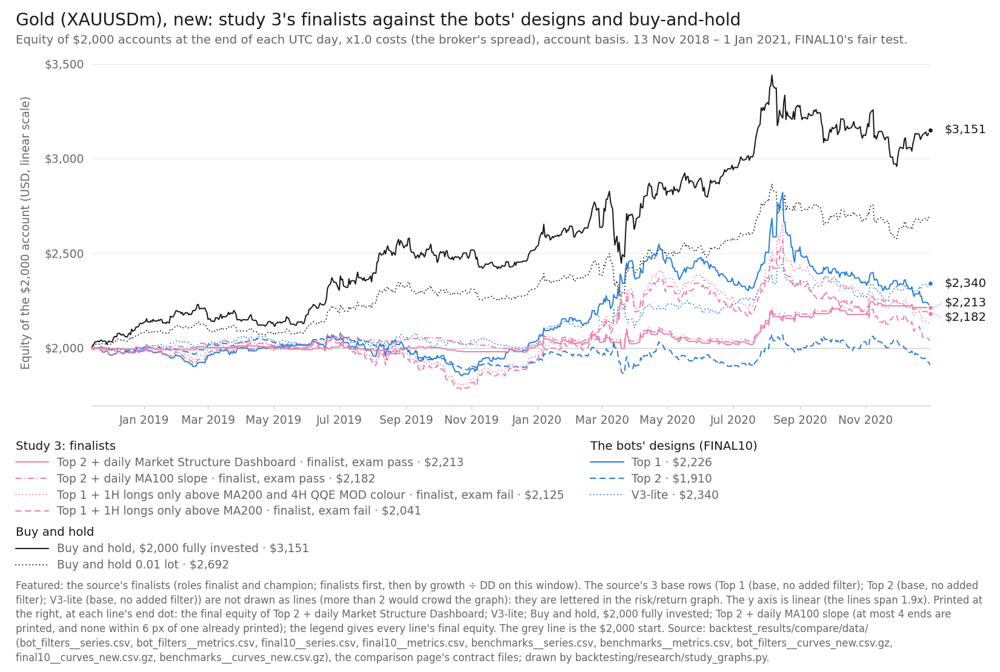
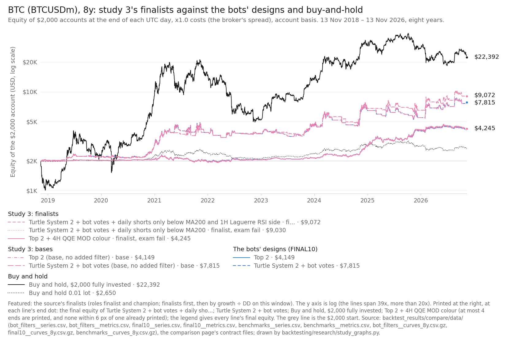
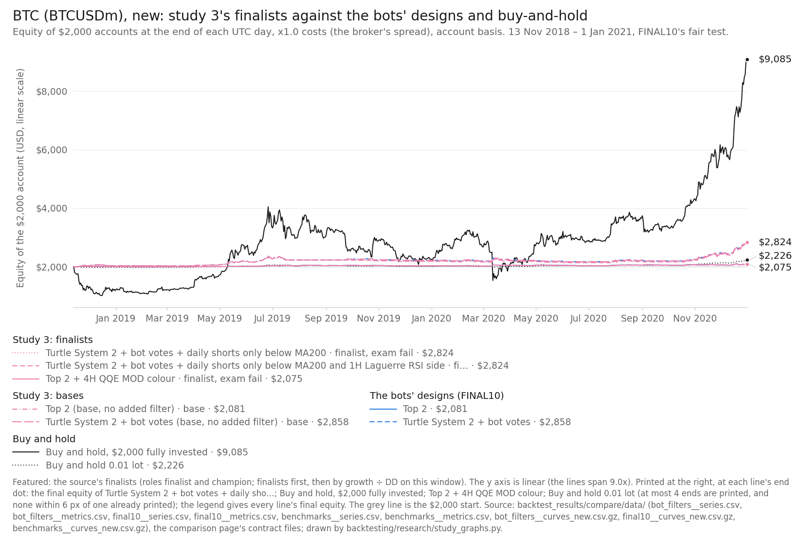

# Entry filters on the bots' designs: the results

28 Nov 2026, branch `backtest_hedging`. This is study 3. It tests entry filters on the five designs the bots run
(`backtest_results/final10/FINAL10.md`): gold V3-lite, Top 1 and Top 2, and BTC Top 2 and the Turtle. Your main idea
was the 200 moving average (MA200) on the 1-hour, 4-hour and daily charts. The filters of TradeIQ's two videos
(studies 1 and 2) and two session filters were tested too.

The rules were written down and frozen before any filter was run (`PREREG.md`). Every later reading of them is logged
in `DEVIATIONS.md`. `BUILD.md` shows that the code runs each design exactly as FINAL10 published it. The finalists were
frozen in `FINALISTS.md` before either exam window was computed. Every number below comes from the study's files,
read and scored with the study's own functions (`backtesting/research/bot_filters.py`), unless another file is named.

**How to read the numbers**

- **Base**: a design as the bot runs it, with no added filter. Every filter is compared with its own base.
- **Filter**: a rule that says, at every moment, whether a new long and a new short may open. It only blocks new
  entries. Exits, Top 1's add and the Turtle's pyramid adds are not touched.
- **The 23 Development quarters**: FINAL10's quarters from 1 Jan 2021 to 13 Nov 2026, each a fresh $2,000 account. They
  form five periods: 2021, 2022, 2023, 2024-25 and 2025-26.
- **Mean profit per quarter**: the average net profit per quarter in each period, then the average of the five periods.
- **Worst-quarter DD**: the largest max drawdown (% below the account's running peak) of the 23 quarters.
- **Score** (FINAL10's yardstick): mean profit per quarter / worst-quarter DD. Higher is better.
- **Periods up**: how many of the five periods made money.
- **Better**: a filter is better than its base when all four hold:
  1. its score is higher;
  2. it has no fewer periods up;
  3. it keeps at least 90% of the base's mean profit per quarter (the profit floor);
  4. no account is wiped and the worst-quarter DD is at most 50%.
- **Share**: a filter's mean profit per quarter as a % of its base's.
- **Per second, raw ticks, timings.** Development runs the four tick designs on per-second prices with one loop timing.
  The confirmation and the exam replay every raw tick eight times, each with another loop timing (the moment the bot
  polls), and take the median of each quarter (FINAL10's format). The Turtle runs on M1 bars and has no loop timing.
- **The sealed exam**, computed only after `FINALISTS.md` was frozen:
  - **T1**: 13 Nov 2018 to 1 Jan 2021, both symbols. It is FINAL10's "new" window, its fair test.
  - **T2**: 3 Jan 2017 to 13 Nov 2018, gold only. BTC has no older data.
- **CAGR**: growth a year. **Max DD**: the biggest fall below the account's running peak, in %. **Growth / DD** = CAGR %
  / max DD %.

## 1. The answer

1. **Which design improved in the sealed exam?** Only **gold Top 2**, with either of two daily filters. Both passed T1
   and T2:
   - `SLOPE100-D1`, the daily MA100 slope: longs only while the daily MA100 is above its value 5 days earlier, shorts
     only while it is below.
   - `MSD-D1`, study 2's Market Structure Dashboard on the daily chart: longs only while its bias is LEAN BULL or
     BULLISH, shorts only while it is LEAN BEAR or BEARISH.

   In both sealed windows Top 2 itself lost money: −$2.70 a quarter in T1 and −$5.87 in T2. With `SLOPE100-D1` it made
   +$14.53 and +$12.87. With `MSD-D1` it made +$18.45 in T1 and lost less in T2 (−$1.13).

   Every other finalist failed:
   - gold Top 1's two (longs only above the 1H MA200, alone and with the 4H QQE MOD) failed T1 and T2;
   - BTC Top 2's 4H QQE MOD failed T1;
   - the Turtle's two (shorts only below the daily MA200, alone and with the 1H Laguerre RSI) failed T1;
   - gold V3-lite had no finalist: its only candidate, the 4H QQE MOD, failed the raw-tick confirmation.

2. **Your MA200 idea.** Six kinds of MA200 filter on the 1H, 4H and daily charts: 18 per design, 90 in all.
   - 24 of the 90 raised the score. Only 7 passed all four rules of "better": 4 on 1H, 1 on 4H and 2 on daily.
   - Two of them reached the finals, alone and in a pair. All four of those finalists failed the exam. Neither exam
     pass is an MA200 filter.
   - **Gold V3-lite:** 11 of 18 raised the score, all but one on 4H and daily. They cut the worst-quarter drawdown
     from 45% to 17-26%, but kept only 46-87% of the profit, so none passed. The best, shorts only below the 4H MA200,
     scored 6.83 against 3.02 with 87% of the profit. FINAL10 found the same for its 200-day filter: less drawdown,
     less profit.
   - **Gold Top 1:** 2 of 18 passed: longs only above the 1H MA200 (6.75 against 4.02, with 159% of the profit) and
     the same on 4H (4.03 against 4.02, almost a tie). The 1H gate made almost all of its gain in 2025-26. It failed
     both sealed windows: in T1 it made $9.80 a quarter against the base's $49.00, and in T2 it lost $1.67 a quarter
     while the base made $15.36.
   - **Gold Top 2:** 7 of 18 raised the score. One passed (price above / below the 1H MA200: 6.43 against 6.32), but
     it ranked too low to be a candidate. The six 4H and daily rows that raised the score cut the worst-quarter
     drawdown from 18.5% to 12-14%, but kept only 80% to 89.9% of the profit.
   - **BTC Top 2:** none of the 18 raised the score.
   - **BTC Turtle:** 4 of 18 passed, and six 1H and 4H rows did not change a single quarter. The best, shorts only
     below the daily MA200 (`SGATE200-D1`), failed T1. It changed one quarter of T1 and made $33 less there.

3. **The video filters.**
   - **Video 1** (TSI, Laguerre RSI, QQE MOD, Volume Weighted RSI): 11 of 60 rows passed "better". Six of them are 1H
     and 4H rows on the Turtle that change one or two quarters each. None survived: V3-lite's 4H QQE MOD failed the
     confirmation, BTC Top 2's 4H QQE MOD failed T1, and the two pairs that used QQE MOD (gold Top 1) and the Laguerre
     RSI (the Turtle) failed the exam.
   - **Video 2** (Trend Target Ribbon, Market Structure Dashboard, Heikin Ashi): 5 of 45 passed. The ribbon passed on
     no design. Heikin Ashi passed only on the Turtle's 1H, by a hair (4.057 against 4.056). The dashboard passed on
     all three gold Top 2 charts and on the Turtle's 1H. The daily dashboard is one of the two exam passes.
   - **Heikin Ashi exits on the Turtle:** all four made it worse (scores 0.65 to 3.49 against 4.06, with 20-79% of the
     profit).
   - **The New York session filters** (Session Hunter's hours) raised no score on any design. They kept between −9%
     (BTC Top 2) and 86% (the Turtle) of the profit.
   - **Pairs** of each design's three best filters: 12 pairs, 9 passed "better". Two became finalists (gold Top 1 and
     the Turtle). Both failed the exam.

4. **Should you change a live bot?**
   - **Gold V3-lite, gold Top 1, BTC Top 2 and the Turtle: no.** No filter passed the exam on them (V3-lite had none
     that reached it). Gold Top 1 with the 1H MA200 gate looks very strong over 5 years ($18,330 against $12,433), but
     it failed both sealed windows. Its gain lies in the years it was chosen on.
   - **Gold Top 2: the evidence supports one thing, and not another.**
     - **It supports this:** in 2017 to 2020, years on which no design or filter was chosen, a daily trend filter made
       Top 2 lose less or earn a little, with fewer trades and about half the drawdown.
     - **It does not support more profit over the long accounts.** Over 8 years, 5 years and the last year, both
       filtered accounts ended below Top 2 as it runs: 8y $8,314 and $8,209 against $8,545; 5y $7,490 and $7,586
       against $8,880; 1y $3,429 and $3,430 against $4,018. None of the 62 Top 2 variants made more money than the
       base over 5 years (SPA p = 1.00, section 7).
     - **Of the two, the dashboard filter (`MSD-D1`) had the lower drawdown** over 8 years, 5 years, "new" and the
       last year. It had a lower max drawdown than the base on every window (8 years: 11.0% against 17.1%) and a better
       growth / DD over 8 years (1.76 against 1.16), 5 years (2.50 against 2.27) and T1. The MA100 slope did better in
       T2 (+$12.87 a quarter against −$1.13), but it had a higher drawdown than the base over 8 years, 5 years and the
       last year.
     - **So:** if a lower drawdown on gold Top 2 matters more to you than 5% (8 years) to 29% (the last year) of its net
       profit, `MSD-D1` is the filter to try, first on a demo account next to the live bot. If profit comes first,
       which is why the plan has its 90% profit floor, keep Top 2 as it is.
   - Live changes are your decision. This study changes no bot (PREREG 1).

## 2. What was tested

**The five designs**, run exactly as FINAL10 runs them. Before any filter ran, an always-allow filter reproduced every
design trade for trade (`BUILD.md`; BTC Top 2 in `DEVIATIONS.md` item 14).

| Design | Symbol | Engine | FINAL10's score | Base score here, per second (the Turtle: M1 bars) | Base score here, raw ticks | Periods up | Eligible by FINAL10's rule |
|---|---|---|---|---|---|---|---|
| V3-lite | gold | tick engine | 3.09 | 3.02 | 3.08 | 5 of 5 | yes |
| Top 1 | gold | tick engine | 3.92 | 4.02 | 3.94 | 3 of 5 | no |
| Top 2 | gold | tick engine | 6.20 | 6.32 | 6.28 | 3 of 5 | no |
| Top 2 | BTC | tick engine | 4.49 | 4.63 | 4.55 | 4 of 5 | yes |
| Turtle System 2 + bot votes | BTC | M1-bar model | 4.65 | 4.06 | (no timing) | 5 of 5 | yes |

- The bases were recomputed on today's data before any filter ran (PREREG 5), and every filter is compared with them.
- On raw ticks the four tick bases equal FINAL10's evidence in every period except 2021, where they differ by $0.64 to
  $6.83 a quarter (my comparison with `final10/evidence.csv`).
- The Turtle's base is lower than FINAL10's 4.65 because of one date. FINAL10's bar runs started 2021 on 1 Feb
  (`WARM_BLOCKS` in `final10.py`; first block, Feb-Mar, +$583 in `final10/warm_external.csv`). This study uses FINAL10's
  tick-design quarters, which start on 1 Jan (+$425, with a 25.4% drawdown). The other three 2021 quarters and the
  other four periods are the same in both.

**The 59 single filters per design** (PREREG 3). Values come from closed bars only and take effect at the first tick
after the bar closes.

| Family | What it allows | Charts | Rows |
|---|---|---|---|
| `SIDE(n)` | longs only above the n-bar moving average, shorts only below; n = 50, 100, 200 | 1H, 4H, daily | 9 |
| `SLOPE(n)` | longs only while the moving average is above its value 5 bars earlier, shorts only while below | 1H, 4H, daily | 9 |
| `TREND(n)` | `SIDE` and `SLOPE` together | 1H, 4H, daily | 9 |
| `CROSS` | longs only while the MA50 is above the MA200, shorts only while below | 1H, 4H, daily | 3 |
| `LGATE200` | longs only above the MA200; shorts always allowed | 1H, 4H, daily | 3 |
| `SGATE200` | shorts only below the MA200; longs always allowed | 1H, 4H, daily | 3 |
| `TSI` (video 1) | longs only while the TSI (5, 25) is above 0, shorts only while below | 1H, 4H, daily | 3 |
| `LARSI` (video 1) | longs only while the Laguerre RSI is above 50, shorts only while below | 1H, 4H, daily | 3 |
| `QQE` (video 1) | no long on a red QQE MOD bar, no short on a blue one; a gray bar allows both | 1H, 4H, daily | 3 |
| `VWRSI` (video 1) | the Volume Weighted RSI above / below 50 (gold: tick volume; BTC: Binance volume) | 1H, 4H, daily | 3 |
| `RIB` (video 2) | the Trend Target Ribbon's trend up / down | 1H, 4H, daily | 3 |
| `MSD` (video 2) | the dashboard's bias: LEAN BULL or BULLISH for longs, LEAN BEAR or BEARISH for shorts | 1H, 4H, daily | 3 |
| `HA` (video 2) | the last closed Heikin Ashi candle bullish / bearish | 1H, 4H, daily | 3 |
| `SESS-KZ` | entries only 02:00-05:00 or 07:00-11:00 New York time | | 1 |
| `SESS-LN` | entries only 02:00-11:00 New York time | | 1 |

- **Your MA200 idea** is the 18 MA200 rows: `SIDE200`, `SLOPE200`, `TREND200`, `CROSS`, `LGATE200` and `SGATE200`
  on the three charts.
- The four tick designs keep their own trend gate (the sign of the 1H MACD signal line). A filter can only block more.
- **Pairs** (stage 2): per design, the AND of every pair among its three best single filters, using only filters with a
  higher score than the base. That gave 3 pairs each for gold V3-lite, Top 1, Top 2 and the Turtle, and none for BTC
  Top 2 (only one filter beat its score).
- **Turtle exits:** exit on a Heikin Ashi colour flip against the position (`HA-M1`), or when the Heikin Ashi streak
  reaches its rare age, the 90th percentile (`HA-M4`), each on 4H and daily: 4 variants.
- **In all: 311 variants** (295 single filters, 12 pairs, 4 exits).

**The selection** (PREREG 5 and 6):
1. Development: every variant is scored on the 23 quarters, per second (the Turtle on M1 bars).
2. Candidates: per design, the three "better" variants with the highest score.
3. Confirmation (tick designs only): the candidates and the base are rerun on raw ticks under eight timings. A candidate
   must still be "better".
4. Finalists: up to two confirmed candidates per design, frozen in `FINALISTS.md`.
5. The exam: on each sealed window a finalist passes when its score over the window's quarters is at least the base's
   **and** its mean profit per quarter is at least 90% of the base's (at least the base's when the base's mean is 0 or
   below). Gold finalists must pass T1 and T2; BTC finalists T1.

## 3. Development: 23 quarters, 2021 to 2026

How many filters beat each base (from `dev_<design>.csv`, scored with `score_dev`):

| Design | Variants | Raised the score | "Better" (all four rules) | Candidates |
|---|---|---|---|---|
| Gold V3-lite | 62 | 21 | 1 | `QQE-H4` |
| Gold Top 1 | 62 | 10 | 10 | `LGATE200-H1&QQE-H4`, `LGATE200-H1`, `LGATE200-H1&VWRSI-H4` |
| Gold Top 2 | 62 | 21 | 11 | `SLOPE100-D1`, `MSD-D1`, `SIDE50-D1` |
| BTC Top 2 | 59 | 1 | 1 | `QQE-H4` |
| BTC Turtle | 66 | 20 | 20 | `SGATE200-D1&LARSI-H1`, `SGATE200-D1`, `SGATE200-D1&MSD-H1` |
| **All** | **311** | **73** | **43** | |

### Each design's base and its best filters

Each table shows the base, the five variants with the highest scores, and any candidate below them. "Trades" is the
sum over the 23 quarters.

**Gold V3-lite**

| Variant | Filter in words | Score | Mean profit per quarter | Share | Worst-quarter DD | Periods up | Trades | Better? |
|---|---|---|---|---|---|---|---|---|
| **Base** | the design as it runs | 3.02 | +$136.53 | 100% | 45.2% | 5 of 5 | 584 | |
| `SGATE200-H4` | 4H shorts only below MA200 | 6.83 | +$119.04 | 87% | 17.4% | 5 of 5 | 523 | no: profit below 90% |
| `SIDE200-H4` | 4H MA200 side | 4.80 | +$83.68 | 61% | 17.4% | 4 of 5 | 472 | no: 4 periods up, profit below 90% |
| `SIDE200-H4&SGATE200-H4` | the two above together (the same rule as `SIDE200-H4`) | 4.80 | +$83.68 | 61% | 17.4% | 4 of 5 | 472 | no: 4 periods up, profit below 90% |
| `SLOPE100-D1` | daily MA100 slope | 4.23 | +$106.35 | 78% | 25.2% | 4 of 5 | 415 | no: 4 periods up, profit below 90% |
| `QQE-H1` | 1H QQE MOD colour | 4.05 | +$101.33 | 74% | 25.0% | 4 of 5 | 521 | no: 4 periods up, profit below 90% |
| `QQE-H4` (candidate) | 4H QQE MOD colour | 3.06 | +$138.16 | 101% | 45.2% | 5 of 5 | 586 | **yes** |

- The base's worst quarter is 13 Nov 2025 to 13 Feb 2026 (a 45.2% drawdown). The high scores come from cutting that
  quarter, at a cost of 13% to 39% of the profit.
- The only "better" filter, the 4H QQE MOD, changed just 3 of the 23 quarters.

**Gold Top 1**

| Variant | Filter in words | Score | Mean profit per quarter | Share | Worst-quarter DD | Periods up | Trades | Better? |
|---|---|---|---|---|---|---|---|---|
| **Base** | the design as it runs | 4.02 | +$166.87 | 100% | 41.6% | 3 of 5 | 878 | |
| `LGATE200-H1&QQE-H4` (**finalist**) | 1H longs only above MA200 and 4H QQE MOD colour | 6.81 | +$267.21 | 160% | 39.2% | 4 of 5 | 827 | **yes** |
| `LGATE200-H1` (**finalist**) | 1H longs only above MA200 | 6.75 | +$264.84 | 159% | 39.2% | 4 of 5 | 830 | **yes** |
| `LGATE200-H1&VWRSI-H4` (candidate) | 1H longs only above MA200 and 4H Volume Weighted RSI side | 6.21 | +$243.84 | 146% | 39.3% | 4 of 5 | 749 | **yes** |
| `VWRSI-H4` | 4H Volume Weighted RSI side | 5.63 | +$220.96 | 132% | 39.3% | 4 of 5 | 762 | **yes** |
| `QQE-H4` | 4H QQE MOD colour | 5.56 | +$218.08 | 131% | 39.2% | 3 of 5 | 874 | **yes** |

- Almost all of the 1H MA200 gate's gain came in 2025-26: +$1,185.91 a quarter against the base's +$707.28. One quarter
  carries much of it: 13 Nov 2025 to 13 Feb 2026, +$981.83 against −$25.69.

**Gold Top 2**

| Variant | Filter in words | Score | Mean profit per quarter | Share | Worst-quarter DD | Periods up | Trades | Better? |
|---|---|---|---|---|---|---|---|---|
| **Base** | the design as it runs | 6.32 | +$117.03 | 100% | 18.5% | 3 of 5 | 920 | |
| `SLOPE100-D1` (**finalist**) | daily MA100 slope | 9.42 | +$115.99 | 99% | 12.3% | 4 of 5 | 610 | **yes** |
| `MSD-D1` (**finalist**) | daily Market Structure Dashboard | 9.27 | +$114.19 | 98% | 12.3% | 4 of 5 | 448 | **yes** |
| `SIDE50-D1` (candidate) | daily MA50 side | 8.96 | +$116.76 | 100% | 13.0% | 4 of 5 | 668 | **yes** |
| `SLOPE100-D1&MSD-D1` | daily MA100 slope and daily dashboard | 8.93 | +$109.96 | 94% | 12.3% | 4 of 5 | 404 | **yes** |
| `SIDE50-D1&MSD-D1` | daily MA50 side and daily dashboard | 8.81 | +$108.47 | 93% | 12.3% | 3 of 5 | 379 | **yes** |

- The three daily single filters kept 98-100% of the profit and raised the score by cutting the drawdown. The base's
  worst quarter (13 Feb to 13 May 2026, 18.5%) fell to 9.2% with `SLOPE100-D1` and 5.8% with `MSD-D1`.
- They also trade less: 610 and 448 trades against 920.
- With 4 of 5 periods up, both finalists would be eligible by FINAL10's rule. The base (3 of 5) is not.

**BTC Top 2**

| Variant | Filter in words | Score | Mean profit per quarter | Share | Worst-quarter DD | Periods up | Trades | Better? |
|---|---|---|---|---|---|---|---|---|
| **Base** | the design as it runs | 4.63 | +$45.38 | 100% | 9.8% | 4 of 5 | 755 | |
| `QQE-H4` (**finalist**) | 4H QQE MOD colour | 4.84 | +$47.45 | 105% | 9.8% | 4 of 5 | 757 | **yes** |
| `SIDE200-H1` | 1H MA200 side | 4.51 | +$42.57 | 94% | 9.4% | 4 of 5 | 747 | no: lower score |
| `TSI-H4` | 4H TSI side | 4.47 | +$44.46 | 98% | 9.9% | 4 of 5 | 746 | no: lower score |
| `QQE-D1` | daily QQE MOD colour | 4.42 | +$42.37 | 93% | 9.6% | 5 of 5 | 676 | no: lower score |
| `VWRSI-H4` | 4H Volume Weighted RSI side | 4.25 | +$40.68 | 89.6% | 9.6% | 3 of 5 | 739 | no: lower score, 3 periods up, profit below 90% |

- Only one of 59 filters raised the score, so there were no pairs. The 4H QQE MOD changed 8 of the 23 quarters.

**BTC Turtle System 2 + bot votes** (scores with three decimals: the differences are small)

| Variant | Filter in words | Score | Mean profit per quarter | Share | Worst-quarter DD | Periods up | Trades | Better? |
|---|---|---|---|---|---|---|---|---|
| **Base** | the design as it runs | 4.056 | +$103.07 | 100% | 25.4% | 5 of 5 | 53 | |
| `SGATE200-D1&LARSI-H1` (**finalist**) | daily shorts only below MA200 and 1H Laguerre RSI side | 4.608 | +$117.10 | 114% | 25.4% | 5 of 5 | 43 | **yes** |
| `SGATE200-D1` (**finalist**) | daily shorts only below MA200 | 4.566 | +$116.04 | 113% | 25.4% | 5 of 5 | 44 | **yes** |
| `SGATE200-D1&MSD-H1` (candidate) | daily shorts only below MA200 and 1H dashboard | 4.355 | +$110.69 | 107% | 25.4% | 5 of 5 | 39 | **yes** |
| `LARSI-H1&MSD-H1` | 1H Laguerre RSI side and 1H dashboard | 4.242 | +$107.81 | 105% | 25.4% | 5 of 5 | 42 | **yes** |
| `MSD-H1` | 1H dashboard | 4.200 | +$106.75 | 104% | 25.4% | 5 of 5 | 43 | **yes** |

- The Turtle trades rarely: 53 trades in 23 quarters. 12 of its 20 "better" variants changed only one or two quarters.
- The finalists changed 10 and 11 quarters. Most of their gain came in 2024-25 (+$245.76 a quarter against +$198.48).
  The worst quarter (1 Jan to 1 Apr 2021, 25.4%) did not change.

### Your MA200 idea, chart by chart

Each cell is the score, with the share of the base's profit in brackets. **Bold**: "better" (all four rules). ↑: a
higher score than the base, but it failed another rule (the profit floor or the periods up). "Same as the base": the
filter did not change one of the 23 quarters.

**Gold V3-lite**: base score 3.02, 5 of 5 periods up

| MA200 filter | 1H | 4H | Daily |
|---|---|---|---|
| `SIDE200`: price above / below the MA200 | 2.71 (69%) | 4.80 (61%) ↑ | 3.44 (63%) ↑ |
| `SLOPE200`: MA200 rising / falling | 2.25 (55%) | 3.52 (64%) ↑ | 3.38 (62%) ↑ |
| `TREND200`: both of the above | 2.11 (45%) | 3.16 (57%) ↑ | 3.10 (57%) ↑ |
| `CROSS`: MA50 above / below the MA200 | 3.30 (63%) ↑ | 3.46 (46%) ↑ | 3.58 (66%) ↑ |
| `LGATE200`: longs only above the MA200 | 2.33 (72%) | 1.74 (58%) | 2.85 (94%) |
| `SGATE200`: shorts only below the MA200 | 2.98 (75%) | 6.83 (87%) ↑ | 3.63 (67%) ↑ |

**Gold Top 1**: base score 4.02, 3 of 5 periods up

| MA200 filter | 1H | 4H | Daily |
|---|---|---|---|
| `SIDE200`: price above / below the MA200 | 2.99 (120%) | 2.55 (63%) | 1.32 (37%) |
| `SLOPE200`: MA200 rising / falling | 1.63 (65%) | 2.16 (56%) | 0.72 (20%) |
| `TREND200`: both of the above | 2.10 (76%) | 1.46 (40%) | 0.66 (18%) |
| `CROSS`: MA50 above / below the MA200 | 3.74 (105%) | 1.31 (37%) | 1.15 (32%) |
| `LGATE200`: longs only above the MA200 | **6.75 (159%)** | **4.03 (100%)** | 3.42 (85%) |
| `SGATE200`: shorts only below the MA200 | 2.61 (97%) | 2.91 (72%) | 1.57 (44%) |

**Gold Top 2**: base score 6.32, 3 of 5 periods up

| MA200 filter | 1H | 4H | Daily |
|---|---|---|---|
| `SIDE200`: price above / below the MA200 | **6.43 (93%)** | 4.05 (72%) | 8.16 (86%) ↑ |
| `SLOPE200`: MA200 rising / falling | 4.30 (72%) | 7.74 (87%) ↑ | 6.17 (85%) |
| `TREND200`: both of the above | 5.16 (82%) | 8.04 (89.9%) ↑ | 7.57 (80%) ↑ |
| `CROSS`: MA50 above / below the MA200 | 4.86 (76%) | 8.17 (86%) ↑ | 5.49 (86%) |
| `LGATE200`: longs only above the MA200 | 5.78 (97%) | 5.54 (83%) | 6.23 (99%) |
| `SGATE200`: shorts only below the MA200 | 5.44 (85%) | 5.37 (90%) | 7.42 (87%) ↑ |

**BTC Top 2**: base score 4.63, 4 of 5 periods up

| MA200 filter | 1H | 4H | Daily |
|---|---|---|---|
| `SIDE200`: price above / below the MA200 | 4.51 (94%) | 2.12 (47%) | 1.55 (42%) |
| `SLOPE200`: MA200 rising / falling | 2.06 (49%) | 2.05 (45%) | 1.04 (31%) |
| `TREND200`: both of the above | 2.83 (57%) | 2.38 (51%) | 1.28 (28%) |
| `CROSS`: MA50 above / below the MA200 | 2.30 (58%) | 0.47 (11%) | 0.20 (6%) |
| `LGATE200`: longs only above the MA200 | 4.15 (89.6%) | 4.19 (102%) | 3.85 (89%) |
| `SGATE200`: shorts only below the MA200 | 3.13 (75%) | 2.30 (52%) | 1.28 (36%) |

**BTC Turtle**: base score 4.056, 5 of 5 periods up

| MA200 filter | 1H | 4H | Daily |
|---|---|---|---|
| `SIDE200`: price above / below the MA200 | same as the base | same as the base | **4.147 (102%)** |
| `SLOPE200`: MA200 rising / falling | **4.130 (102%)** | 3.971 (98%) | 4.027 (99%) |
| `TREND200`: both of the above | **4.130 (102%)** | 3.971 (98%) | 3.915 (97%) |
| `CROSS`: MA50 above / below the MA200 | 3.994 (98%) | 3.978 (98%) | 3.551 (88%) |
| `LGATE200`: longs only above the MA200 | same as the base | same as the base | 3.637 (89.7%) |
| `SGATE200`: shorts only below the MA200 | same as the base | same as the base | **4.566 (113%)** |

In plain words:

| Chart | MA200 rows (5 designs x 6) | Raised the score | "Better" |
|---|---|---|---|
| 1H | 30 | 5 | 4 (Top 1 `LGATE200`, gold Top 2 `SIDE200`, Turtle `SLOPE200` and `TREND200`) |
| 4H | 30 | 9 | 1 (Top 1 `LGATE200`, almost a tie: 4.03 against 4.02) |
| Daily | 30 | 10 | 2 (Turtle `SIDE200` and `SGATE200`) |

- **On gold V3-lite and Top 2, the 4H and daily MA200 rows trade drawdown for profit.** The ones that raised the score
  did it by cutting the worst-quarter drawdown (V3-lite: from 45.2% to 17-25%; Top 2: from 18.5% to 12-14%). Each of
  them cost more than the 10% of profit the plan allows.
- **On gold Top 1, only "longs only above the MA200" helped**, on 1H and 4H. The other 16 rows lowered the score.
- **On BTC Top 2, nothing helped.** The best row kept 94% of the profit with a lower score.
- **On the Turtle the effects are small.** Six of the 1H and 4H rows (`SIDE200`, `LGATE200` and `SGATE200`) never
  changed a quarter, most likely because a 55-day breakout already lies on their side of the MA200.
- **The other moving averages** (`SIDE`, `SLOPE`, `TREND` with the MA50 and MA100, 18 rows per design) passed 0 times
  on V3-lite, 3 on Top 1, 3 on gold Top 2 (among them the finalist `SLOPE100-D1`), 0 on BTC Top 2 and 5 on the Turtle.

### The video filters and the sessions

Per design: the charts on which a family passed "better" (bold), else "none". In brackets: the best row that passed, or,
where none passed, the family's best row (chart, score and share of the base's profit).

| Filter | Gold V3-lite | Gold Top 1 | Gold Top 2 | BTC Top 2 | BTC Turtle |
|---|---|---|---|---|---|
| TSI side (video 1) | none (daily: 3.05, 56%) | none (1H: 3.65, 91%) | **daily** (6.69, 96%) | none (4H: 4.47, 98%) | **1H, 4H** (1H: 4.155, 102%) |
| Laguerre RSI side (video 1) | none (1H: 2.63, 82%) | none (4H: 2.47, 96%) | none (daily: 8.34, 88%) | none (1H: 2.42, 64%) | **1H** (4.197, 103%) |
| QQE MOD colour (video 1) | **4H** (3.06, 101%) | **4H** (5.56, 131%) | none (4H: 6.04, 96%) | **4H** (4.84, 105%) | **1H, 4H** (1H: 4.155, 102%) |
| Volume Weighted RSI side (video 1) | none (1H: 4.02, 74%) | **4H** (5.63, 132%) | none (4H: 4.99, 86%) | none (4H: 4.25, 89.6%) | **1H** (4.155, 102%) |
| Trend Target Ribbon (video 2) | none (1H: 3.40, 62%) | none (4H: 2.80, 97%) | none (daily: 6.78, 82%) | none (4H: 2.27, 63%) | none (4H: 4.033, 99%) |
| Market Structure Dashboard bias (video 2) | none (daily: 2.55, 47%) | none (4H: 2.36, 66%) | **1H, 4H, daily** (daily: 9.27, 98%) | none (1H: 2.06, 46%) | **1H** (4.200, 104%) |
| Heikin Ashi candle colour (video 2) | none (1H: 2.61, 81%) | none (daily: 4.00, 85%) | none (1H: 5.44, 81%) | none (1H: 3.94, 91%) | **1H** (4.057, 100%) |
| New York sessions | none (kill zones: 1.94, 35%) | none (kill zones: 2.52, 50%) | none (02-11 NY: 4.86, 64%) | none (02-11 NY: 0.03, 1%) | none (02-11 NY: 3.475, 86%) |

- **Video 1:** 11 of 60 rows passed. Six of them are on the Turtle and change one or two quarters each.
- **Video 2:** 5 of 45 passed: the dashboard on gold Top 2 (all three charts) and on the Turtle's 1H, and Heikin Ashi
  on the Turtle's 1H. The ribbon passed nowhere.
- **The dashboard is the odd one.** On gold Top 2 it passed on all three charts, and its daily row is a finalist. But it
  cut the profit of V3-lite, Top 1 and BTC Top 2 by a third or more.
- **Sessions:** no session row raised a score. On BTC Top 2 they removed all of the profit (kill zones: −9%) or nearly
  all (02-11 NY: 1%).

### Pairs and the Turtle's exits

| Design | Variant | Score | Share | Worst-quarter DD | Periods up | Better? |
|---|---|---|---|---|---|---|
| Gold V3-lite | `SIDE200-H4&SGATE200-H4` | 4.80 | 61% | 17.4% | 4 of 5 | no |
| Gold V3-lite | `SLOPE100-D1&SGATE200-H4` | 3.97 | 73% | 25.2% | 3 of 5 | no |
| Gold V3-lite | `SIDE200-H4&SLOPE100-D1` | 2.48 | 46% | 25.2% | 3 of 5 | no |
| Gold Top 1 | `LGATE200-H1&QQE-H4` (finalist) | 6.81 | 160% | 39.2% | 4 of 5 | yes |
| Gold Top 1 | `LGATE200-H1&VWRSI-H4` (candidate) | 6.21 | 146% | 39.3% | 4 of 5 | yes |
| Gold Top 1 | `QQE-H4&VWRSI-H4` | 5.45 | 128% | 39.3% | 4 of 5 | yes |
| Gold Top 2 | `SLOPE100-D1&MSD-D1` | 8.93 | 94% | 12.3% | 4 of 5 | yes |
| Gold Top 2 | `SIDE50-D1&MSD-D1` | 8.81 | 93% | 12.3% | 3 of 5 | yes |
| Gold Top 2 | `SIDE50-D1&SLOPE100-D1` | 8.70 | 92% | 12.3% | 4 of 5 | yes |
| BTC Turtle | `SGATE200-D1&LARSI-H1` (finalist) | 4.608 | 114% | 25.4% | 5 of 5 | yes |
| BTC Turtle | `SGATE200-D1&MSD-H1` (candidate) | 4.355 | 107% | 25.4% | 5 of 5 | yes |
| BTC Turtle | `LARSI-H1&MSD-H1` | 4.242 | 105% | 25.4% | 5 of 5 | yes |
| BTC Turtle | exit on a 4H Heikin Ashi flip (`HA-M1-H4`) | 1.807 | 35% | 20.2% | 4 of 5 | no |
| BTC Turtle | exit on a daily Heikin Ashi flip (`HA-M1-D1`) | 3.486 | 79% | 23.3% | 4 of 5 | no |
| BTC Turtle | exit at the 4H streak's rare age (`HA-M4-H4`) | 1.935 | 46% | 24.5% | 3 of 5 | no |
| BTC Turtle | exit at the daily streak's rare age (`HA-M4-D1`) | 0.652 | 20% | 32.1% | 4 of 5 | no |

- On gold Top 2 no pair beat the best single filter (9.42).
- The Heikin Ashi exits cut the Turtle's trades short: 71 to 140 trades against its 53, and less profit every time.

## 4. The confirmation on raw ticks

The candidates of the four tick designs and their bases, rerun on all 23 quarters on raw ticks under eight loop timings,
the median of each quarter (`confirm_<design>.csv`, scored with `score_confirm`). The Turtle's M1-bar model has no
loop timing, so it needs no confirmation (PREREG 5).

| Design | Variant | Development score (per second) | Confirmed score (raw ticks) | Mean profit per quarter | Worst-quarter DD | Periods up | Still better? | Result |
|---|---|---|---|---|---|---|---|---|
| Gold V3-lite | Base | 3.02 | 3.08 | +$139.61 | 45.3% | 5 of 5 | | |
| Gold V3-lite | `QQE-H4` | 3.06 | 3.12 | +$141.25 | 45.3% | 4 of 5 | no: 4 periods up against 5 | dropped |
| Gold Top 1 | Base | 4.02 | 3.94 | +$165.10 | 41.9% | 3 of 5 | | |
| Gold Top 1 | `LGATE200-H1&QQE-H4` | 6.81 | 6.43 | +$252.64 | 39.3% | 4 of 5 | yes | **finalist** |
| Gold Top 1 | `LGATE200-H1` | 6.75 | 6.34 | +$249.21 | 39.3% | 4 of 5 | yes | **finalist** |
| Gold Top 1 | `LGATE200-H1&VWRSI-H4` | 6.21 | 6.09 | +$238.29 | 39.1% | 4 of 5 | yes | third: not a finalist |
| Gold Top 2 | Base | 6.32 | 6.28 | +$115.43 | 18.4% | 3 of 5 | | |
| Gold Top 2 | `SLOPE100-D1` | 9.42 | 9.61 | +$120.23 | 12.5% | 4 of 5 | yes | **finalist** |
| Gold Top 2 | `MSD-D1` | 9.27 | 9.31 | +$116.46 | 12.5% | 4 of 5 | yes | **finalist** |
| Gold Top 2 | `SIDE50-D1` | 8.96 | 8.86 | +$117.37 | 13.3% | 4 of 5 | yes | third: not a finalist |
| BTC Top 2 | Base | 4.63 | 4.55 | +$44.54 | 9.8% | 4 of 5 | | |
| BTC Top 2 | `QQE-H4` | 4.84 | 4.77 | +$46.66 | 9.8% | 4 of 5 | yes | **finalist** |

- **V3-lite's only candidate dropped out.** On raw ticks its 2022 period turned to a loss (−$1.36 a quarter, against
  the base's +$3.05), so it had one period up fewer than the base. V3-lite has no finalist.
- Every other candidate stayed "better" on raw ticks. The best two of each design became its finalists (BTC Top 2 had
  only one candidate).
- The Turtle's finalists are its two best candidates: `SGATE200-D1&LARSI-H1` and `SGATE200-D1`.

## 5. The sealed exam

Each finalist against its base over the same quarters. The tick designs: raw ticks, the median of eight timings per
quarter. The Turtle: the M1-bar model. T1 has 9 quarters (a stub from 13 Nov 2018, then 2019 and 2020). T2 has 8 (2017,
2018 to 1 Oct, a stub to 13 Nov 2018). From `exam_<design>.csv`, judged with `exam_verdict`.

| Design | Finalist | T1 score: finalist / base | T1 mean profit per quarter: finalist / base | T1 | T2 score: finalist / base | T2 mean profit per quarter: finalist / base | T2 | Verdict |
|---|---|---|---|---|---|---|---|---|
| Gold Top 1 | `LGATE200-H1&QQE-H4` | 1.15 / 4.45 | +$14.52 / +$49.00 | fail | −1.83 / 2.29 | −$12.17 / +$15.36 | fail | **FAIL** |
| Gold Top 1 | `LGATE200-H1` | 0.78 / 4.45 | +$9.80 / +$49.00 | fail | −0.27 / 2.29 | −$1.67 / +$15.36 | fail | **FAIL** |
| Gold Top 2 | `SLOPE100-D1` | 3.18 / −0.31 | +$14.53 / −$2.70 | pass | 3.81 / −0.98 | +$12.87 / −$5.87 | pass | **PASS** |
| Gold Top 2 | `MSD-D1` | 4.03 / −0.31 | +$18.45 / −$2.70 | pass | −0.34 / −0.98 | −$1.13 / −$5.87 | pass | **PASS** |
| BTC Top 2 | `QQE-H4` | 4.62 / 4.94 | +$9.60 / +$10.25 | fail | (no T2) | | | **FAIL** |
| BTC Turtle | `SGATE200-D1&LARSI-H1` | 16.94 / 17.56 | +$99.45 / +$103.08 | fail | (no T2) | | | **FAIL** |
| BTC Turtle | `SGATE200-D1` | 16.94 / 17.56 | +$99.45 / +$103.08 | fail | (no T2) | | | **FAIL** |

How to read the verdicts:

- **Gold Top 1.** The 1H MA200 gate fell behind the base in both windows. In T1 it kept 20% of the base's profit per
  quarter (the pair 30%) with a higher worst-quarter drawdown (12.6% against 11.0%). In T2 the base made money and both
  finalists lost: they had 2 quarters up of 8, the base 5.
- **Gold Top 2.** The base lost in both windows. Both filters made it a winner in T1. In T2 `SLOPE100-D1` made money in
  7 of 8 quarters; `MSD-D1` lost a little, but less than the base. Since the base's mean was below 0, the rule asks
  only for a mean at least as high as the base's, so `MSD-D1` passes T2 while losing money. Both roughly halved the
  worst quarter's drawdown: T1 4.6% against 8.8%, T2 3.4% and 3.3% against 6.0%.
- **BTC Top 2.** The 4H QQE MOD changed 3 of the 9 T1 quarters and made $5.87 less in all. Its score fell short of
  the base's (4.62 against 4.94).
- **The Turtle.** Both finalists are the same in T1: the Laguerre RSI added nothing there. They changed one quarter,
  Jul-Sep 2019 (−$6.08 against +$26.55), and made $33 less over T1.
- **Clean tests.** PREREG 4 lists design-filter pairs that earlier work had already run on T1 ("not a clean test").
  None of them is a finalist, so by that list every verdict above is a clean test. What T1 and T2 had seen before is
  in section 9.

**The same windows per second** (one timing; `exam_sec_<design>.csv`). Every verdict is the same.

| Design | Window | Base: score (mean profit per quarter) | Finalist 1 | Finalist 2 |
|---|---|---|---|---|
| Gold Top 1 | T1 | 4.22 (+$46.30) | `LGATE200-H1&QQE-H4`: 1.88 (+$23.56) | `LGATE200-H1`: 1.51 (+$18.95) |
| Gold Top 1 | T2 | 1.66 (+$11.31) | −2.02 (−$13.76) | −0.48 (−$3.02) |
| Gold Top 2 | T1 | −1.25 (−$10.98) | `SLOPE100-D1`: 3.73 (+$17.19) | `MSD-D1`: 4.48 (+$20.63) |
| Gold Top 2 | T2 | −1.31 (−$7.85) | 4.43 (+$15.00) | −0.56 (−$1.87) |
| BTC Top 2 | T1 | 4.53 (+$9.44) | `QQE-H4`: 4.22 (+$8.78) | |

**The continuous accounts** over each window: one $2,000 account from the window's start, per second (the Turtle on
M1 bars). T1's account is FINAL10's "new" window.

| Design | Window | Account | Final equity | Net | Max DD | CAGR | Growth / DD | Trades |
|---|---|---|---|---|---|---|---|---|
| Gold Top 1 | T1 | Base | $2,226 | +$226 | 21.7% | 5.1% | 0.24 | 325 |
| Gold Top 1 | T1 | `LGATE200-H1&QQE-H4` | $2,125 | +$125 | 20.5% | 2.9% | 0.14 | 312 |
| Gold Top 1 | T1 | `LGATE200-H1` | $2,041 | +$41 | 21.2% | 1.0% | 0.05 | 314 |
| Gold Top 1 | T2 | Base | $2,126 | +$126 | 6.6% | 3.3% | 0.51 | 278 |
| Gold Top 1 | T2 | `LGATE200-H1&QQE-H4` | $1,925 | −$75 | 9.7% | −2.0% | −0.21 | 268 |
| Gold Top 1 | T2 | `LGATE200-H1` | $2,011 | +$11 | 8.9% | 0.3% | 0.03 | 267 |
| Gold Top 2 | T1 | Base | $1,910 | −$90 | 10.7% | −2.1% | −0.20 | 358 |
| Gold Top 2 | T1 | `SLOPE100-D1` | $2,182 | +$182 | 4.7% | 4.2% | 0.89 | 250 |
| Gold Top 2 | T1 | `MSD-D1` | $2,213 | +$213 | 4.6% | 4.9% | 1.06 | 174 |
| Gold Top 2 | T2 | Base | $1,952 | −$48 | 7.6% | −1.3% | −0.17 | 308 |
| Gold Top 2 | T2 | `SLOPE100-D1` | $2,125 | +$125 | 3.3% | 3.3% | 1.01 | 190 |
| Gold Top 2 | T2 | `MSD-D1` | $1,985 | −$15 | 3.8% | −0.4% | −0.11 | 118 |
| BTC Top 2 | T1 | Base | $2,081 | +$81 | 2.3% | 1.9% | 0.84 | 322 |
| BTC Top 2 | T1 | `QQE-H4` | $2,075 | +$75 | 2.2% | 1.7% | 0.78 | 322 |
| BTC Turtle | T1 | Base | $2,858 | +$858 | 9.4% | 18.2% | 1.93 | 14 |
| BTC Turtle | T1 | `SGATE200-D1&LARSI-H1` | $2,824 | +$824 | 10.9% | 17.5% | 1.62 | 15 |
| BTC Turtle | T1 | `SGATE200-D1` | $2,824 | +$824 | 10.9% | 17.5% | 1.62 | 15 |

- The continuous accounts tell the same story as the quarters. Gold Top 2 with either filter ended both windows above
  the base, with about half of the base's drawdown or less, and 38% to 70% of its trades. Every other finalist ended
  below its base.

**The forward period** (from 13 Nov 2026 to the end of the data: 26 Nov 00:00 UTC for gold, 27 Nov 00:00 UTC for BTC;
information only). Every finalist equals its base to the cent: gold Top 1 +$78.37, gold Top 2 +$249.87, BTC Top 2
+$51.63, the Turtle +$346.37 (`forward_<design>.csv`). The filters did not change one trade in these two weeks.

## 6. The money: $2,000 accounts

The comparison accounts of each base and its finalists: $2,000, FINAL10's unit rule (0.01 lot, plus 0.01 lot for every
full $2,500 of balance, at most 0.10 lot), Exness bid and ask on every fill, no swap. From `compare_<design>.csv`
(`compare_accounts`). The same rows are on the comparison page:
`backtest_results/compare/data/bot_filters__metrics.csv`.

- **8y** = 13 Nov 2018 to 13 Nov 2026, **5y** = 13 Nov 2021 to 13 Nov 2026, **new** = T1, **1y** = 13 Nov 2025 to 13
  Nov 2026.
- **Who chose on which years.** The designs were chosen on data from 2021 on, and the filters on 2021 to 2026. So 5y
  and 1y are in-sample, "new" is out-of-sample, and 8y mixes both.
- The tick designs: 8y, 5y and new per second; 1y on raw ticks, where the final equity and max DD are the median of the
  eight timings (their range in brackets) and the trades are the middle timing run's (FINAL10's convention). The Turtle:
  M1 bars.
- Every base below equals FINAL10's published account to the cent (`final10__metrics.csv`).

**Gold V3-lite** (no finalist; the base for reference)

| Window | Account | Final equity | Net | CAGR | Max DD | Growth / DD | Trades |
|---|---|---|---|---|---|---|---|
| 8y | Base | $11,957 | +$9,957 | 25.0% | 33.0% | 0.76 | 809 |
| 5y | Base | $10,748 | +$8,748 | 40.0% | 30.6% | 1.31 | 517 |
| new | Base | $2,340 | +$340 | 7.6% | 8.5% | 0.89 | 201 |
| 1y | Base | $3,656 ($3,508 to $3,794) | +$1,656 | 82.9% | 45.3% | 1.83 | 99 |

**Gold Top 1**

| Window | Account | Final equity | Net | CAGR | Max DD | Growth / DD | Trades |
|---|---|---|---|---|---|---|---|
| 8y | Base | $15,168 | +$13,168 | 28.8% | 32.5% | 0.89 | 1,240 |
| 8y | `LGATE200-H1&QQE-H4` | $18,517 | +$16,517 | 32.1% | 29.1% | 1.10 | 1,178 |
| 8y | `LGATE200-H1` | $21,124 | +$19,124 | 34.3% | 29.6% | 1.16 | 1,182 |
| 5y | Base | $12,433 | +$10,433 | 44.1% | 31.5% | 1.40 | 783 |
| 5y | `LGATE200-H1&QQE-H4` | $18,326 | +$16,326 | 55.8% | 31.4% | 1.78 | 737 |
| 5y | `LGATE200-H1` | $18,330 | +$16,330 | 55.8% | 31.1% | 1.79 | 739 |
| new | Base | $2,226 | +$226 | 5.1% | 21.7% | 0.24 | 325 |
| new | `LGATE200-H1&QQE-H4` | $2,125 | +$125 | 2.9% | 20.5% | 0.14 | 312 |
| new | `LGATE200-H1` | $2,041 | +$41 | 1.0% | 21.2% | 0.05 | 314 |
| 1y | Base | $4,165 ($3,662 to $4,474) | +$2,165 | 108.4% | 41.9% | 2.59 | 158 |
| 1y | `LGATE200-H1&QQE-H4` | $8,979 ($8,448 to $9,078) | +$6,979 | 349.4% | 39.3% | 8.89 | 150 |
| 1y | `LGATE200-H1` | $8,979 ($8,448 to $9,078) | +$6,979 | 349.4% | 39.3% | 8.89 | 150 |

**Gold Top 2**

| Window | Account | Final equity | Net | CAGR | Max DD | Growth / DD | Trades |
|---|---|---|---|---|---|---|---|
| 8y | Base | $8,545 | +$6,545 | 19.9% | 17.1% | 1.16 | 1,316 |
| 8y | `SLOPE100-D1` | $8,314 | +$6,314 | 19.5% | 21.1% | 0.92 | 887 |
| 8y | `MSD-D1` | $8,209 | +$6,209 | 19.3% | 11.0% | 1.76 | 634 |
| 5y | Base | $8,880 | +$6,880 | 34.7% | 15.3% | 2.27 | 814 |
| 5y | `SLOPE100-D1` | $7,490 | +$5,490 | 30.2% | 19.4% | 1.56 | 554 |
| 5y | `MSD-D1` | $7,586 | +$5,586 | 30.6% | 12.2% | 2.50 | 404 |
| new | Base | $1,910 | −$90 | −2.1% | 10.7% | −0.20 | 358 |
| new | `SLOPE100-D1` | $2,182 | +$182 | 4.2% | 4.7% | 0.89 | 250 |
| new | `MSD-D1` | $2,213 | +$213 | 4.9% | 4.6% | 1.06 | 174 |
| 1y | Base | $4,018 ($3,662 to $4,353) | +$2,018 | 101.0% | 17.3% | 5.83 | 157 |
| 1y | `SLOPE100-D1` | $3,429 ($2,465 to $3,516) | +$1,429 | 71.5% | 22.7% | 3.16 | 104 |
| 1y | `MSD-D1` | $3,430 ($2,730 to $3,447) | +$1,430 | 71.6% | 12.5% | 5.72 | 55 |

**BTC Top 2**

| Window | Account | Final equity | Net | CAGR | Max DD | Growth / DD | Trades |
|---|---|---|---|---|---|---|---|
| 8y | Base | $4,149 | +$2,149 | 9.5% | 16.6% | 0.57 | 1,110 |
| 8y | `QQE-H4` | $4,245 | +$2,245 | 9.9% | 17.5% | 0.56 | 1,112 |
| 5y | Base | $3,919 | +$1,919 | 14.4% | 16.1% | 0.90 | 675 |
| 5y | `QQE-H4` | $4,021 | +$2,021 | 15.0% | 16.1% | 0.93 | 677 |
| new | Base | $2,081 | +$81 | 1.9% | 2.3% | 0.84 | 322 |
| new | `QQE-H4` | $2,075 | +$75 | 1.7% | 2.2% | 0.78 | 322 |
| 1y | Base | $2,119 ($1,998 to $2,197) | +$119 | 5.9% | 13.1% | 0.45 | 138 |
| 1y | `QQE-H4` | $2,119 ($1,997 to $2,198) | +$119 | 5.9% | 13.1% | 0.45 | 138 |

**BTC Turtle System 2 + bot votes**

| Window | Account | Final equity | Net | CAGR | Max DD | Growth / DD | Trades |
|---|---|---|---|---|---|---|---|
| 8y | Base | $7,815 | +$5,815 | 18.6% | 32.5% | 0.57 | 60 |
| 8y | `SGATE200-D1&LARSI-H1` | $9,072 | +$7,072 | 20.8% | 27.3% | 0.76 | 51 |
| 8y | `SGATE200-D1` | $9,030 | +$7,030 | 20.7% | 27.3% | 0.76 | 52 |
| 5y | Base | $3,547 | +$1,547 | 12.1% | 38.4% | 0.32 | 41 |
| 5y | `SGATE200-D1&LARSI-H1` | $4,671 | +$2,671 | 18.5% | 30.2% | 0.61 | 32 |
| 5y | `SGATE200-D1` | $4,650 | +$2,650 | 18.4% | 30.3% | 0.61 | 33 |
| new | Base | $2,858 | +$858 | 18.2% | 9.4% | 1.93 | 14 |
| new | `SGATE200-D1&LARSI-H1` | $2,824 | +$824 | 17.5% | 10.9% | 1.62 | 15 |
| new | `SGATE200-D1` | $2,824 | +$824 | 17.5% | 10.9% | 1.62 | 15 |
| 1y | Base | $3,039 | +$1,039 | 52.0% | 22.4% | 2.32 | 7 |
| 1y | `SGATE200-D1&LARSI-H1` | $2,946 | +$946 | 47.3% | 22.4% | 2.11 | 6 |
| 1y | `SGATE200-D1` | $2,946 | +$946 | 47.3% | 22.4% | 2.11 | 6 |

What the tables say:

- **The failed finalists look best where they were chosen.** Gold Top 1's MA200 gate grew $2,000 to $18,330 over 5
  years against $12,433, and to $8,979 in the last year against $4,165. The Turtle's daily gate made more over 8 and 5
  years with less drawdown. On "new", the only out-of-sample window of these four, each of them ended below its base.
- **Their 8-year gains come from 2021-2026.** The 8-year account begins with the "new" window, where those finalists
  made less. So the gain comes from the years they were chosen on.
- **Gold Top 2 is the opposite case.** Both filters passed the exam, and both made less money where they were chosen
  (5y, 1y). On "new" they turned the base's loss into a profit. Over 8 years `MSD-D1` made $336 less (5% of the net)
  with a max DD of 11.0% against 17.1%. `SLOPE100-D1` made $231 less with a higher max DD (21.1%).
- **The yardstick and the accounts can disagree.** In Development the gold Top 2 finalists kept 98-99% of the base's
  profit per quarter. Over the 5-year account they made 19-20% less net. The yardstick starts each quarter from a fresh
  $2,000; the accounts compound, so the late years, traded at a larger size, weigh more. On 13 Feb 2026 both filtered
  5-year accounts were still ahead of the base (`SLOPE100-D1` $6,751, `MSD-D1` $6,482, the base $5,344;
  `daily5y_xau_top2.csv`). The whole gap opened in the last nine months, when the accounts were largest.
- **The 1y raw-tick runs are timing-sensitive.** Gold Top 2 with `SLOPE100-D1` ended anywhere from $2,465 to $3,516 in
  the eight timings.
- **BTC Top 2 with the 4H QQE MOD is nearly the base:** the two accounts are within $103 of each other on every window.
- For scale (`benchmarks__metrics.csv`), buy-and-hold with the $2,000 fully invested: gold 8y $6,454 (max DD 31.1%),
  new $3,151; BTC 8y $22,392 (max DD 77.6%), new $9,085. On "new", holding gold made more than every gold account above.

### The graphs

The equity, drawdown, risk/return and family graphs of these accounts are in `img/`, drawn by
`backtesting/research/study_graphs.py` from the comparison page's files. Each equity graph draws this study's finalists
against the bots' designs as they run (on BTC this study's bases, which equal FINAL10's accounts) and buy-and-hold.

The same for 5 years: `img/equity_XAUUSDm_5y.png`, `img/equity_BTCUSDm_5y.png`. The drawdown graphs are
`img/drawdown_<symbol>_<window>.png`, and the risk/return graphs `img/risk_return_<symbol>_<window>.png`.

## 7. Multiple testing

We tried 311 variants. The more you try, the more likely the best one looks good by luck. PREREG 7 asks for two checks
on the 5-year accounts (13 Nov 2021 to 13 Nov 2026, daily profit and loss; `multiple_testing.csv`).

| Design | Variants | SPA p-value | White's Reality Check p | Variants that made more than the base over 5 years (my count, `dev_<design>.csv`) | DSR, best 5-year Sharpe | DSR, best Development score | DSR of the base itself (my computation) |
|---|---|---|---|---|---|---|---|
| Gold V3-lite | 62 | 0.84 | 0.84 | 1 | 0.985 (`LGATE200-D1`) | 0.935 (`SGATE200-H4`) | 0.98 |
| Gold Top 1 | 62 | 0.28 | 0.42 | 5 | 0.987 (`LGATE200-H1`) | 0.987 (`LGATE200-H1&QQE-H4`) | 0.94 |
| Gold Top 2 | 62 | 1.00 | 1.00 | 0 | above 0.999 (`SIDE50-D1&MSD-D1`) | 0.993 (`SLOPE100-D1`) | 0.98 |
| BTC Top 2 | 59 | 0.80 | 0.89 | 4 | 0.90 (`SLOPE50-H1`) | 0.84 (`QQE-H4`) | 0.82 |
| BTC Turtle | 66 | 0.51 | 0.45 | 31 | 0.90 (`TREND200-D1`) | 0.83 (`SGATE200-D1&LARSI-H1`) | 0.70 |

**Hansen's SPA test** asks: does any variant earn more per day than its base, after allowing for the number of
variants tried? A p-value of 0.05 or less would be convincing. Here it is 0.28 at best.
- **Gold Top 2: p = 1.00.** None of its 62 variants made more money than the base over these 5 years, the two exam
  passes included. There is nothing for the test to find.
- **Gold Top 1: p = 0.28.** The 1H MA200 gate ended the 5 years at $18,330 against $12,433, and still the test cannot
  rule out luck: the extra profit came in 2025-26 (on 13 Aug 2025 the gate's account was $73 behind the base's).
- On the Turtle 10 of the 66 variants equal the base every day, so 56 entered the test.
- The test uses blocks of 8 weeks of days, 5,000 resamples and a fixed seed (DEVIATIONS item 9).

**The deflated Sharpe ratio (DSR)** is, roughly, the chance that the best variant's Sharpe ratio is real (above 0) after
allowing for the number of tries. A value of 0.95 would be convincing.
- On gold it is 0.94 to above 0.999. But this does not show that a filter helps. The variants are near-copies of their
  base, and the base itself scores almost as high: 0.94 to 0.98 on gold (my computation: `daily5y_<design>.csv` with
  the module's own method and the same bar of luck).
- So the high DSRs mostly reflect the gold designs' own positive Sharpe over these 5 years, which are in-sample for
  them. They do not say that a filter adds to it. On BTC no DSR reaches 0.95.

**What it means.** On the 5-year accounts the tests find no filter that beats its base by more than luck could
explain. The exam is the stronger evidence, and it gives one result: the two daily filters on gold Top 2. In T1 and
T2, where the base lost money, both did better than the base with a lower drawdown. Over 8 years, 5 years and the last
year both made less, and `SLOPE100-D1` also had a higher drawdown than the base there.

## 8. Compared with FINAL10 and studies 1-2

**With FINAL10** (`backtest_results/final10/FINAL10.md`; its rows on the page are `final10__*`).
- The bases here are FINAL10's designs. On 8y, 5y, new and 1y every base equals FINAL10's published account to the
  cent.
- **The 200-day filter.** FINAL10 found that its 200-day trend filter lowers V3-lite's drawdown, but lost in 2021 and
  earned far less in 2023-24 (§7, §10). The same filter here (`SIDE200-D1`, the same definition, PREREG 4) did the same:
  a score of 3.44 against 3.02, but 63% of the profit and 4 periods up of 5. In 2021 it lost $57.10 a quarter while
  V3-lite made $27.98. In 2023 it made $8.91 a quarter against $102.41.
- **Gold Top 2.** FINAL10 put it under "not for gold": it lost in 2021, 2022 and on the fair test (§10). On the fair
  test both exam passes turned the loss into a profit: on "new" Top 2 lost $90; with `SLOPE100-D1` it made $182, with
  `MSD-D1` $213. In Development each filter turns one of the two bad years positive. `SLOPE100-D1` made +$18.69 a
  quarter in 2022 (base −$10.08), and `MSD-D1` +$7.17 in 2021 (base −$11.65). Each still lost in the other year.

**With study 1** (TradeIQ's "RSI replacements" as stand-alone rules, `backtest_results/tradeiq_rsi/RESULTS.md`).
- Study 1 found that the MA200 filters helped its rules on BTC in all three periods (the 4H MA200 improved 30, 29 and 29
  of 30 one-hour rules), and were mixed on gold.
- On the bots' BTC designs that did not carry over. No MA200 row raised BTC Top 2's score, and the Turtle's daily gate
  failed T1.
- Study 1's four indicators did no better as filters on the bots. The 4H QQE MOD was the only one that passed on more
  than one design, and it failed both the confirmation (V3-lite) and the exam (BTC Top 2).

**With study 2** (TradeIQ's 2027 indicators, `backtest_results/tradeiq_2027/RESULTS.md`).
- Study 2 found the 4H MA200 the only filter that helped its rules on both markets. On the bots, the 4H MA200 rows
  passed once in 30: gold Top 1's longs-only gate, almost a tie (4.03 against 4.02).
- Study 2 found that the dashboard's bias did not help as a filter on study 1's rules (its claim 13). On gold Top 2 the
  daily dashboard is one of the two exam passes. On V3-lite, Top 1 and BTC Top 2 it cut the profit by a third or more.
- Study 2's Heikin Ashi trade management mostly did not make more money (its claims 3 and 4a). Here all four Heikin
  Ashi exits made the Turtle worse.

**Across the three studies.**
- In studies 1 and 2 the MA200 often helped simple indicator rules, which trade often (study 1: on BTC, mixed on gold;
  study 2: the 4H MA200 on both markets). The bots' tick designs already trade only in the direction of the 1H trend
  (the sign of the MACD signal line). An MA200 filter adds a second trend gate. On the bots that second gate mostly
  cut the profit along with the drawdown.
- In study 1, every bot design made more money than every TradeIQ finalist of its market (its section 9). In study 2
  that held over 5 years, but not everywhere: its gold ribbon finalist made more than Top 2 over 8 years, more than
  V3-lite in the last year and more than all three gold designs on "new" (its section 9). Study 2 still judged the
  bots' designs the better choice. Here the bots stay as they are, with one candidate for a demo test: gold Top 2 with
  the daily dashboard.

## 9. Caveats

- **Development is in-sample for the designs.** They were tuned on 2023-2026 data (PREREG 4). A filter that "helps" in
  these years may fit the same noise. Only the exam windows are free of that, and only the forward data will be free of
  everything.
- **The exam windows are short.** T1 has 9 quarters and T2 8. On BTC Top 2 and the Turtle the finalists changed only 3
  and 1 of the 9 T1 quarters, so T1 says little about them either way. On gold the finalists changed every quarter.
- **A pass on gold Top 2 is a pass against a weak base.** In 2017-2020 Top 2 itself lost money. `MSD-D1` passed T2 by
  losing less (−$1.13 a quarter against −$5.87).
- **Two kinds of account.** The yardstick uses fresh $2,000 quarters with no compounding. The comparison accounts
  compound. They can disagree, as on gold Top 2 (section 6).
- **Few trades on the Turtle:** 53 in the 23 Development quarters and 14-15 in T1. 12 of its 20 "better" variants
  changed only one or two quarters.
- **The bases' scores are not exactly FINAL10's** (section 2): the Turtle's first quarter starts on 1 Jan 2021 here and
  on 1 Feb in FINAL10's bar runs, and the tick bases differ a little in 2021. Every filter is compared with the base as
  recomputed here, so each comparison is like for like.
- **The dashboard repaints on TradingView.** `MSD-D1` reads study 2's port of the Market Structure Dashboard on closed
  daily bars, with its weekly row. On TradingView the script's higher-timeframe rows use the forming candle and change
  (study 2, claim 14). A bot would have to compute it from closed bars exactly as here.
- **Costs and sizing.** Exness bid and ask on every fill, no swap, no commission and no slippage beyond the quoted
  spread, stop-out at equity 0 (PREREG 2; FINAL10 §11). The live branches' 50% account share and their per-symbol
  steps are not modelled.
- **Many variants.** 311 variants were tried; the multiple-testing checks find no filter that beats its base beyond
  luck on the 5-year accounts (section 7).
- **The forward period** is 13 days on gold and 14 on BTC, and every finalist equals its base there.
- **BTC has no T2.** Its archive starts in January 2018, so BTC finalists took one exam.
- **What T1 and T2 had seen before.** FINAL10 had published the bases' T1 accounts (its "new" window). Earlier work had
  also run a few MA filters on T1 (PREREG 4), but none of the finalists. T2 had never been scored for any of the bots'
  designs. The indicators themselves had been seen on these years, on other rules: studies 1 and 2 chose their own
  rules on 2019 to June 2024 (T1's 2019 and 2020 included), and study 2 examined its own gold rules on 2017-2018 (its
  Early window) earlier on the same day as this exam. That is a leak at the level of the idea, not of these
  design-filter pairs: the finalists were picked mechanically on 2021-2026 data.
- **Not tested:** other moving averages (for example the EMA) or lengths, filters on the tick designs' exits, filters
  of three or more rules, other symbols, and the live branches' sizing.

## 10. Files

All in `backtest_results/bot_filters/` unless named otherwise. `<design>` is `xau_v3lite`, `xau_top1`, `xau_top2`,
`btc_top2` or `btc_turtle`.

- **The plan and its log:** `PREREG.md` (and its sha256), `DEVIATIONS.md`.
- **The build and its checks:** `BUILD.md`.
- **The freeze:** `FINALISTS.md` (and its sha256), written before T1, T2 or the forward period was computed.
- **Development:** `dev_<design>.csv` (every variant's 23 quarters and its 5-year account), `daily5y_<design>.csv` (the
  5-year daily equity).
- **The confirmation:** `confirm_<design>.csv` (the four tick designs; raw ticks, eight timings).
- **The exam:** `exam_<design>.csv` (raw ticks, eight timings; the Turtle on M1 bars), `exam_sec_<design>.csv` (per
  second, with the continuous accounts), `daily_exam_<design>.csv`, `forward_<design>.csv`,
  `daily_forward_<design>.csv`. Gold V3-lite has no finalist and so no exam files.
- **Multiple testing:** `multiple_testing.csv`.
- **The accounts:** `compare_<design>.csv`, `daily_compare_<design>.csv`, `daily_compare_ticks_<design>.csv` (each
  timing's 1y curve), and the comparison page's files `backtest_results/compare/data/bot_filters__*` (read by
  `backtest_results/compare/index.html`).
- **Graphs and page:** the graphs in `img/` (section 6) and `index.html`, the study's own interactive comparison page.
- **This report:** `RESULTS.md`.
- **Code:** `backtesting/research/bot_filters.py` (the filters, the runs, the guard, the score); the tests
  `tests/test_bot_filters.py`. The tables above were read and scored with its functions (`score_dev`, `score_confirm`,
  `exam_verdict`, `window_score`, `compare_accounts`). Its commands (`python -B -m backtesting.research.bot_filters
  score | select | mt | compare | export`, and the rest) are listed at the top of the module; `BUILD.md` lists those
  of the build.
