<!-- Generated: FINAL10.md is built from FINAL10.template.md by `python -m backtesting.research.final10 report`, which fills every table from the result files. Edit the template, not FINAL10.md. -->
# The final ten: 8 years, 5 years and the last year, gold and BTC

Every design and published strategy with results in all five earlier test periods, 165 in all, was narrowed to ten per symbol by one fixed rule. The rule and the test plan were frozen and pushed before any strategy was run on the older data (commit `5d1e10e`). The ten then ran on fresh $2,000 accounts over four windows:
- eight years, Nov 2018 – Nov 2026;
- five years, Nov 2021 – Nov 2026;
- the last year, Nov 2025 – Nov 2026;
- the fair test, Nov 2018 – Dec 2020.

Our designs replay real ticks through the bot's own logic. The published strategies run on 1-minute bars with real spreads.

**Read this first: three things limit what the eight-year figures prove.**
1. **Only the fair test is new data.** Everything from 2021 on helped choose the ten, so the five-year and last-year windows, and almost six of the eight years, are in-sample. The fair test is the 2.1 years no study had read.
2. **The selection read evidence with too little history.** An independent review after the runs found that the earlier study gave slow indicators too little warm-up.
   - On gold, two finalists had not traded in some periods, and that counted in their favour.
   - On BTC, the cold start had kept two rows out.

   Re-run with full history, the same rule changes two gold finalists and four BTC finalists (§8).
3. **On gold, 2026 dominates.** More than half of V3-lite's eight-year profit, $6,070 of $9,957, came in 2026.

### The answer, among the ten

| | Gold (XAUUSDm) | BTC (BTCUSDm) |
|---|---|---|
| **Highest equity, 8 years** | **V3-lite** (ticks): $2,000 → $11,957 (+25.0% a year), max DD 33.0% | **Turtle, 1% risk** (bars): $113,722 (+65.7% a year), max DD 42.3%. Its size is 1% of equity per unit of volatility, so it grew with the account from a 2018 start at BTC $6,367. On the bot's unit sizing the best is **Turtle + bot votes** (bars): $6,977 (+16.9% a year), max DD 46.0% |
| **Lowest drawdown, 8 years** | **London breakout + H1 trend** (bars): max DD 18.5% ($3,924, +8.8% a year) | **Connors RSI(2) + bot votes** (bars): max DD 8.2% ($2,291, +1.7% a year) |
| **Best balance** (growth per year ÷ max DD), 8 years | **V3-lite** 0.76 | **Turtle, 1% risk** 1.55; on the unit sizing **Top 2** (ticks) 0.57 ($4,149, max DD 16.6%) |
| **Highest equity, 5 years** | **V3-lite** $10,748 (+40.0% a year), max DD 30.6% | **Turtle, 1% risk** $6,835 (max DD 36.3%), only 8% ahead of **Turtle + bot votes** ($6,305, max DD 44.6%) once both start at Nov 2021 prices |
| **Lowest drawdown, 5 years** | **Noise-area momentum, vol-targeted**: max DD 12.4% ($3,211) | **Connors RSI(2) + bot votes**: max DD 4.1% ($2,332) |
| **The fair test**, Nov 2018 – Dec 2020 | **V3-lite**: +17.0% in total (+7.6% a year), max DD 8.5%, the best equity and balance of the ten. Lowest DD: V3-lite + 12-month momentum filter, 8.0% (+14.9%) | **Turtle, 1% risk**: ×12 ($24,161), max DD 39.5%. **Turtle + bot votes**: +37.1% in total (+15.9% a year), max DD 10.7% |
| **The last year**, Nov 2025 – Nov 2026 (in-sample) | Highest equity: **Top 3** $4,545 (+127%, median of 8 timings; range $3,708 – $4,674, level with MA 41/356 + H1 trend's $4,420), max DD 43.3%. Lowest DD among rows that traded normally: **London breakout + H1 trend** (+44%) and **V3-lite + 12-month momentum filter** (+17%), both 17.5% | Highest equity: **Turtle + bot votes** $3,412 (+71%), max DD 26.4%. Lowest DD: **Connors RSI(2) + bot votes** +4.8%, max DD 2.0% |
| **The live logic** | wiped in every window: May 2019, Mar 2022, and in all 8 timings of the last year (Feb – Mar 2026) | wiped in every window: Jun 2019, Dec 2021, and in 5 of the 8 timings of the last year (May – Aug 2026); the other three ended at $1, $571 and $674 |

Two of our designs, left out by the rule for losing in 2 of the 5 selection periods, beat every finalist on growth ÷ drawdown over eight and five years:
- **gold Top 1:** $15,168 over eight years;
- **gold Top 2:** growth ÷ DD 1.16 over eight years, against V3-lite's 0.76.

Both did worse on the fair test: Top 2 lost 4.5%, and Top 1 made +11.3% with a 21.7% drawdown (§3).

The warm re-check of §8 adds one BTC row: **Turtle System 2 + bot votes**. On eight-year equity ($7,815, max DD 32.5%) and on the fair test (+42.9%) it beat every BTC finalist on the unit sizing. Over five years ($3,547 against $6,305) and in the last year (+52% against +71%), System 1 + votes made more.

**In one line per symbol:**
- **Gold:** V3-lite, as the bot runs it, is the most dependable design found. It has the highest equity of the ten over eight and five years and the best fair-test result, and it made money in every window. The trend filters that lower its drawdown (§7) gave up the choppy years. Their pre-registered bar-level versions would not have qualified on warm data (§8).
- **BTC:** only trend following made real money, through the Turtle breakout, and at the price of deep drawdowns. Our Top 2 has the lowest eight-year drawdown of our designs (16.6%), but almost all its profit came in 2024 – 2025.

Section 10 says what to do with this.

---

## 1. What was done, step by step

### 1.1 The pool

**Who was in it:** every design and published strategy from the earlier rounds with results in all five test periods: 2021, 2022, 2023, 2024 – mid-2025 and mid-2025 – Nov 2026.

| Source | What | Gold rows | BTC rows |
|---|---|---|---|
| Our designs (round 4) | V3-lite, Top 1, Top 2, Top 3; the live logic and the owner's rules design as references | 6 | 6 |
| Published strategies (round 4) | 10 strategies × their parameter sets (default, and the alternative where the source gives one) × standalone, risk-sized as the source prescribes, + the bot's votes, + the H1 trend, V3-lite + the strategy's regime; plus V3-lite on M1 bars | 81 | 72 |
| **Total** | | **87** | **78** |

**The ten published strategies:**
1. time-series momentum (TSMOM);
2. the Turtle breakout;
3. the Donchian trend ensemble;
4. a long-horizon moving average;
5. Supertrend;
6. the Asian-range / London breakout on gold, which is the daily volatility breakout on BTC;
7. noise-area intraday momentum;
8. last-half-hour momentum;
9. Connors RSI(2);
10. the bitcoin 10-day MAX / MIN rule.

**Not in the pool, because none has results for 2021 – 2022:**
- round 2's V2, V3 and V3 without the add;
- round 3's variants of the owner's rules;
- the 400 sampled combinations of round 4's search.

### 1.2 The rule that picked ten (frozen and pushed before any strategy ran on the older data)

1. **One yardstick for all:** fresh $2,000 accounts per quarter, the bot's own test format. For each period, the average profit per quarter. For our designs this is the median of the eight loop timings in each quarter.
2. **Eligible:**
   - profit in at least 4 of the 5 periods;
   - never wiped;
   - the worst quarter's drawdown at most 50%;
   - a positive average.

   The references and the bar-level copy of V3-lite are not candidates. That leaves 20 gold rows and 25 BTC rows. Rows with identical results in all five periods count once, so gold has 19 distinct rows.
3. **Score:** the average profit per quarter divided by the worst quarter's drawdown in %.
4. **Diversity:** at most two rows of any one published strategy. Each of our designs counts on its own.
   - A V3-lite hybrid counts against the published strategy whose filter it borrows, so four of gold's ten are V3-lite-based.
   - The cap cut seven rows that scored above the tenth finalist:
     - **gold:** London breakout standalone (3.47, profitable in all five periods), London breakout [alt] + H1 trend (1.68), London breakout + bot votes (1.47);
     - **BTC:** Turtle System 2 + bot votes (3.32), Turtle System 2 at 1% risk (2.93), daily volatility breakout + H1 trend (2.70), Turtle + H1 trend (2.50).
5. **The finalists:** the ten best per symbol.

**Three imbalances in the evidence, to keep in mind:**
- **Tuned against untuned.**
  - Top 1 – 3's evidence for 2023 – 2026 is the data the round-4 optimiser tuned them on: 15 of their 23 quarters.
  - V3-lite was fixed in round 2 on 2024 – Nov 2026 (11 quarters); its 2023 and 2021-22 quarters were one-time tests.
  - The published strategies ran with their sources' untuned settings.
- **Uncapped.** Our designs are not capped. On BTC that kept V3-lite (#9) in the ten instead of Connors RSI(2) [alt] + bot votes (score 2.15).
- **Different 2021 quarters.** The published rows' 2021 quarters start on 1 February and our designs' on 1 January.

**The finalists, with the evidence that chose them** (average profit per quarter on fresh $2,000 accounts; "no trades" = the row took no trade at all in that period):

*Gold*

| # | Strategy | Source | 2021 | 2022 | 2023 | 2024-25 | 2025-26 | Periods up | Worst-quarter DD | Score |
|---|---|---|---|---|---|---|---|---|---|---|
| 1 | London breakout + H1 trend | published | +10 | +49 | −0 | +62 | +179 | 4 of 5 | 10.9% | 5.48 |
| 2 | London breakout, 1% risk | published | +1 | +52 | −2 | +170 | +7 | 4 of 5 | 8.5% | 5.35 |
| 3 | V3-lite + 200-day trend filter | hybrid | +2 | +26 | +1 | +121 | +244 | 5 of 5 | 15.7% | 5.03 |
| 4 | V3-lite + 12-month momentum filter | hybrid | no trades | +1 | +2 | +121 | +206 | 4 of 5 | 15.7% | 4.21 |
| 5 | Top 3 | ours | +28 | −38 | +26 | +111 | +555 | 4 of 5 | 40.1% | 3.40 |
| 6 | MA 41/356 + H1 trend | published | +13 | −13 | +5 | +112 | +450 | 4 of 5 | 34.9% | 3.24 |
| 7 | V3-lite | ours | +28 | +3 | +105 | +154 | +409 | 5 of 5 | 45.3% | 3.09 |
| 8 | Noise-area momentum, vol-targeted | published | −76 | +51 | +135 | +19 | +53 | 4 of 5 | 12.4% | 2.95 |
| 9 | MA 34/339 + H1 trend | published | +13 | −12 | +13 | +133 | +402 | 4 of 5 | 38.8% | 2.84 |
| 10 | V3-lite + H4 Supertrend filter | hybrid | −37 | +14 | +5 | +76 | +105 | 4 of 5 | 29.9% | 1.08 |

*BTC*

| # | Strategy | Source | 2021 | 2022 | 2023 | 2024-25 | 2025-26 | Periods up | Worst-quarter DD | Score |
|---|---|---|---|---|---|---|---|---|---|---|
| 1 | Top 2 | ours | −24 | +20 | +21 | +148 | +56 | 4 of 5 | 9.8% | 4.49 |
| 2 | Top 3 | ours | −61 | +43 | +18 | +102 | +157 | 4 of 5 | 12.3% | 4.23 |
| 3 | Turtle + bot votes | published | +189 | +116 | +58 | +139 | +163 | 5 of 5 | 32.5% | 4.08 |
| 4 | V3-lite + 1/3/12-month momentum filter | hybrid | +35 | +39 | −4 | +45 | +38 | 4 of 5 | 7.8% | 3.94 |
| 5 | Turtle, 1% risk | published | no trades | +103 | +95 | +87 | +44 | 4 of 5 | 17.2% | 3.84 |
| 6 | Daily volatility breakout + bot votes | published | +37 | +14 | +6 | +27 | +6 | 5 of 5 | 5.7% | 3.20 |
| 7 | Daily volatility breakout | published | +49 | +19 | +15 | +30 | +6 | 5 of 5 | 8.0% | 3.02 |
| 8 | Connors RSI(2) + bot votes | published | +2 | +14 | +1 | +16 | +28 | 5 of 5 | 4.3% | 2.91 |
| 9 | V3-lite | ours | −26 | +25 | +7 | +48 | +121 | 4 of 5 | 12.1% | 2.90 |
| 10 | TSMOM | published | +31 | +74 | −3 | +54 | +50 | 4 of 5 | 16.6% | 2.47 |

References, run alongside but not ranked:
- the live logic;
- the owner's rules design from round 3: no entry beyond the H1 / H4 RSI levels, an RSI force-close, the H1 trend and a 4 h pause;
- our designs that missed the cut: gold Top 1 and Top 2, and BTC Top 1;
- V3-lite on M1 bars, to compare the two engines.

### 1.3 The data

- **Source:** Exness's public tick archive for exactly the account's symbols, `XAUUSDm` and `BTCUSDm`. Every bid and ask quote is timestamped to the millisecond in UTC. The archive starts in January 2016 for gold and January 2018 for BTC.
- **Downloaded for this test:** January 2017 – December 2020 for gold and January 2018 – December 2020 for BTC, added to the 2021 – Nov 2026 already on disk. The store now holds 119 gold months and 107 BTC months, with none missing.
- **Before the window:** the months before 13 Nov 2018 only warm up the indicators. The 12-month momentum signal needs a year of history; for BTC it has one only from January 2019.
- **Quality of the new months (2018 – 2020):**

  | | Gold | BTC |
  |---|---|---|
  | Ticks | 58.4 million | 94.3 million |
  | Price range | $1,160 – $2,074 | $3,157 – $29,289 |
  | Median spread | 0.26, i.e. 0.018% of the price | $13.76, i.e. 0.17% of the price |
  | Gaps inside the test window | the daily break, weekends and holidays; one unexplained 2-hour gap (24 Feb 2020) | two holes in the archive of about 5.5 h (26 Oct 2018 is before the window; 30 May 2020); the 25 short gaps of Jan – Apr 2018 fall in warm-up months |

  **Then against now:**
  - **Spread, as a share of price:** gold's was about 3 times today's (0.006% in 2025-26) and BTC's about 10 times (0.016%).
  - **Tick density:**
    - **Gold:** about 5 times fewer ticks than today, though only 1.4 times fewer seconds with a quote.
    - **BTC:** about 1.7 times fewer ticks but about 1.5 times more seconds with a quote.

### 1.4 How each strategy was run

- **The account.** One fresh $2,000 account per strategy and window, nothing withdrawn, leverage 1:2000 (Exness caps BTC at 1:400), stop-out at 0% margin level as on the Exness Standard account, no swap. Sizing follows each row:
  - the bot's unit rule: unit = floor(balance ÷ 2,500) + 1 lots of 0.01, at most 10, so the size steps up as the account grows;
  - the sizing its source prescribes, rounded down to whole 0.01 lots. A signal that cannot buy 0.01 lot is skipped, which the tables count.
- **Our designs: the tick engine.** In the 7 hedging fidelity windows, run on the live configuration, its decisions match the bot's own `app.py` poll for poll: 373,614 polls, all identical. The designs' extra rules (trend filter, volatility stops, pauses, caps, adds) exist only in the backtester and are pinned by its lever tests instead.
  - **Eight-year, five-year and 2018 – 2020 windows:** it replays every second's last quote with one fixed loop timing. Eight years of raw ticks would not fit in memory.
  - **The last year:** it replays every raw tick, eight times with different random loop timing. The headline figure is the median of the eight runs; the tables give the range.
- **Published strategies and V3-lite hybrids: the M1-bar simulator** of the earlier study, code unchanged.
  - Signals are read on closed bars and filled at the next minute bar's open, buys at the ask.
  - Stops and targets are checked on every minute bar, the unfavourable extreme first, so a bar that reaches both counts as a stop.
  - The spread is the bar's mean.
- **Final equity.** The account's equity at the end of the window: the balance plus any position still open, valued at the last price. The tick engine leaves such a position open and out of the trade counts; the simulator closes it at the window end.
- **Drawdown.** The deepest fall from a previous equity peak. The tick engine marks every second or tick. The simulator takes peaks at minute closes and troughs at the worst price inside each minute bar. A drawdown above 100% means the equity went below zero before the stop-out closed the account.
- **Rankings.** In each window, highest final equity, lowest maximum drawdown, and the two combined: annual growth (CAGR) ÷ maximum drawdown, using the plain return for the one-year window. A row that skipped most of its signals is not ranked on drawdown; the generated lists name it.

### 1.5 Checks before trusting the numbers

- **The runner reproduces the published results.** Given the history the original study had, it gives the same final equity to the cent for all 17 bar-level rows (9 gold, 8 BTC) in each of the study's three periods: 51 accounts (`regression_check.csv`). Its account code also matches the simulator's own on every row.
- **The warm-up flaw.** With the longer history, 7 of those rows change, and only in their first period, 2023. The earlier 2021-22 test was re-run in full after the review, with all published rows; §8 has the outcome.
- **The one engine change (§7)** is a backtest-only entry filter, off by default.
  - Thirteen new tests pin it down; for example, a filter that is always "long" gives exactly the fills of the existing long-only switch.
  - With it off, the changed engine reproduces the 2018 – 2020 accounts of all six of our designs per symbol exactly (`identity_check.csv`).
  - The 7 hedging fidelity windows still match `app.py` poll for poll.
- **Independent review.** Every figure in the text was checked against the result files by independent reviewers before this was published (§12).

---

## 2. Results: eight years, Nov 2018 – Nov 2026

How to read the tables:
- **Final equity** is the account's equity at the end; **growth / year** is its compound annual growth (CAGR).
- **Max DD** is the deepest fall from a previous equity peak, in %. **Growth ÷ DD** is the combined ranking.
- **Losing months** are calendar months the account ended lower than it began. **Longest dip** is the longest stretch below a previous equity high, on daily marks.
- **Bold** rows are the finalists, with their selection number (#); *italic* rows are references.
- Five of the eight years are in-sample (see the top of this page).

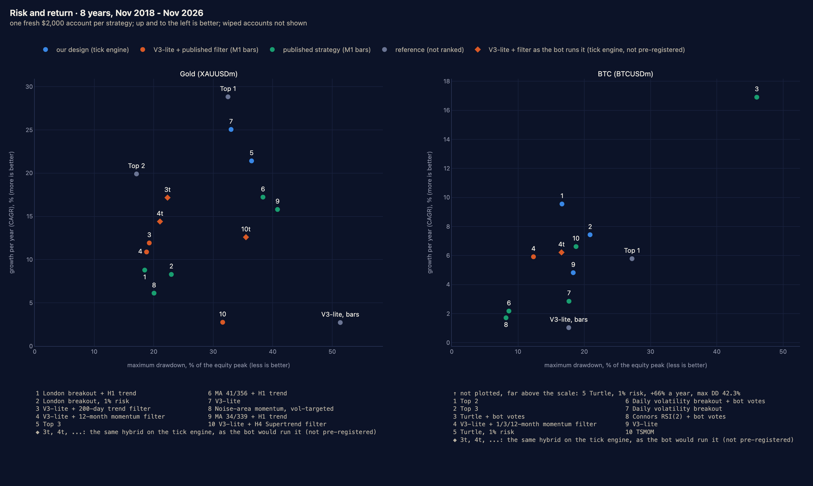

*Interactive: [risk_return_8y.html](risk_return_8y.html).*

### Gold

| Strategy | Engine | Final equity | Growth / year | Max DD | Growth / year ÷ DD | Trades | Win rate | Profit factor | Losing months | Longest dip | Notes |
|---|---|---|---|---|---|---|---|---|---|---|---|
| **#7 V3-lite** | ticks | $11,957 | +25.0% | 33.0% | 0.76 | 809 | 56.1% | 1.41 | 36 of 97 | 532 days |  |
| **#5 Top 3** | ticks | $9,444 | +21.4% | 36.4% | 0.59 | 1,345 | 47.5% | 1.19 | 36 of 97 | 1675 days |  |
| **#6 MA 41/356 + H1 trend** | M1 bars | $7,131 | +17.2% | 38.4% | 0.45 | 1,890 | 31.7% | 1.22 | 47 of 97 | 937 days |  |
| **#9 MA 34/339 + H1 trend** | M1 bars | $6,465 | +15.8% | 40.8% | 0.39 | 2,017 | 30.6% | 1.19 | 51 of 97 | 936 days |  |
| **#3 V3-lite + 200-day trend filter** | M1 bars | $4,926 | +11.9% | 19.3% | 0.62 | 364 | 56.9% | 1.47 | 46 of 97 | 1372 days |  |
| **#4 V3-lite + 12-month momentum filter** | M1 bars | $4,571 | +10.9% | 18.8% | 0.58 | 349 | 56.7% | 1.48 | 42 of 97 | 1406 days |  |
| **#1 London breakout + H1 trend** | M1 bars | $3,924 | +8.8% | 18.5% | 0.48 | 1,288 | 42.2% | 1.23 | 42 of 97 | 684 days |  |
| **#2 London breakout, 1% risk** | M1 bars | $3,781 | +8.3% | 23.0% | 0.36 | 1,462 | 41.5% | 1.16 | 42 of 97 | 1467 days | 44 of 1506 signals too small for 0.01 lot |
| **#8 Noise-area momentum, vol-targeted** | M1 bars | $3,217 | +6.1% | 20.1% | 0.31 | 1,640 | 37.3% | 1.14 | 41 of 97 | 690 days | 130 of 1770 signals too small for 0.01 lot |
| **#10 V3-lite + H4 Supertrend filter** | M1 bars | $2,486 | +2.8% | 31.6% | 0.09 | 455 | 52.1% | 1.07 | 46 of 97 | 2102 days |  |
| *Top 1* (reference) | ticks | $15,168 | +28.8% | 32.5% | 0.89 | 1,240 | 48.3% | 1.25 | 43 of 97 | 1218 days |  |
| *Top 2* (reference) | ticks | $8,545 | +19.9% | 17.1% | 1.16 | 1,316 | 36.4% | 1.33 | 42 of 97 | 1781 days |  |
| *V3-lite (bar level)* (reference) | M1 bars | $2,480 | +2.7% | 51.4% | 0.05 | 561 | 52.9% | 1.05 | 50 of 97 | 1442 days |  |
| *Owner's rules + H1 trend + 4 h pause* (reference) | ticks | $1 | −62.3% | 100.0% | -0.62 | 2,513 | 79.0% | 0.54 | 30 of 97 | 2917 days | account destroyed |
| *Live* (reference) | ticks | $0 | −100.0% | 100.1% | -1.00 | 1,938 | 67.4% | 0.42 | 7 of 97 | 2916 days | wiped 2019-05-21 |

- **Highest equity** (among the ten): 1. #7 V3-lite ($11,957, DD 33.0%); 2. #5 Top 3 ($9,444, DD 36.4%); 3. #6 MA 41/356 + H1 trend ($7,131, DD 38.4%)
- **Lowest drawdown** (among the ten): 1. #1 London breakout + H1 trend ($3,924, DD 18.5%); 2. #4 V3-lite + 12-month momentum filter ($4,571, DD 18.8%); 3. #3 V3-lite + 200-day trend filter ($4,926, DD 19.3%)
- **Best balance** (among the ten): 1. #7 V3-lite ($11,957, DD 33.0%); 2. #3 V3-lite + 200-day trend filter ($4,926, DD 19.3%); 3. #5 Top 3 ($9,444, DD 36.4%)

- **V3-lite turned $2,000 into $11,957**, with the shortest longest dip of the gold finalists (532 days). It grew about 8% a year to the end of 2023 ($3,014), and more than half its profit, $6,070 of $9,957, came in 2026.
- **Top 3 made the second-most** ($9,444) but spent 1,675 days below an earlier peak, from Aug 2020 to Mar 2025.
- **Three rows gave up profit for a lower drawdown** (18 – 19%): V3-lite with the 200-day and with the 12-month filter, and the London breakout with the H1 trend. They ended at $3,900 – $4,900.
- **Two references, Top 1 ($15,168) and Top 2 (max DD 17.1%), beat every finalist** on growth ÷ drawdown. §3 shows how they did on data neither had seen.
- **V3-lite on M1 bars made $2,480**, against $11,957 on the tick engine. On gold the gap comes from when the votes are read (§7).
- **Destroyed:** the live logic (wiped May 2019) and the owner's rules design ($1 left).

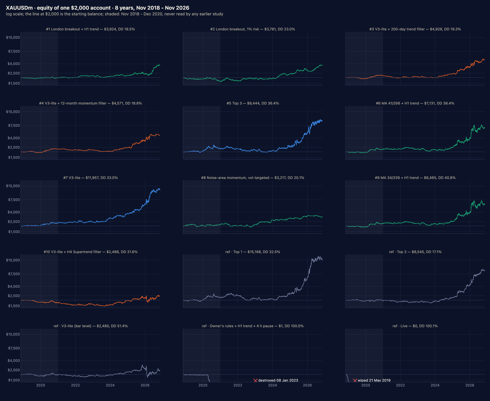

### BTC

| Strategy | Engine | Final equity | Growth / year | Max DD | Growth / year ÷ DD | Trades | Win rate | Profit factor | Losing months | Longest dip | Notes |
|---|---|---|---|---|---|---|---|---|---|---|---|
| **#5 Turtle, 1% risk** | M1 bars | $113,722 | +65.7% | 42.3% | 1.55 | 105 | 32.4% | 1.83 | 48 of 97 | 611 days |  |
| **#3 Turtle + bot votes** | M1 bars | $6,977 | +16.9% | 46.0% | 0.37 | 88 | 38.6% | 1.56 | 43 of 97 | 624 days |  |
| **#1 Top 2** | ticks | $4,149 | +9.5% | 16.6% | 0.57 | 1,110 | 48.4% | 1.20 | 46 of 97 | 1111 days |  |
| **#2 Top 3** | ticks | $3,549 | +7.4% | 20.9% | 0.36 | 1,552 | 53.1% | 1.13 | 46 of 97 | 1015 days |  |
| **#10 TSMOM** | M1 bars | $3,339 | +6.6% | 18.8% | 0.35 | 29 | 37.9% | 2.84 | 46 of 97 | 551 days |  |
| **#4 V3-lite + 1/3/12-month momentum filter** | M1 bars | $3,167 | +5.9% | 12.3% | 0.48 | 499 | 57.1% | 1.26 | 40 of 97 | 510 days |  |
| **#9 V3-lite** | ticks | $2,914 | +4.8% | 18.3% | 0.26 | 1,154 | 52.6% | 1.11 | 48 of 97 | 1123 days |  |
| **#7 Daily volatility breakout** | M1 bars | $2,505 | +2.9% | 17.7% | 0.16 | 484 | 53.9% | 1.27 | 31 of 97 | 730 days |  |
| **#6 Daily volatility breakout + bot votes** | M1 bars | $2,376 | +2.2% | 8.6% | 0.25 | 375 | 54.7% | 1.37 | 33 of 97 | 730 days |  |
| **#8 Connors RSI(2) + bot votes** | M1 bars | $2,291 | +1.7% | 8.2% | 0.21 | 37 | 81.1% | 2.49 | 7 of 97 | 1192 days |  |
| *Top 1* (reference) | ticks | $3,136 | +5.8% | 27.2% | 0.21 | 1,372 | 52.4% | 1.12 | 47 of 97 | 1384 days |  |
| *V3-lite (bar level)* (reference) | M1 bars | $2,171 | +1.0% | 17.7% | 0.06 | 834 | 52.4% | 1.03 | 48 of 97 | 1119 days |  |
| *Live* (reference) | ticks | $0 | −100.0% | 100.0% | -1.00 | 1,997 | 37.1% | 0.24 | 8 of 97 | 2921 days | wiped 2019-06-26 |
| *Owner's rules + H1 trend + 4 h pause* (reference) | ticks | $0 | −100.0% | 100.4% | -1.00 | 1,434 | 58.1% | 0.30 | 34 of 97 | 2921 days | wiped 2021-10-31 |

- **Highest equity** (among the ten): 1. #5 Turtle, 1% risk ($113,722, DD 42.3%); 2. #3 Turtle + bot votes ($6,977, DD 46.0%); 3. #1 Top 2 ($4,149, DD 16.6%)
- **Lowest drawdown** (among the ten): 1. #8 Connors RSI(2) + bot votes ($2,291, DD 8.2%); 2. #6 Daily volatility breakout + bot votes ($2,376, DD 8.6%); 3. #4 V3-lite + 1/3/12-month momentum filter ($3,167, DD 12.3%)
- **Best balance** (among the ten): 1. #5 Turtle, 1% risk ($113,722, DD 42.3%); 2. #1 Top 2 ($4,149, DD 16.6%); 3. #4 V3-lite + 1/3/12-month momentum filter ($3,167, DD 12.3%)

- **Turtle, 1% risk, grew $2,000 to $113,722** from 105 trades with a 32% win rate and large winners. Its size is 1% of equity per unit of volatility. Per leg it grew from 0.16 lot in 2018 to 1.01 lot in 2023; the Turtle on the bot's unit sizing never held more than 0.03 lot per leg. Started in Nov 2021 instead, it made about what the unit-sized Turtle made (§4).
- **Turtle + bot votes**, the best Turtle of the ten on the bot's unit sizing (it is also filtered by the bot's votes), ended at $6,977. Its 46% drawdown is the largest of the BTC finalists.
- **Top 2 has the lowest eight-year drawdown of our designs** (16.6%), with +9.5% a year. Almost all of that came in 2024 – 2025 (+7% in total over 2018 – 2023), and its longest dip lasted 1,111 days.
- **The two lowest-drawdown rows** (Connors RSI(2) and the daily volatility breakout, both with the bot's votes, 8 – 9%) made +2.2% a year or less.
- **Destroyed:** the live logic (wiped Jun 2019) and the owner's rules design (wiped Oct 2021).

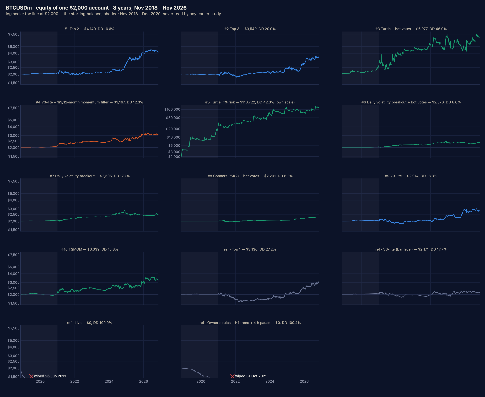

---

## 3. The fair test: Nov 2018 – Dec 2020, data no study had read

This window is the only fair test of the finalists. Nothing about them was chosen on it, and no study had run a strategy on it. It is 2.1 years:
- **gold:** one rising market, from $1,202 to about $1,900;
- **BTC:** two crashes and a rise. It fell from $6,400 to $3,200 (Dec 2018), rose to $13,800 (Jun 2019), crashed to $3,900 (Mar 2020) and then rose to $29,000.

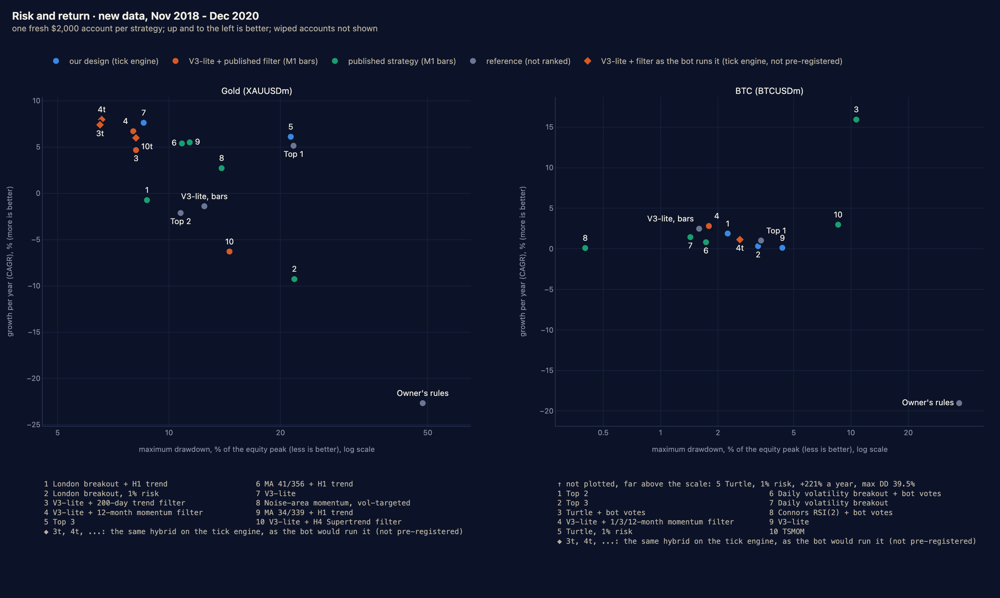

### Gold

| Strategy | Engine | Final equity | Growth / year | Max DD | Growth / year ÷ DD | Trades | Win rate | Profit factor | Losing months | Longest dip | Notes |
|---|---|---|---|---|---|---|---|---|---|---|---|
| **#7 V3-lite** | ticks | $2,340 | +7.6% | 8.5% | 0.89 | 201 | 55.2% | 1.23 | 12 of 26 | 136 days |  |
| **#4 V3-lite + 12-month momentum filter** | M1 bars | $2,297 | +6.7% | 8.0% | 0.84 | 109 | 58.7% | 1.43 | 10 of 26 | 281 days |  |
| **#5 Top 3** | ticks | $2,270 | +6.1% | 21.3% | 0.29 | 360 | 46.9% | 1.07 | 10 of 26 | 199 days |  |
| **#9 MA 34/339 + H1 trend** | M1 bars | $2,243 | +5.5% | 11.4% | 0.48 | 531 | 29.9% | 1.12 | 15 of 26 | 242 days |  |
| **#6 MA 41/356 + H1 trend** | M1 bars | $2,237 | +5.4% | 10.8% | 0.50 | 501 | 30.7% | 1.12 | 14 of 26 | 235 days |  |
| **#3 V3-lite + 200-day trend filter** | M1 bars | $2,205 | +4.7% | 8.1% | 0.57 | 101 | 56.4% | 1.30 | 13 of 26 | 383 days |  |
| **#8 Noise-area momentum, vol-targeted** | M1 bars | $2,118 | +2.7% | 13.9% | 0.20 | 448 | 34.8% | 1.05 | 11 of 26 | 588 days | 1 of 449 signals too small for 0.01 lot |
| **#1 London breakout + H1 trend** | M1 bars | $1,969 | −0.7% | 8.7% | -0.08 | 291 | 40.5% | 0.97 | 15 of 26 | 495 days |  |
| **#10 V3-lite + H4 Supertrend filter** | M1 bars | $1,741 | −6.3% | 14.6% | -0.43 | 117 | 45.3% | 0.75 | 15 of 26 | 654 days |  |
| **#2 London breakout, 1% risk** | M1 bars | $1,625 | −9.3% | 21.8% | -0.43 | 343 | 41.4% | 0.85 | 16 of 26 | 494 days |  |
| *Top 1* (reference) | ticks | $2,226 | +5.1% | 21.7% | 0.24 | 325 | 47.1% | 1.07 | 11 of 26 | 199 days |  |
| *V3-lite (bar level)* (reference) | M1 bars | $1,941 | −1.4% | 12.5% | -0.11 | 154 | 49.4% | 0.95 | 15 of 26 | 420 days |  |
| *Top 2* (reference) | ticks | $1,910 | −2.1% | 10.7% | -0.20 | 358 | 34.1% | 0.95 | 14 of 26 | 547 days |  |
| *Owner's rules + H1 trend + 4 h pause* (reference) | ticks | $1,155 | −22.7% | 48.4% | -0.47 | 1,195 | 78.2% | 0.56 | 15 of 26 | 775 days |  |
| *Live* (reference) | ticks | $0 | −100.0% | 100.1% | -1.00 | 1,938 | 67.4% | 0.42 | 7 of 26 | 774 days | wiped 2019-05-21 |

- **Highest equity** (among the ten): 1. #7 V3-lite ($2,340, DD 8.5%); 2. #4 V3-lite + 12-month momentum filter ($2,297, DD 8.0%); 3. #5 Top 3 ($2,270, DD 21.3%)
- **Lowest drawdown** (among the ten): 1. #4 V3-lite + 12-month momentum filter ($2,297, DD 8.0%); 2. #3 V3-lite + 200-day trend filter ($2,205, DD 8.1%); 3. #7 V3-lite ($2,340, DD 8.5%)
- **Best balance** (among the ten): 1. #7 V3-lite ($2,340, DD 8.5%); 2. #4 V3-lite + 12-month momentum filter ($2,297, DD 8.0%); 3. #3 V3-lite + 200-day trend filter ($2,205, DD 8.1%)

- **V3-lite and its 200-day and 12-month hybrids held up.**
  - V3-lite: +17.0% in total (+7.6% a year), drawdown 8.5%.
  - The hybrids on M1 bars: 200-day +10.2%, 12-month +14.9%, drawdowns of 8%.
  - The hybrids as the bot would run them (§7): 200-day +16.5% (drawdown 6.5%), 12-month +17.8% (6.6%).
- **The Supertrend hybrid lost 13.0% on M1 bars**, and V3-lite with closed-bar votes lost on both engines.
- **Both London breakout rows lost**, though they had been profitable in 2021 – 2026: −1.6% in total with the H1 trend and −18.8% at 1% risk.
- **Gold Top 2 lost 4.5%, and Top 1 made +11.3%** with a 21.7% drawdown. Top 1's equity lead and Top 2's drawdown lead came in 2024 – 2026, inside the years they were chosen on.

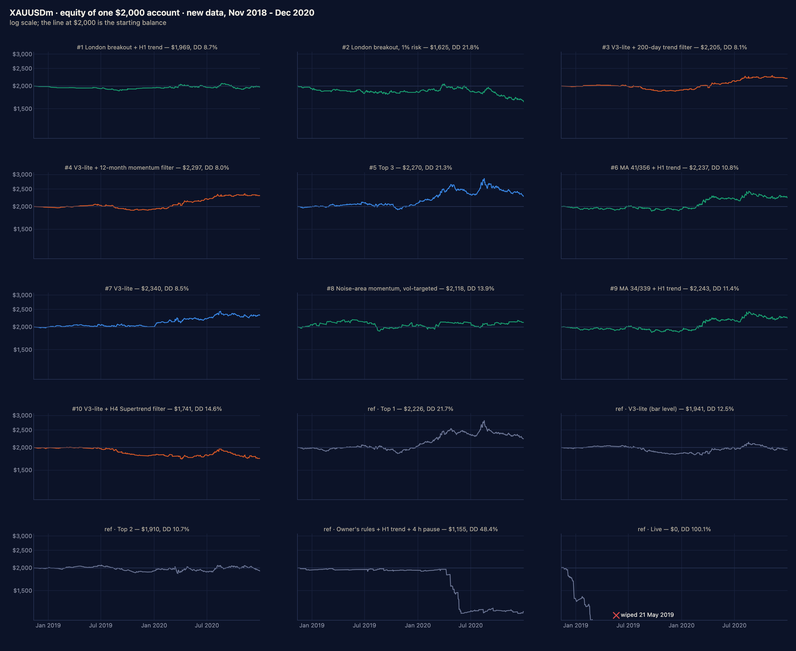

### BTC

| Strategy | Engine | Final equity | Growth / year | Max DD | Growth / year ÷ DD | Trades | Win rate | Profit factor | Losing months | Longest dip | Notes |
|---|---|---|---|---|---|---|---|---|---|---|---|
| **#5 Turtle, 1% risk** | M1 bars | $24,161 | +221.1% | 39.5% | 5.60 | 22 | 45.5% | 9.27 | 9 of 26 | 410 days |  |
| **#3 Turtle + bot votes** | M1 bars | $2,742 | +15.9% | 10.7% | 1.49 | 21 | 47.6% | 6.00 | 8 of 26 | 497 days |  |
| **#10 TSMOM** | M1 bars | $2,129 | +3.0% | 8.6% | 0.35 | 10 | 40.0% | 2.11 | 14 of 26 | 551 days |  |
| **#4 V3-lite + 1/3/12-month momentum filter** | M1 bars | $2,122 | +2.8% | 1.8% | 1.56 | 129 | 62.0% | 1.84 | 8 of 26 | 400 days |  |
| **#1 Top 2** | ticks | $2,081 | +1.9% | 2.3% | 0.84 | 322 | 48.4% | 1.15 | 12 of 26 | 212 days |  |
| **#7 Daily volatility breakout** | M1 bars | $2,062 | +1.4% | 1.4% | 1.00 | 141 | 59.6% | 1.54 | 4 of 26 | 335 days |  |
| **#6 Daily volatility breakout + bot votes** | M1 bars | $2,035 | +0.8% | 1.7% | 0.47 | 119 | 58.0% | 1.38 | 8 of 26 | 328 days |  |
| **#2 Top 3** | ticks | $2,014 | +0.3% | 3.2% | 0.10 | 455 | 52.3% | 1.02 | 12 of 26 | 553 days |  |
| **#9 V3-lite** | ticks | $2,005 | +0.1% | 4.4% | 0.03 | 340 | 50.9% | 1.01 | 16 of 26 | 455 days |  |
| **#8 Connors RSI(2) + bot votes** | M1 bars | $2,004 | +0.1% | 0.4% | 0.23 | 3 | 66.7% | 7.19 | 1 of 26 | 550 days |  |
| *V3-lite (bar level)* (reference) | M1 bars | $2,107 | +2.5% | 1.6% | 1.55 | 232 | 55.2% | 1.35 | 10 of 26 | 189 days |  |
| *Top 1* (reference) | ticks | $2,044 | +1.0% | 3.4% | 0.30 | 402 | 51.5% | 1.07 | 13 of 26 | 504 days |  |
| *Owner's rules + H1 trend + 4 h pause* (reference) | ticks | $1,274 | −19.0% | 37.0% | -0.51 | 806 | 45.2% | 0.32 | 24 of 26 | 779 days |  |
| *Live* (reference) | ticks | $0 | −100.0% | 100.0% | -1.00 | 1,997 | 37.1% | 0.24 | 8 of 26 | 779 days | wiped 2019-06-26 |

- **Highest equity** (among the ten): 1. #5 Turtle, 1% risk ($24,161, DD 39.5%); 2. #3 Turtle + bot votes ($2,742, DD 10.7%); 3. #10 TSMOM ($2,129, DD 8.6%)
- **Lowest drawdown** (among the ten): 1. #8 Connors RSI(2) + bot votes ($2,004, DD 0.4%); 2. #7 Daily volatility breakout ($2,062, DD 1.4%); 3. #6 Daily volatility breakout + bot votes ($2,035, DD 1.7%)
- **Best balance** (among the ten): 1. #5 Turtle, 1% risk ($24,161, DD 39.5%); 2. #4 V3-lite + 1/3/12-month momentum filter ($2,122, DD 1.8%); 3. #3 Turtle + bot votes ($2,742, DD 10.7%)

- **Only the Turtle made real money.**
  - At 1% risk the account grew twelvefold, mostly on the 2019 and late-2020 trends, with a 39.5% drawdown.
  - On the bot's unit sizing, with the votes, it made +37.1% in total with a 10.7% drawdown, from 21 trades with a profit factor of 6.0.
- **Every other finalist ended within 7% of $2,000.** Our designs made between +0.3% and +4.1% over the 2.1 years.
- **Costs were heavy.** BTC's spread was about 0.17% of the price, ten times today's, which weighs on every short-term rule.

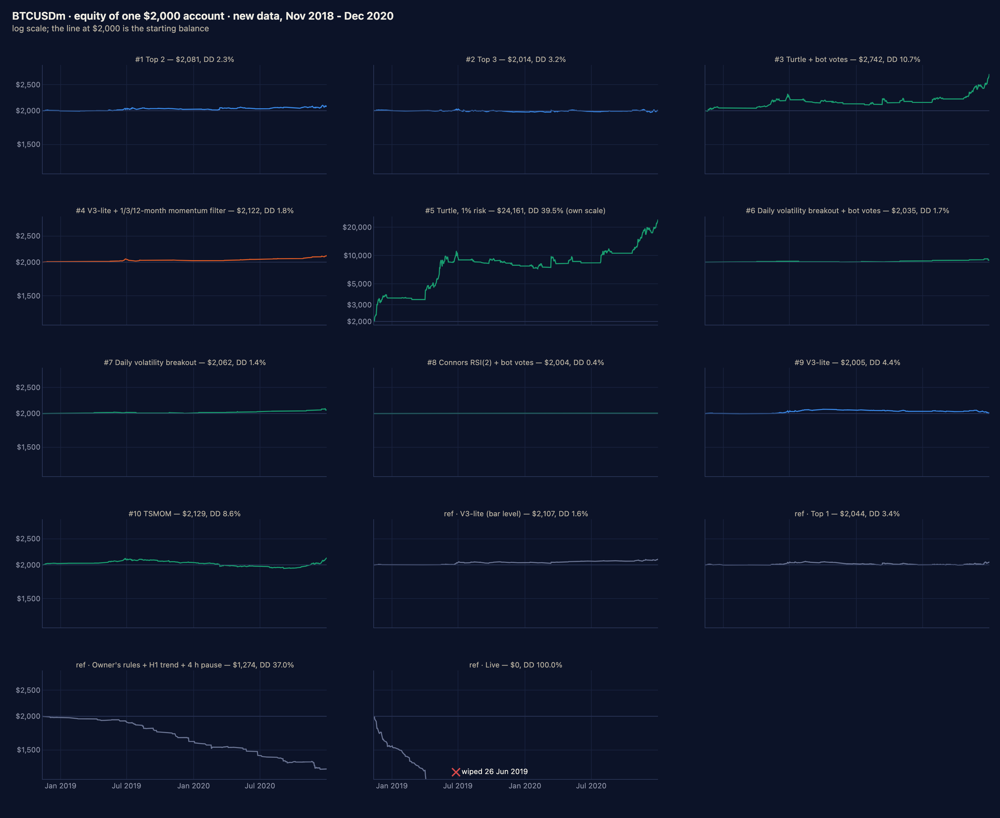

---

## 4. Five years, Nov 2021 – Nov 2026

All five years were data the selection had seen, so this window measures fit, not proof. It starts with BTC at about $64,100, 7% below its Nov 2021 high of $68,984, and before gold's 2024 – 2026 trend.

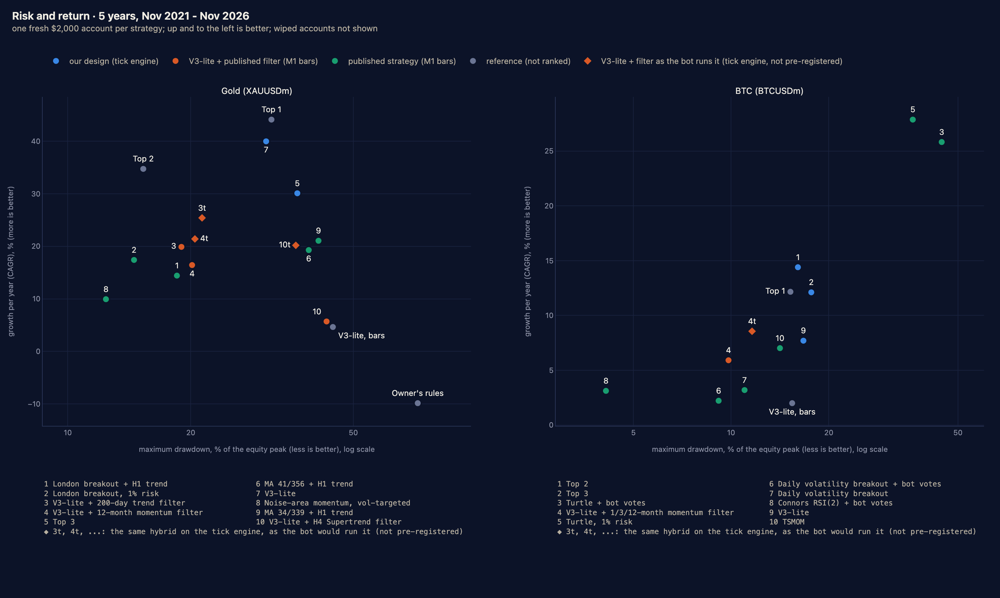

### Gold

| Strategy | Engine | Final equity | Growth / year | Max DD | Growth / year ÷ DD | Trades | Win rate | Profit factor | Losing months | Longest dip | Notes |
|---|---|---|---|---|---|---|---|---|---|---|---|
| **#7 V3-lite** | ticks | $10,748 | +40.0% | 30.6% | 1.31 | 517 | 57.3% | 1.44 | 18 of 61 | 192 days |  |
| **#5 Top 3** | ticks | $7,453 | +30.1% | 36.5% | 0.83 | 844 | 48.1% | 1.18 | 21 of 61 | 898 days |  |
| **#9 MA 34/339 + H1 trend** | M1 bars | $5,200 | +21.1% | 41.1% | 0.51 | 1,260 | 30.9% | 1.17 | 31 of 61 | 933 days |  |
| **#3 V3-lite + 200-day trend filter** | M1 bars | $4,954 | +19.9% | 19.0% | 1.05 | 235 | 60.0% | 1.56 | 23 of 61 | 525 days |  |
| **#6 MA 41/356 + H1 trend** | M1 bars | $4,829 | +19.3% | 38.9% | 0.50 | 1,177 | 32.7% | 1.19 | 30 of 61 | 937 days |  |
| **#2 London breakout, 1% risk** | M1 bars | $4,460 | +17.4% | 14.5% | 1.20 | 956 | 42.9% | 1.28 | 21 of 61 | 361 days | 18 of 974 signals too small for 0.01 lot |
| **#4 V3-lite + 12-month momentum filter** | M1 bars | $4,279 | +16.4% | 20.1% | 0.82 | 208 | 58.2% | 1.54 | 24 of 61 | 627 days |  |
| **#1 London breakout + H1 trend** | M1 bars | $3,923 | +14.4% | 18.5% | 0.78 | 834 | 43.5% | 1.29 | 22 of 61 | 684 days |  |
| **#8 Noise-area momentum, vol-targeted** | M1 bars | $3,211 | +9.9% | 12.4% | 0.80 | 1,009 | 38.7% | 1.22 | 25 of 61 | 154 days | 129 of 1138 signals too small for 0.01 lot |
| **#10 V3-lite + H4 Supertrend filter** | M1 bars | $2,638 | +5.7% | 43.0% | 0.13 | 287 | 56.4% | 1.10 | 26 of 61 | 550 days |  |
| *Top 1* (reference) | ticks | $12,433 | +44.1% | 31.5% | 1.40 | 783 | 48.8% | 1.26 | 26 of 61 | 1073 days |  |
| *Top 2* (reference) | ticks | $8,880 | +34.7% | 15.3% | 2.27 | 814 | 38.3% | 1.38 | 21 of 61 | 386 days |  |
| *V3-lite (bar level)* (reference) | M1 bars | $2,509 | +4.6% | 44.5% | 0.10 | 343 | 55.4% | 1.06 | 28 of 61 | 372 days |  |
| *Owner's rules + H1 trend + 4 h pause* (reference) | ticks | $1,190 | −9.9% | 71.9% | -0.14 | 4,237 | 87.4% | 0.86 | 28 of 61 | 1822 days |  |
| *Live* (reference) | ticks | $0 | −100.0% | 100.0% | -1.00 | 2,063 | 79.8% | 0.51 | 5 of 61 | 1823 days | wiped 2022-03-15 |

- **Highest equity** (among the ten): 1. #7 V3-lite ($10,748, DD 30.6%); 2. #5 Top 3 ($7,453, DD 36.5%); 3. #9 MA 34/339 + H1 trend ($5,200, DD 41.1%)
- **Lowest drawdown** (among the ten): 1. #8 Noise-area momentum, vol-targeted ($3,211, DD 12.4%); 2. #2 London breakout, 1% risk ($4,460, DD 14.5%); 3. #1 London breakout + H1 trend ($3,923, DD 18.5%)
- **Best balance** (among the ten): 1. #7 V3-lite ($10,748, DD 30.6%); 2. #2 London breakout, 1% risk ($4,460, DD 14.5%); 3. #3 V3-lite + 200-day trend filter ($4,954, DD 19.0%)

- **V3-lite again has the most equity of the ten** ($10,748, +40.0% a year) and the best balance (1.31).
- **The lowest drawdown is the noise-area rule** (12.4%), which skipped 129 of its 1,138 signals.
- **The references lead again on growth ÷ drawdown:** Top 2 scores 2.27 and Top 1 1.40, against V3-lite's 1.31. Top 1 made $12,433. Top 2's 15.3% drawdown is third-lowest, behind the noise-area rule's 12.4% and the 1% risk London breakout's 14.5%.

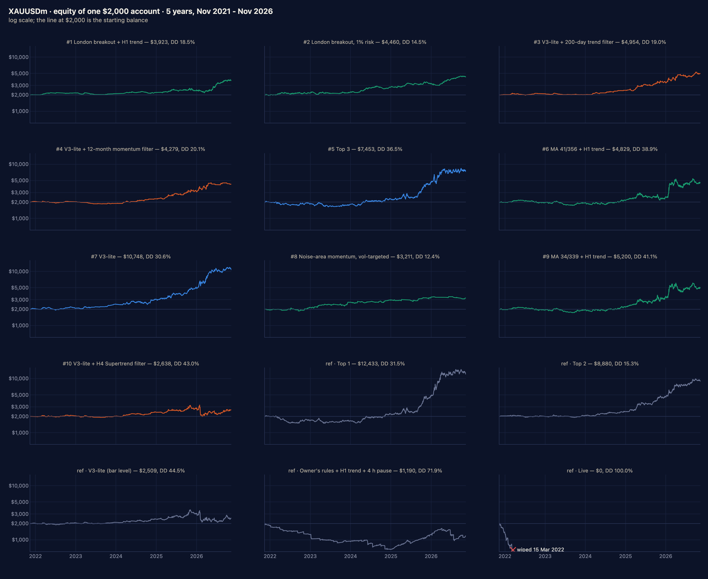

### BTC

| Strategy | Engine | Final equity | Growth / year | Max DD | Growth / year ÷ DD | Trades | Win rate | Profit factor | Losing months | Longest dip | Notes |
|---|---|---|---|---|---|---|---|---|---|---|---|
| **#5 Turtle, 1% risk** | M1 bars | $6,835 | +27.9% | 36.3% | 0.77 | 68 | 26.5% | 1.78 | 32 of 61 | 611 days | 4 of 72 signals too small for 0.01 lot |
| **#3 Turtle + bot votes** | M1 bars | $6,305 | +25.8% | 44.6% | 0.58 | 58 | 34.5% | 1.68 | 32 of 61 | 611 days |  |
| **#1 Top 2** | ticks | $3,919 | +14.4% | 16.1% | 0.90 | 675 | 48.9% | 1.21 | 28 of 61 | 485 days |  |
| **#2 Top 3** | ticks | $3,542 | +12.1% | 17.7% | 0.69 | 940 | 54.0% | 1.17 | 29 of 61 | 320 days |  |
| **#9 V3-lite** | ticks | $2,898 | +7.7% | 16.7% | 0.46 | 701 | 54.1% | 1.14 | 28 of 61 | 325 days |  |
| **#10 TSMOM** | M1 bars | $2,808 | +7.0% | 14.1% | 0.50 | 18 | 33.3% | 2.40 | 28 of 61 | 447 days |  |
| **#4 V3-lite + 1/3/12-month momentum filter** | M1 bars | $2,665 | +5.9% | 9.8% | 0.60 | 316 | 54.7% | 1.24 | 26 of 61 | 510 days |  |
| **#7 Daily volatility breakout** | M1 bars | $2,341 | +3.2% | 11.0% | 0.29 | 298 | 50.7% | 1.31 | 24 of 61 | 730 days |  |
| **#8 Connors RSI(2) + bot votes** | M1 bars | $2,332 | +3.1% | 4.1% | 0.76 | 29 | 86.2% | 5.20 | 4 of 61 | 263 days |  |
| **#6 Daily volatility breakout + bot votes** | M1 bars | $2,232 | +2.2% | 9.2% | 0.24 | 223 | 52.0% | 1.28 | 23 of 61 | 730 days |  |
| *Top 1* (reference) | ticks | $3,550 | +12.2% | 15.2% | 0.80 | 841 | 53.7% | 1.20 | 27 of 61 | 840 days |  |
| *V3-lite (bar level)* (reference) | M1 bars | $2,208 | +2.0% | 15.4% | 0.13 | 513 | 51.5% | 1.05 | 32 of 61 | 531 days |  |
| *Live* (reference) | ticks | $0 | −100.0% | 100.8% | -0.99 | 828 | 73.3% | 0.26 | 2 of 61 | 1824 days | wiped 2021-12-21 |
| *Owner's rules + H1 trend + 4 h pause* (reference) | ticks | $0 | −100.0% | 100.0% | -1.00 | 2,087 | 69.8% | 0.46 | 30 of 61 | 1797 days | wiped 2024-11-25 |

- **Highest equity** (among the ten): 1. #5 Turtle, 1% risk ($6,835, DD 36.3%); 2. #3 Turtle + bot votes ($6,305, DD 44.6%); 3. #1 Top 2 ($3,919, DD 16.1%)
- **Lowest drawdown** (among the ten): 1. #8 Connors RSI(2) + bot votes ($2,332, DD 4.1%); 2. #6 Daily volatility breakout + bot votes ($2,232, DD 9.2%); 3. #4 V3-lite + 1/3/12-month momentum filter ($2,665, DD 9.8%)
- **Best balance** (among the ten): 1. #1 Top 2 ($3,919, DD 16.1%); 2. #5 Turtle, 1% risk ($6,835, DD 36.3%); 3. #8 Connors RSI(2) + bot votes ($2,332, DD 4.1%)

- **Started at Nov 2021 prices, the 1% risk Turtle made $6,835**, about the same as Turtle + bot votes ($6,305). It could not size a trade until Apr 2022 and never held more than 0.06 lot per leg. Its eight-year $113,722 came from the 2018 – 2021 start, not from a better rule.
- **Top 2 has the best balance of the ten** here (+14.4% a year, drawdown 16.1%).

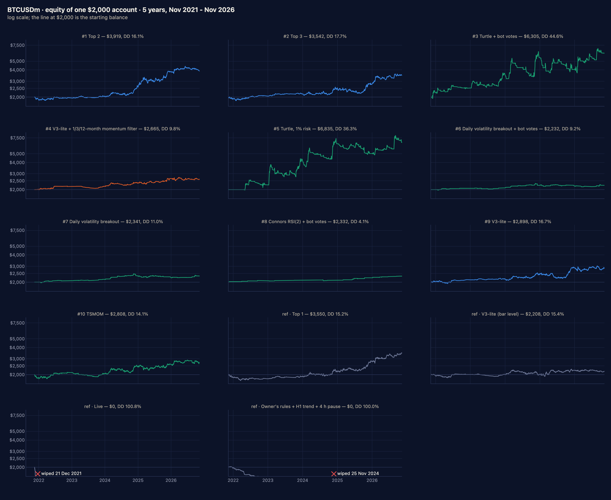

---

## 5. The last year, Nov 2025 – Nov 2026

**This year is in-sample.** It lies inside the selection's 2025-26 period. Top 1 – 3 were tuned on 2023 – 2026, and V3-lite was fixed on 2024 – Nov 2026. Read it as how well the ten fit recent markets, not as fresh evidence. The fair test (§3) is the only out-of-sample window.

**The test:**
- **Account:** a fresh $2,000 on 13 Nov 2025.
- **Our designs:** every raw tick, replayed eight times with different random loop timing. Their **final equity and drawdown are the medians of the eight runs**, the notes give the range, and the other columns come from the middle run.
- **The markets:** gold ran to $5,595 on 29 Jan 2026 and then fell 31%. BTC started at about $101,600, fell to $57,700 by 1 Jul 2026 (−44%) and ended at $71,400.

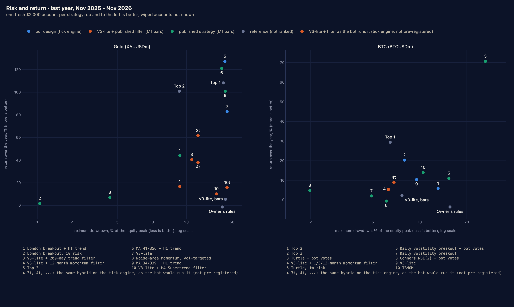

### Gold

| Strategy | Engine | Final equity | Return | Max DD | Return ÷ DD | Trades | Win rate | Profit factor | Losing months | Longest dip | Notes |
|---|---|---|---|---|---|---|---|---|---|---|---|
| **#5 Top 3** | ticks | $4,545 | +127.2% | 43.3% | 2.94 | 175 | 50.3% | 1.22 | 3 of 13 | 48 days | median of 8 timings, range $3,708 – $4,674 |
| **#6 MA 41/356 + H1 trend** | M1 bars | $4,420 | +121.0% | 40.6% | 2.98 | 233 | 35.2% | 1.32 | 5 of 13 | 151 days |  |
| **#9 MA 34/339 + H1 trend** | M1 bars | $4,018 | +100.9% | 43.6% | 2.32 | 254 | 34.3% | 1.25 | 5 of 13 | 149 days |  |
| **#7 V3-lite** | ticks | $3,656 | +82.8% | 45.3% | 1.83 | 99 | 59.6% | 1.28 | 5 of 13 | 68 days | median of 8 timings, range $3,508 – $3,794 |
| **#1 London breakout + H1 trend** | M1 bars | $2,883 | +44.1% | 17.5% | 2.52 | 183 | 41.0% | 1.35 | 4 of 13 | 189 days |  |
| **#3 V3-lite + 200-day trend filter** | M1 bars | $2,810 | +40.5% | 22.2% | 1.82 | 46 | 60.9% | 1.43 | 5 of 13 | 139 days |  |
| **#4 V3-lite + 12-month momentum filter** | M1 bars | $2,335 | +16.7% | 17.5% | 0.96 | 31 | 58.1% | 1.26 | 4 of 13 | 184 days |  |
| **#10 V3-lite + H4 Supertrend filter** | M1 bars | $2,204 | +10.2% | 36.5% | 0.28 | 57 | 57.9% | 1.08 | 5 of 13 | 242 days |  |
| **#8 Noise-area momentum, vol-targeted** | M1 bars | $2,141 | +7.0% | 4.3% | 1.64 | 23 | 30.4% | 2.15 | 2 of 13 | 158 days | barely traded: 228 of 251 signals too small for 0.01 lot |
| **#2 London breakout, 1% risk** | M1 bars | $2,034 | +1.7% | 1.0% | 1.61 | 3 | 66.7% | 3.37 | 0 of 13 | 329 days | barely traded: 221 of 224 signals too small for 0.01 lot |
| *Top 1* (reference) | ticks | $4,165 | +108.3% | 41.9% | 2.58 | 158 | 52.5% | 1.18 | 3 of 13 | 91 days | median of 8 timings, range $3,662 – $4,474 |
| *Top 2* (reference) | ticks | $4,018 | +100.9% | 17.3% | 5.82 | 157 | 41.4% | 1.34 | 3 of 13 | 51 days | median of 8 timings, range $3,662 – $4,353 |
| *V3-lite (bar level)* (reference) | M1 bars | $2,108 | +5.4% | 43.8% | 0.12 | 70 | 54.3% | 1.04 | 6 of 13 | 230 days |  |
| *Owner's rules + H1 trend + 4 h pause* (reference) | ticks | $1,973 | −1.4% | 41.0% | -0.03 | 1,490 | 93.5% | 1.00 | 5 of 13 | 217 days | median of 8 timings, range $1,255 – $2,098 |
| *Live* (reference) | ticks | $0 | −100.0% | 101.1% | -0.99 | 3,243 | 94.4% | 0.75 | 2 of 13 | 299 days | wiped 2026-02-02; median of 8 timings, range $0 – $0 |

- **Highest equity** (among the ten): 1. #5 Top 3 ($4,545, DD 43.3%); 2. #6 MA 41/356 + H1 trend ($4,420, DD 40.6%); 3. #9 MA 34/339 + H1 trend ($4,018, DD 43.6%)
- **Lowest drawdown** (among the ten): 1. #4 V3-lite + 12-month momentum filter ($2,335, DD 17.5%); 2. #1 London breakout + H1 trend ($2,883, DD 17.5%); 3. #3 V3-lite + 200-day trend filter ($2,810, DD 22.2%). *Not ranked, barely traded: #2 London breakout, 1% risk (DD 1.0%, 3 trades); #8 Noise-area momentum, vol-targeted (DD 4.3%, 23 trades).*
- **Best balance** (among the ten): 1. #6 MA 41/356 + H1 trend ($4,420, DD 40.6%); 2. #5 Top 3 ($4,545, DD 43.3%); 3. #1 London breakout + H1 trend ($2,883, DD 17.5%)

- **Four finalists made +83% to +127%:** Top 3, the two moving averages and V3-lite. Each had a drawdown above 40%; V3-lite's was the fall from 29 Jan 2026.
- **Top 3's lead depends on timing.** Three of its eight timings ended below the 41/356 moving average's $4,420.
- **A smoother year:** London breakout + H1 trend made +44% with a 17.5% drawdown. V3-lite + 200-day trend filter, as the bot would run it, made +62% with 25% (§7).
- **The 1% risk London breakout and the noise-area rule barely traded.** Their median signal needed a $2,617 or $3,104 account to buy 0.01 lot (`signal_sizes.csv`), so they skipped 221 of 224 and 228 of 251 signals.

### BTC

| Strategy | Engine | Final equity | Return | Max DD | Return ÷ DD | Trades | Win rate | Profit factor | Losing months | Longest dip | Notes |
|---|---|---|---|---|---|---|---|---|---|---|---|
| **#3 Turtle + bot votes** | M1 bars | $3,412 | +70.6% | 26.4% | 2.68 | 11 | 54.5% | 3.21 | 6 of 13 | 117 days |  |
| **#2 Top 3** | ticks | $2,406 | +20.3% | 8.0% | 2.55 | 195 | 54.4% | 1.25 | 6 of 13 | 121 days | median of 8 timings, range $2,341 – $2,448 |
| **#10 TSMOM** | M1 bars | $2,280 | +14.0% | 10.5% | 1.33 | 3 | 66.7% | 25.35 | 4 of 13 | 134 days |  |
| **#5 Turtle, 1% risk** | M1 bars | $2,221 | +11.0% | 15.4% | 0.72 | 3 | 33.3% | 2.32 | 3 of 13 | 69 days | barely traded: 9 of 12 signals too small for 0.01 lot |
| **#9 V3-lite** | ticks | $2,207 | +10.4% | 9.5% | 1.09 | 134 | 53.7% | 1.19 | 4 of 13 | 200 days | median of 8 timings, range $2,142 – $2,232 |
| **#1 Top 2** | ticks | $2,119 | +5.9% | 13.1% | 0.45 | 138 | 44.9% | 1.08 | 6 of 13 | 158 days | median of 8 timings, range $1,998 – $2,197 |
| **#4 V3-lite + 1/3/12-month momentum filter** | M1 bars | $2,107 | +5.3% | 6.3% | 0.85 | 64 | 53.1% | 1.20 | 6 of 13 | 225 days |  |
| **#8 Connors RSI(2) + bot votes** | M1 bars | $2,097 | +4.8% | 2.0% | 2.46 | 7 | 100.0% | n/a | 0 of 13 | 64 days |  |
| **#7 Daily volatility breakout** | M1 bars | $2,041 | +2.0% | 4.9% | 0.42 | 53 | 41.5% | 1.18 | 6 of 13 | 268 days |  |
| **#6 Daily volatility breakout + bot votes** | M1 bars | $1,989 | −0.6% | 6.1% | -0.09 | 40 | 37.5% | 0.95 | 6 of 13 | 286 days |  |
| *Top 1* (reference) | ticks | $2,589 | +29.5% | 6.5% | 4.56 | 175 | 57.1% | 1.43 | 2 of 13 | 97 days | median of 8 timings, range $2,500 – $2,638 |
| *V3-lite (bar level)* (reference) | M1 bars | $2,044 | +2.2% | 7.7% | 0.28 | 106 | 51.9% | 1.05 | 7 of 13 | 349 days |  |
| *Owner's rules + H1 trend + 4 h pause* (reference) | ticks | $1,928 | −3.6% | 15.6% | -0.23 | 1,128 | 83.7% | 0.94 | 6 of 13 | 282 days | median of 8 timings, range $1,916 – $1,945 |
| *Live* (reference) | ticks | $0 | −100.0% | 100.0% | -1.00 | 5,414 | 83.6% | 0.74 | 6 of 13 | 355 days | wiped 2026-05-16; median of 8 timings, range $0 – $674 |

- **Highest equity** (among the ten): 1. #3 Turtle + bot votes ($3,412, DD 26.4%); 2. #2 Top 3 ($2,406, DD 8.0%); 3. #10 TSMOM ($2,280, DD 10.5%)
- **Lowest drawdown** (among the ten): 1. #8 Connors RSI(2) + bot votes ($2,097, DD 2.0%); 2. #7 Daily volatility breakout ($2,041, DD 4.9%); 3. #6 Daily volatility breakout + bot votes ($1,989, DD 6.1%). *Not ranked, barely traded: #5 Turtle, 1% risk (DD 15.4%, 3 trades).*
- **Best balance** (among the ten): 1. #3 Turtle + bot votes ($3,412, DD 26.4%); 2. #2 Top 3 ($2,406, DD 8.0%); 3. #8 Connors RSI(2) + bot votes ($2,097, DD 2.0%)

- **Turtle + bot votes made +71%** from 11 trades, with a 26.4% drawdown.
- **Among our designs**, Top 3 made +20% with an 8.0% drawdown, and the reference Top 1 made +29.5% with 6.5%.
- **The 1% risk Turtle took 3 of its 12 signals.** Its median signal needed a $2,297 account.

Trades on the price chart (H4 candles, every entry and exit of the last year):

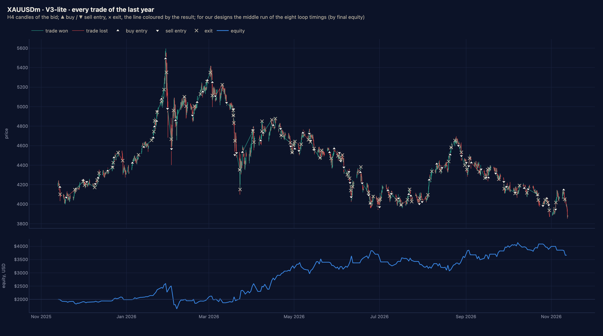

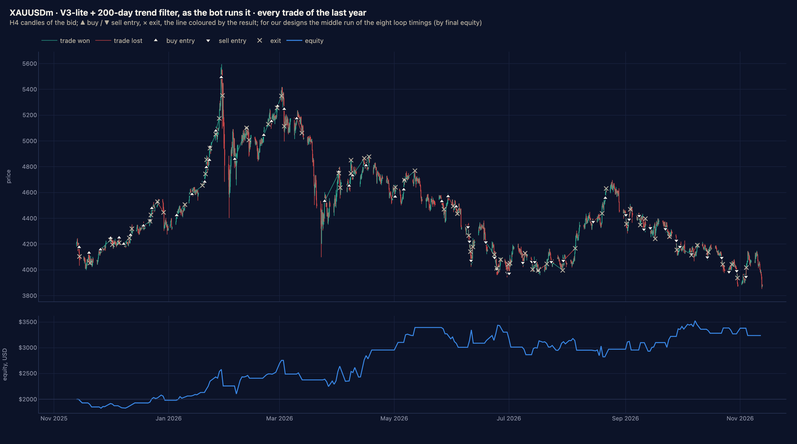

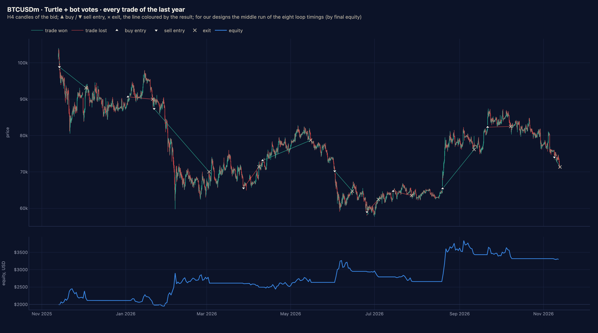

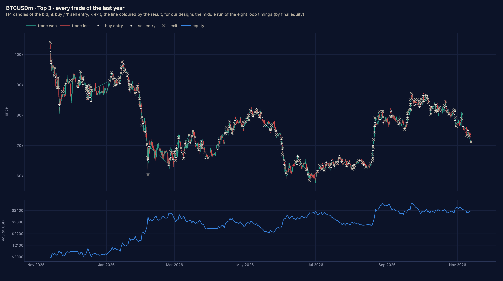

Equity charts: [gold](img/equity_1y_XAUUSDm.png), [BTC](img/equity_1y_BTCUSDm.png). Their panel titles give the median, and the line is the middle run.

---

## 6. Year by year (the eight-year account)

Each cell is the account's return in that calendar year, as a share of its equity at the year's start. 2018 is 13 Nov – 31 Dec and 2026 runs to 13 Nov (marked *). A dash means the account was already destroyed.

**Why later years look bigger.** For the unit-rule rows, the percentages do not compare fairly across years. A unit is 0.01 lot per $2,500 of balance at any price, so its dollar exposure grew with the price: about 3.6 times for gold and 14 times for BTC from the window's start to the end of 2025. That inflates their later years against the early ones. Only the risk-sized rows compare across years.

### Gold

| Strategy | 2018* | 2019 | 2020 | 2021 | 2022 | 2023 | 2024 | 2025 | 2026* |
|---|---|---|---|---|---|---|---|---|---|
| #1 London breakout + H1 trend | −0.2% | −2.0% | +0.7% | +2.3% | +9.8% | −3.6% | +4.4% | +10.5% | +59.5% |
| #2 London breakout, 1% risk | −3.2% | −4.3% | −12.3% | +4.1% | +12.2% | +1.6% | +25.3% | +20.9% | +29.4% |
| #3 V3-lite + 200-day trend filter | −0.5% | −4.4% | +16.0% | −9.7% | +4.6% | −3.8% | +20.4% | +36.0% | +50.2% |
| #4 V3-lite + 12-month momentum filter | −0.7% | −2.5% | +18.7% | −3.7% | +0.1% | −7.0% | +19.9% | +37.0% | +35.1% |
| #5 Top 3 | −0.3% | +4.6% | +9.5% | +1.3% | −6.3% | −1.9% | +24.4% | +101.8% | +76.8% |
| #6 MA 41/356 + H1 trend | −1.2% | −2.0% | +15.5% | +3.7% | −2.1% | −0.7% | +9.7% | +63.4% | +76.4% |
| #7 V3-lite | 0.0% | +0.5% | +17.2% | +4.1% | −1.3% | +24.3% | +23.4% | +58.7% | +103.1% |
| #8 Noise-area momentum, vol-targeted | +2.8% | 0.0% | +3.1% | −6.8% | +9.9% | +24.7% | +9.1% | +13.7% | −4.2% |
| #9 MA 34/339 + H1 trend | −1.0% | −3.4% | +17.2% | +3.9% | −3.0% | +0.5% | +9.4% | +65.6% | +57.1% |
| #10 V3-lite + H4 Supertrend filter | −0.2% | −8.9% | −4.3% | −9.5% | +3.2% | −1.6% | +22.8% | +16.9% | +8.2% |
| *Top 1* | −0.8% | +2.6% | +10.1% | +13.5% | −14.9% | −1.3% | +30.2% | +130.0% | +137.2% |
| *Top 2* | −0.1% | −3.6% | −0.9% | −2.4% | −2.3% | +4.9% | +19.8% | +86.3% | +100.3% |
| *V3-lite (bar level)* | −0.2% | −6.8% | +4.4% | −4.1% | +2.0% | +3.2% | +14.8% | +22.4% | −10.0% |
| *Owner's rules + H1 trend + 4 h pause* | −2.5% | −0.7% | −40.3% | −34.0% | −76.5% | −99.5% | – | – | – |
| *Live* | −33.2% | −100.0% | – | – | – | – | – | – | – |

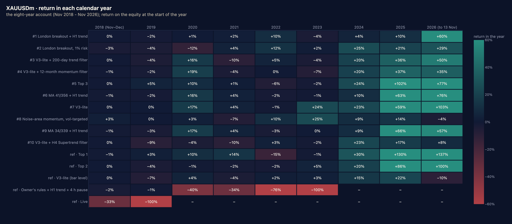

- **V3-lite made money in every full year except 2022** (−1.3%), from +0.5% in 2019 to +58.7% in 2025.
- **Every gold row except the noise-area rule earned most in 2024 – 2026.** The noise-area rule's best year was 2023.
- **2019 and 2021 – 2023 were the hard years** for the trend followers and the filters.

### BTC

| Strategy | 2018* | 2019 | 2020 | 2021 | 2022 | 2023 | 2024 | 2025 | 2026* |
|---|---|---|---|---|---|---|---|---|---|
| #1 Top 2 | −0.1% | +1.4% | +2.8% | −5.3% | +4.7% | +3.4% | +30.9% | +45.1% | +2.3% |
| #2 Top 3 | 0.0% | −1.1% | +1.8% | −7.8% | +8.6% | +6.0% | +16.7% | +11.5% | +27.8% |
| #3 Turtle + bot votes | +2.4% | +3.6% | +29.3% | +32.6% | +19.4% | +23.1% | +24.4% | −31.3% | +52.7% |
| #4 V3-lite + 1/3/12-month momentum filter | +0.5% | +0.8% | +4.8% | +8.5% | +6.9% | +0.2% | +5.5% | +21.3% | +0.3% |
| #5 Turtle, 1% risk | +77.3% | +118.2% | +212.3% | +21.9% | +19.2% | +100.0% | +47.8% | −27.3% | +50.8% |
| #6 Daily volatility breakout + bot votes | +0.1% | −0.2% | +1.8% | +5.5% | +2.7% | +1.4% | +6.6% | −2.2% | +2.0% |
| #7 Daily volatility breakout | +0.2% | +0.2% | +2.8% | +7.2% | +3.5% | +3.0% | +8.9% | −6.2% | +4.1% |
| #8 Connors RSI(2) + bot votes | +0.1% | 0.0% | +0.1% | −0.9% | +2.9% | +0.7% | +0.3% | +6.3% | +4.4% |
| #9 V3-lite | +0.2% | +2.7% | −2.6% | −6.1% | +5.6% | +3.0% | +14.3% | +25.3% | −0.5% |
| #10 TSMOM | +1.3% | +0.9% | +4.2% | +4.1% | +13.4% | −2.7% | +12.7% | +11.1% | +9.1% |
| *Top 1* | 0.0% | +0.9% | +1.4% | −17.0% | −3.7% | +7.4% | +12.2% | +27.5% | +25.0% |
| *V3-lite (bar level)* | +0.3% | +1.5% | +3.5% | −10.0% | +3.6% | +0.4% | −0.5% | +11.6% | −0.9% |
| *Live* | −22.6% | −100.0% | – | – | – | – | – | – | – |
| *Owner's rules + H1 trend + 4 h pause* | −0.9% | −18.7% | −20.9% | −100.0% | – | – | – | – | – |

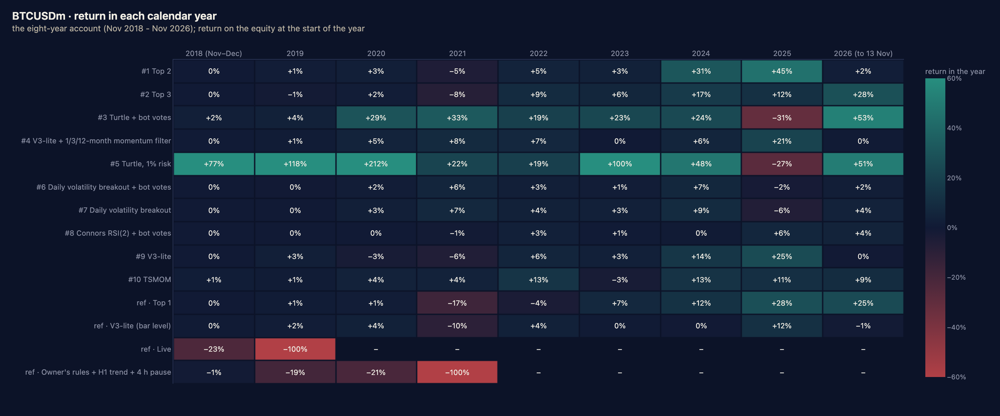

- **Both Turtle finalists had one losing year, 2025** (−31% and −27%), and gained in all the others.
- **Top 2 lost in only one full year**, 2021 (−5%). It made +31% in 2024 and +45% in 2025, after −5% to +5% a year before.

---

## 7. The V3-lite hybrids as the bot would run them (added after the pre-registration)

**Why this section exists.** V3-lite ran in both engines in the main test, and on gold the two disagree by a wide margin (§2). The bot reads its votes on the still-forming bar; the M1-bar simulator can read them only on closed bars. The V3-lite hybrids were selected and tested in the simulator. So the question is how they would do the way the bot actually trades.

**How it was done.**
- **The filter:** the tick engine gained one backtest-only setting, an entry filter given as a series over time. From each time on it allows only buys, only sells, or neither. It is off by default, so every other result is unchanged; it is tested in `tests/test_regime_filter.py`.
- **The hybrids:** each runs on the tick engine with V3-lite's exact settings. Its filter series is built by the published strategy's own code from the same closed D1 / H4 bars as in the simulator.
- **A control row:** V3-lite on the tick engine with its votes read on closed bars. It shows how much of the gap comes from the vote timing and how much from the engines.

These rows were added after the pre-registration, so they are not part of the ranking. On the 2018 – 2020 window they are still a fair test, because nothing about them was chosen on that data.

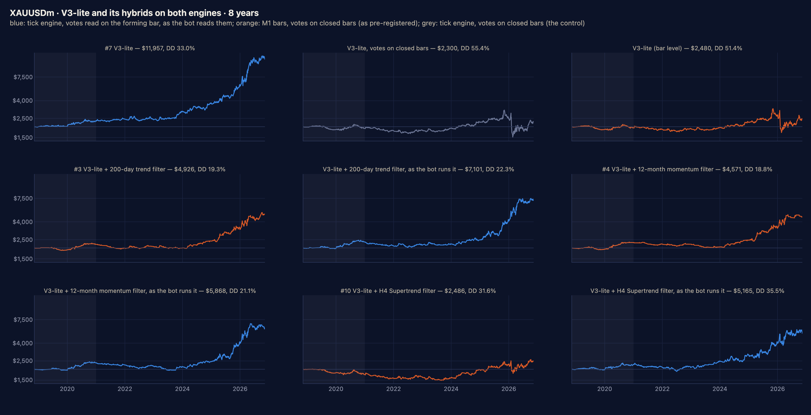

### Gold

| Design | Engine and vote timing | 8 years | 5 years | new data | last year |
|---|---|---|---|---|---|
| V3-lite | M1 bars, votes on closed bars | $2,480, DD 51.4% | $2,509, DD 44.5% | $1,941, DD 12.5% | $2,108, DD 43.8% |
| V3-lite | tick engine, votes on closed bars | $2,300, DD 55.4% | $2,796, DD 44.7% | $1,912, DD 12.5% | $2,085, DD 44.3% |
| V3-lite | tick engine, votes on the forming bar (as the bot) | $11,957, DD 33.0% | $10,748, DD 30.6% | $2,340, DD 8.5% | $3,656, DD 45.3% |
| V3-lite + 200-day trend filter | M1 bars, votes on closed bars (pre-registered) | $4,926, DD 19.3% | $4,954, DD 19.0% | $2,205, DD 8.1% | $2,810, DD 22.2% |
| V3-lite + 200-day trend filter | tick engine, votes on the forming bar (as the bot) | $7,101, DD 22.3% | $6,203, DD 21.3% | $2,329, DD 6.5% | $3,231, DD 25.2% |
| V3-lite + 12-month momentum filter | M1 bars, votes on closed bars (pre-registered) | $4,571, DD 18.8% | $4,279, DD 20.1% | $2,297, DD 8.0% | $2,335, DD 17.5% |
| V3-lite + 12-month momentum filter | tick engine, votes on the forming bar (as the bot) | $5,868, DD 21.1% | $5,273, DD 20.5% | $2,356, DD 6.6% | $2,758, DD 25.2% |
| V3-lite + H4 Supertrend filter | M1 bars, votes on closed bars (pre-registered) | $2,486, DD 31.6% | $2,638, DD 43.0% | $1,741, DD 14.6% | $2,204, DD 36.5% |
| V3-lite + H4 Supertrend filter | tick engine, votes on the forming bar (as the bot) | $5,165, DD 35.5% | $5,015, DD 36.1% | $2,265, DD 8.1% | $2,315, DD 45.3% |

### BTC

| Design | Engine and vote timing | 8 years | 5 years | new data | last year |
|---|---|---|---|---|---|
| V3-lite | M1 bars, votes on closed bars | $2,171, DD 17.7% | $2,208, DD 15.4% | $2,107, DD 1.6% | $2,044, DD 7.7% |
| V3-lite | tick engine, votes on closed bars | $2,229, DD 18.4% | $2,364, DD 12.7% | $2,051, DD 2.9% | $2,205, DD 6.6% |
| V3-lite | tick engine, votes on the forming bar (as the bot) | $2,914, DD 18.3% | $2,898, DD 16.7% | $2,005, DD 4.4% | $2,207, DD 9.5% |
| V3-lite + 1/3/12-month momentum filter | M1 bars, votes on closed bars (pre-registered) | $3,167, DD 12.3% | $2,665, DD 9.8% | $2,122, DD 1.8% | $2,107, DD 6.3% |
| V3-lite + 1/3/12-month momentum filter | tick engine, votes on the forming bar (as the bot) | $3,240, DD 16.6% | $3,015, DD 11.6% | $2,048, DD 2.6% | $2,179, DD 6.8% |

What the rows show:

1. **On gold the gap is the vote timing.** With its votes read on closed bars, V3-lite on the tick engine lands near the simulator: $2,300 against $2,480 over eight years, and within $290 in every window. Reading the votes on the forming bar, as the bot does, turns that into $11,957.
   - **On BTC the engines also differ.** In the last year the whole gap is the engine: $2,044 on M1 bars against $2,205 on the tick engine with closed-bar votes, and $2,207 with forming-bar votes.
2. **The gold hybrids gain the same way.**
   - Run as the bot would, V3-lite + 200-day trend filter makes $7,101 over eight years with a 22.3% drawdown, against $4,926 and 19.3% on M1 bars. It makes +16.5% with a 6.5% drawdown on the fair test.
   - Its growth per unit of drawdown over eight years, 0.77, ties V3-lite's 0.76 at two-thirds of the drawdown. Both are single runs, so 0.01 is inside the timing noise.
   - Its last year splits by loop timing: three of the eight runs ended near $2,400 (+20%) and five near $3,240 (+62%).
3. **The 12-month momentum filter** makes $5,868 with a 21.1% drawdown over eight years, and +17.8% with a 6.6% drawdown on the fair test, level with V3-lite's +17.0%. Its last year splits the same way: three runs near $2,240, five at $2,690 – $2,850.
4. **The filters cost the choppy years.** As the bot would run them, the 200-day and 12-month filters lost 9.6% and 5.5% in 2021, when V3-lite made +4.1%. In 2023 they made +2.2% and −1.5% against V3-lite's +24.3%. They earn their lower drawdown in the trending years and pay for it in the others. Their pre-registered M1-bar versions would not have qualified as finalists on warm data (§8). The versions run as the bot would have not been put through the rule.
5. **The H4 Supertrend filter stays the weakest hybrid:** a 35.5% drawdown over eight years and 45% in the last year.
6. **On BTC the 1/3/12-month momentum filter adds a little to V3-lite:** $3,240 against $2,914 over eight years, with a drawdown of 16.6% against 18.3%.

---

## 8. The warm re-check: what the selection would have been (added after the review)

**The flaw.** The earlier study read nothing before Jan 2021 for its 2021-22 test and nothing before Dec 2022 for 2023 – 2026. Slow filters therefore started cold: the 12-month momentum sign needs a year of history and the 200-day average about ten months. Until a filter was defined, its row opened nothing. Those idle months counted as small profits, or as the one losing period the rule allows.

**The check.**
- **Re-run:** every published row on exactly the same five periods and quarter edges, with history from 2017 (gold) and 2018 (BTC) (`warm_external.csv`, `evidence_warm.csv`).
- **Rule:** the same rule as before (`selection_warm.json`). Our designs' evidence is unchanged.
- **Status:** this was done after the main results, so it is a correction, not a pre-registration. It reads no 2018 – 2020 result; the older bars only warm the indicators up.

**The pre-registered published and hybrid finalists, as selected and re-run warm** (average profit per quarter 2021 / 2022 / 2023 / 2024-25 / 2025-26):

*Gold*

| # | Strategy | As selected (cold start) | Re-run warm | Periods up, cold → warm | Still eligible |
|---|---|---|---|---|---|
| 1 | London breakout + H1 trend | +10 / +49 / −0 / +62 / +179 | +10 / +49 / −0 / +62 / +179 | 4 → 4 | yes |
| 2 | London breakout, 1% risk | +1 / +52 / −2 / +170 / +7 | +1 / +52 / −2 / +170 / +7 | 4 → 4 | yes |
| 3 | V3-lite + 200-day trend filter | +2 / +26 / +1 / +121 / +244 | −38 / +26 / −13 / +121 / +244 | 5 → 3 | **no** |
| 4 | V3-lite + 12-month momentum filter | no trades / +1 / +2 / +121 / +206 | −15 / +1 / −32 / +121 / +206 | 4 → 3 | **no** |
| 6 | MA 41/356 + H1 trend | +13 / −13 / +5 / +112 / +450 | +13 / −13 / +5 / +112 / +450 | 4 → 4 | yes |
| 8 | Noise-area momentum, vol-targeted | −76 / +51 / +135 / +19 / +53 | −76 / +51 / +135 / +19 / +53 | 4 → 4 | yes |
| 9 | MA 34/339 + H1 trend | +13 / −12 / +13 / +133 / +402 | +13 / −12 / +13 / +133 / +402 | 4 → 4 | yes |
| 10 | V3-lite + H4 Supertrend filter | −37 / +14 / +5 / +76 / +105 | −37 / +14 / +5 / +76 / +105 | 4 → 4 | yes |

*BTC*

| # | Strategy | As selected (cold start) | Re-run warm | Periods up, cold → warm | Still eligible |
|---|---|---|---|---|---|
| 3 | Turtle + bot votes | +189 / +116 / +58 / +139 / +163 | +170 / +116 / +58 / +139 / +163 | 5 → 5 | yes |
| 4 | V3-lite + 1/3/12-month momentum filter | +35 / +39 / −4 / +45 / +38 | +20 / +39 / −1 / +45 / +38 | 4 → 4 | yes |
| 5 | Turtle, 1% risk | no trades / +103 / +95 / +87 / +44 | no trades / +103 / +103 / +87 / +44 | 4 → 4 | yes |
| 6 | Daily volatility breakout + bot votes | +37 / +14 / +6 / +27 / +6 | +37 / +14 / +6 / +27 / +6 | 5 → 5 | yes |
| 7 | Daily volatility breakout | +49 / +19 / +15 / +30 / +6 | +49 / +19 / +15 / +30 / +6 | 5 → 5 | yes |
| 8 | Connors RSI(2) + bot votes | +2 / +14 / +1 / +16 / +28 | −8 / +14 / +10 / +16 / +28 | 5 → 4 | yes |
| 10 | TSMOM | +31 / +74 / −3 / +54 / +50 | +11 / +74 / −1 / +54 / +50 | 4 → 4 | yes |

- **Gold:** the two slow-filter hybrids (#3 and #4) lose in both 2021 and 2023 once warm, so they fall to 3 of 5 periods and out of the rule.
- **BTC:** of the four finalists that drop, three are still eligible.
  - **Cut by the two-per-strategy cap:** TSMOM and V3-lite + 1/3/12-month momentum filter (two TSMOM-family rows), and Turtle + bot votes.
  - **Dropped on its score:** Connors RSI(2) + bot votes, whose 2021 falls from +2 to −8.
  - **Kept out by the cold start before:** TSMOM 12-month, vol-targeted, and V3-lite + 12-month momentum filter. With warm data they qualify and come in.

**The ten the same rule picks on warm evidence, with their accounts in every window:**

*Gold*

| Warm # | Strategy | In the pre-registered ten? | 8 years | 5 years | new data | last year |
|---|---|---|---|---|---|---|
| 1 | London breakout + H1 trend | yes | $3,924, DD 18.5% | $3,923, DD 18.5% | $1,969, DD 8.7% | $2,883, DD 17.5% |
| 2 | London breakout, 1% risk | yes | $3,781, DD 23.0% | $4,460, DD 14.5% | $1,625, DD 21.8% | $2,034, DD 1.0% |
| 3 | Top 3 | yes | $9,444, DD 36.4% | $7,453, DD 36.5% | $2,270, DD 21.3% | $4,545, DD 43.3% |
| 4 | MA 41/356 + H1 trend | yes | $7,131, DD 38.4% | $4,829, DD 38.9% | $2,237, DD 10.8% | $4,420, DD 40.6% |
| 5 | V3-lite | yes | $11,957, DD 33.0% | $10,748, DD 30.6% | $2,340, DD 8.5% | $3,656, DD 45.3% |
| 6 | Noise-area momentum, vol-targeted | yes | $3,217, DD 20.1% | $3,211, DD 12.4% | $2,118, DD 13.9% | $2,141, DD 4.3% |
| 7 | MA 34/339 + H1 trend | yes | $6,465, DD 40.8% | $5,200, DD 41.1% | $2,243, DD 11.4% | $4,018, DD 43.6% |
| 8 | Donchian ensemble long/short + H1 trend | **new** | $3,616, DD 39.7% | $3,634, DD 39.6% | $2,009, DD 18.4% | $2,195, DD 34.9% |
| 9 | V3-lite + H4 Supertrend filter | yes | $2,486, DD 31.6% | $2,638, DD 43.0% | $1,741, DD 14.6% | $2,204, DD 36.5% |
| 10 | Donchian ensemble long/short + bot votes | **new** | $2,552, DD 49.7% | $2,581, DD 49.4% | $2,011, DD 12.2% | $1,844, DD 40.2% |

*BTC*

| Warm # | Strategy | In the pre-registered ten? | 8 years | 5 years | new data | last year |
|---|---|---|---|---|---|---|
| 1 | Turtle System 2 + bot votes | **new** | $7,815, DD 32.5% | $3,547, DD 38.4% | $2,858, DD 9.4% | $3,039, DD 22.4% |
| 2 | TSMOM 12-month, vol-targeted | **new** | $4,130, DD 73.3% | $3,833, DD 57.8% | $1,506, DD 73.3% | $1,988, DD 38.6% |
| 3 | Top 2 | yes | $4,149, DD 16.6% | $3,919, DD 16.1% | $2,081, DD 2.3% | $2,119, DD 13.1% |
| 4 | Top 3 | yes | $3,549, DD 20.9% | $3,542, DD 17.7% | $2,014, DD 3.2% | $2,406, DD 8.0% |
| 5 | V3-lite + 12-month momentum filter | **new** | $3,103, DD 10.9% | $2,469, DD 6.8% | $2,102, DD 2.0% | $2,015, DD 6.6% |
| 6 | Turtle, 1% risk | yes | $113,722, DD 42.3% | $6,835, DD 36.3% | $24,161, DD 39.5% | $2,221, DD 15.4% |
| 7 | Daily volatility breakout + bot votes | yes | $2,376, DD 8.6% | $2,232, DD 9.2% | $2,035, DD 1.7% | $1,989, DD 6.1% |
| 8 | Daily volatility breakout | yes | $2,505, DD 17.7% | $2,341, DD 11.0% | $2,062, DD 1.4% | $2,041, DD 4.9% |
| 9 | V3-lite | yes | $2,914, DD 18.3% | $2,898, DD 16.7% | $2,005, DD 4.4% | $2,207, DD 9.5% |
| 10 | Supertrend + bot votes | **new** | $3,056, DD 29.3% | $2,413, DD 30.8% | $2,142, DD 3.5% | $1,769, DD 26.1% |

**The new rows in detail:**

*Gold, the fair test*

| Strategy | Engine | Final equity | Growth / year | Max DD | Growth / year ÷ DD | Trades | Win rate | Profit factor | Losing months | Longest dip | Notes |
|---|---|---|---|---|---|---|---|---|---|---|---|
| *Donchian ensemble long/short + bot votes* (warm re-check #10) | M1 bars | $2,011 | +0.3% | 12.2% | 0.02 | 19 | 31.6% | 1.04 | 11 of 26 | 171 days |  |
| *Donchian ensemble long/short + H1 trend* (warm re-check #8) | M1 bars | $2,009 | +0.2% | 18.4% | 0.01 | 24 | 37.5% | 1.02 | 13 of 26 | 154 days |  |

*BTC, the fair test*

| Strategy | Engine | Final equity | Growth / year | Max DD | Growth / year ÷ DD | Trades | Win rate | Profit factor | Losing months | Longest dip | Notes |
|---|---|---|---|---|---|---|---|---|---|---|---|
| *Turtle System 2 + bot votes* (warm re-check #1) | M1 bars | $2,858 | +18.2% | 9.4% | 1.93 | 14 | 42.9% | 9.36 | 11 of 26 | 508 days |  |
| *Supertrend + bot votes* (warm re-check #10) | M1 bars | $2,142 | +3.3% | 3.5% | 0.93 | 102 | 29.4% | 1.59 | 12 of 26 | 492 days |  |
| *V3-lite + 12-month momentum filter* (warm re-check #5) | M1 bars | $2,102 | +2.3% | 2.0% | 1.15 | 115 | 61.7% | 1.67 | 10 of 26 | 338 days |  |
| *TSMOM 12-month, vol-targeted* (warm re-check #2) | M1 bars | $1,506 | −12.4% | 73.3% | -0.17 | 4 | 50.0% | 0.62 | 14 of 26 | 692 days |  |

*Gold, eight years*

| Strategy | Engine | Final equity | Growth / year | Max DD | Growth / year ÷ DD | Trades | Win rate | Profit factor | Losing months | Longest dip | Notes |
|---|---|---|---|---|---|---|---|---|---|---|---|
| *Donchian ensemble long/short + H1 trend* (warm re-check #8) | M1 bars | $3,616 | +7.7% | 39.7% | 0.19 | 85 | 40.0% | 1.65 | 40 of 97 | 1535 days |  |
| *Donchian ensemble long/short + bot votes* (warm re-check #10) | M1 bars | $2,552 | +3.1% | 49.7% | 0.06 | 67 | 34.3% | 1.28 | 36 of 97 | 1341 days |  |

*BTC, eight years*

| Strategy | Engine | Final equity | Growth / year | Max DD | Growth / year ÷ DD | Trades | Win rate | Profit factor | Losing months | Longest dip | Notes |
|---|---|---|---|---|---|---|---|---|---|---|---|
| *Turtle System 2 + bot votes* (warm re-check #1) | M1 bars | $7,815 | +18.6% | 32.5% | 0.57 | 60 | 38.3% | 2.15 | 50 of 97 | 840 days |  |
| *TSMOM 12-month, vol-targeted* (warm re-check #2) | M1 bars | $4,130 | +9.5% | 73.3% | 0.13 | 7 | 57.1% | 2.27 | 44 of 97 | 742 days |  |
| *V3-lite + 12-month momentum filter* (warm re-check #5) | M1 bars | $3,103 | +5.6% | 10.9% | 0.52 | 476 | 56.9% | 1.26 | 45 of 97 | 450 days |  |
| *Supertrend + bot votes* (warm re-check #10) | M1 bars | $3,056 | +5.4% | 29.3% | 0.19 | 390 | 34.9% | 1.17 | 47 of 97 | 733 days |  |

What changes:
- **Gold:** the two Donchian-ensemble rows that come in are weaker than the hybrids they replace, both over eight years and on the fair test. Over eight years the warm ten's best accounts are still V3-lite, Top 3 and the two moving averages.
- **BTC: Turtle System 2 + bot votes comes in**, with a 55-day breakout and a 20-day exit.
  - Over eight years: $7,815 with a 32.5% drawdown, more equity and less drawdown than System 1 with the votes.
  - Fair test: +42.9% with a 9.4% drawdown. Last year: +52% with 22.4%.
  - **Vol-targeted 12-month TSMOM** reached a 73% drawdown.
  - **Supertrend + bot votes** lost in the last year.
  - **V3-lite + 12-month momentum filter** is steady but small: $3,103 over eight years with a 10.9% drawdown.

---

## 9. The ten strategies in plain words

Our designs share the bot's own machinery:
- the RSI(14) and MACD(12, 26, 9) slope votes, read on the still-forming bar as `app.py` reads them;
- a **volatility unit**, an exponentially weighted mean of the absolute H1 close-to-close moves (weight 1/24 per bar), with stops and targets measured in these units;
- the bot's unit rule for size.

None of them uses the Fibonacci ladder or the M15 force-close.

| Design | Opens when | Stop / target | Adds | Pause after a loss |
|---|---|---|---|---|
| **V3-lite** | H1 votes say buy (sell), both M15 votes agree, the H1 trend agrees (sign of the H1 MACD signal line), inside the trading window | 8 / 8 volatility units | none | 12 h |
| **Top 1** (gold) | H1 votes and the H1 trend; no M15 agreement needed | 8 / 10 units | 1, on an M5 MACD turn at least 1 unit from the entry | 4 h |
| **Top 2** (gold) | as Top 1 | 4 / 8 units, a unit worth at most $12 per 0.01 lot | none | 12 h |
| **Top 3** (gold) | as Top 1 | 8 / 10 units, at most $12 per unit | 1, on an M5 MACD turn | 1 h |
| **Top 1** (BTC) | as gold Top 1 | 8 / 8 units, at most $20 per unit | none | 4 h |
| **Top 2** (BTC) | as gold Top 1 | 8 / 10 units, at most $12 per unit | none | 4 h |
| **Top 3** (BTC) | the H1 and M15 votes added up reach 2, as in the live bot's opening rule; the H1 trend | 8 / 8 units | none | 4 h |

The published strategies run with their sources' default settings or the one alternative a source gives. MA 34/339, the 12-month TSMOM (and the hybrids built on it), the Turtle's System 2 and the long/short Donchian ensemble are such alternatives. None was tuned on this data.

- **London breakout** (gold)
  - **Range:** the high and low of 03:00 – 08:00 server time. The broker clock is taken as New York + 7 h, so in UTC this is 01:00 – 06:00 in winter and 00:00 – 05:00 in summer. A day trades only if the range is 0.30 – 1.60% of price.
  - **Orders:** a buy-stop above the range and a sell-stop below it, each offset by the larger of 2 spreads and 5% of the range; one fill cancels the other.
  - **Exit:** stop at the far side of the range, capped at 0.6% of price; target 2.5 × the risk; stop to break-even after 1.5 × the risk; flat at 21:00 server time.
  - **Variants:** "+ H1 trend" takes the entry only when the bot's H1 trend agrees; the 1% risk version sizes each trade to lose 1% of equity at the stop.
- **MA 41/356 and MA 34/339 + H1 trend** (gold, moving averages of M5 closes): long while the fast average is above the slow one and short below. A position opens only when the H1 trend agrees, so the rule is sometimes flat.
- **Noise-area momentum, vol-targeted** (gold)
  - **When:** every :00 and :30 between 08:20 and 13:30 New York time.
  - **Bands:** the upper band starts from the higher of the day's open and the previous session's close, the lower band from the lower of the two. They are sized by the average move from the open at that time of day over the last 14 sessions.
  - **Trades:** long above the upper band, short below the lower one; out when the price falls back past the band or the session VWAP; flat at the session's end.
  - **Size:** exposure = min(4, 2% ÷ the 14-day volatility) × equity.
- **Turtle, System 1** (BTC)
  - **Entry:** buy (sell) one tick beyond the 20-day high (low). A breakout is skipped when the previous breakout would have won; the 55-day breakout is then the failsafe.
  - **Stop and adds:** stop 2 N, where N is the 20-day average true range; add a unit every ½ N in favour, up to 4.
  - **Exit:** at the 10-day low (high).
  - **Variants:** "+ bot votes" takes the entry only when both M15 votes agree; the 1% risk version sizes 1% of equity per N and cuts the size 20% for every 10% of drawdown since the start of the year. System 2 enters on the 55-day breakout and exits at the 20-day low (high).
- **Daily volatility breakout** (BTC): a buy-stop at the previous daily close + ATR(2) of daily bars, stop 8%, out at the end of the day.
- **Connors RSI(2) + bot votes** (BTC)
  - **Long:** when the daily close is above its 200-day average and the 2-day RSI is below 5.
  - **Short:** the mirror image, below the average with the RSI above 95.
  - **Exit:** at the 5-day average, or when the price crosses the 200-day average.
- **TSMOM, time-series momentum** (BTC): at each month's start, the mean of the signs of the 1-, 3- and 12-month returns. Long if positive, short if negative, held for the month, no stop.
- **The V3-lite hybrids:** V3-lite's entries, kept only in the direction of a published strategy's trend measure:
  - **200-day trend filter:** the daily close against its 200-day average;
  - **12-month momentum filter:** the sign of the 12-month return, reset monthly;
  - **1/3/12-month momentum filter:** TSMOM's signal;
  - **H4 Supertrend filter:** the Supertrend (ATR 10 × 3) direction on H4.

---

## 10. What this means

**Gold**
1. **V3-lite, as the bot runs it, is the most dependable design found.**
   - It has the highest equity of the ten over eight years ($11,957) and five years ($10,748).
   - It has the best fair-test result (+17.0%, drawdown 8.5%).
   - It made money in every window and in every full calendar year except 2022.
   - **Weaknesses:** a 33% drawdown over eight years and 45% in the last year, in gold's fall from its 29 Jan 2026 high. And a profit that came mostly in 2025 – 2026: about 8% a year until the end of 2023.
2. **The trend filters are not a free improvement.** The 200-day and 12-month filters lower V3-lite's drawdown (about 22% instead of 33% over eight years, as the bot would run them), and they did well on the fair test. But they lost in 2021 and earned far less in 2023 – 2024. Their pre-registered bar-level versions would not have qualified on warm data (§8). Consider one only if a lower drawdown matters more to you than profit, and only after a demo-account run.
3. **Not for gold:**
   - **The London breakout:** profitable in 2021 – 2026 but losing on the fair test in both forms.
   - **The 1% risk and vol-targeted rows on a $2,000 account:** at today's prices their median signal needs a $2,600 – $3,100 account to buy 0.01 lot.
   - **Gold Top 2:** the best 2023 – 2026 balance, but it lost in 2021, 2022 and on the fair test.

**BTC**
1. **Only trend following made meaningful money on BTC: the Turtle breakout.**
   - On the bot's unit sizing, System 2 + the bot's votes (from the warm re-check) had the most eight-year equity, $7,815 with a 32.5% drawdown, and the best fair test, +42.9%.
   - System 1 + the votes, a pre-registered finalist, made $6,977 with a 46% drawdown and lost 31% in 2025. It made more than System 2 over five years ($6,305 against $3,547) and in the last year (+71% against +52%).
   - It is not one of our designs: the bot would need breakout orders, a volatility stop and up to four pyramided units.
2. **The 1% risk Turtle's $113,722 is a start-date effect.** Started in Nov 2021 it made about what the unit-sized Turtle made. Started with $2,000 today it skips most signals: the median signal of the last year needed $2,297. No other account size was simulated.
3. **Our Top 2 has the lowest eight-year drawdown of our designs** (16.6%). It gained on the fair test (+4.1%) and in the last year (+5.9%), but its +9.5% a year came almost entirely in 2024 – 2025.

**Everything**
- **The live logic was wiped in every window on both symbols** (on BTC's last year in 5 of the 8 timings), and the owner's rules design was destroyed over eight years on both.
- **What the eight-year totals rest on:** gold rising from $1,202 to $3,881 and BTC from $6,367 to $71,361. The fair test is the better guide to what a design does on data it has not seen.
- **Next steps:**
  - choose one design per symbol;
  - build it into the bot on a new branch;
  - forward-test it on a demo account for one to three months before real money;
  - repeat this test for the netting variant.

---

## 11. Limits of this test

- **Most of the eight years is not a fair test.** The finalists were chosen on 2021 – Nov 2026, so the five-year and one-year windows show how well the chosen rows fit the data they were chosen on. Only §3, Nov 2018 – Dec 2020, is out of sample: 2.1 years, with one rising market for gold and two crashes and a rise for BTC.
- **The selection evidence itself was flawed for slow filters** (§8), and our designs' evidence was partly their own tuning data (§1.2).
- **Two engines.**
  - With the votes read on closed bars, the two engines land within about $30 – $290 of each other on both symbols, far below gold's vote-timing effect (§7).
  - BTC's last-year gap ($2,044 against $2,205) is the engine, not the vote timing.
  - Bar-level figures for strategies that act on closed H1 / H4 / D1 bars should be near what a live bot would get. For minute-level intraday rules they are a coarser estimate.
- **One loop timing for the long windows.** Eight years of raw ticks do not fit in memory, so our designs replay each second's last quote with one loop timing. On the last year, where eight timings ran, the timings spanned about 8% of the median for V3-lite and 21% for Top 3. Differences that small between rows are not rankings.
- **No swap, no commission, no slippage beyond the quoted spread.** The bot's backtester treats the Standard account as swap-free. Long holds (TSMOM, the moving averages, the Turtle) would pay swap on an account that charges it.
- **Risk-sized rows depend on the account size and the price.** Started in 2018, when gold and BTC were cheaper, they could trade and they grew. Started on $2,000 today, the 1% risk London breakout and Turtle skip most of their trades.
- **Mostly rising markets.** Gold rose from $1,202 to $3,881 over the eight years and BTC from $6,367 to $71,361.
  - **The falls, peak to trough:**
    - BTC: −51% (late 2018), −72% (Jun 2019 – Mar 2020), −55% (spring 2021), −78% (Nov 2021 – Nov 2022) and −44% in the last year;
    - gold: −22% (Aug 2020 – Sep 2022) and −31% from 29 Jan 2026, still at its low at the end.
  - **Gains:** most of every trend follower's profit came from the rising stretches.

---

## 12. Files and how to reproduce

All in `backtest_results/final10/`:

| File | What it holds |
|---|---|
| `selection.json`, `evidence.csv` | The pre-registered rule, the finalists and references with their exact settings, and the evidence for all 165 candidates |
| `warm_external.csv`, `evidence_warm.csv`, `selection_warm.json` | The warm re-check of §8 |
| `results.csv` | Every account: symbol, strategy, window, final equity, CAGR, drawdown, trades, win rate, profit factor, losing months, longest dip, and the eight-timing range |
| `runs_<symbol>_<engine>.csv` | The same rows straight from the runs (`bars`, `ticks`, `supplement`, `warm`) |
| `years_<symbol>_<engine>.csv` | The eight-year accounts' profit in each calendar year |
| `equity_<symbol>_<engine>.csv.gz` | Daily equity of every account |
| `trades_<symbol>_<engine>.csv.gz` | Every trade or basket: open and close time, side, prices, lots, reason and profit |
| `timings_1y_<symbol>*.csv` | The last year's eight loop timings for each of our designs and the §7 rows |
| `regression_check.csv`, `identity_check.csv`, `signal_sizes.csv` | The checks of §1.5 and the account sizes quoted for the risk-sized rows |
| `*.html`, `img/*.png` | The charts: interactive pages and the images shown here |

**To reproduce** (from the repository root, with the tick store built for 2017 – Nov 2026):

```
python -m backtesting data --symbols XAUUSDm --from 2017-01 --to 2020-12
python -m backtesting data --symbols BTCUSDm --from 2018-01 --to 2020-12
python -m backtesting.research.final10 select       # the rule -> selection.json (identical to commit 5d1e10e)
python -m backtesting.research.final10 run          # about an hour on the M1
python -m backtesting.research.final10 supplement   # section 7
python -m backtesting.research.final10 warm         # section 8
python -m backtesting.research.final10 checks       # the files of section 1.5
python -m backtesting.research.final10 report       # this page and the charts
```

**Review record.** Before publication the first draft went to four independent reviewers, working in parallel and read-only:
- one fact-checked every figure in the text against the result files;
- one tried to break the method and the code: look-ahead, windows, metrics, the selection and the engine change;
- one recomputed every account, year table, timing median and the selection itself from the raw files;
- one read the draft as the owner would.

**What held up:**
- The arithmetic: every account, table and median reproduced.
- The code: no look-ahead, no defect in the engine change, windows and metrics correct.

**What they found:**
- Wrong or loose statements: the fidelity poll count, the regression count, tick density, a timing-range superlative, the falling-market list, four double-rounded evidence cells, the meaning of final equity, among others.
- Unclear presentation: the last year's in-sample status, the Turtle's start-date effect, the references, unranked rows that barely traded, and chart labels.
- **The selection flaw that §8 now reports.**

The revised text then had a second independent check: a full fact-check and a check that every earlier finding was fixed. Its corrections are included here. Neither round changed a number in a generated table.
