# TradeIQ's nine indicators for 2027 on gold and BTC: the results

28 Nov 2026, branch `backtest_hedging`. This is study 2. It tests the scripts of TradeIQ's video "9 best TradingView
indicators going into 2027" on Exness gold (XAUUSDm) and BTC (BTCUSDm). The rules were written down and frozen before
anything was run (`PREREG.md`). Every later reading of them is logged in `DEVIATIONS.md`. The champions and finalists
were frozen in `FINALISTS.md` before either exam was computed, after an independent check of every one of them
(`REDERIVATION.md`). Study 1, TradeIQ's "RSI replacements" video, is in `backtest_results/tradeiq_rsi/`.

**How to read the numbers**

- **Net per 0.01 lot**: the profit in dollars from trading 0.01 lot on every signal, after Exness spreads. On gold
  0.01 lot makes $1 for every $1 the price moves. On BTC it makes $1 for every $100.
- **Max drawdown (DD)**: the biggest fall from a peak, in the same dollars, measured on the worst price of every minute.
- **Profit / drawdown (P/DD)**: net profit divided by max drawdown. Above 1, a rule earned more than its worst fall.
- **R**: one unit of risk, the distance from the entry to the stop. **ATR**: the average range of the last 14 bars.
  **MA200**: the average of the last 200 closes.
- **The four periods.** Development (2019 to 2022) and Validation (January 2023 to June 2024) were used to choose.
  Then come two exams. Both were sealed until the choice was frozen:
  - the **hold-out**: July 2024 to the data end (25 Nov 2026 for gold, 26 Nov 2026 for BTC);
  - **Early**: 2017 and 2018, gold only. No study had scored these two years before (tests that start on 13 Nov
    2018, such as the bots' 8-year runs, touch only their last 7 weeks).
- **x1.5**: the same run with every spread 1.5 times wider. It is a check on costs.
- **Variant**: one rule with one choice of chart, filter, stop and exit. **Long only**: the rule buys, but never sells
  short.

## 1. The answer

1. **Did anything beat the plain baselines in the sealed exam?** On gold, in the hold-out, yes, but gold's rally made
   that easy (point 2). The best finalist is the Trend Target Ribbon on the 1-hour chart, long only, with the 4-hour
   MA200 filter. It made +2,264 per 0.01 lot with a P/DD of 4.55. Buy-and-hold made +1,251 (P/DD 0.58), and study
   1's three gold finalists made +1,479 to +1,967. But in the Early exam (2017-2018, when gold moved sideways) the
   same rule made only +7 (P/DD 0.07), against +132 (0.64) for buy-and-hold. It failed that exam.
2. **Gold: the hold-out passes are weak evidence.** All 3 finalists and 9 of 11 champions passed the hold-out. But 63%
   of all 775 gold variants pass the same test, because gold rose from $2,325 to $5,595 before falling to $3,576. In
   the Early exam all 3 finalists failed. Only 1 of 11 champions passed both exams: Heikin Ashi's "tighten the stop"
   rule (M2) on study 1's RSI 4H finalist.
3. **BTC: the selection helped a little.** 2 of 3 finalists and 4 of 6 champions passed, against 22% of all BTC
   variants. BTC itself lost money over the hold-out (−23 per 0.01 lot). The best were two 4-hour trend rules with an
   MA200 filter: the ribbon (+434, P/DD 1.78) and the dashboard's break-of-structure trend (+372, 1.61). Finalist 1 is
   study 1's failed Laguerre RSI finalist plus a Heikin Ashi condition. In the exam it took the same 20 trades and
   failed again (+114, P/DD 0.29).
4. **Your MA200 idea.** The MA200 of the 4-hour chart is the only filter that helped on both markets by the plan's
   rule. Against the same rule without a filter it won 36 and 35 of 54 gold pairs, and 37 and 34 of 50 BTC pairs
   (Development, Validation). It also won most hold-out pairs (38 of 54 and 29 of 50). The MA200 of the same chart and
   the MA200 of the daily chart did not help on gold and were mixed on BTC. The video's own higher-timeframe filters
   did not help or were mixed.
5. **Our own rules and combinations.** Two of gold's final three are rules we built: the "2027 setup" (the ribbon
   plus the 4-hour MA200) and our coil breakout. The third, the ribbon with the 4-hour MA200, is also on the plan's
   list of combinations (`PREREG.md` section 6.11). The 2027 setup made +2,259 in the hold-out. But pair by pair it did
   not beat the ribbon alone in 2019 to June 2024 (it won 5 and 3 of 18 gold pairs), and all three gold finalists
   failed the Early exam. Our Wyckoff entries, the COMEX-open range and the tight-range filter did not help or were
   mixed.
6. **The video's claims.** The claims about how the tools behave mostly hold. The ribbon trades less than a plain
   average cross, the dashboard changes its higher-timeframe rows live, the first break of the opening range often
   sets the day's direction, and the Heikin Ashi panel's statistics are reliable. Most claims about making more money
   do not hold: half out at the second target instead of the script's own exit, tightening stops on Heikin Ashi
   candles, the dashboard's bias as a filter (its veto was mixed), Wyckoff entries and chart patterns on the breakout.
7. **The honest caveat.** We ran 1,543 variants. Over the eligible ones, the best Development results cannot be told
   apart from luck: Hansen's SPA p-value is 0.40 on gold and 0.64 on BTC (0.05 or less would be convincing). And
   gold's two exams disagree: 63% of all gold variants passed the hold-out, 13% passed the Early window, and 8% passed
   both.
8. **Should anything go to a bot?** No. Over the last five years (13 Nov 2021 to 13 Nov 2026) the bots' current
   designs grew $2,000 to $8,880-$12,433 on gold and to $3,547-$3,919 on BTC. The finalists and champions here reached
   at most $7,105 and $2,458. These five years are in-sample for the bots (their designs were chosen on data from 2021
   on), so this comparison flatters them. On gold, the ribbon finalist's growth per unit of drawdown is level with
   V3-lite's (1.31 each). But it failed the Early exam and it was picked as the best of 738 tries. If you want to
   pursue it, run it on a demo account first.
   The 4-hour MA200 is being tested on the bots' own designs in study 3 (`backtest_results/bot_filters/`).

## 2. What was tested

**The scripts.** The owner sent the video's transcript and the Pine source of eight of the nine scripts. The ninth,
Coil Breakout AI, is private, so we built our own version from the video's description (COIL). The video's "2027
chart setup" was written as a rule too (STK). Nothing was tuned: every input is the script's default, unless the plan
says otherwise.

The grid by script (from `counts.csv`; I added up the families of each script):

| Script (its place in the video) | What was tested | Charts | Gold: variants / eligible / qualified | BTC: variants / eligible / qualified |
|---|---|---|---|---|
| Trend Target Ribbon, BOSWaves (1) | the ribbon's flips, long and short or long only; four exits (the script's stop or the next flip; all out at 2R; half out at 2R; stop to break-even at 1R); no filter or one of up to six; a plain ALMA average cross as the control | 1H, 4H, 1D | 145 / 142 / 20 | 145 / 142 / 3 |
| Wyckoff, theUltimator5 (2) | the script's entry alerts; our own climax and spring entries | 1H, 4H, 1D | 54 / 54 / 1 | 57 / 54 / 0 |
| Coil Breakout AI, TradeIQ (3): private, **our own version** | a squeeze breakout (Bollinger Bands inside Keltner Channels) with the ribbon, the MA200 or no trend filter, and four grades | 1H, 4H, 1D | 36 / 36 / 6 | 36 / 36 / 1 |
| Market Structure Dashboard, Flux Charts (4) | its bias alone; as a filter on study 1's five oscillator rules; its break-of-structure trend | 1H, 4H, 1D | 150 / 150 / 13 | 150 / 150 / 20 |
| Swing Profile, BigBeluga (5) | a touch and hold of the swing leg's point of control (POC: the price with the most volume); a 50%-level placebo | 1H, 4H | 36 / 24 / 2 | 36 / 24 / 2 |
| Session Hunter, TradeIQ (6) | five session setups (range sweeps and breakouts), up to four confirmation sets, three exits, the three presets | M5, M15 | 118 / 116 / 0 | 118 / 116 / 0 |
| Ultimate Opening Range Breakout, LuxAlgo (7) | the New York 09:30-10:00 range: five trade rules, five filter sets; our COMEX-open range and tight-range filter | M5, M15 | 82 / 72 / 1 | 66 / 54 / 0 |
| Harmonic & Chart Patterns, AI-AlgoCode (8) | forming harmonic and chart patterns at the market; a stop order at the neckline; the confirmed alerts as controls | 1H, 4H, 1D | 58 / 48 / 0 | 58 / 48 / 0 |
| Heikin Ashi trend strength, LunqFX (9) | five ways to manage open trades and one entry gate, on nine base rules; two entry rules as controls | 1H, 4H, 1D | 78 / 78 / 17 | 78 / 78 / 10 |
| The "2027 chart setup" (**our reading**) | the ribbon and the dashboard; the ribbon and the higher-timeframe MA200; all three | 1H, 4H, 1D | 18 / 18 / 5 | 18 / 18 / 0 |
| **All** | | | **775 / 738 / 65** | **762 / 720 / 36** |

- **Eligible** rows can be chosen. The others are scored but never chosen: the placebos, a few controls and checks
  (for example the scripts' literal versions), and the drawn patterns, which look ahead by design. Six more rows check
  the video's claims on Nasdaq (USTECm), EURUSD and GBPUSD, for information only. In all: 1,543 variants.
- **The filters** (`PREREG.md` section 5):
  - F0: none.
  - F1: the MA200 of the same chart. Longs only while the close is above it, shorts only while below it.
  - F2-4H and F2-1D: the same with the MA200 of the last closed 4-hour or daily bar.
  - F3: the TSI (study 1's "Fast" setting) on the side of 0.
  - FR: the ribbon's trend on the higher timeframe. FS: the dashboard's bias on the chart.
  - On "state" rules (in while a condition is true) a filter can close the trade. On "event" rules (flips,
    breakouts, patterns) it only checks the entry.
- **Charts and volume:** M5, M15, 1H, 4H and 1D. Gold uses tick volume. BTC uses Binance spot volume for every rule
  that reads volume.
- **Costs** (study 1's model): Exness tick data, the bots' own source. A decision at a bar's close fills at the next
  minute's open: buys at the ask, sells at the bid. Each stop costs one extra spread. No swap. Every run was repeated
  at x1.5.
- **The selection** (study 1's four rules). A variant qualifies when:
  1. it made money in Development at both cost levels;
  2. it had enough Development trades (30, or 15 on the daily chart);
  3. its Development P/DD was at least 1.0, with at least half of the quarters positive;
  4. it made money in Validation.
  - A **champion** is the qualifier with the best P/DD over 2019 to June 2024, per market and family: 11 on gold, 6
    on BTC.
  - The **finalists** are the three best champions of each market, at most one per script.
- **The exam:** a champion passes when, over the exam period, it makes money at normal costs **and** its P/DD is at
  least 0.5. Every gold champion takes both exams.

## 3. The exam: the 17 champions (6 of them finalists)

Per 0.01 lot after costs, one continuous run per exam (from `exam.csv` and `exam_buy_and_hold.csv`; also in
`EXAM.md`).

**Gold (XAUUSDm): the hold-out (Jul 2024 to Nov 2026) and Early (2017-2018)**

| # | Champion | Hold-out net (x1.5) | Max DD | P/DD | Trades | Early net (x1.5) | Max DD | P/DD | Trades | Verdict |
|---|---|---|---|---|---|---|---|---|---|---|
| 1 | Ribbon 1H: long only, the script's exits, 4H MA200 filter (**finalist 1**) | +2,264 (+2,250) | 498 | 4.55 | 144 | +7 (−8) | 102 | 0.07 | 103 | passes the hold-out only |
| 2 | Coil breakout 1H (ours): ribbon trend, volume grade, 3R target (**finalist 2**) | +463 (+457) | 551 | 0.84 | 57 | −36 (−71) | 81 | −0.45 | 40 | passes the hold-out only |
| 3 | 2027 setup 1H (ours): ribbon + 4H MA200, long only (**finalist 3**) | +2,259 (+2,242) | 709 | 3.19 | 180 | +13 (−10) | 93 | 0.14 | 131 | passes the hold-out only |
| 4 | Heikin Ashi tightening (M2) on study 1's RSI 4H finalist | +853 (+837) | 874 | 0.98 | 144 | +75 (+59) | 65 | 1.15 | 98 | **passes both** |
| 5 | Swing Profile 4H: POC touch, long only, 2R target | +272 (+271) | 297 | 0.91 | 18 | −51 (−54) | 101 | −0.51 | 14 | passes the hold-out only |
| 6 | QQE MOD 1H long only, with the dashboard's veto | +1,645 (+1,613) | 731 | 2.25 | 323 | +15 (−27) | 146 | 0.10 | 325 | passes the hold-out only |
| 7 | Heikin Ashi colour 1D, long only (an entry control) | +943 (+935) | 1,823 | 0.52 | 73 | +39 (+31) | 193 | 0.20 | 60 | passes the hold-out only |
| 8 | Plain ALMA cross 4H, long only (the ribbon's control) | +1,397 (+1,372) | 1,424 | 0.98 | 248 | −9 (−40) | 134 | −0.07 | 218 | passes the hold-out only |
| 9 | Wyckoff climax reversal 1H: 2R target or 50 bars | +49 (+38) | 582 | 0.09 | 125 | −42 (−57) | 61 | −0.69 | 46 | fails |
| 10 | Opening range breakout M5: 2-width target, high volume + 4H MA200 | −14 (−35) | 262 | −0.05 | 199 | −87 (−130) | 97 | −0.90 | 246 | fails |
| 11 | Dashboard bias alone 1H, long only | +2,203 (+2,167) | 1,191 | 1.85 | 333 | −72 (−105) | 167 | −0.43 | 257 | passes the hold-out only |
| | *Buy-and-hold 0.01 lot* | *+1,251 (+1,251)* | *2,167* | *0.58* | | *+132 (+131)* | *206* | *0.64* | | *(would pass both)* |

**BTC (BTCUSDm): the hold-out (Jul 2024 to Nov 2026)**

| # | Champion | Hold-out net (x1.5) | Max DD | P/DD | Trades | Win rate | Verdict |
|---|---|---|---|---|---|---|---|
| 1 | Study 1's Laguerre RSI 1D finalist, taken only on a matching Heikin Ashi candle (**finalist 1**) | +114 (+112) | 397 | 0.29 | 20 | 25% | FAIL |
| 2 | Laguerre RSI 1D long and short, the dashboard's veto, 3-ATR stop (**finalist 2**) | +367 (+361) | 358 | 1.03 | 51 | 43% | **PASS** |
| 3 | Coil breakout 1D (ours): ribbon trend, no grade, 3R target (**finalist 3**) | +166 (+165) | 319 | 0.52 | 11 | 55% | **PASS** |
| 4 | Break-of-structure trend 4H: long only, above its MA200, 3-ATR stop | +372 (+366) | 231 | 1.61 | 65 | 25% | **PASS** |
| 5 | Swing Profile 4H: POC touch, daily MA200 filter, 2R target | −57 (−59) | 217 | −0.26 | 27 | 30% | FAIL |
| 6 | Ribbon 4H: long and short, stop to break-even at 1R, MA200 filter | +434 (+425) | 243 | 1.78 | 95 | 25% | **PASS** |
| | *Buy-and-hold 0.01 lot* | *−23 (−23)* | *711* | *−0.03* | | | *(would fail)* |

Some words in these names:

- **The dashboard's veto** (MSD-F6): no long while all the dashboard's higher-timeframe rows point down, and no
  short while they all point up.
- **Heikin Ashi** candles are smoothed candles. **M2** moves the stop up to break-even (or to that bar's low, if
  tighter) at an indecision candle that comes right after two or more strong candles.
- **Break of structure**: a close beyond the last swing high (up) or swing low (down).
- **The coil's volume grade**: the breakout bar's volume is at least 1.5 times its 20-bar average.

The ids in the files, in the tables' order. Gold: `1H|RIB|LO|X0|F2-4H`, `1H|COIL|COIL-RIB|X-3R|VOL`,
`1H|STK|STK-RA|LO|S1`, `4H|HA-MANAGED|M2|RSI-R2-F1-S0`, `4H|SP|W2|POC|LO`, `1H|MSD-FILTER|MSD-F6|QQE|R2|S0`,
`1D|HA-ENTRY|HA-H2|LO|F0`, `4H|ALMA-X|LO|X0|F0`, `1H|WY-DERIVED|WY-CL|S-CL|X-2R50|F0`, `M5|ORB|O3|HV+F2-4H`,
`1H|MSD-ALONE|MSD-A2|S0`. BTC: `1D|HA-MANAGED|HA-AND|LaRSI-R2-F3-S1`, `1D|MSD-FILTER|MSD-F6|LaRSI|R1|S1`,
`1D|COIL|COIL-RIB|X-3R|none`, `4H|BOS|BOS-trend|LO|F1|S1`, `4H|SP|W2|POC|F2-1D`, `4H|RIB|LS|XBE|F1`.

How to read the verdicts:

- **On gold, a hold-out pass says little.** 488 of 775 gold variants (63%) pass it, and so do 60 of the 65
  qualifiers (92%) (`base_rate.csv`). Gold went from $2,325 (1 July 2024) to $5,595 (29 January 2026), then fell to
  $3,576 (study 1's `RESULTS.md`; `exam_buy_and_hold.csv`). Most long-only trend rules did well.
- **But two gold finalists ranked high.** Among the 699 eligible gold variants with a hold-out P/DD, the ribbon
  finalist ranked 25th and the 2027 setup 61st. The coil finalist ranked 412th, below the middle (my ranking, from
  `results_holdout.csv`).
- **The Early exam is much harder.** Gold moved between $1,120 and $1,370 in 2017-2018 (`PREREG.md` section 3). It
  started at $1,151 and ended at $1,283. Only 103 of 775 gold variants (13%) pass this exam, 13 of the 65 qualifiers
  (20%) and none of the 3 finalists (`base_rate.csv`). Buy-and-hold passes it. Only 5 of the 738 eligible gold
  variants made more than buy-and-hold's +132 there (my count, from `results_early.csv`).
- **Against buy-and-hold.** 8 of gold's 9 hold-out passes, and all 4 BTC passes, have a higher P/DD than buy-and-hold
  over the same months (`exam.csv`, column `edge_over_bh`). By study 1's rule (its DEVIATIONS 28) a pass counts as
  evidence of an edge over holding the market only when its P/DD is also above buy-and-hold's, so these 12 count. The
  exception is the Heikin Ashi colour rule (P/DD 0.52 against 0.58). But on gold this bar is low: 465 of the 738
  eligible gold variants (63%) pass and beat buy-and-hold's P/DD too. On BTC every pass beats it, because
  buy-and-hold's P/DD is below 0 (my counts, from `results_holdout.csv`).
- **BTC.** BTC went from $62,751 to $126,303 (6 October 2025) and back to $60,490 (study 1). Only 170 of 762 BTC
  variants (22%) passed, against 4 of 6 champions. The two 4-hour champions that passed (the ribbon and the
  break-of-structure trend) ranked 22nd and 31st of the 707 eligible BTC variants with a hold-out P/DD (my ranking).
  The third 4-hour champion, the Swing Profile, ranked 434th. All three BTC finalists are daily-chart rules with few
  trades: 11 to 51 in the exam.
- **Costs.** At 1.5 times the spreads every verdict stays the same.

Section 7 draws each family's pick on the exam windows as a $2,000 account (`img/families_<symbol>_holdout.png`,
`img/families_XAUUSDm_early.png`) and every row's growth against its drawdown (`img/risk_return_<symbol>_holdout.png`).

## 4. Each script's best row, period by period

"Best" means the script's champion with the highest P/DD over 2019 to June 2024, chosen before the exams. For a
script without a qualifier, the row is the best row of its family as the study fixed it before the exams (the
`family_best` rows of `curves_summary.csv`). Where such a script has two families, I show the one with the higher P/DD
over 2019 to June 2024. Each cell is **net per 0.01 lot (P/DD)** after costs. Sources: `results_dev_val.csv`,
`results_holdout.csv`, `results_early.csv`; buy-and-hold from `buy_and_hold.csv` and `exam_buy_and_hold.csv`.

**Gold (XAUUSDm)**

| Script: its best row | Development | Validation | Hold-out | Early | Trades: D / V / H / E | Id |
|---|---|---|---|---|---|---|
| **Ribbon**: 1H, long only, the script's exits, 4H MA200 (finalist 1) | +619 (3.49) | +261 (1.33) | +2,264 (4.55) | +7 (0.07) | 207 / 83 / 144 / 103 | `1H\|RIB\|LO\|X0\|F2-4H` |
| **Dashboard**: QQE MOD 1H long only + the dashboard's veto (champion) | +388 (1.38) | +251 (1.14) | +1,645 (2.25) | +15 (0.10) | 592 / 222 / 323 / 325 | `1H\|MSD-FILTER\|MSD-F6\|QQE\|R2\|S0` |
| **Wyckoff**: climax reversal 1H (champion) | +145 (1.24) | +15 (0.13) | +49 (0.09) | −42 (−0.69) | 157 / 71 / 125 / 46 | `1H\|WY-DERIVED\|WY-CL\|S-CL\|X-2R50\|F0` |
| **Swing Profile**: 4H POC touch, long only (champion) | +220 (2.13) | +65 (1.34) | +272 (0.91) | −51 (−0.51) | 31 / 11 / 18 / 14 | `4H\|SP\|W2\|POC\|LO` |
| **Session Hunter**: M15 opening-range breakout, fair value gap + 4H MA200, held to 16:00 (no qualifier) | +56 (0.44) | +132 (1.78) | +44 (0.13) | −131 (−0.99) | 364 / 154 / 276 / 203 | `M15\|SH\|OR\|K2\|E1\|F2-4H` |
| **Opening Range Breakout**: M5, 2-width target, high volume + 4H MA200 (champion) | +126 (1.24) | +6 (0.08) | −14 (−0.05) | −87 (−0.90) | 362 / 108 / 199 / 246 | `M5\|ORB\|O3\|HV+F2-4H` |
| **Harmonic & Chart Patterns**: forming chart pattern 4H, second target (no qualifier) | +226 (2.27) | +76 (0.95) | +103 (0.25) | +13 (0.18) | 42 / 19 / 22 / 29 | `4H\|HP-CHART\|HP-CF\|TP2\|F0` |
| **Heikin Ashi**: M2 tightening on study 1's RSI 4H finalist (champion) | +346 (2.28) | +219 (1.86) | +853 (0.98) | +75 (1.15) | 235 / 81 / 144 / 98 | `4H\|HA-MANAGED\|M2\|RSI-R2-F1-S0` |
| **Coil breakout** (ours): 1H, ribbon trend, volume grade (finalist 2) | +367 (3.89) | +172 (2.02) | +463 (0.84) | −36 (−0.45) | 94 / 43 / 57 / 40 | `1H\|COIL\|COIL-RIB\|X-3R\|VOL` |
| **2027 setup** (ours): 1H ribbon + 4H MA200, long only (finalist 3) | +504 (2.43) | +279 (1.42) | +2,259 (3.19) | +13 (0.14) | 278 / 105 / 180 / 131 | `1H\|STK\|STK-RA\|LO\|S1` |
| *Buy-and-hold 0.01 lot* | *+542 (1.18)* | *+498 (1.88)* | *+1,251 (0.58)* | *+132 (0.64)* | 1 / 1 / 1 / 1 | |

- Only three of the ten clearly beat buy-and-hold in the hold-out: the ribbon, the 2027 setup and QQE MOD with the
  dashboard's veto. All three are long-only trend rules on the 1-hour chart.
- In the Early window none of the ten made as much as buy-and-hold's +132. The Heikin Ashi row came closest (+75), with
  the better P/DD (1.15 against 0.64).
- The best rows of the two intraday scripts (M5 and M15) did not meet the exam rule in either window. The median M5
  variant lost 119 per 0.01 lot in Development (`CANDIDATES.md`): the spreads eat these rules.
- Session Hunter and the patterns had no qualifier at all on gold. (Session Hunter's "fair value gap" is a price gap
  between the first and the third of three candles in a row.)

**BTC (BTCUSDm)**

| Script: its best row | Development | Validation | Hold-out | Trades: D / V / H | Id |
|---|---|---|---|---|---|
| **Ribbon**: 4H long and short, break-even stop, MA200 (champion) | +357 (1.38) | +234 (2.15) | +434 (1.78) | 172 / 57 / 95 | `4H\|RIB\|LS\|XBE\|F1` |
| **Dashboard**: Laguerre RSI 1D long and short + the dashboard's veto (finalist 2) | +724 (3.43) | +137 (0.60) | +367 (1.03) | 72 / 24 / 51 | `1D\|MSD-FILTER\|MSD-F6\|LaRSI\|R1\|S1` |
| **Wyckoff**: spring / UTAD entry 4H (no qualifier) | +93 (1.45) | +85 (1.90) | +9 (0.09) | 11 / 10 / 4 | `4H\|WY-DERIVED\|WY-SP\|S-SP\|X-S\|F0` |
| **Swing Profile**: 4H POC touch, daily MA200 (champion) | +176 (1.83) | +57 (0.59) | −57 (−0.26) | 38 / 14 / 27 | `4H\|SP\|W2\|POC\|F2-1D` |
| **Session Hunter**: M15 Asia-range breakout, fair value gap + daily MA200, held to 16:00 (no qualifier) | −36 (−0.20) | +92 (1.29) | −219 (−0.73) | 243 / 73 / 132 | `M15\|SH\|AB\|K2\|E1\|F2-1D` |
| **Opening Range Breakout**: M15, the script's trail, high volume + 4H MA200 (no qualifier) | +128 (1.87) | +155 (2.56) | +75 (0.33) | 478 / 176 / 327 | `M15\|ORB\|O1\|HV+F2-4H` |
| **Harmonic & Chart Patterns**: forming chart pattern 4H, first target, ribbon filter (no qualifier) | +81 (2.57) | +1 (0.06) | −4 (−0.04) | 21 / 6 / 10 | `4H\|HP-CHART\|HP-CF\|TP1\|FR` |
| **Heikin Ashi**: study 1's Laguerre RSI 1D, matching candle only (finalist 1) | +425 (2.78) | +264 (1.74) | +114 (0.29) | 23 / 10 / 20 | `1D\|HA-MANAGED\|HA-AND\|LaRSI-R2-F3-S1` |
| **Coil breakout** (ours): 1D, ribbon trend, no grade (finalist 3) | +592 (3.23) | +25 (0.18) | +166 (0.52) | 18 / 7 / 11 | `1D\|COIL\|COIL-RIB\|X-3R\|none` |
| **2027 setup** (ours): 4H ribbon + daily MA200, long only (no qualifier) | +154 (0.52) | +305 (2.12) | +176 (0.52) | 83 / 55 / 57 | `4H\|STK\|STK-RA\|LO\|S1` |
| *Buy-and-hold 0.01 lot* | *+128 (0.24)* | *+462 (2.69)* | *−23 (−0.03)* | 1 / 1 / 1 | |

- 7 of the 10 made money in the hold-out, while buy-and-hold lost. Four would meet the exam rule: the ribbon, the
  dashboard's veto, the coil and the 2027 setup (my count; only champions take the exam formally).
- Two of the three daily finalists were weak in Validation, after strong Development years: the coil made +25 (P/DD
  0.18) and the dashboard's veto +137 (0.60).
- On BTC none of the 116 Session Hunter rows made money in Development (`claims.csv`, claim 10). The ORB and the
  patterns had no qualifier either.

## 5. Your MA200 / higher-timeframe idea

Each filtered rule was compared with the same rule without a filter (same script, chart, side and exits). A filter
wins a pair on net when the filtered rule makes strictly more net profit, and on P/DD when its P/DD is higher. The
plan's verdict (study 1's DEVIATIONS 30):

- **helps**: it wins more than half of the pairs on net **and** on P/DD, in Development and in Validation;
- **does not help**: it wins at most half on both, in both;
- **mixed**: anything else.

The hold-out counts are for information. I counted them myself on the same pairs (`vs_f0.csv` with
`results_holdout.csv`). The Development and Validation counts are from `vs_f0_summary.csv`. One exception to "without
a filter": Session Hunter's MA200 and TSI rows are compared with its default row, which uses the script's own 1H
EMA200.

**Gold (XAUUSDm)**

| Filter | Pairs | Development: won on net / on P/DD | Validation: won on net / on P/DD | Verdict | Hold-out: won on net / on P/DD |
|---|---|---|---|---|---|
| F1: MA200 of the same chart | 46 | 14 / 10 of 37 | 16 / 18 of 37 | **does not help** | 20 / 23 of 39 |
| F2-4H: MA200 of the 4-hour chart | 54 | 36 / 31 of 50 | 35 / 36 of 54 | **helps** | 38 / 36 of 48 |
| F2-1D: MA200 of the daily chart | 58 | 25 / 27 of 56 | 25 / 27 of 58 | **does not help** | 37 / 38 of 50 |
| F3: TSI on the side of 0 | 34 | 26 / 27 of 34 | 16 / 17 of 34 | **mixed** | 17 / 18 of 34 |
| FR: the ribbon of the higher timeframe | 29 | 13 / 13 of 29 | 10 / 13 of 26 | **does not help** | 20 / 21 of 29 |
| FS: the dashboard's bias | 24 | 7 / 13 of 24 | 0 / 0 of 24 | **mixed** | 17 / 18 of 24 |

**BTC (BTCUSDm)**

| Filter | Pairs | Development: won on net / on P/DD | Validation: won on net / on P/DD | Verdict | Hold-out: won on net / on P/DD |
|---|---|---|---|---|---|
| F1: MA200 of the same chart | 46 | 37 / 37 of 40 | 16 / 21 of 40 | **mixed** | 25 / 27 of 45 |
| F2-4H: MA200 of the 4-hour chart | 50 | 37 / 36 of 50 | 34 / 35 of 50 | **helps** | 29 / 32 of 50 |
| F2-1D: MA200 of the daily chart | 58 | 42 / 44 of 58 | 26 / 27 of 54 | **mixed** | 14 / 16 of 52 |
| F3: TSI on the side of 0 | 34 | 31 / 31 of 34 | 14 / 16 of 34 | **mixed** | 28 / 29 of 34 |
| FR: the ribbon of the higher timeframe | 29 | 24 / 24 of 29 | 16 / 14 of 29 | **mixed** | 25 / 23 of 29 |
| FS: the dashboard's bias | 24 | 16 / 16 of 24 | 6 / 8 of 24 | **mixed** | 4 / 2 of 24 |

The P/DD counts are out of the pairs where both P/DDs exist (a rule without a drawdown has none).

- **The 4-hour MA200 is the one filter that helps on both markets**, across the scripts it was tried on. It also won
  most pairs in the hold-out.
- **The MA200 of the same chart** did not help on gold. On BTC it won 37 of 46 pairs in Development, but only 16 in
  Validation.
- **The daily MA200** did not help on gold in 2019 to June 2024, but won 37 of 58 hold-out pairs. On BTC it is the
  reverse: 42 and 26 of 58 pairs, then only 14 in the hold-out.
- **The video's own higher-timeframe filters** (the ribbon of the higher timeframe, the dashboard's bias) and the TSI
  were mixed or did not help.
- **Inside the ribbon's own rows** the 4-hour MA200 did not help on gold (it won 4 and 3 of 8 pairs), but helped on BTC
  (8 and 6 of 8) (`vs_f0_summary.csv`, the RIB rows).
- **Study 1** found that the MA200 filters helped on BTC in all three periods and were mixed on gold. Here the 4-hour
  MA200 helps on both markets.

**The champions with and without their MA200 filter** (the pairs of `vs_f0.csv`; the numbers are from
`results_holdout.csv` and `results_early.csv`)

| Champion | Its filter | Hold-out net: with / without | P/DD: with / without | Trades: with / without |
|---|---|---|---|---|
| Gold ribbon 1H, long only (finalist 1) | 4H MA200 | +2,264 / +2,139 | 4.55 / 2.37 | 144 / 251 |
| *the same, Early window* | 4H MA200 | *+7 / +31* | *0.07 / 0.20* | *103 / 218* |
| Gold opening range M5, 2-width target | high volume + 4H MA200 | −14 / +436 | −0.05 / 0.97 | 199 / 767 |
| BTC ribbon 4H, break-even stop | MA200 of the 4H chart | +434 / +369 | 1.78 / 0.80 | 95 / 198 |
| BTC break-of-structure trend 4H | MA200 of the 4H chart | +372 / +95 | 1.61 / 0.21 | 65 / 60 |
| BTC Swing Profile 4H | daily MA200 | −57 / −169 | −0.26 / −0.58 | 27 / 44 |

- The filter cut the ribbons' trades (144 against 251 on gold, 95 against 198 on BTC) and their drawdown: the gold
  ribbon's hold-out drawdown was 498 with the filter and 904 without.
- It raised the hold-out P/DD of 4 of these 5 champions. The exception is gold's opening range: the rule without any
  filter made +436, while the champion lost 14.
- It did not rescue the gold ribbon in 2017-2018: +7 with the filter, +31 without. Both are far below buy-and-hold's
  +132.
- The 2027 setup (gold finalist 3) is the same idea as a state rule: long while the ribbon is up **and** the 4-hour
  close is above its MA200.

## 6. Our own combinations

`PREREG.md` section 6.11 lists our own combinations, each with its reason. First, the four compared pair by pair with
the scripts alone (from `combos_summary.csv`; the hold-out counts are mine, from `combos.csv` with
`results_holdout.csv`):

| Combination | Market | Pairs | Development: won on net / on P/DD | Validation: won on net / on P/DD | Verdict | Hold-out: won on net / on P/DD |
|---|---|---|---|---|---|---|
| The 2027 setup (STK) against the ribbon alone | Gold | 18 | 5 / 7 of 18 | 3 / 7 of 18 | **does not help** | 15 / 15 of 18 |
| | BTC | 18 | 12 / 10 of 18 | 5 / 8 of 18 | **mixed** | 3 / 4 of 18 |
| Our Wyckoff climax and spring entries against the script's Standard entries | Gold | 18 | 3 / 3 of 9 | 7 / 5 of 12 | **does not help** | 5 / 3 of 3 |
| | BTC | 18 | 5 / 6 of 12 | 12 / 6 of 9 | **mixed** | 11 / 8 of 11 |
| The COMEX-open range (08:20-08:50 New York; 08:30-09:00 on M15) against the New York range | Gold | 8 | 0 / 1 of 8 | 5 / 5 of 8 | **mixed** | 2 / 1 of 8 |
| The tight-range filter on the opening range | Gold | 4 | 3 / 3 of 4 | 0 / 0 of 4 | **mixed** | 0 / 0 of 4 |
| | BTC | 4 | 4 / 4 of 4 | 0 / 1 of 4 | **mixed** | 2 / 3 of 4 |

The other lines of section 6.11, one line each:

| Combination | Gold | BTC | Source |
|---|---|---|---|
| The ribbon with higher-timeframe filters | the 4-hour MA200 does not help (4 and 3 of 8 pairs); the other filters are mixed | the 4-hour MA200 helps (8 and 6 of 8); the others are mixed | `vs_f0_summary.csv` |
| The ribbon with half out at 2R, the break-even stop, or Heikin Ashi management | half out at 2R beat the script's exit in only 11 and 4 of 34 pairs; break-even is mixed; Heikin Ashi does not help | half out: 13 and 0 of 34; break-even is mixed; Heikin Ashi is mixed | `claims.csv`, claims 2 and 3 |
| The dashboard as a filter on study 1's rules | the bias filter (F4) does not help against no filter; the veto (F6) is mixed; against study 1's MA200 filters the veto helps only against the daily MA200 (28 and 24 of 40 pairs) | the bias filter does not help against any; the veto is mixed against no filter and does not help against the MA200 filters | `vs_study1_msd_summary.csv` |
| The dashboard's break-of-structure trend as a full system | no qualifier | a champion; it passed the hold-out (+372, P/DD 1.61) | `exam.csv` |
| Wyckoff (the script's entries) with the higher-timeframe MA200 | 4-hour MA200 mixed; daily MA200 does not help | 4-hour MA200 does not help; daily MA200 mixed | `vs_f0_summary.csv` |
| The Swing Profile with weak buying (FD) or the MA200 | weak buying does not help (1 and 1 of 6); the daily MA200 helps (2 and 2 of 3); the 4-hour MA200 is mixed | weak buying is mixed; the 4-hour and daily MA200 help (3 pairs each) | `vs_f0_summary.csv` |
| Session Hunter with the MA200 or TSI in place of its 1H EMA200 | the 4-hour MA200 helps (7 and 6 of 10); no Session Hunter row qualified | mixed or does not help; no row made money in Development | `vs_f0_summary.csv`, `claims.csv` |
| The opening range with high volume (HV) or the MA200 | high volume is mixed (9 and 2 of 10); the 4-hour MA200 helps (10 and 9 of 14) | high volume is mixed (10 and 0 of 10); the MA200 filters are mixed | `vs_f0_summary.csv` |
| The patterns with the MA200 or the ribbon | the 4-hour MA200 helps the harmonics (3 and 2 of 3); the ribbon filter is mixed or does not help; no pattern row qualified | the 4-hour MA200 helps both kinds (3 pairs each); the ribbon filter is mixed; no pattern row qualified | `vs_f0_summary.csv` |
| The coil (our version of the private script) | finalist 2: passed the hold-out (+463), failed Early (−36) | finalist 3: passed the hold-out (+166) on 11 trades | `exam.csv` |
| The 2027 setup | finalist 3: passed the hold-out (+2,259), failed Early (+13, P/DD 0.14) | no qualifier | `exam.csv` |

In plain words:

- **None of the four pair tests above helped on gold by the plan's rule. On BTC all three were mixed.**
- **The 2027 setup lost to the ribbon alone in most gold pairs in 2019 to June 2024, then won 15 of 18 in the
  hold-out.** It was not in the market longer: in all 18 gold pairs it spent less of the hold-out in a trade than the
  ribbon alone (my count, from `results_holdout.csv`, column `time_in_mkt`).
- **Where a filter "helps" a script that loses money, it often only loses less.** The harmonic patterns are an
  example: with the 4-hour MA200 they won most pairs, but they still lost money in Development and Validation on both
  markets. No pattern or Session Hunter row qualified.
- **The coil reached the final three on both markets.** But its grades did not help pair by pair on gold (claim 20,
  section 8), and its BTC pass rests on 11 trades.

## 7. The money: $2,000 accounts

These are the same rules on one $2,000 account, with the bots' size rule: 0.01 lot, plus 0.01 lot for every full
$2,500 of balance, at most 0.10 lot, set when a trade opens. There are two buy-and-hold lines: 0.01 lot held the
whole time (study 1's reference; it never adds size), and the $2,000 fully invested in the asset, with no leverage.

- **CAGR** is the growth a year. **Max DD** is here the biggest fall in % below the account's running peak.
- **Growth / DD** = CAGR % divided by max DD %. Above 1, the account grew more each year than its worst fall. I
  computed it from the files' CAGR and max DD.
- The sources are the comparison page's files in `backtest_results/compare/data/`: `tradeiq_2027__metrics.csv`,
  `tradeiq_rsi__metrics.csv` (study 1), `final10__metrics.csv` (the bots' designs) and `benchmarks__metrics.csv`
  (buy-and-hold). All rows are accounts at normal costs.
- The drawdowns are on the worst price of every minute, except for the bots' tick-engine designs (all but the Turtle):
  they are marked every second (5y, 8y, new) or every tick (1y). Their 1-year final equity and drawdown are the median
  of eight timing runs.

**Who chose on which years.** In-sample years are the years a rule was chosen on. A rule usually looks better there.

| Window | Dates | This study and study 1 (chosen on 2019 to June 2024) | The bots' designs (chosen on data from 2021 on) |
|---|---|---|---|
| 5y | 13 Nov 2021 to 13 Nov 2026 | mixed: in-sample to June 2024, then out | in-sample |
| 8y | 13 Nov 2018 to 13 Nov 2026 | mixed; its first 7 weeks are in gold's sealed Early window | mixed |
| new | 13 Nov 2018 to 1 Jan 2021 | mostly in-sample (2019 and 2020 are Development) | out-of-sample |
| 1y | 13 Nov 2025 to 13 Nov 2026 | out-of-sample (inside the hold-out) | in-sample |

(The bots and study 1: `backtest_results/compare/README.md`, the `sample` field. This study: my reading of `PREREG.md`
section 3, because the page has no `sample` field for it.)

**Gold, 5 years (13 Nov 2021 to 13 Nov 2026)** (the four metrics files above, window `5y`)

| | Final equity | Net | CAGR | Max DD | Growth / DD | Trades |
|---|---|---|---|---|---|---|
| Ribbon 1H, long only, 4H MA200 (finalist 1) | $7,105 | +5,105 | 28.9% | 22.0% | 1.31 | 278 |
| Coil 1H, ribbon trend, volume grade (finalist 2) | $2,448 | +448 | 4.1% | 28.9% | 0.14 | 130 |
| 2027 setup 1H: ribbon + 4H MA200 (finalist 3) | $6,951 | +4,951 | 28.3% | 29.0% | 0.98 | 355 |
| Heikin Ashi tightening on study 1's RSI 4H | $3,671 | +1,671 | 12.9% | 36.1% | 0.36 | 281 |
| Swing Profile 4H, long only | $2,330 | +330 | 3.1% | 11.7% | 0.27 | 38 |
| QQE MOD 1H + the dashboard's veto | $5,593 | +3,593 | 22.8% | 30.5% | 0.75 | 709 |
| Heikin Ashi colour 1D, long only | $3,743 | +1,743 | 13.4% | 56.5% | 0.24 | 154 |
| Plain ALMA cross 4H, long only | $4,399 | +2,399 | 17.1% | 50.3% | 0.34 | 543 |
| Wyckoff climax 1H | $2,283 | +283 | 2.7% | 24.3% | 0.11 | 244 |
| Opening range M5, high volume + 4H MA200 | $2,091 | +91 | 0.9% | 11.8% | 0.08 | 396 |
| Dashboard bias 1H, long only | $5,396 | +3,396 | 22.0% | 34.1% | 0.64 | 792 |
| Study 1: QQE MOD 1H | $4,780 | +2,780 | 19.0% | 26.6% | 0.71 | 459 |
| Study 1: Laguerre RSI 1H | $6,217 | +4,217 | 25.5% | 35.9% | 0.71 | 444 |
| Study 1: RSI 4H | $4,754 | +2,754 | 18.9% | 43.5% | 0.43 | 281 |
| **Bot: V3-lite** | $10,748 | +8,748 | 40.0% | 30.6% | 1.31 | 517 |
| **Bot: Top 1** | $12,433 | +10,433 | 44.1% | 31.5% | 1.40 | 783 |
| **Bot: Top 2** | $8,880 | +6,880 | 34.7% | 15.3% | 2.27 | 814 |
| *Buy-and-hold 0.01 lot* | $4,014 | +2,014 | 15.0% | 30.4% | 0.49 | 1 |
| *Buy-and-hold, $2,000 fully invested* | $4,157 | +2,157 | 15.8% | 31.1% | 0.51 | 1 |

**Gold, the last year (13 Nov 2025 to 13 Nov 2026)** (the same files, window `1y`)

| | Final equity | Net | CAGR | Max DD | Growth / DD | Trades |
|---|---|---|---|---|---|---|
| Ribbon 1H, long only, 4H MA200 (finalist 1) | $3,772 | +1,772 | 88.7% | 28.1% | 3.16 | 38 |
| Coil 1H, ribbon trend, volume grade (finalist 2) | $2,149 | +149 | 7.5% | 22.3% | 0.34 | 25 |
| 2027 setup 1H: ribbon + 4H MA200 (finalist 3) | $3,372 | +1,372 | 68.7% | 34.0% | 2.02 | 53 |
| Heikin Ashi tightening on study 1's RSI 4H | $1,784 | −216 | −10.8% | 33.7% | −0.32 | 46 |
| Swing Profile 4H, long only | $2,266 | +266 | 13.3% | 12.0% | 1.11 | 7 |
| QQE MOD 1H + the dashboard's veto | $2,203 | +203 | 10.1% | 40.8% | 0.25 | 137 |
| Heikin Ashi colour 1D, long only | $1,462 | −538 | −26.9% | 55.5% | −0.49 | 34 |
| Plain ALMA cross 4H, long only | $1,666 | −334 | −16.7% | 51.4% | −0.33 | 111 |
| Wyckoff climax 1H | $2,282 | +282 | 14.1% | 14.4% | 0.98 | 49 |
| Opening range M5, high volume + 4H MA200 | $1,913 | −87 | −4.4% | 11.6% | −0.37 | 96 |
| Dashboard bias 1H, long only | $2,432 | +432 | 21.6% | 35.7% | 0.61 | 165 |
| Study 1: QQE MOD 1H | $2,284 | +284 | 14.2% | 31.9% | 0.45 | 73 |
| Study 1: Laguerre RSI 1H | $2,577 | +577 | 28.9% | 41.6% | 0.69 | 93 |
| Study 1: RSI 4H | $1,859 | −141 | −7.1% | 46.4% | −0.15 | 46 |
| **Bot: V3-lite** | $3,656 | +1,656 | 82.9% | 45.3% | 1.83 | 99 |
| **Bot: Top 1** | $4,165 | +2,165 | 108.4% | 41.9% | 2.59 | 158 |
| **Bot: Top 2** | $4,018 | +2,018 | 101.0% | 17.3% | 5.83 | 157 |
| *Buy-and-hold 0.01 lot* | $1,689 | −311 | −15.5% | 51.2% | −0.30 | 1 |
| *Buy-and-hold, $2,000 fully invested* | $1,852 | −148 | −7.4% | 31.1% | −0.24 | 1 |

**Gold, 8 years (13 Nov 2018 to 13 Nov 2026)** (the four metrics files, window `8y`). Study 1's and buy-and-hold's
rows on this window and on "new" were computed after this study's exam, as the page's README planned.

| | Final equity | Net | CAGR | Max DD | Growth / DD | Trades |
|---|---|---|---|---|---|---|
| Ribbon 1H, long only, 4H MA200 (finalist 1) | $9,368 | +7,368 | 21.3% | 17.3% | 1.23 | 446 |
| Coil 1H, ribbon trend, volume grade (finalist 2) | $3,393 | +1,393 | 6.8% | 27.3% | 0.25 | 199 |
| 2027 setup 1H: ribbon + 4H MA200 (finalist 3) | $8,177 | +6,177 | 19.2% | 27.6% | 0.70 | 576 |
| Heikin Ashi tightening on study 1's RSI 4H | $4,023 | +2,023 | 9.1% | 35.6% | 0.26 | 467 |
| Swing Profile 4H, long only | $2,447 | +447 | 2.6% | 17.4% | 0.15 | 63 |
| QQE MOD 1H + the dashboard's veto | $6,192 | +4,192 | 15.2% | 28.2% | 0.54 | 1,160 |
| Heikin Ashi colour 1D, long only | $4,253 | +2,253 | 9.9% | 55.7% | 0.18 | 247 |
| Plain ALMA cross 4H, long only | $5,227 | +3,227 | 12.8% | 47.9% | 0.27 | 882 |
| Wyckoff climax 1H | $2,305 | +305 | 1.8% | 24.4% | 0.07 | 350 |
| Opening range M5, high volume + 4H MA200 | $2,061 | +61 | 0.4% | 11.9% | 0.03 | 678 |
| Dashboard bias 1H, long only | $7,133 | +5,133 | 17.2% | 37.7% | 0.46 | 1,182 |
| Study 1: QQE MOD 1H | $5,430 | +3,430 | 13.3% | 28.1% | 0.47 | 736 |
| Study 1: Laguerre RSI 1H | $6,982 | +4,982 | 16.9% | 33.4% | 0.51 | 740 |
| Study 1: RSI 4H | $5,467 | +3,467 | 13.4% | 42.9% | 0.31 | 467 |
| **Bot: V3-lite** | $11,957 | +9,957 | 25.0% | 33.0% | 0.76 | 809 |
| **Bot: Top 1** | $15,168 | +13,168 | 28.8% | 32.5% | 0.89 | 1,240 |
| **Bot: Top 2** | $8,545 | +6,545 | 19.9% | 17.1% | 1.16 | 1,316 |
| *Buy-and-hold 0.01 lot* | $4,678 | +2,678 | 11.2% | 27.2% | 0.41 | 1 |
| *Buy-and-hold, $2,000 fully invested* | $6,454 | +4,454 | 15.8% | 31.1% | 0.51 | 1 |

**Gold, "new" (13 Nov 2018 to 1 Jan 2021)** (the same files, window `new`). The bots' only out-of-sample window;
mostly in-sample for this study and study 1 (the page calls it "mixed" for study 1).

| | Final equity | Net | CAGR | Max DD | Growth / DD | Trades |
|---|---|---|---|---|---|---|
| Ribbon 1H, long only, 4H MA200 (finalist 1) | $2,375 | +375 | 8.4% | 4.7% | 1.77 | 134 |
| Coil 1H, ribbon trend, volume grade (finalist 2) | $2,230 | +230 | 5.2% | 3.3% | 1.57 | 51 |
| 2027 setup 1H: ribbon + 4H MA200 (finalist 3) | $2,407 | +407 | 9.1% | 6.8% | 1.33 | 169 |
| Heikin Ashi tightening on study 1's RSI 4H | $2,221 | +221 | 5.0% | 5.9% | 0.85 | 142 |
| Swing Profile 4H, long only | $2,086 | +86 | 2.0% | 4.8% | 0.41 | 17 |
| QQE MOD 1H + the dashboard's veto | $2,358 | +358 | 8.0% | 7.8% | 1.03 | 309 |
| Heikin Ashi colour 1D, long only | $2,383 | +383 | 8.5% | 8.2% | 1.04 | 67 |
| Plain ALMA cross 4H, long only | $2,347 | +347 | 7.8% | 7.3% | 1.06 | 236 |
| Wyckoff climax 1H | $2,027 | +27 | 0.6% | 4.4% | 0.14 | 72 |
| Opening range M5, high volume + 4H MA200 | $1,976 | −24 | −0.6% | 5.2% | −0.11 | 213 |
| Dashboard bias 1H, long only | $2,436 | +436 | 9.7% | 10.1% | 0.96 | 340 |
| Study 1: QQE MOD 1H | $2,360 | +360 | 8.1% | 6.4% | 1.26 | 219 |
| Study 1: Laguerre RSI 1H | $2,354 | +354 | 7.9% | 6.4% | 1.24 | 202 |
| Study 1: RSI 4H | $2,279 | +279 | 6.3% | 7.3% | 0.86 | 142 |
| **Bot: V3-lite** | $2,340 | +340 | 7.6% | 8.5% | 0.89 | 201 |
| **Bot: Top 1** | $2,226 | +226 | 5.1% | 21.7% | 0.24 | 325 |
| **Bot: Top 2** | $1,910 | −90 | −2.1% | 10.7% | −0.20 | 358 |
| *Buy-and-hold 0.01 lot* | $2,692 | +692 | 14.9% | 10.8% | 1.39 | 1 |
| *Buy-and-hold, $2,000 fully invested* | $3,151 | +1,151 | 23.7% | 14.9% | 1.59 | 1 |

**BTC, 5 years (13 Nov 2021 to 13 Nov 2026)** (the four metrics files, window `5y`)

| | Final equity | Net | CAGR | Max DD | Growth / DD | Trades |
|---|---|---|---|---|---|---|
| Study 1's Laguerre RSI 1D + Heikin Ashi candle (finalist 1) | $2,275 | +275 | 2.6% | 15.6% | 0.17 | 36 |
| Laguerre RSI 1D + the dashboard's veto (finalist 2) | $2,406 | +406 | 3.8% | 20.8% | 0.18 | 95 |
| Coil 1D, ribbon trend (finalist 3) | $2,279 | +279 | 2.6% | 14.7% | 0.18 | 23 |
| Break-of-structure trend 4H, MA200 | $2,458 | +458 | 4.2% | 14.2% | 0.30 | 143 |
| Swing Profile 4H, daily MA200 | $2,041 | +41 | 0.4% | 11.7% | 0.03 | 48 |
| Ribbon 4H, break-even stop, MA200 | $2,406 | +406 | 3.8% | 11.2% | 0.34 | 208 |
| Study 1: Laguerre RSI 1D | $2,254 | +254 | 2.4% | 15.7% | 0.15 | 37 |
| Study 1: Volume Weighted RSI 1D | $2,223 | +223 | 2.1% | 13.0% | 0.16 | 75 |
| Study 1: TSI 4H | $2,419 | +419 | 3.9% | 10.1% | 0.38 | 214 |
| **Bot: Top 2** | $3,919 | +1,919 | 14.4% | 16.1% | 0.90 | 675 |
| **Bot: Turtle System 2 + bot votes** | $3,547 | +1,547 | 12.1% | 38.4% | 0.32 | 41 |
| *Buy-and-hold 0.01 lot* | $2,072 | +72 | 0.7% | 26.1% | 0.03 | 1 |
| *Buy-and-hold, $2,000 fully invested* | $2,223 | +223 | 2.1% | 76.6% | 0.03 | 1 |

**BTC, the last year (13 Nov 2025 to 13 Nov 2026)** (the same files, window `1y`)

| | Final equity | Net | CAGR | Max DD | Growth / DD | Trades |
|---|---|---|---|---|---|---|
| Study 1's Laguerre RSI 1D + Heikin Ashi candle (finalist 1) | $2,013 | +13 | 0.7% | 7.6% | 0.09 | 8 |
| Laguerre RSI 1D + the dashboard's veto (finalist 2) | $2,209 | +209 | 10.5% | 10.9% | 0.96 | 18 |
| Coil 1D, ribbon trend (finalist 3) | $2,008 | +8 | 0.4% | 14.9% | 0.03 | 7 |
| Break-of-structure trend 4H, MA200 | $2,008 | +8 | 0.4% | 5.2% | 0.08 | 26 |
| Swing Profile 4H, daily MA200 | $2,105 | +105 | 5.3% | 3.8% | 1.40 | 11 |
| Ribbon 4H, break-even stop, MA200 | $1,969 | −31 | −1.5% | 11.3% | −0.14 | 44 |
| Study 1: Laguerre RSI 1D | $2,013 | +13 | 0.7% | 7.6% | 0.09 | 8 |
| Study 1: Volume Weighted RSI 1D | $1,787 | −213 | −10.6% | 15.7% | −0.68 | 12 |
| Study 1: TSI 4H | $1,992 | −8 | −0.4% | 6.7% | −0.06 | 39 |
| **Bot: Top 2** | $2,119 | +119 | 5.9% | 13.1% | 0.45 | 138 |
| **Bot: Turtle System 2 + bot votes** | $3,039 | +1,039 | 52.0% | 22.4% | 2.32 | 7 |
| *Buy-and-hold 0.01 lot* | $1,697 | −303 | −15.2% | 22.9% | −0.66 | 1 |
| *Buy-and-hold, $2,000 fully invested* | $1,404 | −596 | −29.8% | 44.5% | −0.67 | 1 |

**BTC, 8 years and "new".** This study computed these two windows for gold only (`DEVIATIONS.md`, D17), so only
study 1, the bots and buy-and-hold have rows here (the same files, windows `8y` and `new`).

BTC, 8 years (13 Nov 2018 to 13 Nov 2026):

| | Final equity | Net | CAGR | Max DD | Growth / DD | Trades |
|---|---|---|---|---|---|---|
| Study 1: Laguerre RSI 1D | $3,035 | +1,035 | 5.4% | 22.2% | 0.24 | 56 |
| Study 1: Volume Weighted RSI 1D | $2,234 | +234 | 1.4% | 15.6% | 0.09 | 114 |
| Study 1: TSI 4H | $2,873 | +873 | 4.6% | 15.7% | 0.29 | 353 |
| **Bot: Top 2** | $4,149 | +2,149 | 9.5% | 16.6% | 0.57 | 1,110 |
| **Bot: Turtle System 2 + bot votes** | $7,815 | +5,815 | 18.6% | 32.5% | 0.57 | 60 |
| *Buy-and-hold 0.01 lot* | $2,650 | +650 | 3.6% | 21.4% | 0.17 | 1 |
| *Buy-and-hold, $2,000 fully invested* | $22,392 | +20,392 | 35.2% | 77.6% | 0.45 | 1 |

BTC, "new" (13 Nov 2018 to 1 Jan 2021):

| | Final equity | Net | CAGR | Max DD | Growth / DD | Trades |
|---|---|---|---|---|---|---|
| Study 1: Laguerre RSI 1D | $2,235 | +235 | 5.3% | 3.3% | 1.61 | 13 |
| Study 1: Volume Weighted RSI 1D | $2,106 | +106 | 2.4% | 2.0% | 1.20 | 28 |
| Study 1: TSI 4H | $2,201 | +201 | 4.6% | 2.4% | 1.90 | 89 |
| **Bot: Top 2** | $2,081 | +81 | 1.9% | 2.3% | 0.84 | 322 |
| **Bot: Turtle System 2 + bot votes** | $2,858 | +858 | 18.2% | 9.4% | 1.93 | 14 |
| *Buy-and-hold 0.01 lot* | $2,226 | +226 | 5.1% | 4.8% | 1.08 | 1 |
| *Buy-and-hold, $2,000 fully invested* | $9,085 | +7,085 | 103.1% | 71.7% | 1.44 | 1 |

**The exam period alone: a fresh $2,000 on 1 July 2024** (from `curves_summary.csv`). The bots' rows are study 1's
rebuilds of their trades. They end on 13 Nov 2026, use daily marks (which hide falls inside a day) and are in-sample.

| | End | Final equity | CAGR | Max DD | Growth / DD | Trades |
|---|---|---|---|---|---|---|
| Gold: ribbon 1H (finalist 1) | 26 Nov 2026 | $5,944 | 57.3% | 22.9% | 2.50 | 144 |
| Gold: coil 1H (finalist 2) | 26 Nov 2026 | $2,302 | 6.0% | 27.8% | 0.22 | 57 |
| Gold: 2027 setup 1H (finalist 3) | 26 Nov 2026 | $5,550 | 52.9% | 30.2% | 1.75 | 180 |
| Gold: **bot V3-lite** | 13 Nov 2026 | $7,486 | 74.6% | 26.4% | 2.82 | 239 |
| Gold: **bot Top 1** | 13 Nov 2026 | $12,423 | 116.2% | 22.9% | 5.07 | 360 |
| Gold: **bot Top 2** | 13 Nov 2026 | $8,370 | 83.0% | 14.0% | 5.91 | 384 |
| Gold: *buy-and-hold 0.01 lot* | 26 Nov 2026 | $3,251 | 22.4% | 41.1% | 0.54 | 1 |
| BTC: Laguerre RSI 1D + Heikin Ashi candle (finalist 1) | 27 Nov 2026 | $2,114 | 2.3% | 16.6% | 0.14 | 20 |
| BTC: Laguerre RSI 1D + the dashboard's veto (finalist 2) | 27 Nov 2026 | $2,367 | 7.2% | 16.5% | 0.44 | 51 |
| BTC: coil 1D (finalist 3) | 27 Nov 2026 | $2,166 | 3.4% | 14.8% | 0.23 | 11 |
| BTC: ribbon 4H, MA200 (champion) | 27 Nov 2026 | $2,434 | 8.5% | 10.3% | 0.82 | 95 |
| BTC: break-of-structure trend 4H, MA200 (champion) | 27 Nov 2026 | $2,372 | 7.4% | 9.9% | 0.75 | 65 |
| BTC: **bot Top 2** | 13 Nov 2026 | $2,929 | 17.5% | 15.6% | 1.12 | 339 |
| BTC: **bot Turtle System 2 + bot votes** | 13 Nov 2026 | $3,167 | 21.4% | 34.8% | 0.61 | 19 |
| BTC: *buy-and-hold 0.01 lot* | 27 Nov 2026 | $1,977 | −0.5% | 27.0% | −0.02 | 1 |

(The "End" column is exclusive: 26 Nov 2026 means the run stops at the end of 25 Nov.)

What the tables say (section 9 compares these rows with the bots and study 1, window by window):

- **Gold.** The ribbon finalist has the best growth / DD of all TradeIQ rows of these tables on every window. On 8
  years and "new" it is the best gold row of the tables (1.23 and 1.77), the bots and buy-and-hold included. But on
  "new" buy-and-hold made more money than any rule of the table ($2,692 and $3,151), with a lower growth / DD (1.39
  and 1.59).
- **BTC.** Top 2 is the best row of the table over 5 years (growth / DD 0.90, against at most 0.38 for the TradeIQ
  rows of the table), and the Turtle over the last year (2.32). Both windows are in-sample for the bots. Over 8 years
  the two bots tie (0.57). On "new" the Turtle (1.93) and study 1's TSI (1.90) lead.
- **The exam period alone.** On gold the bots' rebuilt accounts ended higher than the finalists ($7,486 to $12,423
  against $2,302 to $5,944). On BTC they ended at $2,929 and $3,167, against at most $2,434 here. These months are
  in-sample for the bots and out-of-sample for this study's rules.
- **Some rows trade very little.** The BTC coil traded 7 times in the last year, and gold's Swing Profile 7 times.
- **The accounts compound.** The rules add size as the account grows, while buy-and-hold 0.01 lot does not. Part of
  their lead over that line comes from the size rule, not from better timing. The per-lot tables of sections 3 and 4
  are the like-for-like view.

### The equity graphs

The equity graphs are drawn from the comparison page's files (`backtest_results/compare/data/`): the $2,000 accounts
at normal costs, with buy-and-hold. The per-family and risk/return graphs come from the same files. The folder holds
44 graphs (equity, drawdown, risk/return and families per symbol and window); the ones below are the main ones.

Each equity graph draws four of this study's rows (the three finalists and one champion) and, where they have rows,
the bots' designs and the two buy-and-hold lines. Study 1's finalists are not drawn; their numbers are in the tables
above. The graph list is in `img/graphs.csv`.

Gold, $2,000 from 1 January 2019 to the data end: the three finalists and QQE MOD with the dashboard's veto, against
the bots' designs (study 1's rebuilds, which stop on 13 Nov 2026) and buy-and-hold.

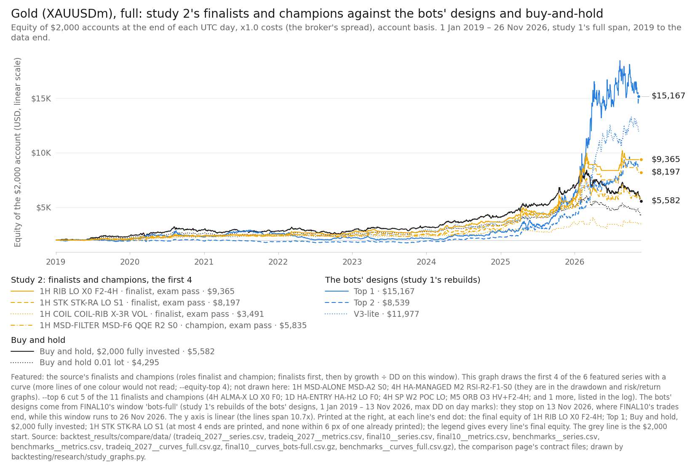

BTC, the same, with the break-of-structure champion (log scale):

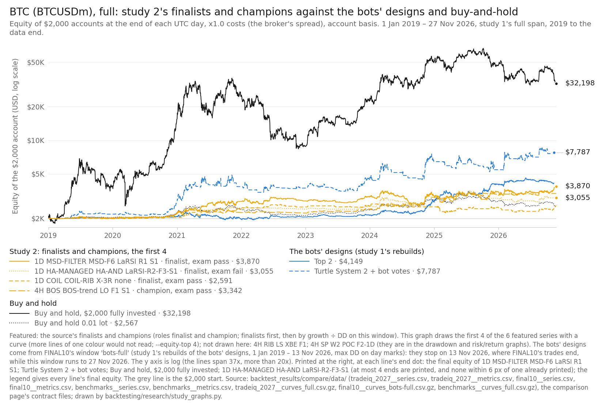

The finalists and one champion against the bots' designs and buy-and-hold, over the common 5 years:

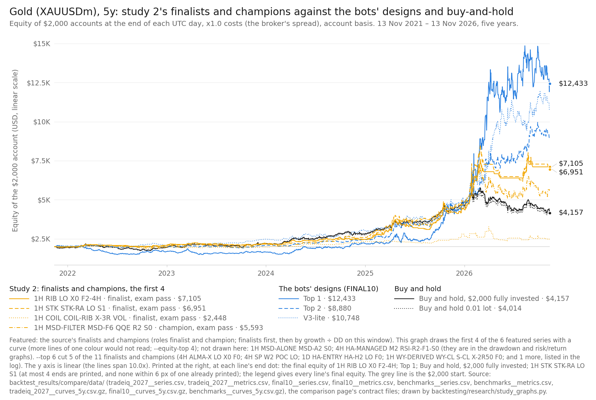

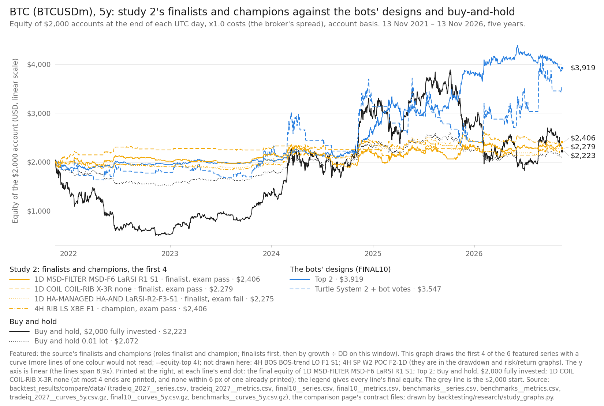

Gold over 8 years, the same lines:

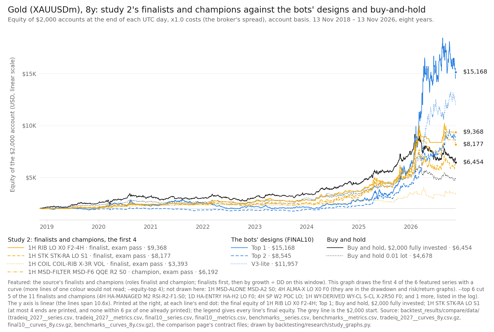

The exam periods alone, each from a fresh $2,000. The hold-out graphs also draw the bots' rebuilt accounts (they stop
on 13 Nov 2026). The Early graph draws the three finalists and the Heikin Ashi champion only: the bots and
buy-and-hold have no account row on that window.

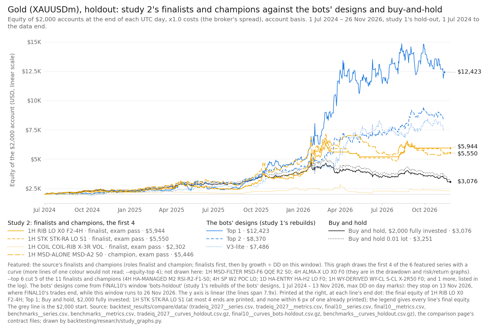

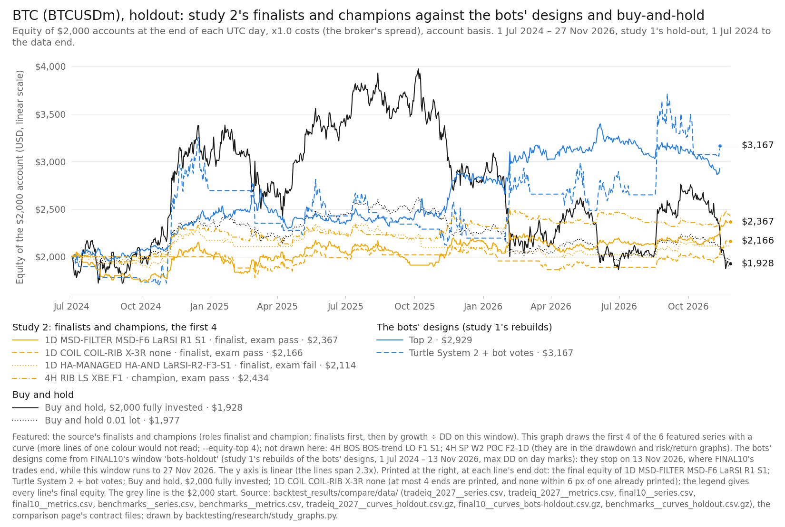

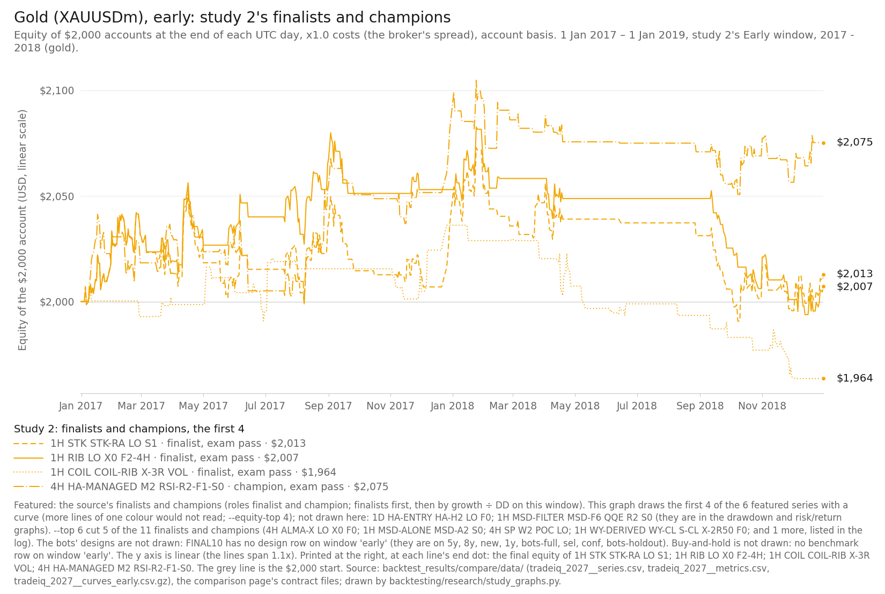

Each family's pre-registered pick on the exam windows as a $2,000 account: growth / DD (CAGR % / max DD %, the
comparison page's ranking; not the exam's P/DD per 0.01 lot), with buy-and-hold's and the bots' best rebuilt design's
as lines. A family without a pick shows only a thin tick: its best row, picked in hindsight.

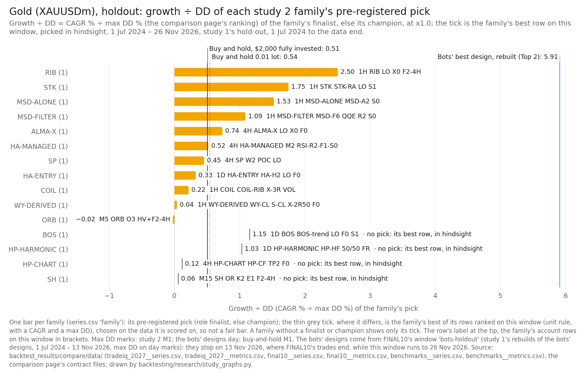

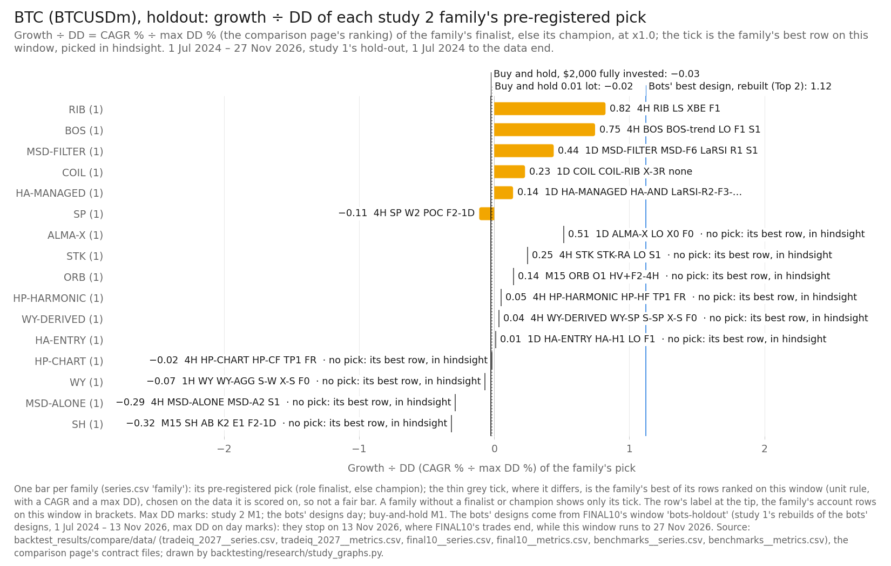

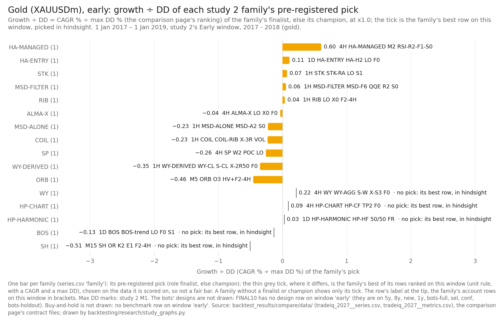

Every account row of the study on the hold-out, growth against drawdown, the picks labelled (the grey diagonal is
growth / DD = 1):

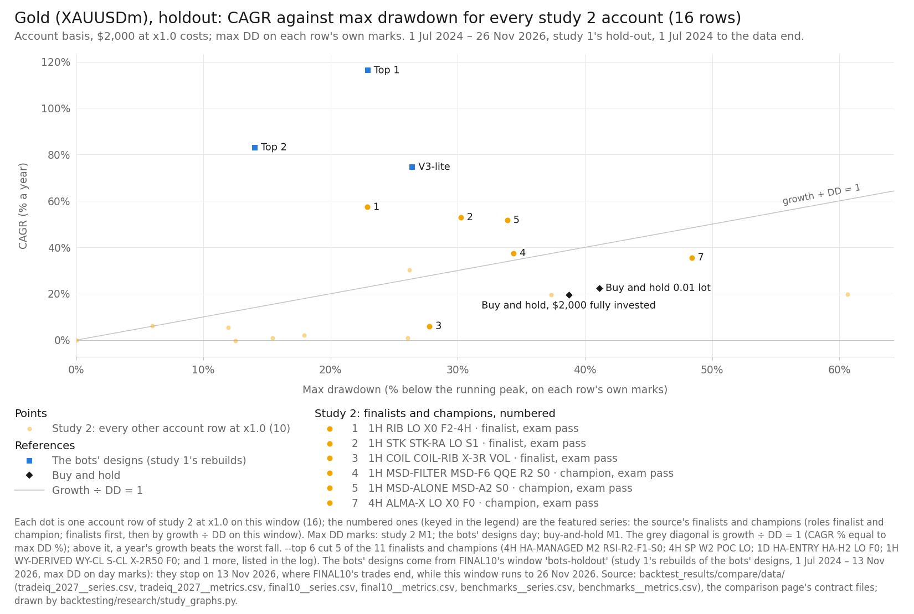

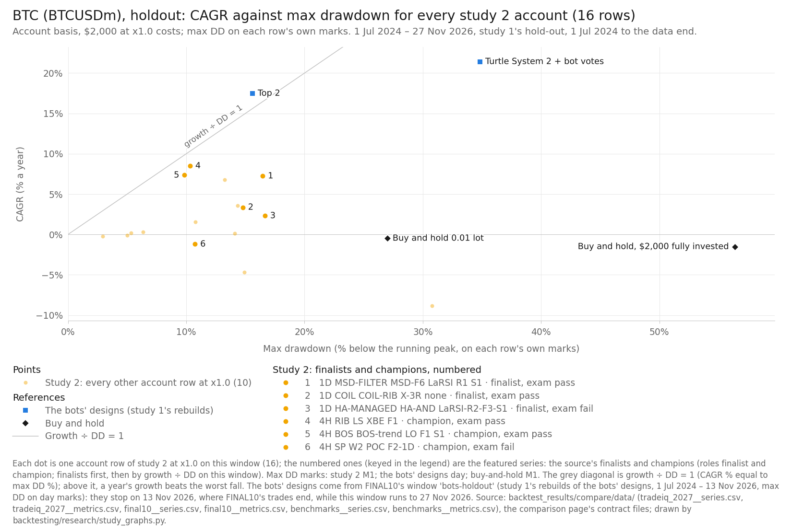

How often each filter beat no filter is in section 5's tables.

The list:

| File | What it shows | Section |
|---|---|---|
| `img/equity_XAUUSDm_full.png` | gold accounts from 1 Jan 2019: the finalists, one champion, the bots' rebuilt designs, buy-and-hold | 7 |
| `img/equity_BTCUSDm_full.png` | the same for BTC | 7 |
| `img/equity_XAUUSDm_5y.png` | gold, 5 years: finalists against the bots' designs | 7, 9 |
| `img/equity_BTCUSDm_5y.png` | BTC, 5 years: finalists against the bots' designs | 7, 9 |
| `img/equity_XAUUSDm_8y.png` | gold, 8 years: finalists against the bots' designs and buy-and-hold | 7, 9 |
| `img/equity_XAUUSDm_holdout.png` | gold, the hold-out alone from $2,000 | 3, 7 |
| `img/equity_BTCUSDm_holdout.png` | BTC, the hold-out alone from $2,000 | 3, 7 |
| `img/equity_XAUUSDm_early.png` | gold, the Early window alone from $2,000 | 3, 7 |
| `img/families_XAUUSDm_holdout.png` | gold, hold-out: growth / DD of each family's pick, buy-and-hold and the bots' best design | 3, 7 |
| `img/families_BTCUSDm_holdout.png` | the same for BTC | 3, 7 |
| `img/families_XAUUSDm_early.png` | gold, Early window: growth / DD of each family's pick | 3, 7 |
| `img/risk_return_XAUUSDm_holdout.png` | gold, hold-out: every row's growth against its drawdown | 3, 7 |
| `img/risk_return_BTCUSDm_holdout.png` | the same for BTC | 3, 7 |

## 8. The video's claims, one line each

The plan's rule: a claim **holds** when it holds in both Development and Validation, **does not hold** when it fails
in both, and is **mixed** otherwise (study 1's DEVIATIONS 31). "Most" means more than half, and a win means strictly
more net profit. The counts are Development, then Validation. The hold-out is for information. Sources: `claims.csv`,
`claims_holdout.csv` and `CLAIMS.md`.

| # | What the video says | Gold | BTC | Key numbers (Development; Validation) | Hold-out (gold / BTC) |
|---|---|---|---|---|---|
| 1 | The ribbon flips only when slope and band agree, so it ignores most of the noise | **holds** | **holds** | against a plain ALMA cross: fewer trades in 6/6 pairs in both windows; more net in 4/6 and 6/6, on both markets | more net: does not hold (3/6) / holds (4/6) |
| 2a | Take half at the second target and let the rest run (against the script's own exit) | **does not hold** | **does not hold** | won 11/34 and 4/34 pairs (gold), 13/34 and 0/34 (BTC) | does not hold / does not hold |
| 2b | ... (against all out at the second target) | **holds** | **holds** | won 23/34 and 29/34 (gold), 21/34 and 32/34 (BTC) | holds / holds |
| 3 | "Manage it": move the stop to break-even | mixed | mixed | won 7/34 and 21/34 (gold), 24/34 and 10/34 (BTC); Heikin Ashi management of the ribbon: does not hold on gold (12/30, 5/30), mixed on BTC | does not hold / does not hold |
| 4a | Heikin Ashi: hold on strong candles, tighten on weak ones (more net) | **does not hold** | **does not hold** | M2 won 3/9 and 2/9, M3 3/9 and 3/9, M5 1/9 and 0/9 (gold); M2 4/9 and 3/9, M3 2/9 and 3/9 (BTC); BTC's M5 is mixed (5/9, 0/9) | M3 holds on gold; the rest do not hold |
| 4b | ... (smaller drawdown) | **holds** | **holds** for M2 and M5, not M3 | M5's drawdown was smaller in 7/9 and 9/9 pairs (gold) and 9/9 and 9/9 (BTC) | M2 and M5 hold, M3 does not / the same |
| 5 | The panel's "reached age A, then 5 or more" rates are reliable | **holds** | **holds** | the year's share fell inside the panel's 95% range in 155/174 (89%) and 66/71 (93%) cells (gold), 136/170 (80%) and 75/81 (93%) (BTC) | holds / holds |
| 6 | A break of the opening range often sets the day's direction | **holds** | **holds** | the 16:00 close was beyond the first break's side on 57.0% and 54.3% of breakout days (gold M5; beyond the other side 14.5%), 57.4% and 58.7% (BTC M5) | holds / holds |
| 7 | Take the breakouts that come with high volume | mixed | mixed | high volume beat low volume in 8/8 and 4/8 pairs (gold), 1/8 and 5/8 (BTC) | holds (6/8) / holds (8/8) |
| 8a | The ORB dashboard's hit rates are not win rates | **holds** | **holds** | target 1 was reached on 29.9% of all side-days but after 49.3% of breakouts (gold M5); 51.1% against 65.1% (BTC M5) | holds / holds for targets 1 and 2, not 3 |
| 8b | Pick the target from the hit rates | **does not hold** | **does not hold** | against the first target: won 0/12 and 0/12 (gold), 3/10 and 0/10 (BTC); against the second: mixed on gold (4/12, 11/12), does not hold on BTC (0/10, 0/10) | does not hold / does not hold |
| 9 | The script's default clock (UTC−5) is an hour late in summer | **holds** | **holds** | its range started at 10:30 New York on 676 of 1,031 gold sessions, all of them in daylight saving; New York time made more net on both charts: mixed on gold (2/2, 1/2), holds on BTC (2/2, 2/2) | holds / holds |
| 10a | Session Hunter on Nasdaq and forex (the author: profit factor 1.95 on Nasdaq) | - | - | information only: on Nasdaq a profit factor above 1 holds on all 4 rows (1.09 to 1.44 in Development, far below 1.95); the forex preset is mixed on EURUSD (0.75, 1.33) and holds on GBPUSD (1.54, 1.02) | Nasdaq 1.15 to 1.38; EURUSD 1.29; GBPUSD 0.84 |
| 10b | On gold and crypto "nothing held up" | mixed | mixed | rows that made money: 11/116 and 59/116 (gold), 0/116 and 72/116 (BTC); no Session Hunter row qualified on either market | holds / holds |
| 10c | Holding to 16:00 is the exit that tested best | **holds** against the 2R target; does not hold against the far side of the range | mixed | against the 2R target: won 20/30 and 17/30 (gold), 8/30 and 26/30 (BTC); against the far side: 3/10 and 5/10 (gold) | holds / against 2R does not hold (13/30), against the far side holds (6/10) |
| 10d | The plan's own hypothesis, not the video's (`PREREG.md` 6.6): on gold the Asia-range breakout (AB) makes money and the Asia-range sweep (AS) loses | AB: **does not hold**; AS: **holds** | - | AB rows that made money: 3/22 and 2/22; AS rows that lost: 21/24 and 21/24 | both hold (AB 22/22, AS 13/24) / - |
| 11 | The swing leg's POC is a level price often comes back to | **does not hold** | mixed | price touched the POC in 85.2% of gold 1H legs and the 50% level in 81.7% (a gap that chance could explain: p = 0.121); the POC rule against its 50%-level placebo: mixed on gold (4/12, 8/12), does not hold on BTC (5/12, 6/12) | gold: the 1H touch holds, the 4H touch and the placebo test do not / BTC: all hold |
| 12 | An up leg with weak buying is a warning | **does not hold** | **does not hold** | gold 1H: only 5 such legs (against 154), and their next leg was smaller (median 6.60 ATR against 8.69); on 4H too few legs to test | does not hold / does not hold |
| 13 | The dashboard "filters out a lot of bad trades" | **does not hold** (bias filter); mixed (veto) | **does not hold** (bias filter); mixed (veto) | the bias filter beat no filter in 25/60 and 9/60 pairs (gold), 19/60 and 21/60 (BTC); on gold the trades it removed made money (+727 and +8,461 per 0.01 lot); against study 1's MA200 filters it does not hold on BTC | holds on gold (57/60) / does not hold on BTC (5/60) |
| 14 | The dashboard's higher-timeframe rows use the forming candle and can change | **holds** | **holds** | a row's live score differed from its closed score at 19% to 29% of chart closes; the live label differed from the chart's history at 19.1% (gold) and 20.0% (BTC) of 1-hour closes | holds / holds |
| 15 | Wyckoff is strict and rare: "when it shows up, it means something" | **does not hold** (both markets pooled) | pooled with gold | the 43 Standard entries averaged −0.27R against −0.04R for 1,000 random-entry sets (p = 0.94); the median Standard row gave 0.1 (gold) and 0.9 (BTC) entries a year | does not hold (7 trades) |
| 16 | The risk is smallest at the spring and its test | the stop is closest at the test: **holds**; the test entries earn more: **does not hold** (both markets pooled) | pooled with gold | median stop 2.90 ATR at the test, against 4.99 and 6.94 at the other entries; average R −0.59 at the test, against +0.46 and +0.31 | both hold, on 10 trades |
| 17 | Use Wyckoff on the 4-hour or the daily chart | **does not hold** | **does not hold** | the daily chart gave no entry at all in 2019 to June 2024; the 4-hour rows beat the 1-hour rows on gold (83% and 100% made money, against 17% and 67%), not on BTC (0% and 33%, against 67% and 0%) | does not hold / does not hold |
| 18 | On an old chart every pattern looks like it caught the turn | **holds** (harmonics) | **holds** (harmonics) | the harmonics as drawn later (looking ahead) won more often than the live entries in 54/54 and 48/54 pairs (gold), 54/54 and 54/54 (BTC); for chart patterns it does not hold | holds / holds (harmonics) |
| 19 | Trade the chart patterns on the breakout, where the entry is real | **does not hold** | **does not hold** | the neckline stop order beat the confirmed alert in 0/2 and 0/2 pairs (gold), 1/2 and 0/2 (BTC) | holds (2/2) / does not hold |
| 20 | Coil Breakout AI: 731 trades, 1 in 4 won, average winner 8.5R; big candles, volume and trend strength helped | cannot be tested (the script is private) | cannot be tested | our coil on 4H: profit factor above 1 in 2/12 and 12/12 rows (gold), 6/12 and 7/12 (BTC): mixed. Grades: volume does not help on gold (0/6, 2/6); big candle and volume help on BTC (4/6, 5/6 each); ADX does not help on BTC (3/6, 3/6) | the grades do not hold on either |

The count over the 178 parts of `claims.csv` (my count): gold 36 hold, 21 do not hold, 16 are mixed and 1 cannot be
tested; BTC 36, 21, 14 and 1. Another 22 parts (11 per market) are information only, and 10 parts are pooled over both
markets or on the claim-check markets. The pattern is the one of study 1:

- **The claims about how the tools behave mostly hold.** The ribbon trades less, the dashboard repaints live, the
  opening range often sets the day's direction, the Heikin Ashi panel is reliable, the drawn harmonics look better
  than they trade. Two do not: price did not come back to the swing leg's POC clearly more often than to its 50% level
  (claim 11), and weak buying was no warning (claim 12).
- **The claims about making more money mostly do not hold.** The exceptions: the ribbon made more than a plain ALMA
  cross in most pairs, and half out at the second target beat all out at the second target (both markets); holding
  Session Hunter's trades to 16:00 beat the 2R target on gold; the coil's big-candle and volume grades and the New
  York clock (against the script's UTC−5 default) made more on BTC.

## 9. Compared with study 1 and the bots' designs

**Against study 1, on the data both studies chose on (2019 to June 2024).** Each family's best row was compared with
study 1's best row on the same market and chart (`vs_study1_best.csv`; my count of its yes / no column):

- Gold: 6 of 14 families did better on P/DD. They are the ribbon (4.61 against 3.48), the coil (4.11 against 3.48),
  the 2027 setup (3.81 against 3.48), Heikin Ashi's M2 (3.76 against 3.00), the break-of-structure trend (2.16
  against 2.08) and the chart patterns (3.03 against 3.00). The last two rows did not qualify.
- BTC: 2 of 14. Both add one condition to a Laguerre RSI rule of study 1: the dashboard's veto (3.75 against 3.70)
  and the Heikin Ashi candle (4.32 against 3.70).
- The ORB and Session Hunter (M5, M15) have no study-1 row to compare with.

**Against study 1, in the exams** (per 0.01 lot; this study's rows from `exam.csv`; study 1's rows from
`curves_summary.csv`, which re-ran study 1's code on this study's data and equals study 1's own hold-out results)

| Market | Study | Finalist | Hold-out net (P/DD) | Early net (P/DD) |
|---|---|---|---|---|
| Gold | 2 | Ribbon 1H, long only, 4H MA200 | +2,264 (4.55) | +7 (0.07) |
| Gold | 2 | Coil 1H, volume grade | +463 (0.84) | −36 (−0.45) |
| Gold | 2 | 2027 setup 1H | +2,259 (3.19) | +13 (0.14) |
| Gold | 1 | QQE MOD 1H, long only, 4H MA200 | +1,552 (2.48) | +78 (1.01) |
| Gold | 1 | Laguerre RSI 1H, long only, 1H MA200 | +1,967 (2.19) | +52 (0.40) |
| Gold | 1 | RSI 4H, long only, 4H MA200 | +1,479 (1.20) | +41 (0.45) |
| BTC | 2 | Laguerre RSI 1D + Heikin Ashi candle | +114 (0.29) | |
| BTC | 2 | Laguerre RSI 1D + the dashboard's veto | +367 (1.03) | |
| BTC | 2 | Coil 1D | +166 (0.52) | |
| BTC | 1 | Laguerre RSI 1D, long only, TSI > 0, 3-ATR stop | +114 (0.29) | |
| BTC | 1 | Volume Weighted RSI 1D, sits out the chop | −109 (−0.29) | |
| BTC | 1 | TSI 4H, long only, 4H MA200 | +252 (1.02) | |

- **Gold, hold-out:** the ribbon and the 2027 setup beat all three of study 1's finalists, on net and on P/DD.
- **Gold, Early:** study 1's finalists did better (+41 to +78, against −36 to +13). Study 1's QQE MOD finalist would
  even pass this exam (P/DD 1.01). Study 1 was never examined on these years, so this is information only.
- **BTC:** this study's dashboard-veto finalist (+367, P/DD 1.03) made more than study 1's best, the TSI finalist
  (+252, 1.02), and more than study 1's 4-hour MA200 alone (+316, 1.03; study 1's `RESULTS.md`), at about the same
  P/DD.
- **On the accounts (section 7):** over 5 years the gold ribbon ($7,105, growth / DD 1.31) and the 2027 setup ($6,951,
  0.98) are ahead of study 1's best gold finalist, the Laguerre RSI ($6,217, 0.71). On BTC the best rows of the two
  studies are close: the break-of-structure trend $2,458 (0.30) and the ribbon $2,406 (0.34) here, the TSI $2,419
  (0.38) in study 1. Over 8 years the gold ribbon ($9,368, 1.23) is far ahead of study 1's best gold finalist, the
  Laguerre RSI ($6,982, 0.51). This study has no BTC row on 8 years.

**Against the bots' designs** (section 7's tables):

- **5 years** (in-sample for the bots, mixed for the TradeIQ rules): every bot design made more money than every
  finalist and champion of either TradeIQ study, on both markets. Top 2 had the best growth / DD of the tables on both
  (2.27 on gold, 0.90 on BTC). On gold the ribbon finalist's growth / DD (1.31, $7,105) is level with V3-lite's (1.31,
  $10,748) and above study 1's finalists (0.43 to 0.71) and buy-and-hold (0.49 and 0.51).
- **8 years** (gold; mixed for both sides): the ribbon finalist ($9,368, 1.23) made more than Top 2 ($8,545, 1.16),
  less than V3-lite ($11,957, 0.76) and Top 1 ($15,168, 0.89), with the best growth / DD of the table.
- **The last year** (out-of-sample for the ribbon, in-sample for the bots): the ribbon grew $2,000 to $3,772 (growth
  / DD 3.16), more than V3-lite ($3,656, 1.83) and less than Top 1 ($4,165, 2.59) and Top 2 ($4,018, 5.83).
  Buy-and-hold lost money over this year.
- **"New"** (out-of-sample for the bots, mostly in-sample for the ribbon): the ribbon grew $2,000 to $2,375 (1.77),
  V3-lite to $2,340 (0.89), Top 1 to $2,226 (0.24), and Top 2 lost money ($1,910). Buy-and-hold grew it to $2,692
  (0.01 lot) and $3,151 (fully invested): in those years holding gold made more than every rule of the table.

**Which is better for the live bot, and why.** The bots' current designs stay the better choice.

- **On BTC the gap is large.** Over 5 years Top 2 grew $2,000 to $3,919 (growth / DD 0.90). No TradeIQ finalist or
  champion in section 7 passed 0.38.
- **On gold one rule keeps up: the ribbon finalist.** Its growth per unit of drawdown is level with V3-lite over 5
  years and ahead of V3-lite and Top 1 over the last year, which it never saw. Top 2 stays well ahead in both (2.27
  and 5.83).
- **But its evidence is weaker than it looks.**
  - It was picked as the best of 738 eligible gold variants, and the tests for luck cannot tell that best apart from
    chance (SPA p 0.40).
  - In 2017-2018, when gold went sideways, it made +7 per 0.01 lot. It is long only: it needs gold to rise.
  - It passed one exam out of two.
- **The bots' 5-year and 1-year numbers are in-sample, so they flatter the bots.** The fair comparison would be a
  period that neither side has seen. Only the future gives that.
- **The idea most likely to carry over is the 4-hour MA200 filter**, but it is not yet shown to help the bots. Study
  3 (`backtest_results/bot_filters/`) tests MA200 filters on the bots' own designs. If you want to pursue the ribbon
  itself, the honest next step is a demo forward test next to the bots. Neither is part of this study.

## 10. Caveats

- **Many variants were tried.** We ran 1,543 variants. Statistically, the best Development results cannot be told
  apart from luck (`multiple_testing.csv`, the eligible variants):
  - the deflated Sharpe ratio is 0.172 for the best gold finalist (the ribbon) and 0.045 and 0.066 for the other two;
    it is at most 0.001 for the BTC finalists. A value of 0.95 would be convincing. (The deflated Sharpe ratio is,
    roughly, the chance that a Sharpe ratio is real after allowing for the number of tries.)
  - Hansen's SPA p-value is 0.40 on gold and 0.64 on BTC, and White's Reality Check gives 0.49 and 0.39. A value of
    0.05 or less would be convincing.
  - The plan's own version over every variant run gives SPA p = 0.000 on gold and 0.028 on BTC. That is only because
    the drawn-pattern rows are in it: they look ahead by design and are the best rows of that set (a Development
    Sharpe of 6.67 on gold). They can never be traded, so the eligible set is the honest one.
- **Gold's rally made the hold-out easy.** 63% of all gold variants pass it. The 738 eligible gold variants made a
  median of +745 per 0.01 lot there, with a median P/DD of 1.09 (my medians, from `results_holdout.csv`). A pass on
  gold is weak evidence. A rank is more telling: the ribbon finalist's hold-out P/DD was in the top 25 of 699 eligible
  gold rows.
- **The Early exam is one sideways window.** It is two years, 2017 and 2018. All three gold finalists failed it, and
  only 13% of all gold variants passed it. It does not prove that the finalists cannot work, but it suggests that
  they need a trend. Buy-and-hold passed it.
- **Few trades.** The three BTC finalists are daily-chart rules: 18 to 72 trades in Development, 7 to 24 in
  Validation and 11 to 51 in the exam. The BTC coil's pass rests on 11 trades, the gold Swing Profile champion's on
  18. Wyckoff is rare: 47 gold and 46 BTC Wyckoff rows had fewer than 15 Development trades (`CANDIDATES.md`).
- **Costs.**
  - The real Exness spread of each minute is used, with one extra spread on every stop. There is no other slippage
    and no commission (Standard account). At 1.5 times the spreads every exam verdict stays the same.
  - The M5 and M15 rules lose to spreads: the median M5 variant lost 119 (gold) and 246 (BTC) per 0.01 lot in
    Development, the median M15 variant 98 and 176 (`CANDIDATES.md`).
  - No swap. On an account that charges swap, rules that stay in the market for days would earn less. The BTC
    dashboard-veto finalist was in the market 89% of the time in Development (`FINALISTS.md`).
  - Rows with half out at 2R need at least 0.02 lot per unit live.
- **The dashboard repaints live.** Its higher-timeframe rows were read from closed bars, which is what the chart shows
  on history. Live, its label differed from that at 19.1% (gold) and 20.0% (BTC) of 1-hour closes (claim 14). A live
  trader would see other signals.
- **Volume.** Exness has no real traded volume. Gold uses tick volume, as TradingView does on CFD charts. BTC uses
  Binance spot volume; it was checked against Exness prices (a correlation of 5-minute closes of 0.999998 from 2018
  to June 2024, `DATA.md`).
- **TradingView itself was not run.** Every script was ported twice, independently, and the two ports agree bit for
  bit on our bars (`DEVIATIONS.md`; `porting/`). Coil Breakout AI is private: COIL is our own version, so its results
  say nothing about TradeIQ's script.
- **The re-derivation.** Before the freeze, four agents re-ran all 17 champions with their own execution code, and a
  fifth re-derived the selection from the result files. All 9,794 Development and Validation trade rows and every
  score matched bit for bit, and the selection was reproduced (`REDERIVATION.md`). After the exam, every variant's
  Development and Validation results were recomputed on the data to the data end and matched (1,523 variants; 20
  rows that look ahead by design were left out; `EXAM.md`). So the later data did not change any earlier result.
- **What was seen before the plan.** The planning passes counted events on bars up to June 2024, never the profit or
  loss of this study's rules (one pass printed the profit of two Turtle filters, which belong to study 3). The
  hold-out's market path was known from study 1 (`PREREG.md`).
- **The accounts.** They compound, while buy-and-hold 0.01 lot does not. The bots' curves are largely in-sample, and
  their tick engine marks the drawdown on other marks than our minute bars.
- **Not tested:**
  - the private Coil Breakout AI itself;
  - the video's other markets, except the claim checks on Nasdaq, EURUSD and GBPUSD;
  - settings other than the scripts' defaults;
  - the live, repainting dashboard;
  - Wyckoff's phases and schematics as the script draws them: they are drawn back in time, so no rule used them.

## 11. Files

- **The plan and its log:** `PREREG.md` (and its sha256), `DEVIATIONS.md`.
- **Data and ports:** `DATA.md`, `porting/*.md`.
- **The selection:** `CANDIDATES.md`, `FINALISTS.draft.md`, `FINALISTS.md` (frozen before the exams, with its sha256),
  `REDERIVATION.md`, `qualification.csv`, `champions.csv`, `counts.csv`, `freeze_checks.csv`.
- **The exam:** `EXAM.md`, `exam.csv`, `exam_full.csv`, `exam_trades.csv.gz`, `exam_buy_and_hold.csv`,
  `exam_info.csv`, `exam_checks.csv`, `base_rate.csv`, `multiple_testing.csv`.
- **The claims:** `CLAIMS.md`, `claims.csv`, `claims_holdout.csv`.
- **The comparisons:** `RESULTS_TABLES.md`, `vs_f0.csv`, `vs_f0_summary.csv`, `combos.csv`, `combos_summary.csv`,
  `vs_study1_best.csv`, `vs_study1_msd.csv`, `vs_study1_msd_summary.csv`.
- **Every variant, every period:** `grid.csv`, `results_dev_val.csv`, `results_holdout.csv`, `results_early.csv`,
  `results_recheck_dev_val.csv`, `quarters_dev_val.csv`, `weekly_dev_val.csv.gz`, `trades_dev_val.csv.gz`,
  `trades_holdout.csv.gz`, `trades_early.csv.gz`, `buy_and_hold.csv`, `run_info.csv`.
- **Accounts:** `curves_full.csv`, `curves_holdout.csv`, `curves_early.csv`, `curves_summary.csv`, and the comparison
  page's files `backtest_results/compare/data/tradeiq_2027__*` (read by `backtest_results/compare/index.html`).
- **This report:** `RESULTS.md`, and the graphs in `img/` (section 7's list).
- **Code:** `backtesting/research/tradeiq2.py` (the study), `tradeiq2_market.py` and `tradeiq2_filters.py` (data,
  guard and execution), `tradeiq2_ind_*.py` (the ports), `tradeiq2_rules_*.py` (the rules); the second ports
  `tests/tradeiq2_oracle_*.py`; the tests `tests/test_tradeiq2*.py`.
