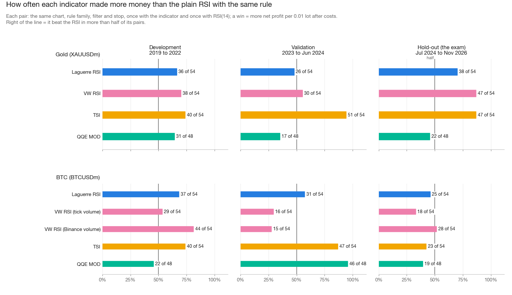
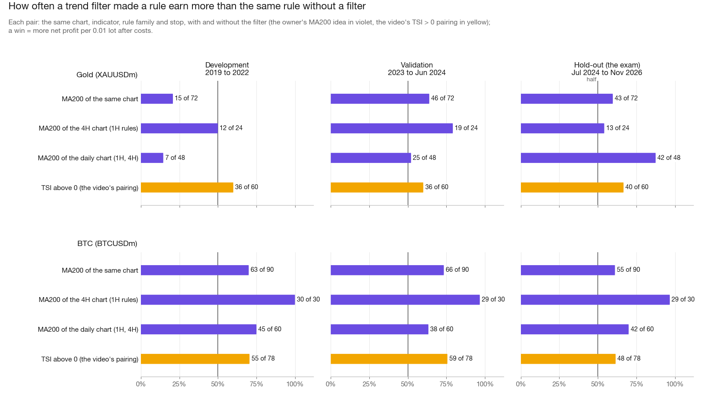
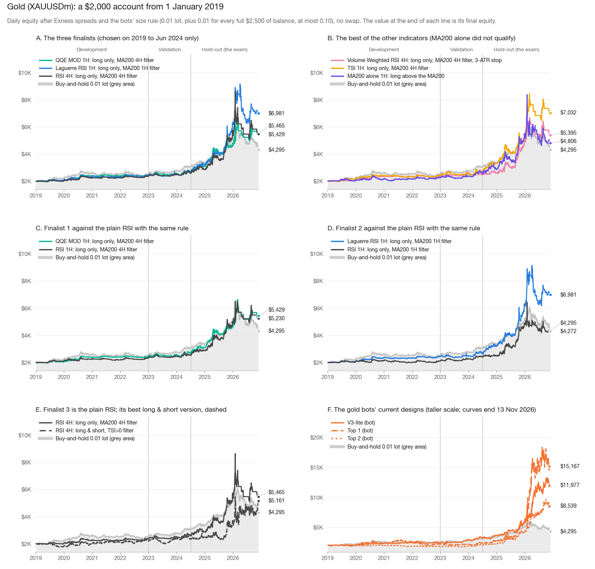
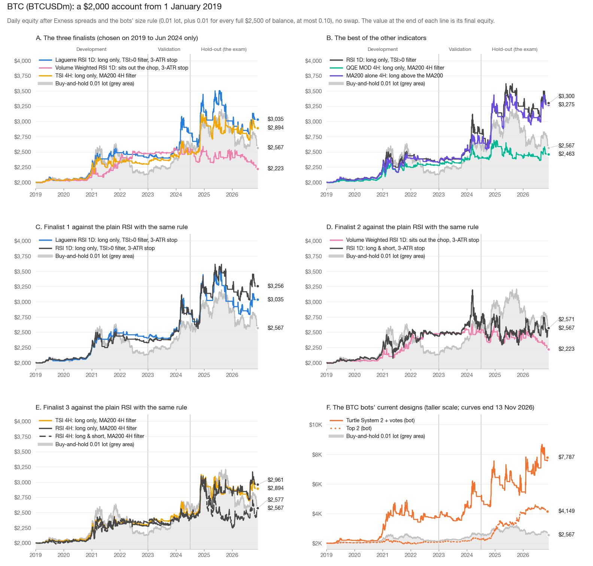
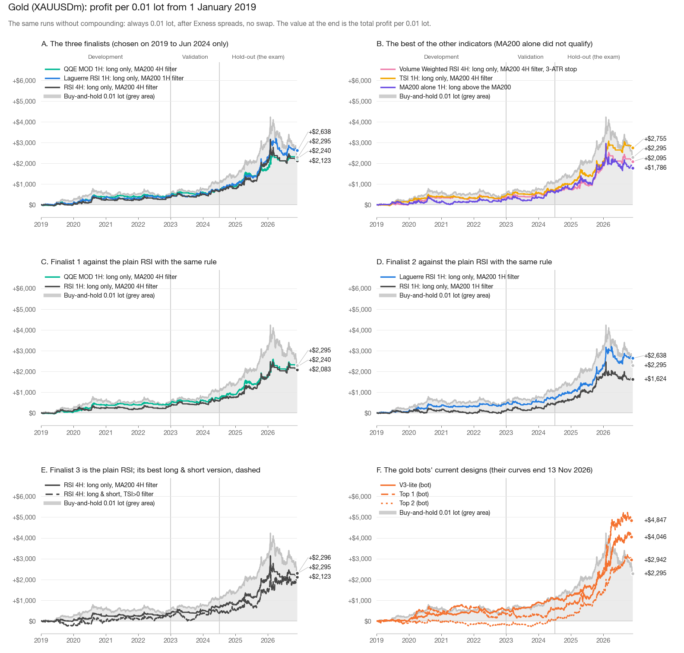
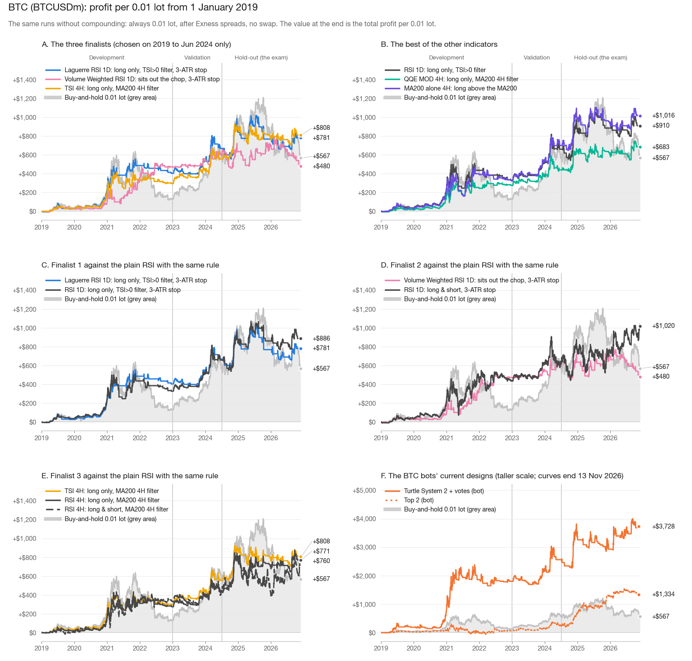
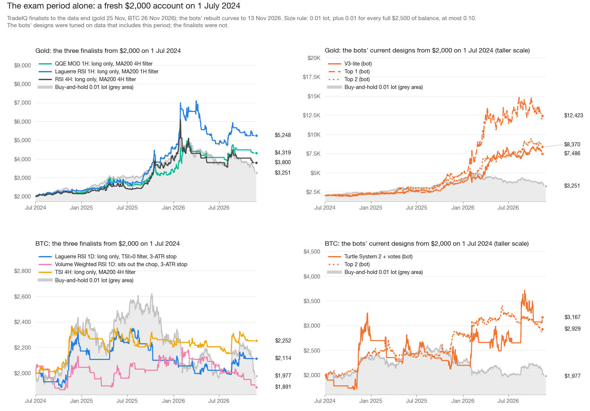
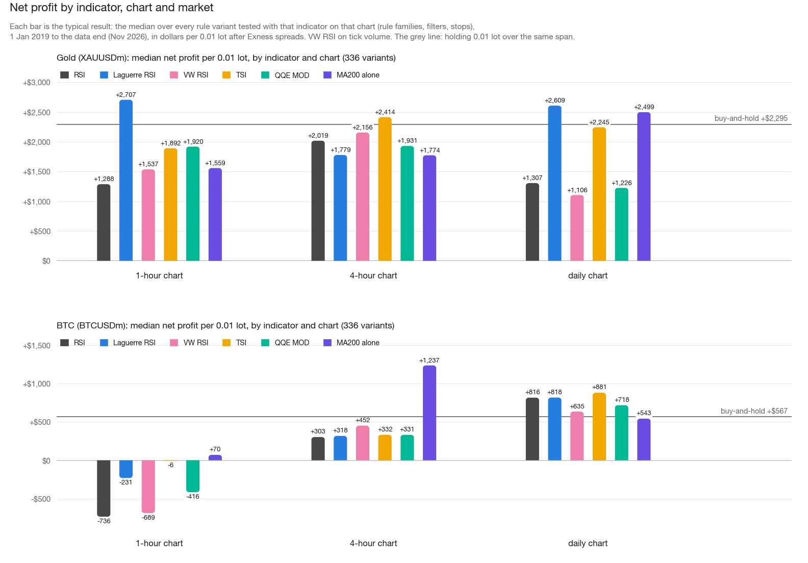

# TradeIQ's four "RSI replacements" on gold and BTC: the results

28 Nov 2026, branch `backtest_hedging`. The rules of this test were written down and frozen before anything was
run (`PREREG.md`); every later reading of them is logged in `DEVIATIONS.md`. The same graphs, interactive, and the main
tables are in `index.html` (it opens offline). What each indicator does, and how to use it, is in `STUDY.md`.

**How to read the numbers**

- **Net per 0.01 lot**: the profit in dollars from trading 0.01 lot on every signal, after Exness spreads. On gold
  0.01 lot makes $1 for every $1 the price moves. On BTC it makes $1 for every $100.
- **Max drawdown**: the biggest fall from a peak, in the same dollars, measured on the worst price of every minute.
- **Profit / drawdown (P/DD)**: net profit divided by max drawdown. Above 1, it earned more than its worst fall.
- **The three periods**: Development (2019 to 2022) and Validation (2023 to June 2024) were used to pick the
  finalists. The **hold-out** (July 2024 to the data end: 25 Nov 2026 for gold, 26 Nov 2026 for BTC) is the exam.
  Nobody looked at it until the finalists were frozen.

## 1. The answer

1. **Did any of the four beat the plain RSI?** Not reliably. On gold the TSI beat the RSI in most like-for-like tests
   in all three periods (40, 51 and 47 of 54). The Volume Weighted RSI also did (38, 30 and 47 of 54). The Laguerre RSI
   and QQE MOD were mixed. On BTC none did in all three periods. The TSI and the Laguerre RSI won from 2019 to June 2024,
   then lost more than half of their tests in the exam period.
2. **Did they make money after costs?** On gold almost everything did: 315 of 336 variants made money from 2019 to
   now, because gold rose from $1,281 to $3,576. But only 73 of the 336 made more per 0.01 lot than simply holding
   gold. On BTC the 1-hour charts lost money to spreads: only 23 of 168 one-hour variants made money from 2019 to now.
   The 4-hour and daily charts made modest money.
3. **Did the MA200 filters help?** On BTC, yes, in all three periods. This holds for the MA200 of the same chart, of
   the 4-hour chart and of the daily chart. The 4-hour MA200 on 1-hour rules improved 30 of 30, 29 of 30 and 29 of
   30 rules. On gold it is mixed: the filters hurt in 2019 to 2022 and helped from 2023 on. As a strategy on its own,
   the 4-hour MA200 on BTC did about as well as the best finalist: it missed a finalist slot by $18 and made +316 per
   0.01 lot in the exam. On gold no MA200-alone rule qualified.
4. **The finalists and the exam.** Gold: 3 of 3 passed. They are QQE MOD 1H, Laguerre RSI 1H and the plain RSI 4H,
   all long only and only above an MA200. BTC: 1 of 3 passed, the TSI 4H (long only above the 4-hour MA200). The
   daily Laguerre RSI and the daily Volume Weighted RSI failed. Gold's passes mostly reflect gold's rally: 90% of all
   gold variants would have passed the same exam. On BTC, the plain RSI with the TSI finalist's exact rule did better
   than the TSI.
5. **Should anything go to a bot?** No. From $2,000 in January 2019, the gold finalists grew to $5,429 to $6,981 and
   the BTC finalists to $2,223 to $3,035. The bots' current designs grew to $8,539 to $15,167 on gold and $4,149 to
   $7,787 on BTC (to 13 November 2026). Those bot curves look better than they would on unseen data, because the bots
   were tuned on most of these years. Even so, no indicator here showed an edge that the plain RSI or a simple MA200
   did not also show.

## 2. What was tested

- **The four indicators**, at the scripts' default settings: QQE MOD (Mihkel00), Bjorgum TSI ("Fast"), Volume
  Weighted RSI (AlgoAlpha) and Laguerre RSI (KivancOzbilgic). The baseline was the plain RSI(14). Your idea was tested
  too: the 200-bar moving average (MA200), both as a filter and as a strategy on its own.
- **The video's rules.** Each one was tested long and short, and long only:
  - **trend:** long above the middle line, short or flat below it (RSI, Laguerre RSI and VW RSI 50; TSI 0; QQE MOD
    blue/red bars);
  - **stand aside in chop:** QQE MOD flat on gray bars; VW RSI flat while its histogram shows chop;
  - **reversal levels:** buy up through 30/20, sell down through 70/80 (a control);
  - **two controls the video calls weak:** the TSI signal-line cross and the QQE white line.
- **Filters:** none; price above or below the MA200 of the same chart; the MA200 of the 4-hour chart (for 1-hour
  rules); the MA200 of the daily chart (for 1-hour and 4-hour rules); the TSI above or below 0.
- **Stops:** none, or a fixed stop 3 x ATR(14) from the entry.
- **Charts and markets:** 1-hour, 4-hour and daily, on XAUUSDm and BTCUSDm.
- **750 variants** in all: 336 on gold and 414 on BTC. BTC has 78 extra Volume Weighted RSI rows on real Binance
  volume.
- **Costs:** Exness tick data, the bots' own source. Each buy fills at the ask, each sell at the bid, at the next
  minute after the signal bar closes. Each stop costs one extra spread. No swap. Every result was checked again with
  spreads 1.5 times wider.
- **The selection.** A variant qualified when it met four conditions:
  - it made money in Development at both cost levels;
  - it had enough trades (30, or 15 on the daily chart);
  - its Development P/DD was at least 1.0, with at least half of the quarters positive;
  - it made money in Validation.
  The three qualifiers with the best P/DD over 2019 to June 2024 became the finalists, at most one per indicator.
  This left 44 qualifiers on gold and 59 on BTC.
- **The exam:** a finalist passes when, over the hold-out, it makes money after costs **and** its P/DD is at least
  0.5.

## 3. The exam: the six finalists

| Market | Finalist | Net per 0.01 lot (1.5x spreads) | Max drawdown | P/DD | Trades | Win rate | Verdict |
|---|---|---|---|---|---|---|---|
| Gold | QQE MOD 1H: long only, 4H MA200 filter | +1,552 (+1,530) | 626 | 2.48 | 233 | 40% | **PASS** |
| Gold | Laguerre RSI 1H: long only, 1H MA200 filter | +1,967 (+1,945) | 898 | 2.19 | 219 | 31% | **PASS** |
| Gold | RSI 4H: long only, 4H MA200 filter | +1,479 (+1,466) | 1,233 | 1.20 | 144 | 32% | **PASS** |
| Gold | *Buy-and-hold 0.01 lot* | *+1,251* | *2,167* | *0.58* | | | |
| BTC | Laguerre RSI 1D: long only, TSI > 0 filter, 3-ATR stop | +114 (+112) | 397 | 0.29 | 20 | 25% | **FAIL** |
| BTC | Volume Weighted RSI 1D: sits out the chop, 3-ATR stop | −109 (−113) | 377 | −0.29 | 39 | 28% | **FAIL** |
| BTC | TSI 4H: long only, 4H MA200 filter | +252 (+242) | 248 | 1.02 | 103 | 26% | **PASS** |
| BTC | *Buy-and-hold 0.01 lot* | *−23* | *711* | *−0.03* | | | |

All four passes also have a better P/DD than buy-and-hold over the same months. By the plan's rule (DEVIATIONS 28),
that makes each of them evidence of an edge over holding the market in the exam period. But read them with this in
mind:

- **Gold's passes are not special.** Gold went from $2,325 (1 July 2024) to $5,595 (29 January 2026), then fell
  to $3,576. Any rule that was long in the rally and out for part of the fall did well:
  - 302 of 336 gold variants (90%) met the pass rule;
  - the median gold variant made +1,609 per 0.01 lot in the exam;
  - the RSI finalist's P/DD (1.20) is below the median variant's (1.61).
- **On BTC the selection helped, but the plain RSI did better.** BTC went from $62,751 to $126,303 (6 October 2025)
  and back to $60,490. Only 30% of all BTC variants met the pass rule, against 69% of the qualifiers. But each BTC
  finalist made less than the plain RSI with the same rule (section 5). The TSI finalist made +312 by the end of 2024
  and gave back about 60 since.
- November 2026, when both markets fell hard, was checked for bad prices. Gold fell 8% over the month and BTC 22%;
  no single minute moved more than 1.0% (gold) or 1.5% (BTC).

## 4. Each indicator's best variant, period by period

"Best" means the qualifier with the highest P/DD over 2019 to June 2024, chosen before the exam. The best variants of
QQE MOD, the Laguerre RSI and the RSI on gold, and of the Laguerre RSI, the VW RSI and the TSI on BTC, are the
finalists. No MA200-alone rule qualified on gold, so its best row over 2019 to June 2024 is shown. Every row is net per
0.01 lot after costs.

**Gold (XAUUSDm)**

| Indicator: its best variant | Period | Trades | Win rate | Net per 0.01 lot | Max drawdown | P/DD |
|---|---|---|---|---|---|---|
| **RSI** 4H: long only, 4H MA200 filter (**finalist 3**) | Development | 235 | 24% | +368 | 203 | 1.82 |
|  | Validation | 81 | 25% | +270 | 215 | 1.26 |
|  | Hold-out | 144 | 32% | +1,479 | 1,233 | 1.20 |
| **Laguerre RSI** 1H: long only, 1H MA200 filter (**finalist 2**) | Development | 378 | 25% | +436 | 180 | 2.41 |
|  | Validation | 132 | 26% | +228 | 200 | 1.14 |
|  | Hold-out | 219 | 31% | +1,967 | 898 | 2.19 |
| **Volume Weighted RSI** 4H: long only, 4H MA200 filter, 3-ATR stop | Development | 206 | 26% | +330 | 256 | 1.29 |
|  | Validation | 64 | 28% | +289 | 169 | 1.71 |
|  | Hold-out | 117 | 37% | +1,470 | 790 | 1.86 |
| **TSI** 1H: long only, 4H MA200 filter | Development | 386 | 28% | +446 | 231 | 1.93 |
|  | Validation | 152 | 28% | +241 | 216 | 1.12 |
|  | Hold-out | 253 | 32% | +2,061 | 595 | 3.46 |
| **QQE MOD** 1H: long only, 4H MA200 filter (**finalist 1**) | Development | 348 | 34% | +458 | 163 | 2.82 |
|  | Validation | 137 | 35% | +224 | 198 | 1.13 |
|  | Hold-out | 233 | 40% | +1,552 | 626 | 2.48 |
| **MA200 alone** 1H: long above the MA200 (did not qualify) | Development | 410 | 15% | +249 | 395 | 0.63 |
|  | Validation | 132 | 11% | +329 | 254 | 1.29 |
|  | Hold-out | 215 | 19% | +1,201 | 1,406 | 0.85 |
| **Buy-and-hold** 0.01 lot | Development | 1 | 100% | +542 | 459 | 1.18 |
|  | Validation | 1 | 100% | +498 | 264 | 1.88 |
|  | Hold-out | 1 | 100% | +1,251 | 2,167 | 0.58 |

The best TSI missed the third finalist slot by a hair. It needed +0.52 more net over 5.5 years. Its exam result
(+2,061, P/DD 3.46) is for information only: picking it now would mean choosing on the exam's data.

**BTC (BTCUSDm)**

| Indicator: its best variant | Period | Trades | Win rate | Net per 0.01 lot | Max drawdown | P/DD |
|---|---|---|---|---|---|---|
| **RSI** 1D: long only, TSI > 0 filter | Development | 50 | 36% | +330 | 262 | 1.26 |
|  | Validation | 17 | 41% | +330 | 180 | 1.83 |
|  | Hold-out | 36 | 22% | +250 | 297 | 0.84 |
| **Laguerre RSI** 1D: long only, TSI > 0 filter, 3-ATR stop (**finalist 1**) | Development | 26 | 42% | +404 | 171 | 2.36 |
|  | Validation | 10 | 30% | +264 | 151 | 1.74 |
|  | Hold-out | 20 | 25% | +114 | 397 | 0.29 |
| **Volume Weighted RSI** 1D: sits out the chop, 3-ATR stop (**finalist 2**) | Development | 54 | 50% | +473 | 174 | 2.72 |
|  | Validation | 22 | 36% | +117 | 122 | 0.96 |
|  | Hold-out | 39 | 28% | −109 | 377 | −0.29 |
| **TSI** 4H: long only, 4H MA200 filter (**finalist 3**) | Development | 178 | 26% | +294 | 192 | 1.53 |
|  | Validation | 68 | 24% | +261 | 138 | 1.90 |
|  | Hold-out | 103 | 26% | +252 | 248 | 1.02 |
| **QQE MOD** 4H: long only, 4H MA200 filter | Development | 168 | 32% | +274 | 185 | 1.48 |
|  | Validation | 66 | 30% | +166 | 182 | 0.91 |
|  | Hold-out | 95 | 27% | +243 | 208 | 1.17 |
| **MA200 alone** 4H: long above the MA200 | Development | 128 | 15% | +324 | 248 | 1.30 |
|  | Validation | 47 | 19% | +376 | 130 | 2.88 |
|  | Hold-out | 67 | 19% | +316 | 307 | 1.03 |
| **Buy-and-hold** 0.01 lot | Development | 1 | 100% | +128 | 535 | 0.24 |
|  | Validation | 1 | 100% | +462 | 171 | 2.69 |
|  | Hold-out | 1 | 0% | −23 | 711 | −0.03 |

The 4-hour MA200 alone missed the third BTC slot by $18 of net over 5.5 years.

## 5. Against the plain RSI: the video's main claim

The video compares each indicator with the RSI "with the same kind of rule". We did the same thing. Each variant was
paired with the RSI variant that has the same chart, rule, filter and stop. It wins when it makes more net profit.

**How often each indicator beat the RSI** (pairs won: Development, Validation, hold-out):

| Indicator | Gold | BTC |
|---|---|---|
| Laguerre RSI | 36, 26, 38 of 54 | 37, 31, 25 of 54 |
| Volume Weighted RSI (tick volume) | 38, 30, 47 of 54 | 29, 16, 18 of 54 |
| Volume Weighted RSI (Binance volume) | not possible on gold | 44, 15, 28 of 54 |
| TSI | **40, 51, 47 of 54** | 40, 47, 23 of 54 |
| QQE MOD | 31, 17, 22 of 48 | 22, 46, 19 of 48 |

**Each finalist against its RSI twin** (the same rule with the plain RSI):

| Market | Finalist | Its plain-RSI twin | Exam net: finalist / RSI | Exam P/DD: finalist / RSI | 2019 to now net: finalist / RSI | Trades 2019 to now: finalist / RSI |
|---|---|---|---|---|---|---|
| Gold | QQE MOD 1H, long only, 4H MA200 filter | RSI 1H, same rule | +1,552 / +1,511 | 2.48 / 2.35 | +2,240 / +2,083 | 717 / 1,531 |
| Gold | Laguerre RSI 1H, long only, 1H MA200 filter | RSI 1H, same rule | +1,967 / +1,220 | 2.19 / 1.25 | +2,638 / +1,624 | 728 / 1,796 |
| Gold | RSI 4H, long only, 4H MA200 filter (it *is* the RSI) | the RSI's best long & short version: 4H, TSI > 0 filter | +1,479 / +1,922 | 1.20 / 1.49 | +2,123 / +2,296 | 459 / 976 |
| BTC | Laguerre RSI 1D, long only, TSI > 0 filter, 3-ATR stop | RSI 1D, same rule | +114 / +229 | 0.29 / 0.72 | +781 / +886 | 56 / 103 |
| BTC | Volume Weighted RSI 1D, sits out the chop, 3-ATR stop | RSI 1D, long & short, 3-ATR stop | −109 / +401 | −0.29 / 0.99 | +480 / +1,020 | 113 / 275 |
| BTC | TSI 4H, long only, 4H MA200 filter | RSI 4H, same rule | +252 / +344 | 1.02 / 1.17 | +808 / +771 | 349 / 566 |

In plain words:

- **Three of the four trade much less.** In the median pair, the Laguerre RSI takes 34% to 42% of the RSI's trades,
  QQE MOD 44% to 54% and the TSI 52% to 60%. The VW RSI takes 78% to 96%.
- **Gold.** The Laguerre RSI clearly beat its RSI twin. QQE MOD and its twin were a tie.
- **BTC.** All three finalists made less than their RSI twin in the exam.

## 6. Your MA200 idea

**As a filter.** Each filtered rule was compared with the same rule without a filter. The table counts how often the
filtered rule made more money. The chart shows the same counts.

| Filter | Gold: Development, Validation, hold-out | Gold verdict | BTC: Development, Validation, hold-out | BTC verdict |
|---|---|---|---|---|
| MA200 of the same chart | 15, 46, 43 of 72 | mixed | 63, 66, 55 of 90 | **helps** |
| MA200 of the 4-hour chart (1-hour rules) | 12, 19, 13 of 24 | mixed | **30, 29, 29 of 30** | **helps** |
| MA200 of the daily chart (1-hour and 4-hour rules) | 7, 25, 42 of 48 | mixed | 45, 38, 42 of 60 | **helps** |
| TSI above 0 (the video's pairing) | 36, 36, 40 of 60 | **helps** | 55, 59, 48 of 78 | **helps** |

The verdict is the plan's: "helps" means it won more than half of the pairs, on net and on P/DD, in both Development and
Validation. The hold-out counts are for information.

- **BTC: the MA200 helps most on the 1-hour chart.** There, the 4-hour MA200 improved 30, 29 and 29 of 30 rules, and
  the 1-hour MA200 30, 30 and 19 of 30 (Development, Validation, hold-out). The filters also cut trading: the median
  1-hour BTC rule made 1,406 trades in 2019 to 2022 without a filter, and 937 with the 4-hour MA200. Fewer trades
  means less money lost to spreads. On the daily chart, the daily MA200 did not help in 2019 to 2022 (3 of 30) or in
  the exam (10 of 30).
- **Gold: it depends on the years.** Gold peaked in August 2020 and then moved sideways, between about $1,630 and
  $2,040, until the end of 2022. In those years the MA200 filters cost money in most rules. In the steady rise from
  2023 on they helped. The bots' final-ten study found the same with a 200-day filter on gold: less drawdown, but it
  gives up profit in choppy years.
- **As a strategy on its own** (long above the MA200, flat below):
  - BTC, 4-hour chart: it qualified, ranked 12th of 59, and made +316 per 0.01 lot in the exam (P/DD 1.03). That is
    level with the TSI finalist.
  - Gold: no version qualified. Its 2019 to 2022 drawdown was too large: P/DD 0.63, against the 1.0 the selection
    needs.

## 7. The money: $2,000 accounts

These are the same runs on one $2,000 account, with the bots' size rule: 0.01 lot, plus 0.01 lot for every full
$2,500 of balance, at most 0.10 lot, set when a trade opens. Buy-and-hold holds 0.01 lot the whole time. So part of
the strategies' lead on the account comes from trading a larger size as the account grows, not from better timing.
The "per 0.01 lot" graphs are the like-for-like view.

**Gold, from $2,000 on 1 January 2019** (the hold-out column is a separate, fresh $2,000 account from 1 July 2024)

| | Final equity | Growth a year | Max drawdown | Hold-out alone: final equity |
|---|---|---|---|---|
| QQE MOD 1H (finalist 1) | $5,429 | 13.5% | 28.1% | $4,319 |
| Laguerre RSI 1H (finalist 2) | $6,981 | 17.1% | 33.4% | $5,248 |
| RSI 4H (finalist 3) | $5,465 | 13.6% | 42.9% | $3,800 |
| TSI 1H (best TSI) | $7,032 | 17.2% | 24.9% | $5,516 |
| Volume Weighted RSI 4H (best VW RSI) | $5,395 | 13.4% | 32.0% | $4,278 |
| MA200 alone 1H | $4,806 | 11.7% | 46.7% | $3,121 |
| Buy-and-hold 0.01 lot | $4,295 | 10.2% | 34.3% | $3,251 |

**BTC, from $2,000 on 1 January 2019**

| | Final equity | Growth a year | Max drawdown | Hold-out alone: final equity |
|---|---|---|---|---|
| Laguerre RSI 1D (finalist 1) | $3,035 | 5.4% | 22.2% | $2,114 |
| Volume Weighted RSI 1D (finalist 2) | $2,223 | 1.3% | 17.3% | $1,891 |
| TSI 4H (finalist 3) | $2,894 | 4.8% | 15.6% | $2,252 |
| RSI 1D (best RSI) | $3,300 | 6.5% | 18.8% | $2,250 |
| QQE MOD 4H (best QQE) | $2,463 | 2.7% | 15.6% | $2,243 |
| MA200 alone 4H | $3,275 | 6.4% | 17.7% | $2,316 |
| Buy-and-hold 0.01 lot | $2,567 | 3.2% | 22.1% | $1,977 |

The drawdowns above are on the worst price of every minute. Per 0.01 lot, from 2019 to now, gold's finalists made
+2,123 to +2,638 against buy-and-hold's +2,295, so per lot they are level with holding gold, with smaller falls.
BTC's finalists made +480 to +808, against buy-and-hold's +567.

### The equity graphs

Each graph has six panels:

- A: the finalists;
- B: the best variant of each other indicator, MA200 alone included;
- C to E: each finalist against the plain RSI with the same rule;
- F: the bots' current designs.

The grey area is buy-and-hold. The vertical lines mark Development, Validation and the hold-out.

Per 0.01 lot, without compounding:

The exam period alone, from a fresh $2,000 on 1 July 2024:

Net profit by indicator, chart and market. Each bar is the median of every variant tested, from 2019 to now:

## 8. The video's claims, one line each

The plan's rule: a claim **holds** when it holds in both Development and Validation, **does not hold** when it fails in
both, and is **mixed** otherwise. The counts in brackets are Development then Validation. The exam period is shown for
information.

| # | What the video says | Gold | BTC | Exam period (gold / BTC) |
|---|---|---|---|---|
| 1 | Half of the 8 alternatives he rebuilt could not beat the RSI | cannot be tested | cannot be tested | the other four were not in our test |
| 1 | QQE MOD beats the RSI in most tests | mixed (31/48, 17/48) | mixed (22/48, 46/48) | does not hold / does not hold |
| 1 | TSI beats the RSI in most tests | **holds** (40/54, 51/54) | **holds** (40/54, 47/54) | holds / does not hold |
| 1 | Volume Weighted RSI beats the RSI in most tests | **holds** (38/54, 30/54) | mixed (29/54, 16/54) | holds / does not hold |
| 1 | Laguerre RSI beats the RSI in most tests | mixed (36/54, 26/54) | **holds** (37/54, 31/54) | holds / does not hold |
| 1 | The same, VW RSI on real (Binance) volume | (gold has no real volume) | mixed (44/54, 15/54) | - / holds (28/54) |
| 2 | QQE MOD takes fewer trades than the RSI, every time | **holds** (48/48, 48/48) | **holds** (48/48, 48/48) | holds / holds |
| 2 | QQE MOD beats the RSI on most (same test as claim 1) | mixed | mixed | does not hold / does not hold |
| 2 | QQE MOD has shorter losing streaks than the RSI | **holds** (34/48, 40/48) | **holds** (42/48, 48/48) | holds / holds |
| 3 | TSI: trading the zero line makes money | **holds** (8/12, 10/12) | **holds** (8/12, 10/12) | holds / holds |
| 3 | TSI: the signal-line cross is a coin flip, the zero line does better | **does not hold**: the zero line won only 2/6 and 3/6 | **holds** (6/6, 5/6) | holds / holds |
| 3 | TSI takes about half as many trades as the RSI | **holds** (0.60, 0.58 of the RSI's) | **holds** (0.57, 0.52) | holds / holds |
| 4 | VW RSI's 20/80 reversal signals are no better than the RSI's | **does not hold**: they were better (6/6, 4/6) | **holds** (1/6, 2/6) | holds / does not hold |
| 4 | VW RSI is for crypto and needs real volume | cannot be tested (no real volume on gold) | see the next rows | |
| 4 | VW RSI's trend rule beats the RSI on every crypto timeframe (tick volume) | | **does not hold**: it lost every 1-hour test | - / does not hold |
| 4 | The same on real (Binance) volume | | mixed: won everywhere in 2019-2022, lost 1-hour and daily in 2023-2024 | - / does not hold |
| 4 | VW RSI's reversals are no better than the RSI's (Binance volume) | | **holds** (0/6, 1/6) | - / does not hold |
| 4 | VW RSI needs real volume: Binance volume beats tick volume | | mixed (60/78, 11/78) | - / holds |
| 5 | Laguerre RSI beats the RSI on every timeframe | **does not hold**: it lost most 4-hour tests in 2019-2022 and most 1-hour and daily tests in 2023-2024 | **does not hold**: it lost most 4-hour tests in 2019-2022 and most daily tests in 2023-2024 | does not hold / does not hold |
| 5 | Laguerre RSI takes far fewer trades than the RSI | **holds** (0.42, 0.41 of the RSI's) | **holds** (0.42, 0.34) | holds / holds |
| 5 | Laguerre RSI on the 1-hour chart mostly did not make money on its own | **does not hold**: it made money (6/6, 4/6) | **holds** (0/6, 2/6 made money) | does not hold / holds |
| 5 | Laguerre RSI shines on the 4-hour and daily charts | **does not hold**: the 1-hour chart did as well | **holds** | does not hold / does not hold |
| 5 | Pair the Laguerre RSI with TSI > 0 | **does not hold** (4/12, 3/12) | mixed (10/12, 5/12) | does not hold / holds |
| 5 | Pair the Laguerre RSI with the 200 moving average | mixed (1/24, 13/24) | **holds** (18/24, 15/24) | holds / holds |
| 6 | All four work best on the 4-hour and daily charts | **does not hold**: on gold the daily chart was the weakest | **holds** | does not hold / holds |
| 6 | On the 1-hour chart even the best of them struggled | mixed | **holds** | does not hold / holds |

Count of the verdicts: gold 7 hold, 7 do not, 5 mixed; BTC 15 hold, 2 do not, 7 mixed; 2 parts cannot be tested.
The claims that hold everywhere are about **trading less**: fewer trades, shorter losing streaks, about half the
trades. The claims about **making more money than the RSI** hold only in places.

## 9. Compared with the bots' current designs

The five designs the live bots run were rebuilt on the same $2,000 account and the same size rule. Their published
eight-year runs end on 13 November 2026, so every row below stops on that date. Drawdowns here are on daily marks for
all rows, because the bots' rebuilt curves only have daily points.

| Market | Design | $2,000 from 1 Jan 2019 | Growth a year | Max drawdown (daily) | $2,000 from 1 Jul 2024 |
|---|---|---|---|---|---|
| Gold | QQE MOD 1H (TradeIQ finalist 1) | $5,429 | 13.5% | 25.5% | $4,319 |
| Gold | Laguerre RSI 1H (TradeIQ finalist 2) | $6,981 | 17.2% | 32.5% | $5,248 |
| Gold | RSI 4H (TradeIQ finalist 3) | $5,465 | 13.6% | 40.9% | $3,800 |
| Gold | Buy-and-hold 0.01 lot | $4,599 | 11.2% | 26.3% | $3,556 |
| Gold | **V3-lite (bot)** | **$11,977** | 25.6% | 23.4% | $7,486 |
| Gold | **Top 1 (bot)** | **$15,167** | 29.4% | 31.3% | $12,423 |
| Gold | **Top 2 (bot)** | **$8,539** | 20.3% | 16.5% | $8,370 |
| BTC | Laguerre RSI 1D (TradeIQ finalist 1) | $3,035 | 5.4% | 20.5% | $2,114 |
| BTC | Volume Weighted RSI 1D (TradeIQ finalist 2) | $2,239 | 1.4% | 14.9% | $1,908 |
| BTC | TSI 4H (TradeIQ finalist 3) | $2,894 | 4.8% | 13.8% | $2,252 |
| BTC | Buy-and-hold 0.01 lot | $2,676 | 3.8% | 20.6% | $2,086 |
| BTC | **Top 2 (bot)** | **$4,149** | 9.7% | 16.0% | $2,929 |
| BTC | **Turtle System 2 + bot votes (bot)** | **$7,787** | 18.9% | 30.8% | $3,167 |

- **Every bot design made more than every finalist of its market.** On gold, V3-lite and Top 2 also had smaller
  drawdowns than all three finalists.
- **This comparison is not fair to TradeIQ.** The bots' designs were chosen and tuned on data from 2021 on, so their
  curves are largely in-sample. The TradeIQ finalists never saw the hold-out.
- **But the gap is large, and the finalists show no edge the bots lack.** They are long-only trend followers that ride
  the market; per lot they are level with holding gold.
- **None of them is a reason to change or add a bot.** If you want to pursue the MA200 idea, the honest next step is a
  new pre-registered test of a 4-hour MA200 filter on the bots' own designs, or a demo forward test. Neither is part of
  this study.
- **How the bot curves were rebuilt.** They come from the final-ten study's trade files. They match that study's own
  five-year accounts to within −1.0% to +5.4% of final equity (Turtle: exact). The live bots size from half the
  balance, in steps of $1,250 to $2,500; that is not modelled here.

## 10. Caveats

- **Tick volume.** Exness has no real traded volume. The Volume Weighted RSI therefore uses the number of price ticks
  per bar, as TradingView does on CFD charts. The video says this indicator needs real volume. For BTC we also ran it
  on Binance spot volume. Against the same rule on tick volume, Binance volume did better in 2019 to 2022 (60 of 78
  rows) and in the exam period (55 of 78), but worse in 2023 to June 2024 (11 of 78).
- **No swap.** The test assumes the swap-free Standard account, as all earlier studies did. On an account that pays
  swap, rules that hold for days (the daily and 4-hour rules) would earn less.
- **The exam is short and is one path.** It covers 2 years and 5 months: one big gold rally and fall, and one BTC run
  to $126,000 and back. One window cannot prove an edge, only fail to find one.
- **Many variants were tried.** We ran 750 variants. Statistically, the best results of 2019 to 2022 cannot be told
  apart from luck:
  - the deflated Sharpe ratio is 0.14 to 0.30 for the gold finalists and below 0.01 for the BTC finalists (0.95
    would be convincing);
  - Hansen's SPA p-value is 0.17 on gold and 0.38 on BTC (0.05 would be convincing).
- **Costs.** The real Exness spread of each minute is used, with one extra spread on every stop. There is no other
  slippage and no commission (Standard account). Every result was also run with spreads 1.5 times wider: all six
  exam verdicts stay the same.
- **The account graphs compound.** The strategies add size as the account grows, while buy-and-hold keeps 0.01 lot.
  Use the per-lot graphs to compare timing.
- **The bots' curves:**
  - they are largely in-sample;
  - their drawdown is on daily marks, which understates the drawdown inside a day (the Turtle: 30.8% daily against
    32.7% exact);
  - they end 13 days (gold) and 14 days (BTC) before the data end.
- **Not tested here:**
  - the video's other markets (ETH, SOL, Nasdaq, S&P 500, EUR/USD);
  - its other four indicators (Heikin Ashi RSI, RSI Kernel Optimized, Stochastic Momentum Index and one it does not
    name);
  - the hand-made parts of its setups (support and resistance levels for QQE MOD, pullback entries for the TSI);
  - settings other than the defaults (for example the TSI's "Slow" speed);
  - trailing stops or partial exits;
  - stacking several indicators.
- **TradingView itself was not run.** Two independent ports of each script agree bit for bit on our data
  (`PORTING.md`). The remaining Pine details that cannot be checked without TradingView do not change any signal on
  these bars.

## 11. Files

- **The plan and its log:** `PREREG.md`, `DEVIATIONS.md`.
- **Data, ports and selection:** `DATA.md`, `PORTING.md`, `CANDIDATES.md`, `FINALISTS.md` (frozen before the exam).
- **The exam and the claims:** `EXAM.md`, `CLAIMS.md`.
- **Every variant, every period:** `results_dev_val.csv`, `results_holdout.csv`, `results_full.csv`, and the
  trades.
- **Account curves:** `curves_full.csv`, `curves_holdout.csv`, `curves_bots_*.csv`, `curves_summary.csv`.
- **This report:** `RESULTS.md`, `STUDY.md`, `index.html`, and the graphs in `img/`.
